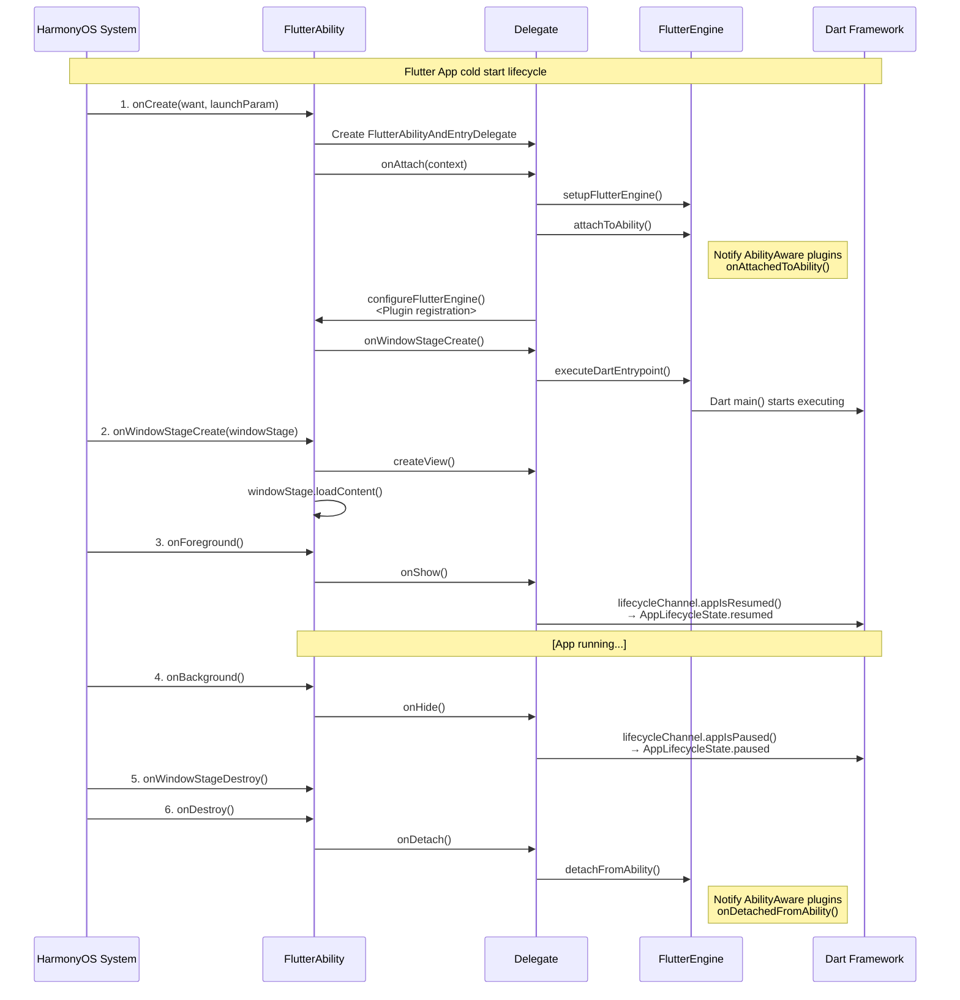
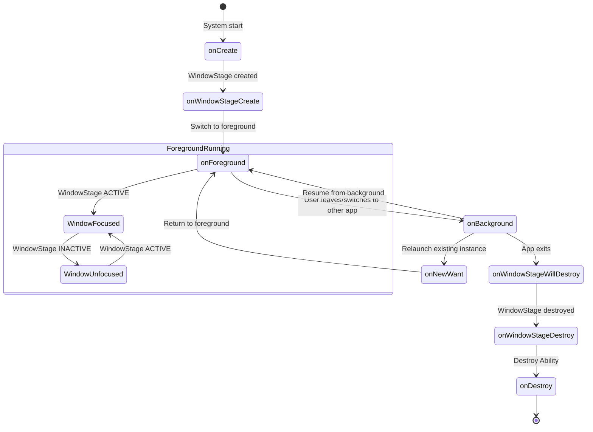
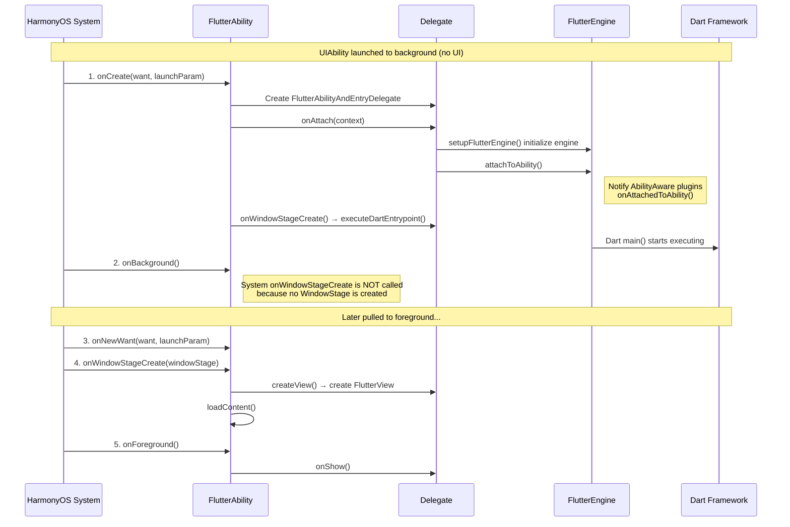
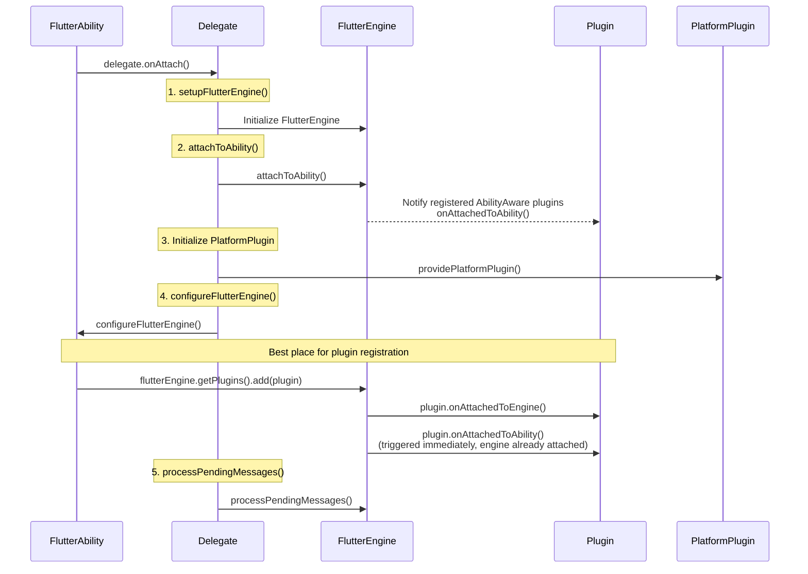
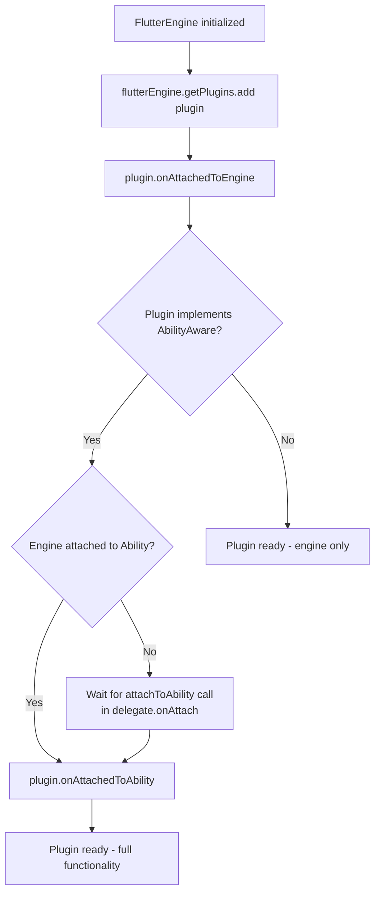

# Flutter App/Module Launch Lifecycle Callback Guide

---

## Overview

This document details the launch lifecycle callback mechanism of a Flutter App/Module on the OpenHarmony/HarmonyOS platform, including the execution order and trigger timing of each callback, the best-practice location for plugin registration, and related considerations. The Flutter on HarmonyOS lifecycle is based on the HarmonyOS `UIAbility` lifecycle model, and bridges the Flutter engine with the HarmonyOS system through the `FlutterAbility` base class and the `FlutterAbilityAndEntryDelegate` delegate class.

---

## 1. Lifecycle

### 1.1 Cold Start Flow

The diagram below shows the cold start lifecycle.



**Flow description:**

1. **onCreate phase**: The system starts the app, FlutterAbility creates the delegate and initializes the FlutterEngine, and notifies AbilityAware plugins via `attachToAbility()`. `configureFlutterEngine()` is the best place for plugin registration. Finally, the Dart entry point is executed and the Dart `main()` function starts running.

2. **onWindowStageCreate phase**: The system creates the WindowStage, and the delegate creates a FlutterView and loads the UI content.

3. **onForeground phase**: The app switches to the foreground and sends `AppLifecycleState.resumed` to Dart via lifecycleChannel. The app enters the running state.

4. **onBackground phase**: The user leaves the app, and `AppLifecycleState.paused` is sent to Dart via lifecycleChannel.

5. **Destroy phase**: onWindowStageDestroy and onDestroy are executed in turn. The delegate notifies AbilityAware plugins to clean up resources via `detachFromAbility()`.

### 1.2 Lifecycle State Transition Diagram



**State transition description:**

1. **Initial start flow**: System starts the app → onCreate → onWindowStageCreate → onForeground, completing the cold start.

2. **Foreground running state**: While the app is in the foreground, the window switches between focused (ACTIVE) and unfocused (INACTIVE). For example, when the user opens the notification panel the window loses focus, and when the panel is closed the window regains focus.

3. **Background switch flow**:
   - User leaves the app: onForeground → onBackground
   - Relaunch an existing instance: onBackground → onNewWant → onForeground
   - Resume directly from background: onBackground → onForeground

4. **App exit flow**: onBackground → onWindowStageWillDestroy → onWindowStageDestroy → onDestroy, eventually releasing all resources.

### 1.3 Launch-to-Background Scenario

When a UIAbility is launched to the background via `UIAbilityContext.startAbilityByCall()` (without UI display), the lifecycle callback flow is as follows:



**Flow description:**

1. **Background launch phase**:
   - The system calls onCreate, initializes the FlutterEngine, and executes Dart main()
   - Unlike a normal cold start, the system's `onWindowStageCreate(windowStage)` is **not executed** in this phase (because no UI display is required)
   - It goes directly into the onBackground state

2. **Pull to foreground phase**:
   - When the app needs to be brought to the foreground, the system calls onNewWant (because the instance already exists)
   - Then the system's onWindowStageCreate(windowStage) is executed, creating a FlutterView and loading the UI content
   - Finally onForeground is called, and the app enters the foreground running state

---

## 2. Callback Function Details

### 2.1 onCreate(want: Want, launchParam: LaunchParam)

#### Trigger timing
- **Timing**: Called when the UIAbility instance is created for the first time. It is the first callback in the lifecycle. Developers can perform one-time startup logic here
- **Call count**: Called once on first creation. It is not called when restoring an existing instance from the recent tasks list (in that case `onNewWant` → `onForeground` is used)

#### Main responsibilities
```typescript
onCreate(want: Want, launchParam: AbilityConstant.LaunchParam) {
  // 1. Store the system font scale
  AppStorage.setOrCreate('fontSizeScale', this.context.config.fontSizeScale);

  // 2. Push the current Ability onto the FlutterManager stack
  FlutterManager.getInstance().pushUIAbility(this);

  // 3. Create the delegate instance
  this.delegate = new FlutterAbilityAndEntryDelegate(this);

  // 4. Attach the delegate to the Context and initialize the FlutterEngine
  this?.delegate?.onAttach(this.context);

  // 5. Set the UIAbility context on the PlatformPlugin
  this?.delegate?.platformPlugin?.setUIAbilityContext(this.context);

  // 6. Restore saved state (if any)
  this?.delegate?.onRestoreInstanceState(want);

  // 7. Trigger Dart entry point execution
  if (this.stillAttachedForEvent("onWindowStageCreate")) {
    this?.delegate?.onWindowStageCreate();
  }

  // 8. Register error listener and app recovery mechanism
  let observer: errorManager.ErrorObserver = {
    onUnhandledException(errorMsg) {
      appRecovery.saveAppState();
      appRecovery.restartApp();
    }
  }
  this.errorManagerId = errorManager.on('error', observer);

  // 9. Initialize the window in debug mode
  if (flutterApplicationInfo.isDebugMode) {
    this.delegate?.initWindow();
  }
}
```

#### delegate.onAttach() internal flow
```typescript
onAttach(context: common.Context) {
  this.context = context;
  this.ensureAlive();

  // 1. Set up the FlutterEngine (prefer cached, then host-provided, then create new)
  if (this.flutterEngine == null) {
    this.setupFlutterEngine();
  }

  // 2. Attach the FlutterEngine to the Ability
  if (this.host?.shouldAttachEngineToAbility()) {
    this.flutterEngine?.getAbilityControlSurface()?.attachToAbility(this);
  }

  // 3. Initialize the PlatformPlugin
  this.platformPlugin = this.host?.providePlatformPlugin(this.flutterEngine!)

  this.isAttached = true;

  // 4. Get system language and color mode
  if (this.flutterEngine) {
    this.flutterEngine.getSystemLanguages();
    const config = this.context.resourceManager.getConfigurationSync();
    this.currentColorMode = /* set color mode based on config */;
  }

  // 5. Automatically attach the FlutterView to the FlutterEngine
  if (this.flutterEngine && this.flutterView && this.host?.attachToEngineAutomatically()) {
    this.flutterView.attachToFlutterEngine(this.flutterEngine!!);
  }

  // 6. Configure the FlutterEngine — best place for plugin registration
  this.host?.configureFlutterEngine(this.flutterEngine!!);

  // 7. Process pending messages
  if (this.flutterEngine) {
    this.flutterEngine.processPendingMessages();
  }
}
```

#### delegate.onWindowStageCreate() → doInitialFlutterViewRun()

```typescript
private doInitialFlutterViewRun(): void {
  // 1. Get the initial route
  let initialRoute = this.host?.getInitialRoute();
  if (initialRoute == null && this.host != null) {
    initialRoute = this.maybeGetInitialRouteFromIntent(this.host.getWant());
  }
  if (initialRoute == null) {
    initialRoute = FlutterAbilityLaunchConfigs.DEFAULT_INITIAL_ROUTE;
  }

  // 2. Set the initial route before executing Dart code (must be before executeDartEntrypoint)
  this.flutterEngine?.getNavigationChannel()?.setInitialRoute(initialRoute ?? '');

  // 3. Get the app bundle path
  let appBundlePathOverride = this.host?.getAppBundlePath();
  if (appBundlePathOverride == null || appBundlePathOverride == '') {
    appBundlePathOverride = FlutterInjector.getInstance().getFlutterLoader().findAppBundlePath();
  }

  // 4. Construct the Dart entry point and execute it
  const dartEntrypoint: DartEntrypoint = new DartEntrypoint(
    appBundlePathOverride,
    this.host?.getDartEntrypointLibraryUri() ?? '',
    this.host?.getDartEntrypointFunctionName() ?? ''
  );
  this.flutterEngine?.dartExecutor.executeDartEntrypoint(
    dartEntrypoint,
    this.host?.getDartEntrypointArgs()
  );
}
```

#### Operations that can be performed in the onCreate phase
- Initialize the FlutterEngine
- Register plugins (via `configureFlutterEngine`)
- Initialize app-level resources
- Configure error handling and recovery mechanisms
- Read and restore saved state

---

### 2.2 onWindowStageCreate(windowStage: WindowStage)

#### Trigger timing
- **Timing**: After the UIAbility instance is created and before entering the foreground, the system creates the WindowStage. This callback is triggered after the WindowStage is created
- **Call count**: Called once each time a WindowStage is created

#### Main responsibilities
```typescript
onWindowStageCreate(windowStage: window.WindowStage) {
  // 1. Push the WindowStage onto FlutterManager
  FlutterManager.getInstance().pushWindowStage(this, windowStage);
  
  // 2. Initialize the window
  this.delegate?.initWindow();
  
  // 3. Get the main window
  this.mainWindow = windowStage.getMainWindowSync();
  
  // 4. Register WindowStage event listener
  windowStage.on('windowStageEvent', this.windowStageEventCallback);
  
  // 5. Create the FlutterView
  this.flutterView = this.delegate!!.createView(this.context);
  
  // 6. Prepare LocalStorage, passing in the viewId
  let storage: LocalStorage = new LocalStorage();
  storage.setOrCreate("viewId", this.flutterView!!.getId());
  
  // 7. Load page content
  windowStage.loadContent(this.pagePath(), storage, (err, data) => {
    if (err.code) {
      Log.e(TAG, 'Failed to load the content.');
      return;
    }
    // 8. Notify the FlutterView that the window has been created
    this.flutterView?.onWindowCreated();
  });
  
  // 9. Set full-screen mode (based on device type)
  if (this.isDefaultFullScreen()) {
    FlutterManager.getInstance().setUseFullScreen(true, this.context);
  }
}
```

#### delegate.createView() internal flow
```typescript
createView(context: Context): FlutterView {
  // 1. Create the FlutterView via FlutterManager
  this.flutterView = FlutterManager.getInstance().createFlutterView(context);
  
  // 2. If auto-attach is configured, attach the FlutterView to the FlutterEngine
  if (this.flutterEngine && this.host?.attachToEngineAutomatically()) {
    this.flutterView.attachToFlutterEngine(this.flutterEngine!!);
  }
  
  return this.flutterView;
}
```

#### Operations that can be performed in the OnWindowStageCreate phase
- Create and configure the FlutterView
- Load UI content
- Configure window properties (full screen, brightness, etc.)

---

### 2.3 onForeground()

#### Trigger timing
- **Timing**: Called when the UIAbility switches to the foreground and before the UI is visible. Developers can request resources needed by the system here, or re-request resources released in `onBackground()`
- **Call count**: Called each time the app switches from background to foreground (on first launch it is called once after `onWindowStageCreate`)

#### Main responsibilities
```typescript
onForeground() {
  if (this.stillAttachedForEvent("onForeground")) {
    this?.delegate?.onShow();
  }
}
```

#### delegate.onShow() internal flow
```typescript
onShow() {
  this.ensureAlive();
  this.isPageShow = true;
  
  // 1. Activate the FlutterView
  this.flutterView?.setActive(true);
  
  // 2. Notify the Flutter framework that the app has resumed
  if (this.shouldDispatchAppLifecycleState()) {
    this.flutterEngine?.getLifecycleChannel()?.appIsResumed();
  }
}
```

#### Operations that can be performed in the onForeground phase
- Resume paused animations
- Restart video playback
- Refresh UI data
- Register sensor/location listeners
- Request necessary permissions

#### Lifecycle channel messages
- **Sent to Flutter**: `AppLifecycleState.resumed`
- **Listenable on the Dart side**: `WidgetsBindingObserver.didChangeAppLifecycleState()`

---

### 2.4 onNewWant(want: Want, launchParam: LaunchParam)

#### Trigger timing
- **Timing**: Triggered when the UIAbility instance already exists and is launched again via a method
- **Call count**: Triggered each time an existing instance is re-invoked

#### Main responsibilities
```typescript
onNewWant(want: Want, launchParams: AbilityConstant.LaunchParam): void {
  this?.delegate?.onNewWant(want, launchParams)
}
```

#### delegate.onNewWant() internal flow
```typescript
onNewWant(want: Want, launchParams: AbilityConstant.LaunchParam): void {
  this.ensureAlive()
  if (this.flutterEngine != null) {
    // 1. Notify AbilityAware plugins of the new Want
    this.flutterEngine?.getAbilityControlSurface()?.onNewWant(want, launchParams);
    // 2. Handle the route information in the new Want
    const initialRoute = this.maybeGetInitialRouteFromIntent(want);
    if (initialRoute && initialRoute.length > 0) {
      this.flutterEngine?.getNavigationChannel()?.pushRouteInformation(initialRoute);
    }
  }
}
```

#### Operations that can be performed in the onNewWant phase
- Update resources and data to be loaded
- Handle new launch parameters
- Navigate to a new route page

---

### 2.5 WindowStage Event Callbacks

#### windowStageEvent event types

#### Event handling code
```typescript
onWindowStageChanged(stageEventType: window.WindowStageEventType) {
  switch (stageEventType) {
    // Window shown
    case window.WindowStageEventType.SHOWN:
      Log.i(TAG, 'windowStage shown.');
      break;
    // Window focused
    case window.WindowStageEventType.ACTIVE:
      Log.i(TAG, 'windowStage active.');
      this.getFlutterEngine()?.getTextInputChannel()?.textInputMethodHandler?.handleChangeFocus(true);
      this.onWindowFocusChanged(true);
      break;
     // Window unfocused
    case window.WindowStageEventType.INACTIVE:
      Log.i(TAG, 'windowStage inactive.');
      this.onWindowFocusChanged(false);
      break;
     // Window paused
    case window.WindowStageEventType.PAUSED:
      Log.i(TAG, 'windowStage paused.');
      this.onPaused();
      break;
     // Window resumed
    case window.WindowStageEventType.RESUMED:
      Log.i(TAG, 'windowStage resumed.');
      this.onResumed();
      break;
     // Window hidden
    case window.WindowStageEventType.HIDDEN:
      Log.i(TAG, 'windowStage hidden.');
      break;
  }
}
```

#### onWindowFocusChanged() internal flow
```typescript
onWindowFocusChanged(hasFocus: boolean): void {
  if (this.shouldDispatchAppLifecycleState()) {
    // 1. Notify the AbilityControlSurface of focus change
    this.flutterEngine?.getAbilityControlSurface()?.onWindowFocusChanged(hasFocus);
    
    // 2. Notify the Flutter framework of focus change
    if (hasFocus) {
      this.flutterEngine?.getLifecycleChannel()?.aWindowIsFocused();
    } else {
      this.flutterEngine?.getLifecycleChannel()?.noWindowsAreFocused();
    }
  }
}
```

---

### 2.6 onBackground()

#### Trigger timing
- **Timing**: Called after the Ability's UI is completely invisible, switching the Ability instance to the background state
- **Call count**: Called each time the app switches from foreground to background

#### Main responsibilities
```typescript
onBackground() {
  if (this.stillAttachedForEvent("onBackground")) {
    this?.delegate?.onHide();
  }
}
```

#### delegate.onHide() internal flow
```typescript
onHide() {
  if (this.shouldDispatchAppLifecycleState()) {
    this.isPageShow = false;
    
    // 1. Deactivate the FlutterView
    this.flutterView?.setActive(false);
    
    // 2. Notify the Flutter framework that the app has been paused
    this.flutterEngine?.getLifecycleChannel()?.appIsPaused();
  }
}
```

#### Operations that can be performed in the onBackground phase
- Pause animations and video playback
- Release unnecessary resources (e.g., stop location features)
- Cancel sensor/location listeners
- Stop network request polling

#### Lifecycle channel messages
- **Sent to Flutter**: `AppLifecycleState.paused`

---

### 2.7 onWindowStageWillDestroy(windowStage: WindowStage)

#### Trigger timing
- **Timing**: Called before the WindowStage is destroyed. At this point the WindowStage is still usable
- **Call count**: Called once each time the Ability enters the destroy state

#### Main responsibilities
```typescript
onWindowStageWillDestroy(windowStage: window.WindowStage) {
  try {
    // Unregister the WindowStage event listener
    windowStage.off('windowStageEvent', this.windowStageEventCallback);
  } catch (err) {
    Log.e(TAG, "windowStage off failed");
  }
}
```

#### Operations that can be performed in this phase
- Release resources obtained through the WindowStage
- Unsubscribe from WindowStage events

---

### 2.8 onWindowStageDestroy()

#### Trigger timing
- **Timing**: Called after the WindowStage is destroyed. At this point the WindowStage is no longer usable
- **Call count**: Called once each time the Ability enters the destroy state

#### Main responsibilities
```typescript
onWindowStageDestroy() {
  // 1. Remove the WindowStage from FlutterManager
  FlutterManager.getInstance().popWindowStage(this);

  // 2. Notify the delegate
  if (this.stillAttachedForEvent("onWindowStageDestroy")) {
    this?.delegate?.onWindowStageDestroy();
  }
}
```

#### Operations that can be performed in the onWindowStageDestroy phase
-  Release UI resources

---

### 2.9 onDestroy()

#### Trigger timing
- **Timing**: Called when the Ability is destroyed. It is the last callback in the lifecycle
- **Call count**: Called once each time the Ability is destroyed

#### Main responsibilities
```typescript
onDestroy() {
  // 1. Remove the Ability from FlutterManager
  FlutterManager.getInstance().popUIAbility(this);
  
  // 2. Unregister the error listener
  errorManager.off('error', this.errorManagerId);
  
  // 3. Destroy the FlutterView
  if (this.flutterView != null) {
    this.flutterView.onDestroy();
    this.flutterView = null;
  }
  
  // 4. Notify the delegate to detach
  if (this.stillAttachedForEvent("onDestroy")) {
    this?.delegate?.onDetach();
  }
  
  // 5. Release all resources
  this.release();
}
```

#### delegate.onDetach() internal flow
```typescript
onDetach() {
  // 1. Detach the FlutterEngine from the Ability
  if (this.host?.shouldAttachEngineToAbility()) {
    Log.d(TAG, "Detaching FlutterEngine from the Ability");
    this.flutterEngine?.getAbilityControlSurface()?.detachFromAbility();
  }

  // 2. Detach the FlutterView from the FlutterEngine
  this.flutterView?.detachFromFlutterEngine();

  // 3. Clean up the FlutterEngine
  this.host?.cleanUpFlutterEngine(this.flutterEngine!!);

  // 4. Notify the Flutter framework that the app has been detached
  if (this.host?.shouldDispatchAppLifecycleState() && this.flutterEngine != null) {
    this.flutterEngine?.getLifecycleChannel()?.appIsDetached();
  }

  // 5. Destroy the PlatformPlugin
  if (this.platformPlugin) {
    this.platformPlugin.destroy();
  }

  // 6. Decide whether to destroy the FlutterEngine based on configuration
  if (this.host?.shouldDestroyEngineWithHost()) {
    this.flutterEngine?.destroy();
    if (this.host.getCachedEngineId() != null && this.host.getCachedEngineId().length > 0) {
      FlutterEngineCache.getInstance().remove(this.host.getCachedEngineId());
    }
    this.flutterEngine = null;
  }
  this.isAttached = false;
}
```

#### FlutterEngine.destroy() internal flow
```typescript
destroy(): void {
  Log.d(TAG, "Destroying.");
  
  // 1. Notify engine lifecycle listeners
  this.engineLifecycleListeners.forEach(listener => listener.onEngineWillDestroy());
  
  // 2. Remove the engine lifecycle listener
  this.flutterNapi.removeEngineLifecycleListener(this);
  
  // 3. Detach from the Ability
  this.pluginRegistry?.detachFromAbility();
  
  // 4. Platform views controller detach
  this.platformViewsController?.onDetachedFromNapi();
  
  // 5. Destroy the plugin registry
  this.pluginRegistry?.destroy();
  
  // 6. DartExecutor detach
  this.dartExecutor.onDetachedFromNAPI();
  
  // 7. Release native engine resources
  this.flutterNapi.detachFromNativeAndReleaseResources();
}
```

#### Operations that can be performed in the onDestroy phase
- Clean up all resources
-  Unregister all listeners
-  Persist data
-  Cancel network requests
-  Release memory caches

---

## 3. Plugin Registration

### 3.1 Plugin System Interfaces

The Flutter on HarmonyOS plugin system consists of two core interfaces:

```typescript
// Basic plugin interface
interface FlutterPlugin {
  getUniqueClassName(): string;
  onAttachedToEngine(binding: FlutterPluginBinding): void;
  onDetachedFromEngine(binding: FlutterPluginBinding): void;
}

// Extended interface aware of the Ability lifecycle
interface AbilityAware {
  onAttachedToAbility(binding: AbilityPluginBinding): void;
  onDetachedFromAbility(): void;
}
```

### 3.2 Plugin Registration Timing Details

#### 3.2.1 Plugin Registration Location Comparison

| Registration location | Accessible resources | Applicable scenarios |
|---------|-----------|---------|
| `configureFlutterEngine()` | ApplicationContext + FlutterEngine | Standard plugin registration location (called during the onCreate phase) |
| `onAttachedToAbility()` [in-plugin callback] | UIAbility instance | Plugins that need an Ability reference |
| `onWindowStageCreate()` | All + WindowStage | Plugins that need a Window context |

---

#### 3.2.2 attachToAbility Call Timing Explanation

**attachToAbility is automatically called by the framework during the onCreate phase (not onWindowStageCreate)**

In `delegate.onAttach()`, `attachToAbility()` executes before `configureFlutterEngine()`. Therefore, plugins registered via `add()` in `configureFlutterEngine()` that implement `AbilityAware` will immediately receive the `onAttachedToAbility` callback when `add()` is called (because the engine is already attached to the Ability at that point).

```typescript
export class MyFlutterAbility extends FlutterAbility {
  configureFlutterEngine(flutterEngine: FlutterEngine) {
    super.configureFlutterEngine(flutterEngine);
    // Register the MyPlugin plugin here
    // The plugin will immediately receive the onAttachedToAbility callback on add
    flutterEngine.getPlugins().add(MyPlugin());
  }
}
```

**Internal execution flow of `delegate.onAttach()`**:



**Flow description:**

1. **setupFlutterEngine()**: Initializes the FlutterEngine, preferring a cached engine, then a host-provided one, and finally creating a new one.
2. **attachToAbility()**: Attaches the engine to the Ability and notifies all registered AbilityAware plugins.
3. **Initialize PlatformPlugin**: Creates and initializes the platform plugin.
4. **configureFlutterEngine()**: Callback to the host to configure the engine. This is the best place for plugin registration. Since the engine is already attached, a newly registered AbilityAware plugin will immediately receive the `onAttachedToAbility()` callback when `add()` is called.
5. **processPendingMessages()**: Processes the engine's pending messages.

---

### 3.3 Plugin Implementation Practices

#### Example 1: Basic plugin (no Ability required)

```typescript
export class MyBasicPlugin implements FlutterPlugin {
  private static const CLASS_NAME = "com.example.MyBasicPlugin";
  private methodChannel: MethodChannel | null = null;
  
  getUniqueClassName(): string {
    return MyBasicPlugin.CLASS_NAME;
  }
  
  onAttachedToEngine(binding: FlutterPluginBinding): void {
    // Initialize here: get BinaryMessenger, create MethodChannel
    const messenger = binding.getBinaryMessenger();
    this.methodChannel = new MethodChannel(messenger, "my_basic_plugin");
    
    // Set the method call handler
    this.methodChannel.setMethodCallHandler((call) => {
      switch (call.method) {
        case "getPlatformVersion":
          return Promise.resolve("HarmonyOS " + deviceInfo.osFullName);
        default:
          return Promise.reject("Not implemented");
      }
    });
    
    // Can access the ApplicationContext
    const context = binding.getApplicationContext();
    // Use context for initialization...
  }
  
  onDetachedFromEngine(binding: FlutterPluginBinding): void {
    // Clean up resources here
    this.methodChannel?.setMethodCallHandler(null);
    this.methodChannel = null;
  }
}
```

#### Example 2: AbilityAware plugin (requires Ability)

```typescript
export class MyAbilityPlugin implements FlutterPlugin, AbilityAware {
  private static const CLASS_NAME = "com.example.MyAbilityPlugin";
  private ability: UIAbility | null = null;
  private methodChannel: MethodChannel | null = null;
  private binding: FlutterPluginBinding | null = null;
  
  getUniqueClassName(): string {
    return MyAbilityPlugin.CLASS_NAME;
  }
  
  // ========== FlutterPlugin callbacks ==========
  
  onAttachedToEngine(binding: FlutterPluginBinding): void {
    // Save the binding reference
    this.binding = binding;
    
    // Initialize MethodChannel (same as the basic plugin)
    const messenger = binding.getBinaryMessenger();
    this.methodChannel = new MethodChannel(messenger, "my_ability_plugin");
    
    this.methodChannel.setMethodCallHandler((call) => {
      switch (call.method) {
        case "startActivity":
          return this.startActivity(call.arguments);
        case "getAbilityInfo":
          return Promise.resolve({
            abilityName: this.ability?.context.name ?? "null"
          });
        default:
          return Promise.reject("Not implemented");
      }
    });
    
    // The ability is not available yet; do not try to access it here
  }
  
  onDetachedFromEngine(binding: FlutterPluginBinding): void {
    this.methodChannel?.setMethodCallHandler(null);
    this.methodChannel = null;
    this.binding = null;
  }
  
  // ========== AbilityAware callbacks ==========
  
  onAttachedToAbility(binding: AbilityPluginBinding): void {
    // Obtain the UIAbility instance here
    this.ability = binding.getAbility();
    
    // Can register lifecycle listeners here
    binding.addOnWindowFocusChangedListener((hasFocus) => {
      Log.d(TAG, "Window focus changed: " + hasFocus);
    });
    
    binding.addOnNewWantListener((want, launchParams) => {
      Log.d(TAG, "New want received: " + want.uri);
    });
    
    Log.d(TAG, "Plugin attached to ability: " + this.ability.context.name);
  }
  
  onDetachedFromAbility(): void {
    // Clean up Ability-related resources here
    // Clear the ability reference to avoid memory leaks
    this.ability = null;
    
    Log.d(TAG, "Plugin detached from ability");
  }
  
  // Example method: use the Ability to start a new Ability
  private async startActivity(arguments: Record<string, Object>): Promise<void> {
    if (!this.ability) {
      throw new Error("Ability not attached");
    }
    
    const want = new Want();
    want.bundleName = arguments["bundleName"] as string;
    want.abilityName = arguments["abilityName"] as string;
    
    await this.ability.context.startAbility(want);
  }
}
```

### Plugin Registration Flowchart



**Flow description:**

1. **Plugin registration begins**: After the FlutterEngine is initialized, the plugin is registered via `flutterEngine.getPlugins.add(plugin)`.

2. **Basic plugin initialization**: The plugin's `onAttachedToEngine()` is called immediately. At this point the plugin can access the FlutterEngine and ApplicationContext.

3. **AbilityAware check**:
   - If the plugin does **not** implement the AbilityAware interface: the plugin is ready and can use basic Engine functionality
   - If the plugin **does** implement the AbilityAware interface: continue to check whether the Engine is already attached to the Ability

4. **Ability attach handling**:
   - If the Engine is already attached to the Ability (this is typically the case when registering inside `configureFlutterEngine()`): `onAttachedToAbility()` is called immediately, and the plugin gains full functionality
   - If the Engine is not yet attached: wait for the `attachToAbility()` call in `delegate.onAttach()`, after which `onAttachedToAbility()` is triggered

#### Reverse troubleshooting: why a missing attachToAbility call throws MissingPluginException

Understanding the forward flow above, you can troubleshoot in reverse: if the host does not go through the standard `delegate.onAttach()` (typically in Add-to-App mixed compilation where a custom `EntryAbility` omits `this.delegate?.onAttach(this.context)`, or where `engines.createAndRunEngineByOptions()` is called manually to build an engine but `attachToAbility(host)` is never called), then the entire chain above **will not execute** — the engine is not attached to the Ability, `configureFlutterEngine()` is not called back by the framework, and even if the plugin writes `GeneratedPluginRegistrant.registerWith()`, it will not run; `onAttachedToEngine()` is not called, leaving the channel without a native handler.

At this point, Dart-side calls to the plugin will throw `MissingPluginException`, and the exception log itself **cannot indicate** that this is a lifecycle problem (it only shows "No implementation found for method ...").

**Verification method**: Capture HiLog and filter for keywords. If you cannot find logs related to `configureFlutterEngine` / `attachToAbility`, you can locate this as the root cause:

```bash
hdc shell hilog | grep -E "configureFlutterEngine|attachToAbility|FlutterAbilityAndEntryDelegate"
```

For the complete decision tree covering the three root-cause categories (lifecycle / registration calls / plugin ohos layer), see [Flutter plugin calls throwing MissingPluginException](../faq/plugin-adaptation-faq.en.md#section592016).

---

## 4. Considerations

### 4.1 Threading/Concurrency Considerations

#### Callback execution thread
- **All lifecycle callbacks** execute on the **main thread (ArkTS thread)**
- **Do not perform time-consuming operations in lifecycle callbacks**
- Time-consuming operations should use `async/await` or be dispatched to a background thread

```typescript
// Wrong: performing time-consuming operations on the main thread
onCreate(want: Want, launchParam: AbilityConstant.LaunchParam) {
  super.onCreate(want, launchParam);
  // Will block the UI!
  const data = this.loadLargeDataSync(); 
}

// Correct: use async processing
onCreate(want: Want, launchParam: AbilityConstant.LaunchParam) {
  super.onCreate(want, launchParam);
  this.loadLargeDataAsync(); // returns immediately, does not block
}

private async loadLargeDataAsync(): Promise<void> {
  try {
    // Execute on a background thread (using taskpool or other means)
    const data = await TaskPool.execute(this.loadLargeDataSync);
    // Return to the main thread to update the UI
  } catch (e) {
    // Handle the error
  }
}
```

---

### 4.2 Memory Leak Considerations

#### Common leak scenarios and prevention

| Leak source | Prevention |
|-------|---------|
| Ability reference | Clear in `onDetachedFromAbility()` |
| Listener registration | Unregister in the corresponding detach callback |
| Static reference | Avoid holding Context/Ability statically |
| Async task | Cancel unfinished tasks on destroy |

```typescript
// Correct resource cleanup pattern
class SafePlugin implements FlutterPlugin, AbilityAware {
  private ability: UIAbility | null = null;
  private someListener: SomeListener | null = null;
  
  onAttachedToAbility(binding: AbilityPluginBinding): void {
    this.ability = binding.getAbility();
    
    // Register the listener
    this.someListener = new SomeListener();
    this.ability.context.on('someEvent', this.someListener);
  }
  
  onDetachedFromAbility(): void {
    // Unregister the listener
    if (this.ability && this.someListener) {
      this.ability.context.off('someEvent', this.someListener);
    }
    
    // Clear the references
    this.someListener = null;
    this.ability = null; // important!
  }
  
  onDetachedFromEngine(binding: FlutterPluginBinding): void {
    // Clean up Engine-related resources
    // Note: do not clean up Ability-related resources here!
  }
}
```

---

### 4.3 FlutterEngine Reuse Considerations

#### Using a cached FlutterEngine

```typescript
// Cache the FlutterEngine in the Application or elsewhere
class MyApplication {
  private cachedEngine: FlutterEngine | null = null;
  
  createAndCacheEngine(context: common.Context): void {
    this.cachedEngine = new FlutterEngine(context, null, null, null);
    this.cachedEngine.init(context, null, false);
    
    // Pre-register plugins
    this.cachedEngine.getPlugins().add(MyPlugin());
    
    // Store in the cache
    FlutterEngineCache.getInstance().put("my_cached_engine", this.cachedEngine);
  }
}

// Use the cached engine in FlutterAbility
export class MyFlutterAbility extends FlutterAbility {
  getCachedEngineId(): string {
    return "my_cached_engine"; // return the cache ID
  }
  
  shouldDestroyEngineWithHost(): boolean {
    return false; // do not destroy the cached engine
  }
  
  configureFlutterEngine(flutterEngine: FlutterEngine) {
    // Do not re-register plugins already registered in the cached engine
    // unless you need to add additional plugins
  }
}
```

#### FlutterEngineGroup multi-engine management

```typescript
// Use FlutterEngineGroup to create multiple lightweight engines
const group = new FlutterEngineGroup();

// Create the first engine
const engine1 = group.createAndRunEngineByOptions(
  new Options(context)
    .setDartEntrypoint(new DartEntrypoint("", "", "main"))
    .setInitialRoute("/page1")
);

// Create a second engine from the same group (more efficient)
const engine2 = group.createAndRunEngineByOptions(
  new Options(context)
    .setDartEntrypoint(new DartEntrypoint("", "", "main"))
    .setInitialRoute("/page2")
);
```

---

### 4.4 Configuration Changes and State Saving

- **Configuration changes** (font, language, dark mode, etc.): The `FlutterAbility` base class handles these automatically. Override `onConfigurationUpdate()` if you need additional logic
- **State saving**: Override `shouldRestoreAndSaveState()` to return `true` to enable it. Flutter framework state is saved automatically via `RestorationChannel`, and plugin state is saved via `OnSaveStateListener`
- **Window focus**: Text input focus and `AppLifecycleState` changes are handled automatically by the framework. Plugins can listen for focus changes via `binding.addOnWindowFocusChangedListener()`

---

### 4.5 Multi-Ability/Multi-FlutterView Considerations

#### Add-to-App mode

```typescript
// Embed Flutter in an existing HarmonyOS app

// 1. Create the FlutterView
const flutterView = FlutterManager.getInstance().createFlutterView(context);

// 2. Attach to the FlutterEngine
flutterView.attachToFlutterEngine(flutterEngine);

// 3. Add to the UI tree
// (used in ArkUI)

// 4. Set to active at the appropriate time
flutterView.setActive(true); // when shown
flutterView.setActive(false); // when hidden

// 5. Clean up
flutterView.detachFromFlutterEngine();
flutterView.onDestroy();
```

---

### 4.6 Error Handling

`FlutterAbility` has already configured global error capture (`errorManager.on('error', ...)`). After catching an unhandled exception, it saves the app state and attempts to restart. If you need custom error reporting, you can register an additional `ErrorObserver` in `onCreate`.

---

### 4.7 Performance Considerations

#### Startup optimization

| Optimization item | Recommendation |
|-------|------|
| Plugin registration | Register only necessary plugins |
| Preloading | Use a cached engine for preloading |
| Initialization | Defer non-essential initialization to onForeground |
| Asset loading | Use lazy loading strategies |

```typescript
// Deferred initialization example
export class MyFlutterAbility extends FlutterAbility {
  private heavyInitializer: HeavyInitializer | null = null;
  
  configureFlutterEngine(flutterEngine: FlutterEngine) {
    super.configureFlutterEngine(flutterEngine);
    
    // Register only core plugins
    flutterEngine.getPlugins().add(CorePlugin());
  }
  
  onForeground() {
    super.onForeground();
    
    // Initialize heavy features only when shown in the foreground
    if (!this.heavyInitializer) {
      this.initializeHeavyFeatures();
    }
  }
  
  private async initializeHeavyFeatures(): Promise<void> {
    this.heavyInitializer = new HeavyInitializer();
    await this.heavyInitializer.initialize();
    
    // Defer registration of non-core plugins
    this.getFlutterEngine()?.getPlugins().add(HeavyPlugin());
  }
}
```

---

## 5. Code Examples

### FlutterAbility Implementation Example

```typescript
import { AbilityConstant, Want } from '@kit.AbilityKit';
import { window } from '@kit.ArkUI';
import { FlutterAbility } from '../embedding/ohos/FlutterAbility';
import FlutterEngine from '../embedding/engine/FlutterEngine';

export class EntryAbility extends FlutterAbility {
  // Register all plugins here
  configureFlutterEngine(flutterEngine: FlutterEngine) {
    super.configureFlutterEngine(flutterEngine);
    flutterEngine.getPlugins().add(new CorePlugin());
    flutterEngine.getPlugins().add(new MyAbilityPlugin());
  }

  // When overriding lifecycle callbacks, always call super first
  onCreate(want: Want, launchParam: AbilityConstant.LaunchParam) {
    super.onCreate(want, launchParam);
    // Custom initialization (do not perform time-consuming operations)
  }

  onWindowStageCreate(windowStage: window.WindowStage) {
    super.onWindowStageCreate(windowStage);
    // Can configure window properties here (full screen, status bar, etc.)
  }

  onForeground() {
    super.onForeground();
    // Resume activities, refresh data
  }

  onBackground() {
    super.onBackground();
    // Pause activities, save data
  }

  onDestroy() {
    super.onDestroy();
    // Custom cleanup
  }
}
```
