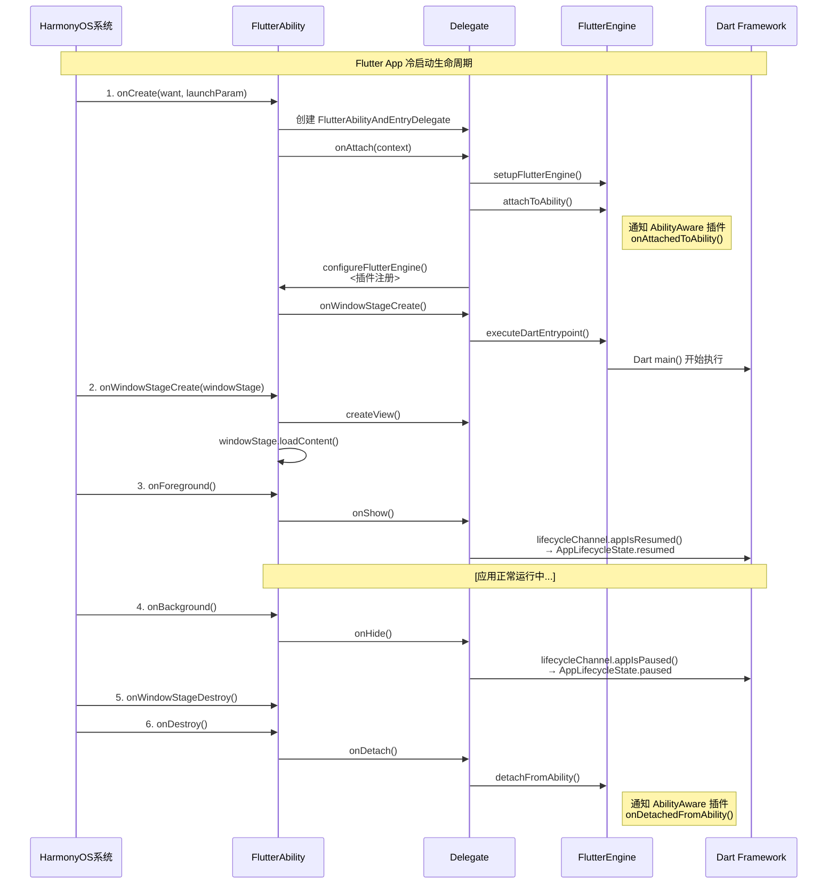
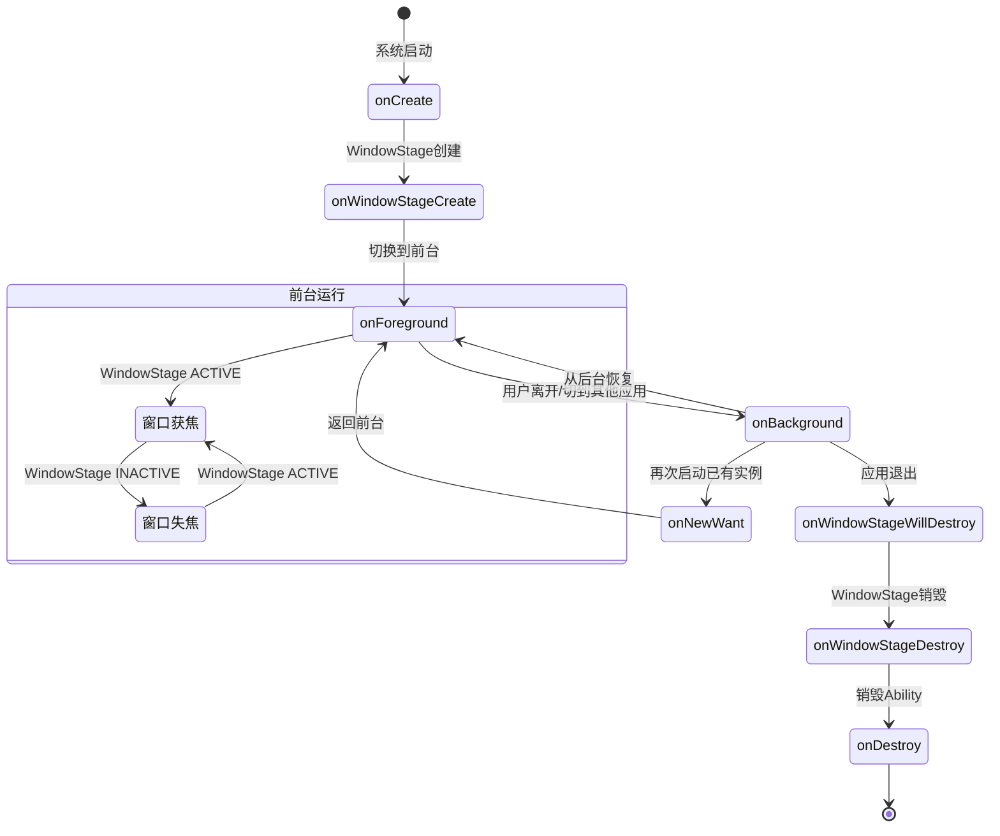
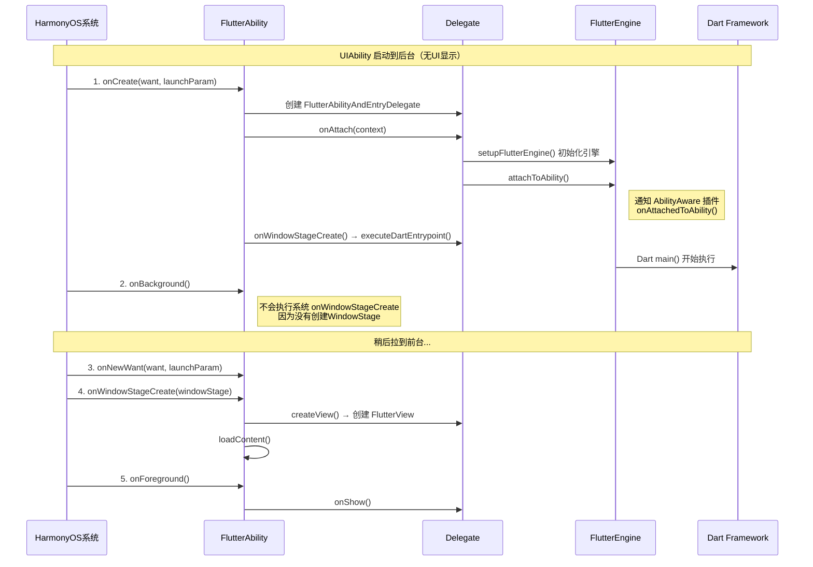
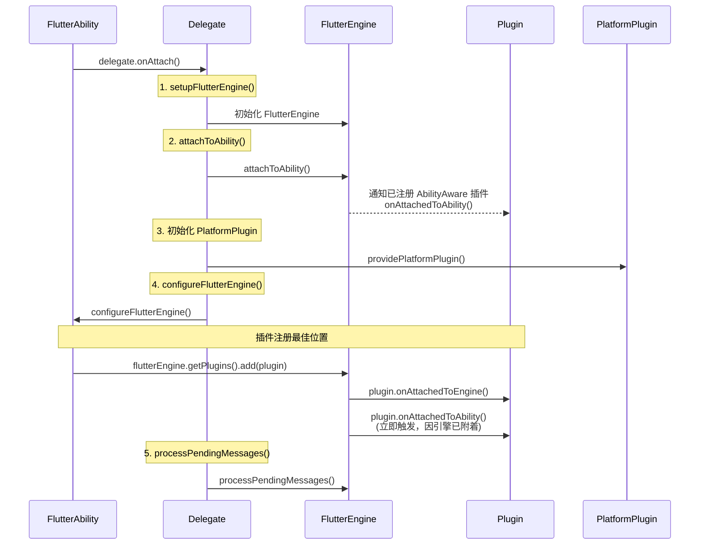
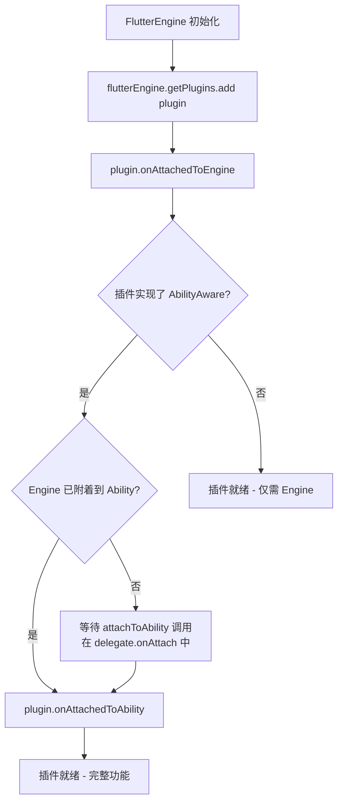

# Flutter App/Module启动生命周期回调指南

## 概述

本文档详细说明了Flutter App/Module在OpenHarmony/HarmonyOS平台上的启动生命周期回调机制，包括各回调函数的执行顺序、触发时机、插件注册的最佳实践位置以及相关注意事项。Flutter on HarmonyOS的生命周期基于HarmonyOS的`UIAbility`生命周期模型，通过`FlutterAbility`基类和`FlutterAbilityAndEntryDelegate`委托类实现Flutter引擎与HarmonyOS系统的桥接。

---

## 生命周期

### 冷启动流程

冷启动生命周期流程



**流程说明：**

1. **onCreate 阶段**：系统启动应用，FlutterAbility 创建委托类并初始化 FlutterEngine，通过 `attachToAbility()` 通知 AbilityAware 插件。`configureFlutterEngine()` 是插件注册的最佳位置。最后执行 Dart 入口点，Dart 的 main() 函数开始运行。

2. **onWindowStageCreate 阶段**：系统创建 WindowStage，委托创建 FlutterView 并加载 UI 内容。

3. **onForeground 阶段**：应用切换到前台，通过 lifecycleChannel 向 Dart 发送 `AppLifecycleState.resumed` 状态，应用进入正常运行状态。

4. **onBackground 阶段**：用户离开应用，通过 lifecycleChannel 向 Dart 发送 `AppLifecycleState.paused` 状态。

5. **销毁阶段**：依次执行 onWindowStageDestroy 和 onDestroy，委托通过 `detachFromAbility()` 通知 AbilityAware 插件清理资源。

### 生命周期状态转换图



**状态转换说明：**

1. **初始启动流程**：系统启动应用 → onCreate → onWindowStageCreate → onForeground，完成冷启动。

2. **前台运行状态**：应用在前台时，窗口会在获焦（ACTIVE）和失焦（INACTIVE）之间切换，例如用户打开通知栏时窗口会失焦，关闭通知栏时重新获焦。

3. **后台切换流程**：
   - 用户离开应用：onForeground → onBackground
   - 再次启动已有实例：onBackground → onNewWant → onForeground
   - 直接从后台恢复：onBackground → onForeground

4. **应用退出流程**：onBackground → onWindowStageWillDestroy → onWindowStageDestroy → onDestroy，最终释放所有资源。

### 启动到后台场景

当通过`UIAbilityContext.startAbilityByCall()`接口启动UIAbility到后台时（不涉及UI显示），生命周期回调流程如下：



**流程说明：**

1. **后台启动阶段**：
   - 系统调用 onCreate，初始化 FlutterEngine 并执行 Dart main()
   - 与普通冷启动不同，此阶段**不会执行系统的 onWindowStageCreate(windowStage)**（因为不需要UI显示）
   - 直接进入 onBackground 状态

2. **拉到前台阶段**：
   - 当需要将应用拉到前台时，系统调用 onNewWant（因为实例已存在）
   - 然后执行系统的 onWindowStageCreate(windowStage)，创建 FlutterView 并加载 UI 内容
   - 最后调用 onForeground，应用进入前台运行状态

---

## 各回调函数详解

### onCreate(want: Want, launchParam: LaunchParam)

#### 触发时机
- **时机**：UIAbility实例首次创建时调用，是生命周期的第一个回调。开发者可以在该回调中执行整个生命周期中仅发生一次的启动逻辑
- **调用次数**：首次创建时调用1次。从最近任务列表恢复已有实例时不会调用（此时走`onNewWant`→`onForeground`）

#### 主要职责
```ts
onCreate(want: Want, launchParam: AbilityConstant.LaunchParam) {
  // 1. 存储系统字体缩放比例
  AppStorage.setOrCreate('fontSizeScale', this.context.config.fontSizeScale);

  // 2. 将当前Ability推入FlutterManager栈
  FlutterManager.getInstance().pushUIAbility(this);

  // 3. 创建委托实例
  this.delegate = new FlutterAbilityAndEntryDelegate(this);

  // 4. 委托附着到Context，初始化FlutterEngine
  this?.delegate?.onAttach(this.context);

  // 5. 设置UIAbility上下文到PlatformPlugin
  this?.delegate?.platformPlugin?.setUIAbilityContext(this.context);

  // 6. 恢复保存的状态（如果有）
  this?.delegate?.onRestoreInstanceState(want);

  // 7. 触发 Dart 入口点执行
  if (this.stillAttachedForEvent("onWindowStageCreate")) {
    this?.delegate?.onWindowStageCreate();
  }

  // 8. 注册错误监听和应用恢复机制
  let observer: errorManager.ErrorObserver = {
    onUnhandledException(errorMsg) {
      appRecovery.saveAppState();
      appRecovery.restartApp();
    }
  }
  this.errorManagerId = errorManager.on('error', observer);

  // 9. 调试模式下初始化窗口
  if (flutterApplicationInfo.isDebugMode) {
    this.delegate?.initWindow();
  }
}
```

#### delegate.onAttach() 内部流程
```ts
onAttach(context: common.Context) {
  this.context = context;
  this.ensureAlive();

  // 1. 设置FlutterEngine（优先使用缓存，其次由宿主提供，最后新建）
  if (this.flutterEngine == null) {
    this.setupFlutterEngine();
  }

  // 2. 将FlutterEngine附着到Ability
  if (this.host?.shouldAttachEngineToAbility()) {
    this.flutterEngine?.getAbilityControlSurface()?.attachToAbility(this);
  }

  // 3. 初始化PlatformPlugin
  this.platformPlugin = this.host?.providePlatformPlugin(this.flutterEngine!)

  this.isAttached = true;

  // 4. 获取系统语言和颜色模式
  if (this.flutterEngine) {
    this.flutterEngine.getSystemLanguages();
    const config = this.context.resourceManager.getConfigurationSync();
    this.currentColorMode = /* 根据config设置颜色模式 */;
  }

  // 5. 自动将FlutterView附着到FlutterEngine
  if (this.flutterEngine && this.flutterView && this.host?.attachToEngineAutomatically()) {
    this.flutterView.attachToFlutterEngine(this.flutterEngine!!);
  }

  // 6. 配置FlutterEngine —— 插件注册的最佳位置
  this.host?.configureFlutterEngine(this.flutterEngine!!);

  // 7. 处理待处理消息
  if (this.flutterEngine) {
    this.flutterEngine.processPendingMessages();
  }
}
```

#### delegate.onWindowStageCreate() → doInitialFlutterViewRun()

```ts
private doInitialFlutterViewRun(): void {
  // 1. 获取初始路由
  let initialRoute = this.host?.getInitialRoute();
  if (initialRoute == null && this.host != null) {
    initialRoute = this.maybeGetInitialRouteFromIntent(this.host.getWant());
  }
  if (initialRoute == null) {
    initialRoute = FlutterAbilityLaunchConfigs.DEFAULT_INITIAL_ROUTE;
  }

  // 2. 在执行Dart代码前设置初始路由（必须在executeDartEntrypoint之前）
  this.flutterEngine?.getNavigationChannel()?.setInitialRoute(initialRoute ?? '');

  // 3. 获取应用bundle路径
  let appBundlePathOverride = this.host?.getAppBundlePath();
  if (appBundlePathOverride == null || appBundlePathOverride == '') {
    appBundlePathOverride = FlutterInjector.getInstance().getFlutterLoader().findAppBundlePath();
  }

  // 4. 构造Dart入口点并执行
  const dartEntrypoint: DartEntrypoint = new DartEntrypoint(
    appBundlePathOverride,
    this.host?.getDartEntrypointLibraryUri() ?? '',
    this.host?.getDartEntrypointFunctionName() ?? ''
  );
  this.flutterEngine?.dartExecutor.executeDartEntrypoint(
    dartEntrypoint,
    this.host?.getDartEntrypointArgs()
  );
}
```

#### 可在onCreate阶段执行的操作
- 初始化FlutterEngine
- 注册插件（通过 `configureFlutterEngine`）
- 初始化应用级别的资源
- 配置错误处理和恢复机制
- 读取和恢复保存的状态

---

### onWindowStageCreate(windowStage: WindowStage)

#### 触发时机
- **时机**：UIAbility实例创建完成之后，在进入前台之前，系统会创建WindowStage。WindowStage创建完成后触发此回调
- **调用次数**：每次创建WindowStage时调用1次

#### 主要职责
```ts
onWindowStageCreate(windowStage: window.WindowStage) {
  // 1. 将WindowStage推入FlutterManager
  FlutterManager.getInstance().pushWindowStage(this, windowStage);
  
  // 2. 初始化窗口
  this.delegate?.initWindow();
  
  // 3. 获取主窗口
  this.mainWindow = windowStage.getMainWindowSync();
  
  // 4. 注册WindowStage事件监听
  windowStage.on('windowStageEvent', this.windowStageEventCallback);
  
  // 5. 创建FlutterView
  this.flutterView = this.delegate!!.createView(this.context);
  
  // 6. 准备LocalStorage，传入viewId
  let storage: LocalStorage = new LocalStorage();
  storage.setOrCreate("viewId", this.flutterView!!.getId());
  
  // 7. 加载页面内容
  windowStage.loadContent(this.pagePath(), storage, (err, data) => {
    if (err.code) {
      Log.e(TAG, 'Failed to load the content.');
      return;
    }
    // 8. 通知FlutterView窗口已创建
    this.flutterView?.onWindowCreated();
  });
  
  // 9. 设置全屏模式（根据设备类型）
  if (this.isDefaultFullScreen()) {
    FlutterManager.getInstance().setUseFullScreen(true, this.context);
  }
}
```

#### delegate.createView() 内部流程
```ts
createView(context: Context): FlutterView {
  // 1. 通过FlutterManager创建FlutterView
  this.flutterView = FlutterManager.getInstance().createFlutterView(context);
  
  // 2. 如果配置了自动附着，将FlutterView附着到FlutterEngine
  if (this.flutterEngine && this.host?.attachToEngineAutomatically()) {
    this.flutterView.attachToFlutterEngine(this.flutterEngine!!);
  }
  
  return this.flutterView;
}
```

#### 可在OnWindowStageCreate阶段执行的操作
- 创建和配置FlutterView
- 加载UI内容
- 配置窗口属性（全屏、亮度等）

---

### onForeground()

#### 触发时机
- **时机**：UIAbility切换至前台时且UI可见之前调用。开发者可以在该回调中申请系统需要的资源，或者重新申请在`onBackground()`中释放的资源
- **调用次数**：每次从后台切回前台时调用（首次启动时在`onWindowStageCreate`之后调用一次）

#### 主要职责
```ts
onForeground() {
  if (this.stillAttachedForEvent("onForeground")) {
    this?.delegate?.onShow();
  }
}
```

#### delegate.onShow() 内部流程
```ts
onShow() {
  this.ensureAlive();
  this.isPageShow = true;
  
  // 1. 激活FlutterView
  this.flutterView?.setActive(true);
  
  // 2. 通知Flutter框架应用已恢复
  if (this.shouldDispatchAppLifecycleState()) {
    this.flutterEngine?.getLifecycleChannel()?.appIsResumed();
  }
}
```

#### 可在onForeground阶段执行的操作
- 恢复暂停的动画
- 重新开始视频播放
- 刷新UI数据
- 注册传感器/位置监听器
- 请求必要的权限

#### 生命周期通道消息
- **发送到Flutter**：`AppLifecycleState.resumed`
- **Dart端可监听**：`WidgetsBindingObserver.didChangeAppLifecycleState()`

---

### onNewWant(want: Want, launchParam: LaunchParam)

#### 触发时机
- **时机**：当UIAbility实例已创建，再次通过方法启动该UIAbility实例时触发
- **调用次数**：每次已有实例被重新调用时触发

#### 主要职责
```ts
onNewWant(want: Want, launchParams: AbilityConstant.LaunchParam): void {
  this?.delegate?.onNewWant(want, launchParams)
}
```

#### delegate.onNewWant() 内部流程
```ts
onNewWant(want: Want, launchParams: AbilityConstant.LaunchParam): void {
  this.ensureAlive()
  if (this.flutterEngine != null) {
    // 1. 通知AbilityAware插件有新的Want
    this.flutterEngine?.getAbilityControlSurface()?.onNewWant(want, launchParams);
    // 2. 处理新Want中的路由信息
    const initialRoute = this.maybeGetInitialRouteFromIntent(want);
    if (initialRoute && initialRoute.length > 0) {
      this.flutterEngine?.getNavigationChannel()?.pushRouteInformation(initialRoute);
    }
  }
}
```

#### 可在onNewWant阶段执行的操作
- 更新要加载的资源和数据
- 处理新的启动参数
- 导航到新的路由页面

---

### WindowStage 事件回调

#### windowStageEvent 事件类型

#### 事件处理代码
```ts
onWindowStageChanged(stageEventType: window.WindowStageEventType) {
  switch (stageEventType) {
    //窗口已显示
    case window.WindowStageEventType.SHOWN:
      Log.i(TAG, 'windowStage shown.');
      break;
    // 窗口获焦  
    case window.WindowStageEventType.ACTIVE:
      Log.i(TAG, 'windowStage active.');
      this.getFlutterEngine()?.getTextInputChannel()?.textInputMethodHandler?.handleChangeFocus(true);
      this.onWindowFocusChanged(true);
      break;
     // 窗口失焦 
    case window.WindowStageEventType.INACTIVE:
      Log.i(TAG, 'windowStage inactive.');
      this.onWindowFocusChanged(false);
      break;
     // 窗口暂停 
    case window.WindowStageEventType.PAUSED:
      Log.i(TAG, 'windowStage paused.');
      this.onPaused();
      break;
     // 窗口恢复 
    case window.WindowStageEventType.RESUMED:
      Log.i(TAG, 'windowStage resumed.');
      this.onResumed();
      break;
     // 窗口隐藏 
    case window.WindowStageEventType.HIDDEN:
      Log.i(TAG, 'windowStage hidden.');
      break;
  }
}
```

#### onWindowFocusChanged() 内部流程
```ts
onWindowFocusChanged(hasFocus: boolean): void {
  if (this.shouldDispatchAppLifecycleState()) {
    // 1. 通知AbilityControlSurface焦点变化
    this.flutterEngine?.getAbilityControlSurface()?.onWindowFocusChanged(hasFocus);
    
    // 2. 通知Flutter框架焦点变化
    if (hasFocus) {
      this.flutterEngine?.getLifecycleChannel()?.aWindowIsFocused();
    } else {
      this.flutterEngine?.getLifecycleChannel()?.noWindowsAreFocused();
    }
  }
}
```

---

### onBackground()

#### 触发时机
- **时机**：Ability的UI完全不可见之后调用，将Ability实例切换至后台状态
- **调用次数**：每次从前台切到后台时调用

#### 主要职责
```ts
onBackground() {
  if (this.stillAttachedForEvent("onBackground")) {
    this?.delegate?.onHide();
  }
}
```

#### delegate.onHide() 内部流程
```ts
onHide() {
  if (this.shouldDispatchAppLifecycleState()) {
    this.isPageShow = false;
    
    // 1. 停用FlutterView
    this.flutterView?.setActive(false);
    
    // 2. 通知Flutter框架应用已暂停
    this.flutterEngine?.getLifecycleChannel()?.appIsPaused();
  }
}
```

#### 可在onBackground阶段执行的操作
- 暂停动画和视频播放
- 释放不必要的资源（如停止定位功能）
- 取消传感器/位置监听器
- 停止网络请求轮询

#### 生命周期通道消息
- **发送到Flutter**：`AppLifecycleState.paused`

---

### onWindowStageWillDestroy(windowStage: WindowStage)

#### 触发时机
- **时机**：WindowStage销毁之前调用，此时WindowStage仍可使用
- **调用次数**：每次Ability进入销毁状态时调用1次

#### 主要职责
```ts
onWindowStageWillDestroy(windowStage: window.WindowStage) {
  try {
    // 取消WindowStage事件监听
    windowStage.off('windowStageEvent', this.windowStageEventCallback);
  } catch (err) {
    Log.e(TAG, "windowStage off failed");
  }
}
```

#### 可在此阶段执行的操作
- 释放通过WindowStage获取的资源
- 注销WindowStage事件订阅

---

### onWindowStageDestroy()

#### 触发时机
- **时机**：WindowStage销毁之后调用，此时WindowStage不可使用
- **调用次数**：每次Ability进入销毁状态时调用1次

#### 主要职责
```ts
onWindowStageDestroy() {
  // 1. 从FlutterManager中移除WindowStage
  FlutterManager.getInstance().popWindowStage(this);

  // 2. 通知委托
  if (this.stillAttachedForEvent("onWindowStageDestroy")) {
    this?.delegate?.onWindowStageDestroy();
  }
}
```

#### 可在onWindowStageDestroy阶段执行的操作
-  释放UI资源

---

### onDestroy()

#### 触发时机
- **时机**：Ability销毁时调用，是生命周期的最后一个回调
- **调用次数**：每次Ability销毁时调用1次

#### 主要职责
```ts
onDestroy() {
  // 1. 从FlutterManager中移除Ability
  FlutterManager.getInstance().popUIAbility(this);
  
  // 2. 取消错误监听
  errorManager.off('error', this.errorManagerId);
  
  // 3. 销毁FlutterView
  if (this.flutterView != null) {
    this.flutterView.onDestroy();
    this.flutterView = null;
  }
  
  // 4. 通知委托分离
  if (this.stillAttachedForEvent("onDestroy")) {
    this?.delegate?.onDetach();
  }
  
  // 5. 释放所有资源
  this.release();
}
```

#### delegate.onDetach() 内部流程
```ts
onDetach() {
  // 1. 将FlutterEngine从Ability分离
  if (this.host?.shouldAttachEngineToAbility()) {
    Log.d(TAG, "Detaching FlutterEngine from the Ability");
    this.flutterEngine?.getAbilityControlSurface()?.detachFromAbility();
  }

  // 2. 将FlutterView从FlutterEngine分离
  this.flutterView?.detachFromFlutterEngine();

  // 3. 清理FlutterEngine
  this.host?.cleanUpFlutterEngine(this.flutterEngine!!);

  // 4. 通知Flutter框架应用已分离
  if (this.host?.shouldDispatchAppLifecycleState() && this.flutterEngine != null) {
    this.flutterEngine?.getLifecycleChannel()?.appIsDetached();
  }

  // 5. 销毁PlatformPlugin
  if (this.platformPlugin) {
    this.platformPlugin.destroy();
  }

  // 6. 根据配置决定是否销毁FlutterEngine
  if (this.host?.shouldDestroyEngineWithHost()) {
    this.flutterEngine?.destroy();
    if (this.host.getCachedEngineId() != null && this.host.getCachedEngineId().length > 0) {
      FlutterEngineCache.getInstance().remove(this.host.getCachedEngineId());
    }
    this.flutterEngine = null;
  }
  this.isAttached = false;
}
```

#### FlutterEngine.destroy() 内部流程
```ts
destroy(): void {
  Log.d(TAG, "Destroying.");
  
  // 1. 通知引擎生命周期监听器
  this.engineLifecycleListeners.forEach(listener => listener.onEngineWillDestroy());
  
  // 2. 移除引擎生命周期监听
  this.flutterNapi.removeEngineLifecycleListener(this);
  
  // 3. 从Ability分离
  this.pluginRegistry?.detachFromAbility();
  
  // 4. 平台视图控制器分离
  this.platformViewsController?.onDetachedFromNapi();
  
  // 5. 销毁插件注册表
  this.pluginRegistry?.destroy();
  
  // 6. DartExecutor分离
  this.dartExecutor.onDetachedFromNAPI();
  
  // 7. 释放原生引擎资源
  this.flutterNapi.detachFromNativeAndReleaseResources();
}
```

#### 可在onDestroy阶段执行的操作
- 清理所有资源
-  取消所有注册的监听器
-  保存持久化数据
-  取消网络请求
-  释放内存缓存

---

## 插件注册

### 插件系统接口

Flutter on HarmonyOS的插件系统由两个核心接口组成：

```ts
// 基础插件接口
interface FlutterPlugin {
  getUniqueClassName(): string;
  onAttachedToEngine(binding: FlutterPluginBinding): void;
  onDetachedFromEngine(binding: FlutterPluginBinding): void;
}

// 感知Ability生命周期的扩展接口
interface AbilityAware {
  onAttachedToAbility(binding: AbilityPluginBinding): void;
  onDetachedFromAbility(): void;
}
```

### 插件注册时机详解

#### 插件注册位置对比

| 注册位置 | 可访问资源 | 适用场景 |
|---------|-----------|---------|
| `configureFlutterEngine()` | ApplicationContext + FlutterEngine | 标准插件注册位置（onCreate阶段调用） |
| `onAttachedToAbility()` [插件内回调] | UIAbility实例 | 需要Ability引用的插件 |
| `onWindowStageCreate()` | All + WindowStage | 需要Window上下文的插件 |

---

#### attachToAbility 调用时机说明

**attachToAbility 由框架在 onCreate 阶段自动调用（非 onWindowStageCreate）**

在 `delegate.onAttach()` 中，`attachToAbility()` 先于 `configureFlutterEngine()` 执行。因此在 `configureFlutterEngine()` 中通过 `add()` 注册的插件，如果实现了 `AbilityAware`，会在 `add()` 时立即收到 `onAttachedToAbility` 回调（因为此时引擎已附着到 Ability）。

```ts
export class MyFlutterAbility extends FlutterAbility {
  configureFlutterEngine(flutterEngine: FlutterEngine) {
    super.configureFlutterEngine(flutterEngine);
    // 在此注册插件MyPlugin
    // 插件会在 add 时立即收到 onAttachedToAbility 回调
    flutterEngine.getPlugins().add(MyPlugin());
  }
}
```

**`delegate.onAttach()` 内部执行流程**：



**流程说明：**

1. **setupFlutterEngine()**：初始化 FlutterEngine，优先使用缓存，其次由宿主提供，最后新建。
2. **attachToAbility()**：将引擎附着到 Ability，通知所有已注册的 AbilityAware 插件。
3. **初始化 PlatformPlugin**：创建并初始化平台插件。
4. **configureFlutterEngine()**：回调宿主配置引擎，此处是插件注册最佳位置。由于引擎已附着，新注册的 AbilityAware 插件会在 `add()` 时立即收到 `onAttachedToAbility()` 回调。
5. **processPendingMessages()**：处理引擎的待处理消息。

---

### 插件实现实践

#### 示例1：基础插件（不需要Ability）

```ts
export class MyBasicPlugin implements FlutterPlugin {
  private static const CLASS_NAME = "com.example.MyBasicPlugin";
  private methodChannel: MethodChannel | null = null;
  
  getUniqueClassName(): string {
    return MyBasicPlugin.CLASS_NAME;
  }
  
  onAttachedToEngine(binding: FlutterPluginBinding): void {
    // 在此初始化：获取BinaryMessenger，创建MethodChannel
    const messenger = binding.getBinaryMessenger();
    this.methodChannel = new MethodChannel(messenger, "my_basic_plugin");
    
    // 设置方法调用处理器
    this.methodChannel.setMethodCallHandler((call) => {
      switch (call.method) {
        case "getPlatformVersion":
          return Promise.resolve("HarmonyOS " + deviceInfo.osFullName);
        default:
          return Promise.reject("Not implemented");
      }
    });
    
    // 可以访问 ApplicationContext
    const context = binding.getApplicationContext();
    // 使用 context 做一些初始化...
  }
  
  onDetachedFromEngine(binding: FlutterPluginBinding): void {
    // 在此清理资源
    this.methodChannel?.setMethodCallHandler(null);
    this.methodChannel = null;
  }
}
```

#### 示例2：AbilityAware插件（需要Ability）

```ts
export class MyAbilityPlugin implements FlutterPlugin, AbilityAware {
  private static const CLASS_NAME = "com.example.MyAbilityPlugin";
  private ability: UIAbility | null = null;
  private methodChannel: MethodChannel | null = null;
  private binding: FlutterPluginBinding | null = null;
  
  getUniqueClassName(): string {
    return MyAbilityPlugin.CLASS_NAME;
  }
  
  // ========== FlutterPlugin 回调 ==========
  
  onAttachedToEngine(binding: FlutterPluginBinding): void {
    // 保存 binding 引用
    this.binding = binding;
    
    // 初始化MethodChannel（与基础插件相同）
    const messenger = binding.getBinaryMessenger();
    this.methodChannel = new MethodChannel(messenger, "my_ability_plugin");
    
    this.methodChannel.setMethodCallHandler((call) => {
      switch (call.method) {
        case "startActivity":
          return this.startActivity(call.arguments);
        case "getAbilityInfo":
          return Promise.resolve({
            abilityName: this.ability?.context.name ?? "null"
          });
        default:
          return Promise.reject("Not implemented");
      }
    });
    
    // 此时 ability 还不可用, 不要在这里尝试访问 ability
  }
  
  onDetachedFromEngine(binding: FlutterPluginBinding): void {
    this.methodChannel?.setMethodCallHandler(null);
    this.methodChannel = null;
    this.binding = null;
  }
  
  // ========== AbilityAware 回调 ==========
  
  onAttachedToAbility(binding: AbilityPluginBinding): void {
    // 在此获取 UIAbility 实例
    this.ability = binding.getAbility();
    
    // 可以在此注册生命周期监听器
    binding.addOnWindowFocusChangedListener((hasFocus) => {
      Log.d(TAG, "Window focus changed: " + hasFocus);
    });
    
    binding.addOnNewWantListener((want, launchParams) => {
      Log.d(TAG, "New want received: " + want.uri);
    });
    
    Log.d(TAG, "Plugin attached to ability: " + this.ability.context.name);
  }
  
  onDetachedFromAbility(): void {
    // 在此清理与Ability相关的资源
    // 清除 ability 引用，避免内存泄漏
    this.ability = null;
    
    Log.d(TAG, "Plugin detached from ability");
  }
  
  // 示例方法：使用Ability启动新Ability
  private async startActivity(arguments: Record<string, Object>): Promise<void> {
    if (!this.ability) {
      throw new Error("Ability not attached");
    }
    
    const want = new Want();
    want.bundleName = arguments["bundleName"] as string;
    want.abilityName = arguments["abilityName"] as string;
    
    await this.ability.context.startAbility(want);
  }
}
```

### 插件注册流程图



**流程说明：**

1. **插件注册开始**：在 FlutterEngine 初始化完成后，通过 `flutterEngine.getPlugins.add(plugin)` 注册插件。

2. **基础插件初始化**：立即调用插件的 `onAttachedToEngine()`，此时插件可以访问 FlutterEngine 和 ApplicationContext。

3. **AbilityAware 判断**：
   - 如果插件**未实现** AbilityAware 接口：插件就绪，可使用基础 Engine 功能
   - 如果插件**实现了** AbilityAware 接口：继续判断 Engine 是否已附着到 Ability

4. **Ability 附着处理**：
   - 如果 Engine 已附着到 Ability（通常在 `configureFlutterEngine()` 中注册时已是这种状态）：立即调用 `onAttachedToAbility()`，插件获得完整功能
   - 如果 Engine 尚未附着：等待 `delegate.onAttach()` 中的 `attachToAbility()` 调用，之后再触发 `onAttachedToAbility()`

#### 反向排查：attachToAbility 未执行为什么会报 MissingPluginException

理解上述正向流程后，可据此反向排查：若宿主未走标准 `delegate.onAttach()`（典型如 Add-to-App 混编中自定义 `EntryAbility` 漏调 `this.delegate?.onAttach(this.context)`，或手动 `engines.createAndRunEngineByOptions()` 建引擎后未调 `attachToAbility(host)`），则上述流程**整条链路不会执行**——引擎未附着到 Ability、`configureFlutterEngine()` 不被框架回调、插件即使写了 `GeneratedPluginRegistrant.registerWith()` 也不会执行，`onAttachedToEngine()` 不被调用导致 channel 无原生 handler。

此时 Dart 侧调用插件就会抛 `MissingPluginException`，且异常日志本身**无法提示**是生命周期问题（只会显示"No implementation found for method ..."）。

**验证方法**：抓取 HiLog 过滤关键字，若搜不到 `configureFlutterEngine` / `attachToAbility` 相关日志，即可定位为本根因：

```bash
hdc shell hilog | grep -E "configureFlutterEngine|attachToAbility|FlutterAbilityAndEntryDelegate"
```

完整的 3 类根因排查决策树（生命周期 / 注册调用 / 插件 ohos 层）见 [Flutter 插件调用报 MissingPluginException](../faq/plugin-adaptation-faq.md#section592016)。

---

## 注意事项

### 线程/并发注意事项

#### 回调执行线程
- **所有生命周期回调**都在**主线程（ArkTS线程）**执行
- **不要在生命周期回调中执行耗时操作**
- 耗时操作应使用`async/await`或分派到后台线程

```ts
// 错误：在主线程执行耗时操作
onCreate(want: Want, launchParam: AbilityConstant.LaunchParam) {
  super.onCreate(want, launchParam);
  // 会阻塞UI！
  const data = this.loadLargeDataSync(); 
}

// 正确：使用异步处理
onCreate(want: Want, launchParam: AbilityConstant.LaunchParam) {
  super.onCreate(want, launchParam);
  this.loadLargeDataAsync(); // 立即返回，不阻塞
}

private async loadLargeDataAsync(): Promise<void> {
  try {
    // 在后台线程执行（使用taskpool或其他方式）
    const data = await TaskPool.execute(this.loadLargeDataSync);
    // 回到主线程更新UI
  } catch (e) {
    // 处理错误
  }
}
```

---

### 内存泄漏注意事项

#### 常见泄漏场景及预防

| 泄漏源 | 预防措施 |
|-------|---------|
| Ability引用 | 在`onDetachedFromAbility()`中清除 |
| 监听器注册 | 在对应的分离回调中取消注册 |
| 静态引用 | 避免静态持有Context/Ability |
| 异步任务 | 在销毁时取消未完成的任务 |

```ts
// 正确的资源清理模式
class SafePlugin implements FlutterPlugin, AbilityAware {
  private ability: UIAbility | null = null;
  private someListener: SomeListener | null = null;
  
  onAttachedToAbility(binding: AbilityPluginBinding): void {
    this.ability = binding.getAbility();
    
    // 注册监听器
    this.someListener = new SomeListener();
    this.ability.context.on('someEvent', this.someListener);
  }
  
  onDetachedFromAbility(): void {
    // 取消监听器
    if (this.ability && this.someListener) {
      this.ability.context.off('someEvent', this.someListener);
    }
    
    // 清除引用
    this.someListener = null;
    this.ability = null; // 重要！
  }
  
  onDetachedFromEngine(binding: FlutterPluginBinding): void {
    // 清理Engine相关资源
    // 注意：不要在这里清理Ability相关资源！
  }
}
```

---

### FlutterEngine 复用注意事项

#### 使用缓存的FlutterEngine

```ts
// 在Application或其他地方缓存FlutterEngine
class MyApplication {
  private cachedEngine: FlutterEngine | null = null;
  
  createAndCacheEngine(context: common.Context): void {
    this.cachedEngine = new FlutterEngine(context, null, null, null);
    this.cachedEngine.init(context, null, false);
    
    // 预注册插件
    this.cachedEngine.getPlugins().add(MyPlugin());
    
    // 存入缓存
    FlutterEngineCache.getInstance().put("my_cached_engine", this.cachedEngine);
  }
}

// 在FlutterAbility中使用缓存的引擎
export class MyFlutterAbility extends FlutterAbility {
  getCachedEngineId(): string {
    return "my_cached_engine"; // 返回缓存ID
  }
  
  shouldDestroyEngineWithHost(): boolean {
    return false; // 不要销毁缓存的引擎
  }
  
  configureFlutterEngine(flutterEngine: FlutterEngine) {
    // 不要再重复注册已在缓存引擎中注册的插件
    // 除非需要添加额外的插件
  }
}
```

#### FlutterEngineGroup 多引擎管理

```ts
// 使用FlutterEngineGroup创建多个轻量级引擎
const group = new FlutterEngineGroup();

// 创建第一个引擎
const engine1 = group.createAndRunEngineByOptions(
  new Options(context)
    .setDartEntrypoint(new DartEntrypoint("", "", "main"))
    .setInitialRoute("/page1")
);

// 从同一组创建第二个引擎（更高效）
const engine2 = group.createAndRunEngineByOptions(
  new Options(context)
    .setDartEntrypoint(new DartEntrypoint("", "", "main"))
    .setInitialRoute("/page2")
);
```

---

### 配置变更与状态保存

- **配置变更**（字体、语言、深色模式等）：`FlutterAbility` 基类已自动处理，如需额外逻辑可重写 `onConfigurationUpdate()`
- **状态保存**：重写 `shouldRestoreAndSaveState()` 返回 `true` 即可启用。Flutter框架状态通过 `RestorationChannel` 自动保存，插件状态通过 `OnSaveStateListener` 保存
- **窗口焦点**：文本输入焦点、`AppLifecycleState` 变化由框架自动处理。插件可通过 `binding.addOnWindowFocusChangedListener()` 监听焦点变化

---

### 多Ability/多FlutterView注意事项

#### Add-to-App模式

```ts
// 在现有HarmonyOS应用中嵌入Flutter

// 1. 创建FlutterView
const flutterView = FlutterManager.getInstance().createFlutterView(context);

// 2. 附着到FlutterEngine
flutterView.attachToFlutterEngine(flutterEngine);

// 3. 添加到UI树
// (在ArkUI中使用)

// 4. 在适当时机设置为active
flutterView.setActive(true); // 显示时
flutterView.setActive(false); // 隐藏时

// 5. 清理
flutterView.detachFromFlutterEngine();
flutterView.onDestroy();
```

---

### 错误处理

`FlutterAbility` 已自动配置全局错误捕获（`errorManager.on('error', ...)`），捕获未处理异常后会保存应用状态并尝试重启。如需自定义错误上报，可在 `onCreate` 中额外注册 `ErrorObserver`。

---

### 性能注意事项

#### 启动优化

| 优化项 | 建议 |
|-------|------|
| 插件注册 | 只注册必要的插件 |
| 预加载 | 使用缓存引擎预加载 |
| 初始化 | 将非必要初始化延迟到onForeground |
| 资产加载 | 使用懒加载策略 |

```ts
// 延迟初始化示例
export class MyFlutterAbility extends FlutterAbility {
  private heavyInitializer: HeavyInitializer | null = null;
  
  configureFlutterEngine(flutterEngine: FlutterEngine) {
    super.configureFlutterEngine(flutterEngine);
    
    // 只注册核心插件
    flutterEngine.getPlugins().add(CorePlugin());
  }
  
  onForeground() {
    super.onForeground();
    
    // 在前台显示时才初始化重量级功能
    if (!this.heavyInitializer) {
      this.initializeHeavyFeatures();
    }
  }
  
  private async initializeHeavyFeatures(): Promise<void> {
    this.heavyInitializer = new HeavyInitializer();
    await this.heavyInitializer.initialize();
    
    // 延迟注册非核心插件
    this.getFlutterEngine()?.getPlugins().add(HeavyPlugin());
  }
}
```

---

## 代码示例

### FlutterAbility 实现示例

```ts
import { AbilityConstant, Want } from '@kit.AbilityKit';
import { window } from '@kit.ArkUI';
import { FlutterAbility } from '../embedding/ohos/FlutterAbility';
import FlutterEngine from '../embedding/engine/FlutterEngine';

export class EntryAbility extends FlutterAbility {
  // 在此注册所有插件
  configureFlutterEngine(flutterEngine: FlutterEngine) {
    super.configureFlutterEngine(flutterEngine);
    flutterEngine.getPlugins().add(new CorePlugin());
    flutterEngine.getPlugins().add(new MyAbilityPlugin());
  }

  // 重写生命周期回调时，务必先调用 super
  onCreate(want: Want, launchParam: AbilityConstant.LaunchParam) {
    super.onCreate(want, launchParam);
    // 自定义初始化（不要执行耗时操作）
  }

  onWindowStageCreate(windowStage: window.WindowStage) {
    super.onWindowStageCreate(windowStage);
    // 可在此配置窗口属性（全屏、状态栏等）
  }

  onForeground() {
    super.onForeground();
    // 恢复活动、刷新数据
  }

  onBackground() {
    super.onBackground();
    // 暂停活动、保存数据
  }

  onDestroy() {
    super.onDestroy();
    // 自定义清理
  }
}
```

