# Core Object Architecture Principles

---

## Overview

This document analyzes the responsibilities and collaboration relationships of Flutter's five core objects on the OHOS platform (FlutterAbility, FlutterEntry, Delegate, FlutterEngine, FlutterView). It covers lifecycle coordination, the plugin registration mechanism, and multi-engine scenario differences, aiming to help developers quickly build a global understanding and locate plugin adaptation issues.

---

## 1. Core Objects

The five objects are organized by layer:

| Object | Layer | One-line Responsibility |
|------|------|-----------|
| **FlutterAbility** | Host layer (UIAbility) | Entry Ability for pure Flutter apps; forwards UIAbility lifecycle |
| **FlutterEntry** | Host layer (Page) | Page-level entry for Add-to-App scenarios; embedded in ArkUI pages |
| **Delegate** | Coordination layer | Connects host and engine; manages engine creation/destruction/lifecycle forwarding |
| **FlutterEngine** | Engine layer | Flutter execution environment: Dart VM, system channels, plugin registry |
| **FlutterView** | View layer | Rendering container: viewport management, input handling, platform views |

> The two hosts (FlutterAbility / FlutterEntry) share the same Delegate + Engine + View collaboration mechanism; the only difference is the source of their lifecycles.

---

## 2. Overall Architecture Relationship

The diagram below shows the ownership and collaboration direction of the five core objects.

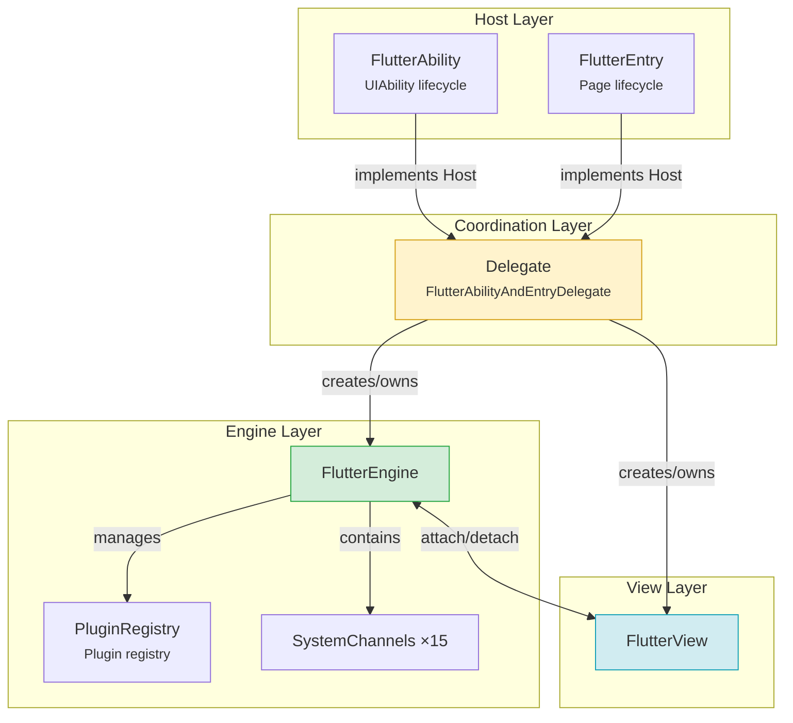

**Key point:** FlutterAbility and FlutterEntry are two parallel hosts that both interact with the Delegate through the Host interface. The Delegate is the only role that creates and manages the Engine and View.

---

## 3. Responsibilities of Each Object

### 3.1 FlutterAbility — UIAbility-level Host

Inherits from OHOS's `UIAbility` and serves as the entry for pure Flutter apps. Its core responsibility is to forward UIAbility lifecycle callbacks to the Delegate.

**Key attributes:**

```typescript
export class FlutterAbility extends UIAbility implements Host {
  private delegate?: FlutterAbilityAndEntryDelegate | null;
  private flutterView: FlutterView | null = null;
  private mainWindow?: window.Window | null;
}
```

**Lifecycle forwarding overview:**

| UIAbility Callback | Forwarded to Delegate | Actual Effect |
|----------------|----------------|---------|
| `onCreate()` | `onAttach()` | Creates the engine and attaches it to the Ability |
| `onWindowStageCreate()` | `createView()` + `doInitialFlutterViewRun()` | Creates the view and executes the Dart entry |
| `onForeground()` | `onShow()` | Notifies Flutter of foreground (resumed) |
| `onBackground()` | `onHide()` | Notifies Flutter of background (paused) |
| `onDestroy()` | `onDetach()` | Detaches plugins; optionally destroys the engine |

**Overridable hooks (Host interface):**

| Method | Default Behavior | Typical Use |
|------|---------|---------|
| `configureFlutterEngine(engine)` | Empty | **Register plugins** |
| `provideFlutterEngine(context)` | Returns null | Provide a custom engine |
| `getCachedEngineId()` | Empty string | Use a pre-warmed cached engine |
| `shouldDestroyEngineWithHost()` | Cached engine=false, otherwise=true | Control whether the engine is destroyed with the host |

---

### 3.2 FlutterEntry — Page-level Host (Add-to-App)

Used to embed Flutter content within an existing OHOS app (non-fullscreen scenarios), serving as the entry for an ArkUI page component.

**Key differences from FlutterAbility:**

| Comparison Dimension | FlutterAbility | FlutterEntry |
|---------|----------------|--------------|
| Host type | UIAbility (app-level) | Page (page-level) |
| Applicable scenario | Pure Flutter apps | Hybrid development; Flutter embedded in native pages |
| Lifecycle source | Standard UIAbility callbacks | ArkUI Page callbacks |
| Plugin registration method | Override `configureFlutterEngine()` | Via `FlutterEngineConfigurator` |

**FlutterEntry lifecycle forwarding:**

| Page Callback | Forwarded to Delegate |
|-----------|----------------|
| `aboutToAppear()` | `createView()` + `onAttach()` |
| `onPageShow()` | `onShow()` |
| `onPageHide()` | `onHide()` |
| `aboutToDisappear()` | `onDetach()` |

---

### 3.3 Delegate — The Coordinator

`FlutterAbilityAndEntryDelegate` is the core coordinator shared by both hosts. Its responsibilities: create/obtain the engine, manage the view, and forward lifecycles.

**Engine selection strategy (setupFlutterEngine executes by priority):**

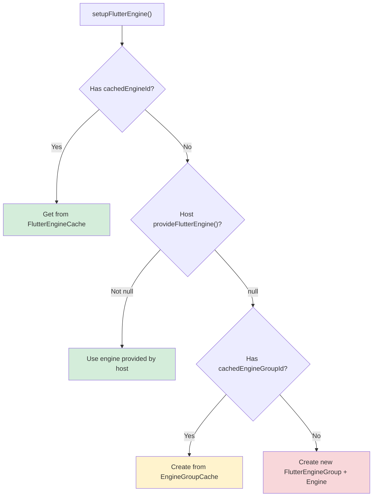

| Priority | Strategy | Typical Scenario |
|--------|------|---------|
| 1 | FlutterEngineCache | Pre-warmed engine; hot start |
| 2 | `provideFlutterEngine()` | Custom engine management |
| 3 | FlutterEngineGroupCache | Multi-engine Add-to-App |
| 4 | New EngineGroup | Default first launch |

---

### 3.4 FlutterEngine — The Execution Engine

A container for a single Flutter execution environment, holding the Dart executor, system channels, and plugin registry.

**Internal composition overview:**

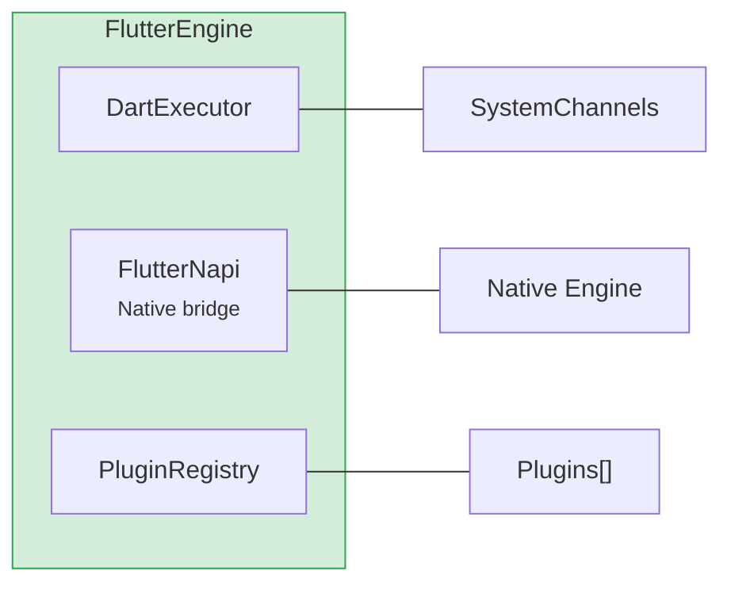

**Key point:** FlutterEngine internally consists of three parts — DartExecutor, FlutterNapi, and PluginRegistry — responsible for Dart code execution, native bridging, and plugin management respectively.

**Engine initialization (`init()`) core steps:**

```typescript
init(context, dartVmArgs, waitForRestorationData) {
  // 1. Ensure FlutterLoader is initialized
  this.flutterLoader.ensureInitializationComplete(dartVmArgs);

  // 2. Create 15 system channels (lifecycle, navigation, textInput, platform...)
  this.lifecycleChannel = new LifecycleChannel(this.dartExecutor);
  this.navigationChannel = new NavigationChannel(this.dartExecutor, context);
  // ... remaining 13 channels

  // 3. Attach to the native engine
  this.attachToNapi();

  // 4. Create the plugin registry
  this.pluginRegistry = new FlutterEngineConnectionRegistry(context, this, loader);
}
```

**Engine destruction (`destroy()`) core steps:**

```typescript
destroy(): void {
  this.engineLifecycleListeners.forEach(l => l.onEngineWillDestroy());
  this.pluginRegistry?.detachFromAbility();   // Notify plugins onDetachedFromAbility
  this.pluginRegistry?.destroy();             // Notify plugins onDetachedFromEngine
  this.dartExecutor.onDetachedFromNAPI();
  this.flutterNapi.detachFromNativeAndReleaseResources();
}
```

---

### 3.5 FlutterView — The Rendering View

The visual container for Flutter content, managing viewport metrics, input events (keyboard/mouse/touch), and system safe areas.

**Key steps of attaching an engine (`attachToFlutterEngine()`):**

```typescript
attachToFlutterEngine(flutterEngine: FlutterEngine): void {
  // 1. Save engine reference; native layer attaches
  this.flutterEngine = flutterEngine;
  flutterEngine.getFlutterNapi().xComponentAttachFlutterEngine(this.id);

  // 2. Update display parameters (refresh rate/size/DPI)
  flutterEngine.getFlutterNapi().updateRefreshRate(...);
  flutterEngine.getFlutterNapi().updateSize(...);

  // 3. Initialize input plugins
  this.mouseCursorPlugin = new MouseCursorPlugin(...);
  this.textInputPlugin = new TextInputPlugin(...);
  this.keyboardManager = new KeyboardManager(flutterEngine, this.textInputPlugin);

  // 4. Update viewport metrics
  this.onAreaChange(newArea, true);
}
```

**ViewportMetrics:** Manages `devicePixelRatio`, physical width/height, safe-area padding, keyboard insets, foldable-screen DisplayFeature, etc.

---

## 4. Lifecycle Timing

### 4.1 FlutterAbility Startup Flow

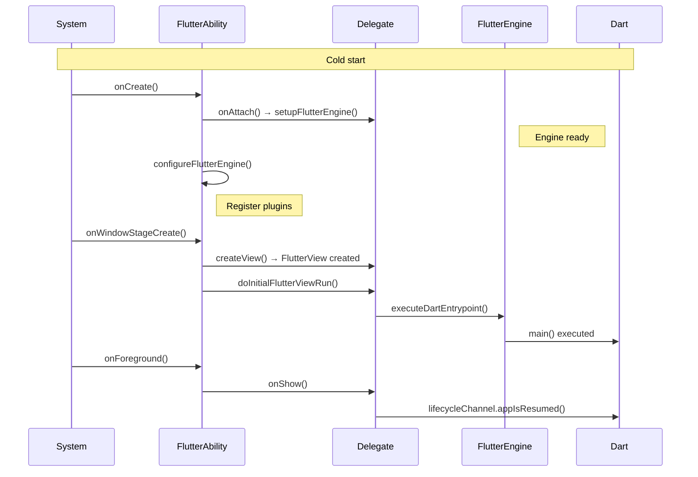

**Three phases:** Engine ready → View creation + Dart execution → Foreground display. `configureFlutterEngine()` is called immediately after the engine is ready, which is the standard timing for plugin registration.

### 4.2 Startup Details

The diagram above omits the plugin attachment and Ability binding process. The diagram below supplements those details:

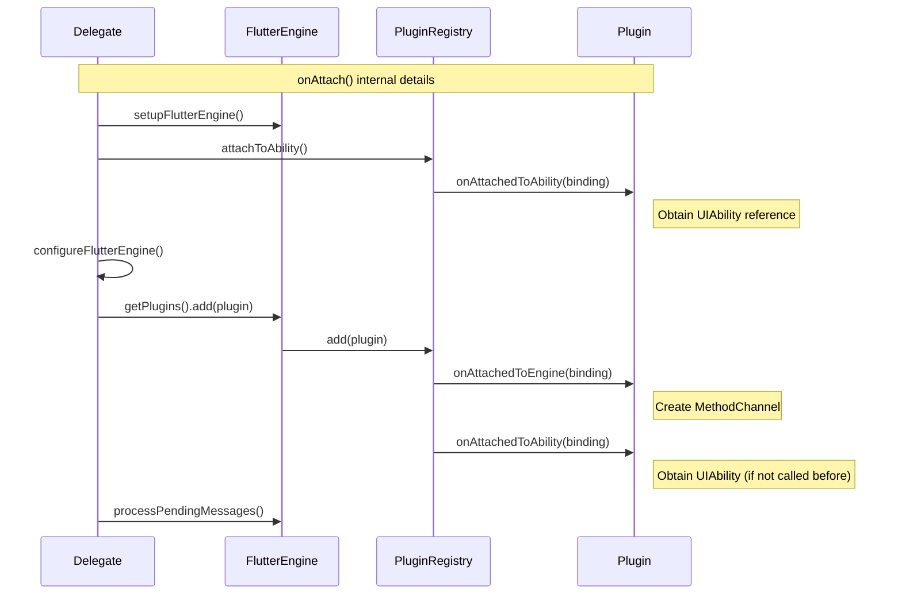

**Key point:** `attachToAbility()` is called **before** `configureFlutterEngine()`. This means already-registered AbilityAware plugins will receive `onAttachedToAbility` immediately upon `add()`. Newly registered plugins will also receive both callbacks during `add()`.

### 4.3 FlutterAbility Destruction Flow

```mermaid
sequenceDiagram
    participant Sys as System
    participant FA as FlutterAbility
    participant D as Delegate
    participant FE as FlutterEngine
    participant Plugin as Plugin

    Sys->>FA: onDestroy()
    FA->>D: onDetach()

    D->>FE: detachFromAbility()
    FE->>Plugin: onDetachedFromAbility()
    Note right of Plugin: Clear Ability reference

    D->>FA: cleanUpFlutterEngine()

    alt shouldDestroyEngineWithHost() == true
        D->>FE: destroy()
        FE->>Plugin: onDetachedFromEngine()
        Note right of Plugin: Clear MethodChannel
    else Using cached engine
        Note right of FE: Engine retained; not destroyed
    end

    D->>Dart: lifecycleChannel.appIsDetached()
```

**Key decision:** `shouldDestroyEngineWithHost()` determines whether the engine is destroyed with the host. It returns false when using a cached engine.

### 4.4 FlutterEntry Page-level Lifecycle

FlutterEntry's lifecycle is shorter and originates from ArkUI Page callbacks rather than UIAbility callbacks:

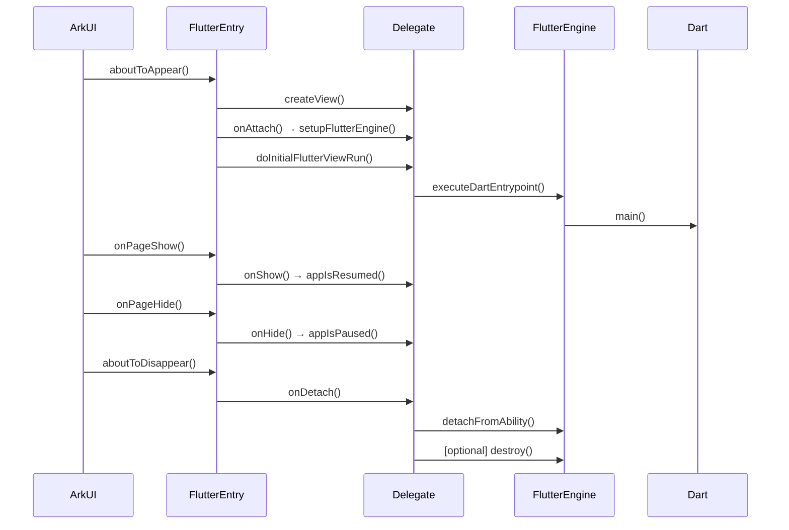

### 4.5 Flutter Lifecycle State Mapping

UIAbility state + window focus together determine the Flutter-side AppLifecycleState:

| UIAbility State | Window Focus | Flutter AppLifecycleState |
|---------------|---------|--------------------------|
| onCreate/onForeground | Focused | `resumed` |
| onCreate/onForeground | Unfocused | `inactive` |
| onBackground | Any | `paused` |
| onDestroy | Any | `detached` |

---

## 5. Plugin Registration Mechanism

### 5.1 Plugin Interface System

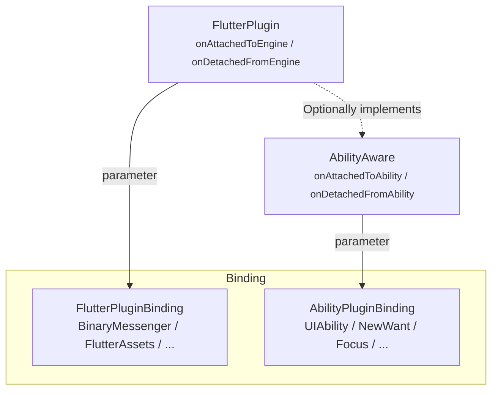

**FlutterPluginBinding (engine-level):** Provides `getBinaryMessenger()` (the core for creating MethodChannels), `getFlutterEngine()`, `getFlutterAssets()`, etc.

**AbilityPluginBinding (Ability-level):** Provides `getAbility()` (obtain the UIAbility instance), `addOnNewWantListener()`, `addOnWindowFocusChangedListener()`, etc.

### 5.2 Registration Flow

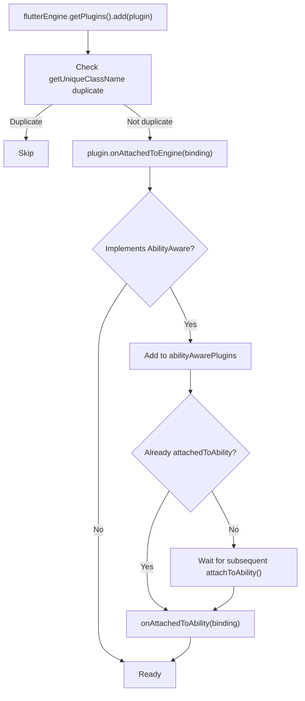

**Core: Create the MethodChannel in `onAttachedToEngine`:**

```typescript
onAttachedToEngine(binding: FlutterPluginBinding): void {
  const messenger = binding.getBinaryMessenger();
  this.methodChannel = new MethodChannel(messenger, "com.example/my_plugin");
  this.methodChannel.setMethodCallHandler(this.handleMethodCall.bind(this));
}
```

### 5.3 MethodChannel Message Flow

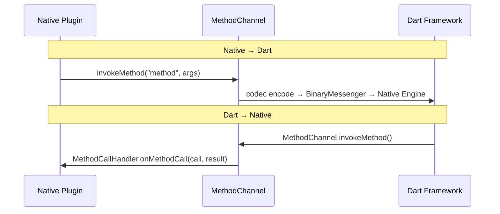

### 5.4 Plugin Destruction Flow

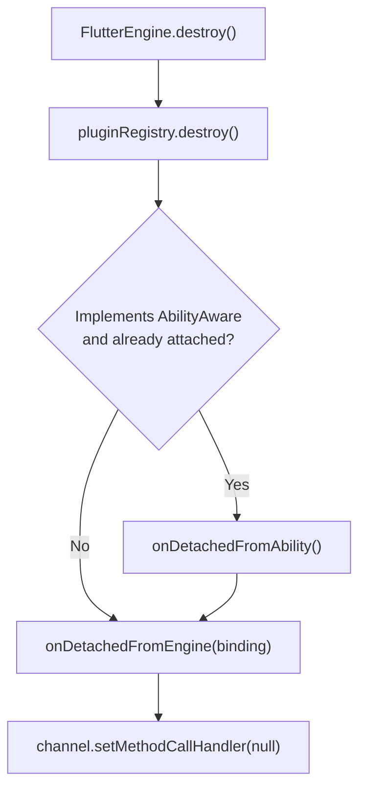

**Destruction order:** First `onDetachedFromAbility` (clear Ability reference), then `onDetachedFromEngine` (clear MethodChannel).

---

## 6. Multi-Engine Scenarios

### 6.1 Engine Group Working Mode

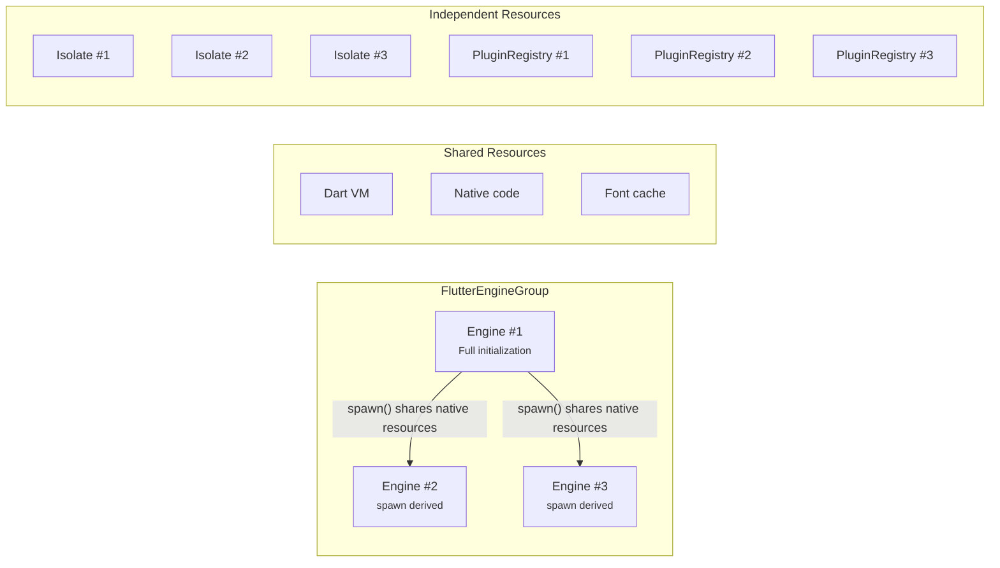

| Resource Type | Shared | Independent |
|---------|------|------|
| Dart VM / Native code / Font cache | Yes | |
| Dart Isolate / Plugin registry / System channels / Render state | | Yes |

### 6.2 First Engine vs. Subsequent Engines

**First engine:** Full initialization (`createEngine` + `init` + `executeDartEntrypoint`).

**Subsequent engines:** Derived via `spawn()`, sharing native resources but creating independent plugin registries and system channels.

```typescript
// First engine
engine = new FlutterEngine(context, null, null, null);
engine.init(context, null, waitForRestorationData);
engine.getDartExecutor().executeDartEntrypoint(dartEntrypoint);

// Subsequent engine (spawn)
engine = activeEngines[0].spawn(context, dartEntrypoint, initialRoute, ...);
// Inside spawn: create new FlutterNapi (shared resources), new FlutterEngine, new plugin registry
```

### 6.3 Multi-Engine Plugin Considerations

```typescript
// Wrong: sharing a plugin instance
const plugin = new MyPlugin();
engine1.getPlugins().add(plugin);
engine2.getPlugins().add(plugin);  // Same instance attached to two engines!

// Correct: new instance per engine
engine1.getPlugins().add(new MyPlugin());
engine2.getPlugins().add(new MyPlugin());
```

---

## 7. Code Walkthrough

### 7.1 FlutterAbility Standard Usage

After extending `FlutterAbility`, override `configureFlutterEngine()` to register plugins, and optionally override lifecycle callbacks:

```typescript
export class EntryAbility extends FlutterAbility {
  // Automatically called back after the engine is ready — the only correct place to register plugins
  configureFlutterEngine(flutterEngine: FlutterEngine) {
    super.configureFlutterEngine(flutterEngine);
    flutterEngine.getPlugins().add(new CorePlugin());
    flutterEngine.getPlugins().add(new MyAbilityPlugin());
  }

  // When overriding lifecycle methods, always call super, otherwise the Delegate won't receive the callback
  onCreate(want, launchParam) { super.onCreate(want, launchParam); }
  onForeground() { super.onForeground(); }
  onBackground() { super.onBackground(); }
  onDestroy() { super.onDestroy(); }
}
```

**Key point:** `FlutterAbility.onCreate()` does three things internally — creates the Delegate and calls `onAttach()` (which triggers engine creation and plugin registration), restores instance state, and registers a global error listener. Developer custom logic should run after `super.onCreate()`.

```typescript
onCreate(want: Want, launchParam: AbilityConstant.LaunchParam) {
  AppStorage.setOrCreate('fontSizeScale', this.context.config.fontSizeScale);
  FlutterManager.getInstance().pushUIAbility(this)       // Register with the global manager

  this.delegate = new FlutterAbilityAndEntryDelegate(this);
  this?.delegate?.onAttach(this.context);                 // Core: create engine + register plugins
  this?.delegate?.onRestoreInstanceState(want);           // State restoration

  if (this.stillAttachedForEvent("onWindowStageCreate")) {
    this?.delegate?.onWindowStageCreate();                // Execute Dart entry point
  }
}
```

**`stillAttachedForEvent()` defensive mechanism:** Before each lifecycle callback, it checks whether the delegate still exists — preventing operations on a released delegate in asynchronous scenarios.

---

### 7.2 FlutterEntry Add-to-App Usage

FlutterEntry is used to embed Flutter content into ArkUI pages. Unlike FlutterAbility, you **cannot override methods**; instead, configuration is injected via the `FlutterEngineConfigurator` callback:

```typescript
// 1. Implement the configurator
class MyConfigurator implements FlutterEngineConfigurator {
  configureFlutterEngine(engine: FlutterEngine) {
    engine.getPlugins().add(new MyPlugin());
  }
  cleanUpFlutterEngine(engine: FlutterEngine) {
    // Clean up resources
  }
}

// 2. Use in an ArkUI page
@Entry @Component
struct FlutterEmbedPage {
  private entry: FlutterEntry | null = null;

  aboutToAppear() {
    this.entry = new FlutterEntry(this.context);
    this.entry.setFlutterEngineConfigurator(new MyConfigurator()); // Set configurator first
    this.entry.aboutToAppear();                                    // Then initialize
  }

  build() {
    Column() {
      Text("Native Title").fontSize(20)
      if (this.entry) {
        FlutterViewBuilder(this.entry!.getFlutterView()!);  // Render the Flutter view
      }
    }
  }

  onPageShow()      { this.entry?.onPageShow(); }
  onPageHide()      { this.entry?.onPageHide(); }
  onBackPress()     { this.entry?.onBackPress(); return true; }
  aboutToDisappear() { this.entry?.aboutToDisappear(); }
}
```

**Key point:** FlutterEntry's `aboutToAppear()` execution order is `createView → onAttach → onWindowStageCreate`, more compact than FlutterAbility — all initialization is completed within a single synchronous callback of the ArkUI Page.

```typescript
aboutToAppear() {
  if (this.hasInit == false) {
    this.delegate = new FlutterAbilityAndEntryDelegate(this);
    this.flutterView = this.delegate?.createView(this.context);  // Create the view
    this.flutterView?.onWindowCreated();
    this?.delegate?.onAttach(this.context);                       // Create engine + register plugins
    this.delegate?.onWindowStageCreate();                         // Execute Dart entry
    this.hasInit = true;
    this.registerEnvironmentCallback();                           // Listen for configuration changes
  }
}
```

**registerEnvironmentCallback:** Registers an `EnvironmentCallback` to listen for system configuration changes (font, language, dark mode) and forward them to the Flutter engine. This is unique to FlutterEntry — FlutterAbility implements the same functionality via the `onConfigurationUpdate` callback.

---

### 7.3 Complete Plugin Implementation

```typescript
export class MyPlugin implements FlutterPlugin, AbilityAware {
  private static readonly CHANNEL = "com.example/my_plugin";
  private channel: MethodChannel | null = null;
  private ability: UIAbility | null = null;

  getUniqueClassName(): string { return "com.example.MyPlugin"; }

  // ===== Engine attach → create MethodChannel =====
  onAttachedToEngine(binding: FlutterPluginBinding): void {
    // binding.getBinaryMessenger() returns DartExecutor, the foundation of all message channels
    this.channel = new MethodChannel(binding.getBinaryMessenger(), MyPlugin.CHANNEL);
    this.channel.setMethodCallHandler((call, result) => {
      switch (call.method) {
        case "getPlatform":
          result.success("OHOS");
          break;
        case "startAbility":
          // Methods that operate on UIAbility must check whether ability is attached
          if (!this.ability) {
            result.error("NO_ABILITY", "Plugin not attached to Ability", null);
            return;
          }
          this.ability.context.startAbility(call.arguments);
          result.success(true);
          break;
        default:
          result.notImplemented();
      }
    });
  }

  onDetachedFromEngine(binding: FlutterPluginBinding): void {
    this.channel?.setMethodCallHandler(null);  // Clear the handler to prevent dangling pointers
    this.channel = null;
  }

  // ===== Ability attach → obtain UIAbility reference =====
  onAttachedToAbility(binding: AbilityPluginBinding): void {
    this.ability = binding.getAbility();

    // Optional: register NewWant listener (handle deep links, scheme redirects)
    binding.addOnNewWantListener((want, launchParams) => {
      if (want.uri) {
        this.channel?.invokeMethod("onNewWant", { uri: want.uri });
      }
    });

    // Optional: register window focus listener
    binding.addOnWindowFocusChangedListener((hasFocus: boolean) => {
      this.channel?.invokeMethod("onFocusChanged", { hasFocus });
    });
  }

  onDetachedFromAbility(): void {
    this.ability = null;  // Must clear the reference, otherwise UIAbility cannot be garbage collected
  }
}
```

---

### 7.4 Delegate onAttach/onDetach Flow

The Delegate is the most critical class in the coordination layer. Understanding the actual execution logic of its `onAttach` and `onDetach` is essential for troubleshooting issues.

**onAttach() complete steps:**

```typescript
onAttach(context: common.Context) {
  this.context = context;
  this.ensureAlive();

  // 1. Create/obtain engine (4-level priority strategy)
  if (this.flutterEngine == null) {
    this.setupFlutterEngine();
  }

  // 2. Attach the engine to the Ability (notify AbilityAware plugins)
  if (this.host?.shouldAttachEngineToAbility()) {
    this.flutterEngine?.getAbilityControlSurface()?.attachToAbility(this);
  }

  // 3. Create PlatformPlugin (handle back key, system UI, etc.)
  this.platformPlugin = this.host?.providePlatformPlugin(this.flutterEngine!)

  // 4. Create SensitiveContentPlugin (handle sensitive content screenshot/screen recording)
  this.sensitiveContentPlugin = this.host?.provideSensitiveContentPlugin(this.flutterEngine!)

  // 5. Attach FlutterView to the engine
  if (this.flutterEngine && this.flutterView && this.host?.attachToEngineAutomatically()) {
    this.flutterView.attachToFlutterEngine(this.flutterEngine!!);
  }

  // 6. Call configureFlutterEngine() — developer plugin registration happens here
  this.host?.configureFlutterEngine(this.flutterEngine!!);

  // 7. Process messages queued during engine creation
  if (this.flutterEngine) {
    this.flutterEngine.processPendingMessages();
  }
}
```

**Key timing:** `attachToAbility` executes before `configureFlutterEngine`. This means that when `getPlugins().add(plugin)` is called within `configureFlutterEngine()`, the engine is already attached to the Ability, and the plugin will receive both `onAttachedToEngine` and `onAttachedToAbility` callbacks simultaneously.

**onDetach() complete steps:**

```typescript
onDetach() {
  // 1. Notify plugins to detach from the Ability
  if (this.host?.shouldAttachEngineToAbility()) {
    this.flutterEngine?.getAbilityControlSurface()?.detachFromAbility();
  }

  // 2. Detach the view from the engine
  this.flutterView?.detachFromFlutterEngine();

  // 3. Call cleanUpFlutterEngine() — developers can override this
  this.host?.cleanUpFlutterEngine(this.flutterEngine!!);

  // 4. Notify the Flutter side of detached
  if (this.host?.shouldDispatchAppLifecycleState() && this.flutterEngine != null) {
    this.flutterEngine?.getLifecycleChannel()?.appIsDetached();
  }

  // 5. Destroy PlatformPlugin and SensitiveContentPlugin
  if (this.platformPlugin) { this.platformPlugin.destroy(); }
  if (this.sensitiveContentPlugin) { this.sensitiveContentPlugin.destroy(); }

  // 6. Decide whether to destroy the engine based on configuration
  if (this.host?.shouldDestroyEngineWithHost()) {
    this.flutterEngine?.destroy();
    // If it's a cached engine, remove it from the cache
    if (this.host.getCachedEngineId() != null && this.host.getCachedEngineId().length > 0) {
      FlutterEngineCache.getInstance().remove(this.host.getCachedEngineId());
    }
    this.flutterEngine = null;
  }

  this.isAttached = false;
}
```

---

### 7.5 Plugin Registry add Internal Implementation

Understanding the internal logic of `add` helps troubleshoot "plugin registration ineffective" issues:

```typescript
add(plugin: FlutterPlugin): void {
  // 1. Deduplicate by className — return immediately on duplicate
  if (this.has(plugin.getUniqueClassName())) {
    Log.w(TAG, "Attempted to register plugin (" + plugin + ") but already registered.");
    return;
  }

  // 2. Store in the general plugin table; callback onAttachedToEngine
  this.plugins.set(plugin.getUniqueClassName(), plugin);
  plugin.onAttachedToEngine(this.pluginBinding);

  // 3. Reflectively check whether AbilityAware is implemented (check whether the onAttachedToAbility method exists)
  if (ToolUtils.implementsInterface(plugin, "onAttachedToAbility")) {
    this.abilityAwarePlugins.set(plugin.getUniqueClassName(), plugin);

    // 4. If currently attached to the Ability, immediately callback onAttachedToAbility
    if (this.isAttachedToAbility()) {
      plugin.onAttachedToAbility(this.abilityPluginBinding);
    }
    // Otherwise, wait for the subsequent attachToAbility() call to notify uniformly
  }
}
```

**Three key points:**

1. **Deduplication mechanism:** `has()` looks up the Map by `getUniqueClassName()`, so the className must be globally unique.
2. **Reflective check:** `ToolUtils.implementsInterface(plugin, "onAttachedToAbility")` essentially checks whether a method named `"onAttachedToAbility"` exists on the object. Merely writing the method is not enough — you must `implements AbilityAware`.
3. **Immediate notification:** If the engine is already attached to an Ability (`isAttachedToAbility() == true`), a newly registered AbilityAware plugin will receive the `onAttachedToAbility` callback **immediately**, without waiting.

---

### 7.6 Multi-Engine Pre-warming and Caching

**FlutterEngineGroup.createAndRunEngineByOptions() logic:**

```typescript
createAndRunEngineByOptions(options: Options) {
  if (this.activeEngines.length == 0) {
    // First engine: full initialization
    engine = this.createEngine(context, platformViewsController);
    engine.init(context, null, waitForRestorationData);
    engine.getNavigationChannel()?.setInitialRoute(initialRoute);
    engine.getDartExecutor().executeDartEntrypoint(dartEntrypoint, dartEntrypointArgs);
    engine.prefetchFramesCfg();
  } else {
    // Subsequent engines: spawn from the first engine, sharing native resources
    engine = this.activeEngines[0].spawn(
      context, dartEntrypoint, initialRoute,
      dartEntrypointArgs, platformViewsController, waitForRestorationData);
  }

  // Register a lifecycle listener — automatically removed from the active list when the engine is destroyed
  let listener = new EngineLifecycleListenerImpl(..., engine);
  engine?.addEngineLifecycleListener(listener);
  return engine;
}
```

**Pre-warming usage example:**

```typescript
// Scenario: pre-warm the engine group at app startup, then quickly use it on subsequent pages
import FlutterEngineGroup, { Options } from '@ohos/flutter_ohos/FlutterEngineGroup';
import { FlutterEngineGroupCache } from '@ohos/flutter_ohos/FlutterEngineGroupCache';
import { FlutterEngineCache } from '@ohos/flutter_ohos/FlutterEngineCache';
import { DartEntrypoint } from '@ohos/flutter_ohos/DartExecutor';

// 1. Pre-warm during App initialization
static preInit(context: Context) {
  const group = new FlutterEngineGroup();
  group.checkLoader(context, []);
  FlutterEngineGroupCache.instance.put("main_group", group);

  // Optional: pre-warm the first engine (execute Dart main() in advance)
  const engine = group.createAndRunEngineByOptions(
    new Options(context)
      .setDartEntrypoint(DartEntrypoint.createDefault())
      .setInitialRoute("/")
  );
  FlutterEngineCache.getInstance().put("warm_engine", engine);
}

// 2. FlutterAbility uses a cached engine (hot start, no re-initialization needed)
class HotStartAbility extends FlutterAbility {
  getCachedEngineId(): string { return "warm_engine"; }
  shouldDestroyEngineWithHost(): boolean { return false; }  // Cached engine is not destroyed with the host
}

// 3. FlutterEntry uses the engine group (Add-to-App multi-page scenario)
const entry = new FlutterEntry(this.context, {
  "cached_engine_group_id": "main_group",   // Create a new engine from the engine group
  "initial_route": "/detail",               // Specify the initial route
});
```

**FlutterEnginePreload advanced pre-warming:** Supports pre-rendering the first frame before the UI is displayed, further reducing blank-screen time:

```typescript
// Pre-render: called after engine creation and before FlutterView display
FlutterEnginePreload.predrawEngine(engine, {
  // Optional: custom viewport size (defaults to screen size)
  "preload_viewport_metrics": customViewportMetrics
}, "next_view_id");
```

---

### 7.7 Configuration Change Handling

When system configuration such as font, language, or dark mode changes, the Flutter side must be notified in real time. The two hosts implement this differently:

**FlutterAbility — via the `onConfigurationUpdate` callback:**

```typescript
onConfigurationUpdate(config: Configuration) {
  // 1. Send system settings to Flutter via SettingsChannel
  this?.delegate?.flutterEngine?.getSettingsChannel()?.startMessage()
    .setAlwaysUse24HourFormat(I18n.System.is24HourClock())
    .setPlatformBrightness(config.colorMode != ConfigurationConstant.ColorMode.COLOR_MODE_DARK
      ? PlatformBrightness.LIGHT : PlatformBrightness.DARK)
    .setTextScaleFactor(config.fontSizeScale == undefined ? 1.0 : config.fontSizeScale)
    .send();

  // 2. Set the font weight scale
  this.delegate?.getFlutterNapi()?.setFontWeightScale(
    config.fontWeightScale == undefined ? 0 : config.fontWeightScale);

  // 3. When language changes, resend localization information
  if (config.language != '') {
    this.getFlutterEngine()?.getLocalizationPlugin()?.sendLocaleToFlutter();
  }

  // 4. Check and reload fonts
  this?.delegate?.onCheckAndReloadFont();
}
```

**FlutterEntry — via `EnvironmentCallback`:** The logic is identical, but it is registered via `applicationContext.on('environment', callback)` because a Page does not have an `onConfigurationUpdate` callback.

---

### 7.8 Engine Destruction and Resource Cleanup

The engine destruction call chain and cleanup order:

```typescript
// FlutterEngine.destroy() call chain
destroy(): void {
  // 1. Notify listeners that the engine is about to be destroyed
  this.engineLifecycleListeners.forEach(l => l.onEngineWillDestroy());

  // 2. Detach from the Ability (notify plugins onDetachedFromAbility)
  this.pluginRegistry?.detachFromAbility();

  // 3. Platform views controller detach
  this.platformViewsController?.onDetachedFromNapi();

  // 4. Destroy the plugin registry (notify plugins onDetachedFromEngine)
  this.pluginRegistry?.destroy();

  // 5. DartExecutor detach
  this.dartExecutor.onDetachedFromNAPI();

  // 6. Release native engine resources
  this.flutterNapi.detachFromNativeAndReleaseResources();
}
```

```typescript
destroy(): void {
  this.detachFromAppComponent();  // Detach from Ability first (→ onDetachedFromAbility)
  this.removeAll();               // Then remove all plugins (→ onDetachedFromEngine)
}
```

**Destruction order:** `onDetachedFromAbility` → `onDetachedFromEngine`. If a plugin holds both Ability references and MethodChannel resources, they should be cleaned up in their respective callbacks.
