# 核心对象架构原理说明

---

## 概述

本文档解析了 Flutter 在OHOS平台的五个核心对象（FlutterAbility、FlutterEntry、Delegate、FlutterEngine、FlutterView）的职责与协作关系，覆盖生命周期协同、插件注册机制、多 Engine 场景差异，旨在帮助开发者快速建立全局认知，定位插件适配问题。

---

## 1. 核心对象

五个对象按层级分布：

| 对象 | 层级 | 一句话职责 |
|------|------|-----------|
| **FlutterAbility** | 宿主层（UIAbility） | 纯 Flutter 应用的入口 Ability，转发 UIAbility 生命周期 |
| **FlutterEntry** | 宿主层（Page） | Add-to-App 场景的页面级入口，嵌入 ArkUI 页面 |
| **Delegate** | 协调层 | 连接宿主与引擎，管理引擎创建/销毁/生命周期转发 |
| **FlutterEngine** | 引擎层 | Flutter 执行环境：Dart VM、系统通道、插件注册表 |
| **FlutterView** | 视图层 | 渲染容器：视口管理、输入处理、平台视图 |

> 两个宿主（FlutterAbility / FlutterEntry）共享同一套 Delegate + Engine + View 协作机制，区别仅在于生命周期来源不同。

---

## 2. 整体架构关系

下图展示五个核心对象的 ownership 与协作方向。

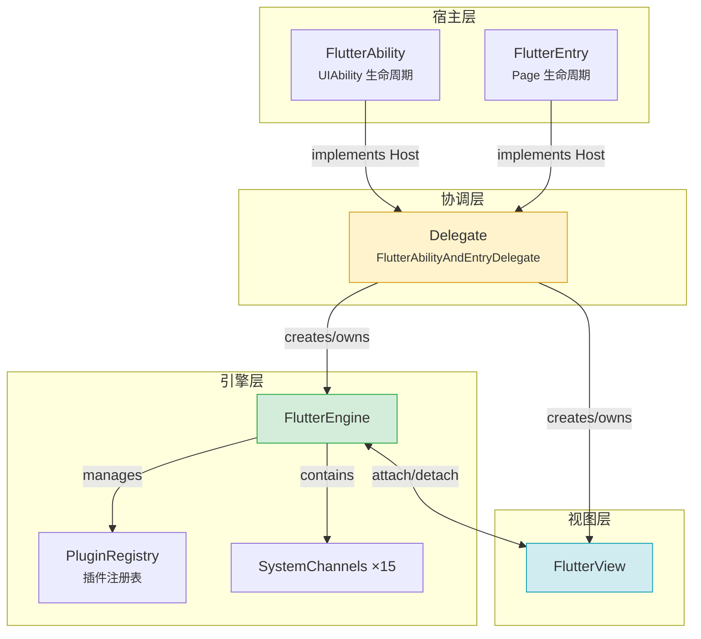

**要点：** FlutterAbility 和 FlutterEntry 是平行的两种宿主，都通过 Host 接口与 Delegate 交互。Delegate 是唯一创建和管理 Engine、View 的角色。

---

## 3. 各对象职责

### 3.1 FlutterAbility  UIAbility 级宿主

继承自 OHOS 的 `UIAbility`，作为纯 Flutter 应用的入口。核心职责是转发 UIAbility 生命周期回调到 Delegate。

**关键属性：**

```ts
export class FlutterAbility extends UIAbility implements Host {
  private delegate?: FlutterAbilityAndEntryDelegate | null;
  private flutterView: FlutterView | null = null;
  private mainWindow?: window.Window | null;
}
```

**生命周期转发一览：**

| UIAbility 回调 | 转发到 Delegate | 实际作用 |
|----------------|----------------|---------|
| `onCreate()` | `onAttach()` | 创建引擎、附着到 Ability |
| `onWindowStageCreate()` | `createView()` + `doInitialFlutterViewRun()` | 创建视图、执行 Dart 入口 |
| `onForeground()` | `onShow()` | 通知 Flutter 前台 (resumed) |
| `onBackground()` | `onHide()` | 通知 Flutter 后台 (paused) |
| `onDestroy()` | `onDetach()` | 分离插件、可选销毁引擎 |

**可重写的钩子（Host 接口）：**

| 方法 | 默认行为 | 典型用途 |
|------|---------|---------|
| `configureFlutterEngine(engine)` | 空 | **注册插件** |
| `provideFlutterEngine(context)` | 返回 null | 提供自定义引擎 |
| `getCachedEngineId()` | 空字符串 | 使用预热缓存引擎 |
| `shouldDestroyEngineWithHost()` | 缓存引擎=false，否则=true | 控制引擎随宿主销毁 |

---

### 3.2 FlutterEntry   Page 级宿主（Add-to-App）

用于在现有OHOS应用中嵌入 Flutter 内容（非全屏场景），作为 ArkUI 页面组件的入口。

**与 FlutterAbility 的关键差异：**

| 对比维度 | FlutterAbility | FlutterEntry |
|---------|----------------|--------------|
| 宿主类型 | UIAbility（应用级） | Page（页面级） |
| 适用场景 | 纯 Flutter 应用 | 混合开发，Flutter 嵌入原生页面 |
| 生命周期来源 | UIAbility 标准回调 | ArkUI Page 回调 |
| 插件注册方式 | 重写 `configureFlutterEngine()` | 通过 `FlutterEngineConfigurator` |

**FlutterEntry 生命周期转发：**

| Page 回调 | 转发到 Delegate |
|-----------|----------------|
| `aboutToAppear()` | `createView()` + `onAttach()` |
| `onPageShow()` | `onShow()` |
| `onPageHide()` | `onHide()` |
| `aboutToDisappear()` | `onDetach()` |

---

### 3.3 Delegate  协调者

`FlutterAbilityAndEntryDelegate` 是两个宿主共享的核心协调者，职责：创建/获取引擎、管理视图、转发生命周期。

**引擎选择策略（setupFlutterEngine 按优先级执行）：**

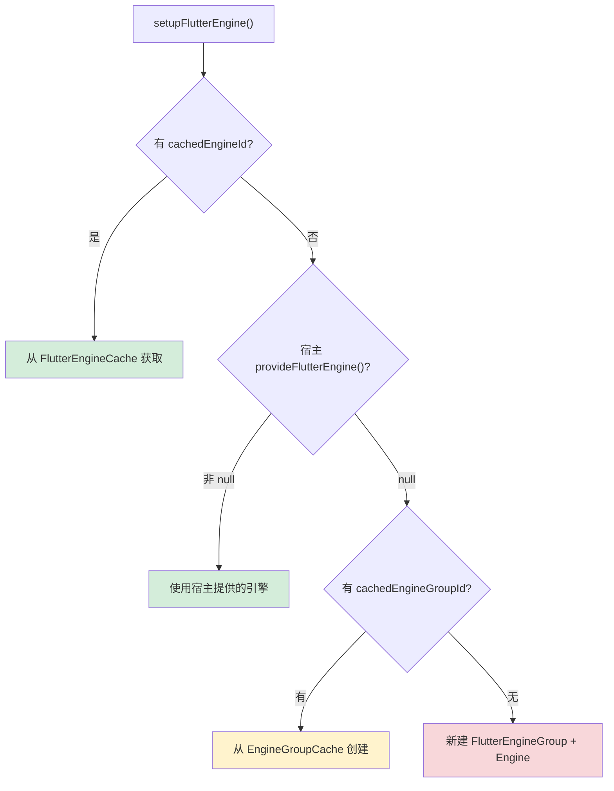

| 优先级 | 策略 | 典型场景 |
|--------|------|---------|
| 1 | FlutterEngineCache | 预热引擎、热启动 |
| 2 | `provideFlutterEngine()` | 自定义引擎管理 |
| 3 | FlutterEngineGroupCache | 多引擎 Add-to-App |
| 4 | 新建 EngineGroup | 默认首次启动 |

---

### 3.4 FlutterEngine  执行引擎

单个 Flutter 执行环境的容器，持有 Dart 执行器、系统通道、插件注册表。

**内部组成概览：**

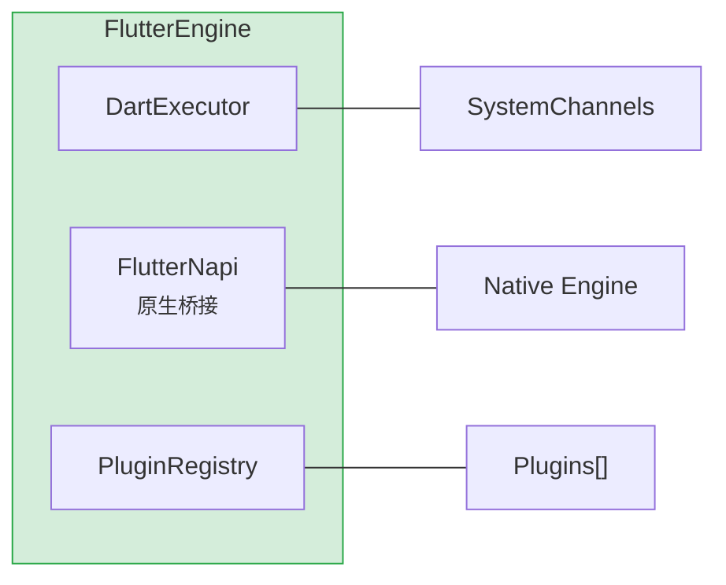

**要点：** FlutterEngine 内部由 DartExecutor、FlutterNapi、PluginRegistry 三部分组成，分别负责 Dart 代码执行、原生桥接和插件管理。

**引擎初始化（`init()`）核心步骤：**

```ts
init(context, dartVmArgs, waitForRestorationData) {
  // 1. 确保FlutterLoader初始化
  this.flutterLoader.ensureInitializationComplete(dartVmArgs);

  // 2. 创建15个系统通道（lifecycle, navigation, textInput, platform...）
  this.lifecycleChannel = new LifecycleChannel(this.dartExecutor);
  this.navigationChannel = new NavigationChannel(this.dartExecutor, context);
  // ... 其余13个通道

  // 3. 附着到原生引擎
  this.attachToNapi();

  // 4. 创建插件注册表
  this.pluginRegistry = new FlutterEngineConnectionRegistry(context, this, loader);
}
```

**引擎销毁（`destroy()`）核心步骤：**

```ts
destroy(): void {
  this.engineLifecycleListeners.forEach(l => l.onEngineWillDestroy());
  this.pluginRegistry?.detachFromAbility();   // 通知插件 onDetachedFromAbility
  this.pluginRegistry?.destroy();             // 通知插件 onDetachedFromEngine
  this.dartExecutor.onDetachedFromNAPI();
  this.flutterNapi.detachFromNativeAndReleaseResources();
}
```

---

### 3.5 FlutterView  渲染视图

Flutter 内容的视觉容器，管理视口指标、输入事件（键盘/鼠标/触摸）、系统避让区。

**附着引擎的关键步骤（`attachToFlutterEngine()`）：**

```ts
attachToFlutterEngine(flutterEngine: FlutterEngine): void {
  // 1. 保存引擎引用，原生层附着
  this.flutterEngine = flutterEngine;
  flutterEngine.getFlutterNapi().xComponentAttachFlutterEngine(this.id);

  // 2. 更新显示参数（刷新率/尺寸/DPI）
  flutterEngine.getFlutterNapi().updateRefreshRate(...);
  flutterEngine.getFlutterNapi().updateSize(...);

  // 3. 初始化输入插件
  this.mouseCursorPlugin = new MouseCursorPlugin(...);
  this.textInputPlugin = new TextInputPlugin(...);
  this.keyboardManager = new KeyboardManager(flutterEngine, this.textInputPlugin);

  // 4. 更新视口指标
  this.onAreaChange(newArea, true);
}
```

**视口指标（ViewportMetrics）：** 管理 `devicePixelRatio`、物理宽高、安全区 Padding、键盘 Insets、折叠屏 DisplayFeature 等。

---

## 4. 生命周期时序

### 4.1 FlutterAbility 启动流程

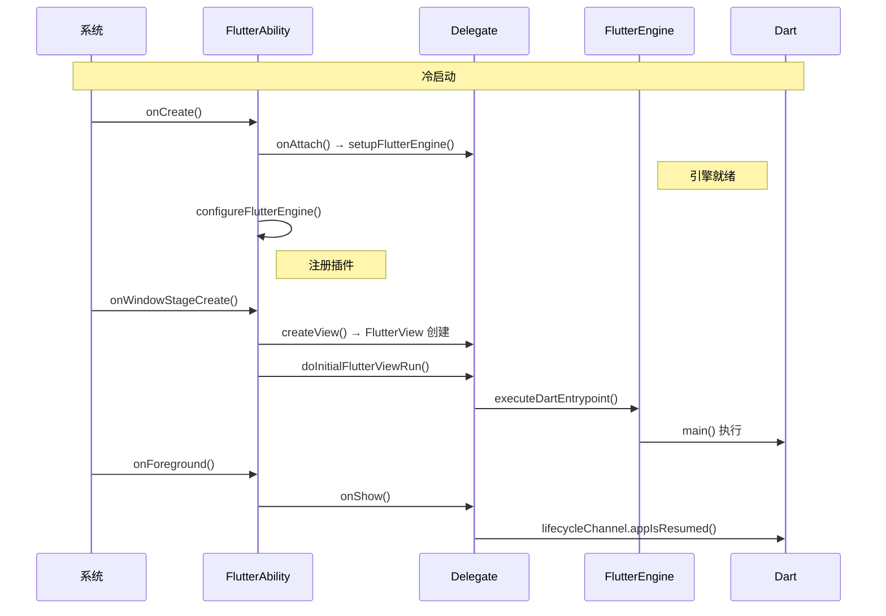

**三个阶段：** 引擎就绪 → 视图创建 + Dart 执行 → 前台显示。`configureFlutterEngine()` 在引擎就绪后立即调用，是插件注册的标准时机。

### 4.2 启动细节补充

上图省略了插件附着和 Ability 绑定过程，下图补充这部分细节：

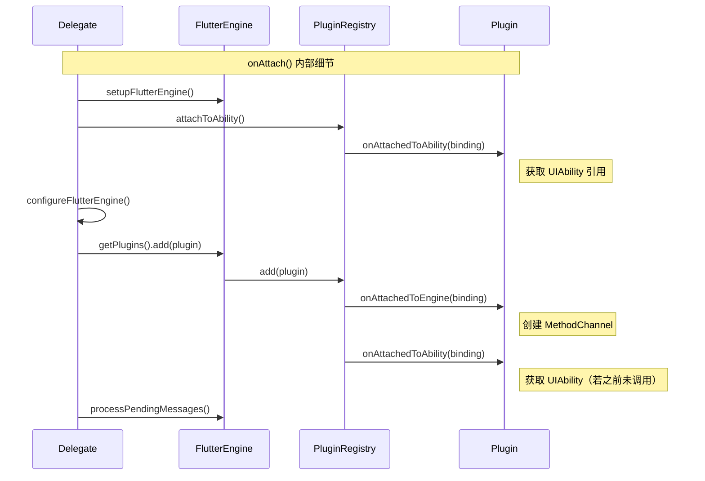

**要点：** `attachToAbility()` 在 `configureFlutterEngine()` **之前**调用，这意味着已注册的 AbilityAware 插件会在 `add()` 时立即收到 `onAttachedToAbility`。新注册的插件也会在 `add()` 中同时收到两个回调。

### 4.3 FlutterAbility 销毁流程

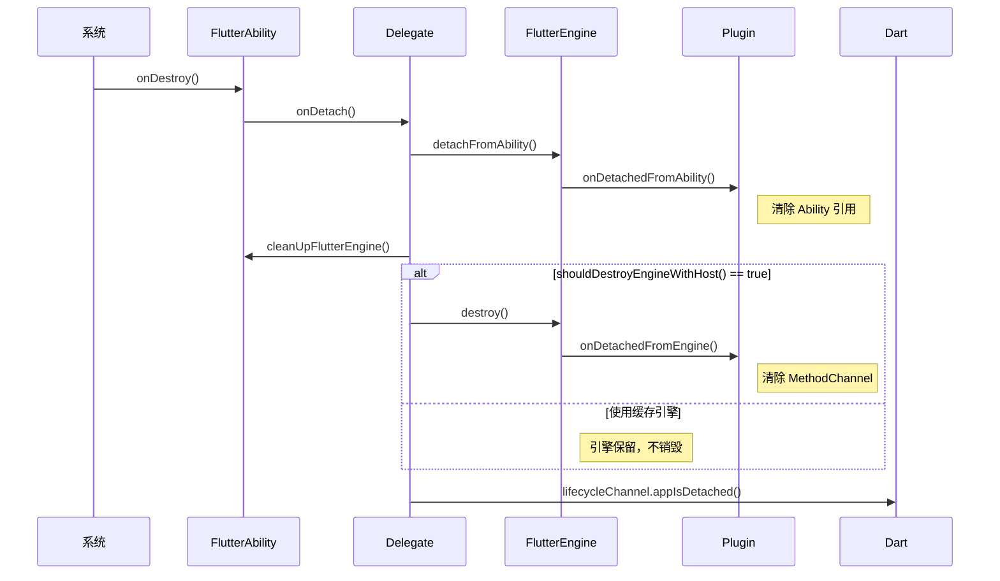

**关键判断：** `shouldDestroyEngineWithHost()` 决定引擎是否随宿主销毁。使用缓存引擎时返回 false。

### 4.4 FlutterEntry 页面级生命周期

FlutterEntry 的生命周期更简短，来源是 ArkUI Page 回调而非 UIAbility 回调：

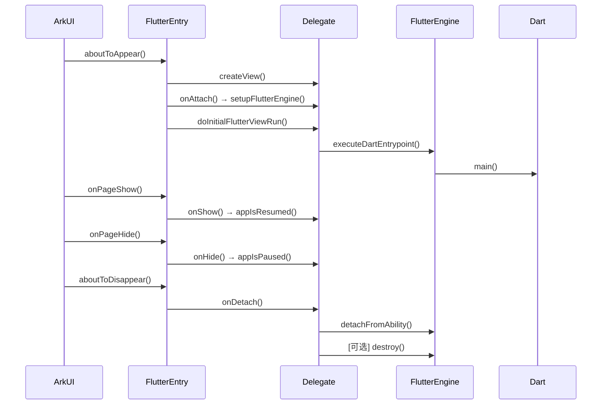

### 4.5 Flutter 生命周期状态映射

UIAbility 状态 + 窗口焦点 共同决定 Flutter 侧的 AppLifecycleState：

| UIAbility 状态 | 窗口焦点 | Flutter AppLifecycleState |
|---------------|---------|--------------------------|
| onCreate/onForeground | 有焦点 | `resumed` |
| onCreate/onForeground | 无焦点 | `inactive` |
| onBackground | 任意 | `paused` |
| onDestroy | 任意 | `detached` |

---

## 5. 插件注册机制

### 5.1 插件接口体系

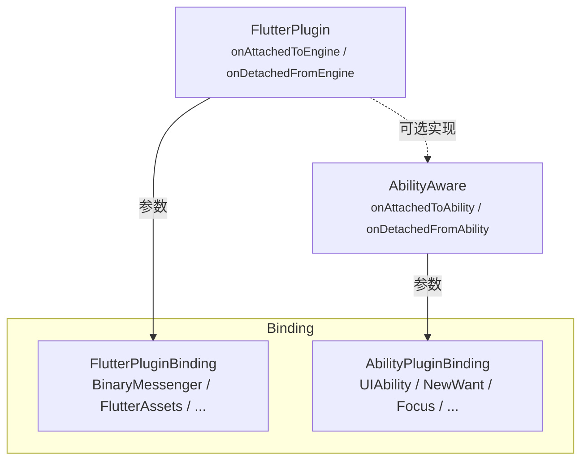

**FlutterPluginBinding（引擎级）：** 提供 `getBinaryMessenger()`（创建 MethodChannel 的核心）、`getFlutterEngine()`、`getFlutterAssets()` 等。

**AbilityPluginBinding（Ability 级）：** 提供 `getAbility()`（获取 UIAbility 实例）、`addOnNewWantListener()`、`addOnWindowFocusChangedListener()` 等。

### 5.2 注册流程

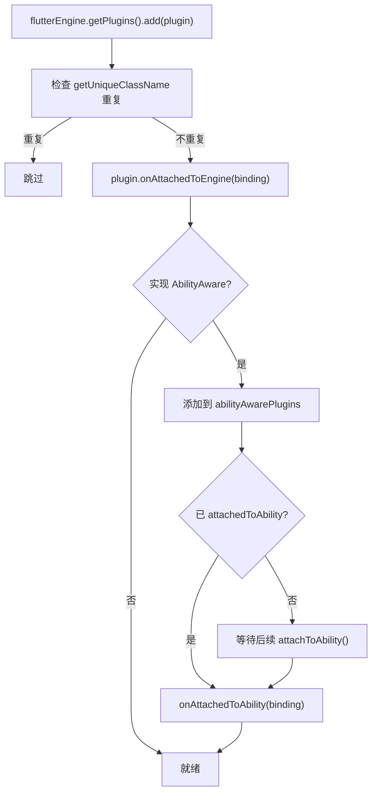

**核心：在 `onAttachedToEngine` 中创建 MethodChannel：**

```ts
onAttachedToEngine(binding: FlutterPluginBinding): void {
  const messenger = binding.getBinaryMessenger();
  this.methodChannel = new MethodChannel(messenger, "com.example/my_plugin");
  this.methodChannel.setMethodCallHandler(this.handleMethodCall.bind(this));
}
```

### 5.3 MethodChannel 消息流向

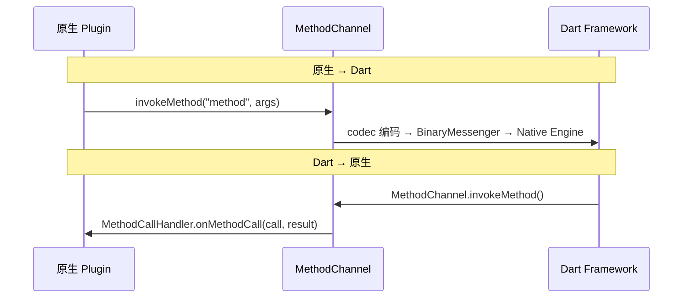

### 5.4 插件销毁流程

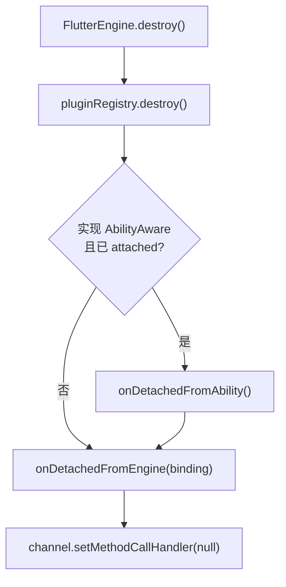

> [!NOTE]
> 销毁顺序：先 `onDetachedFromAbility`（清除 Ability 引用），再 `onDetachedFromEngine`（清除 MethodChannel）。

---

## 6. 多 Engine 场景

### 6.1 引擎组工作模式

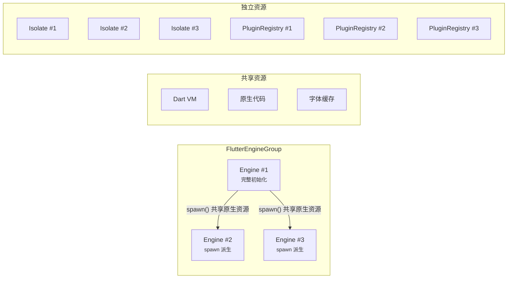

| 资源类型 | 是否共享 | 是否独立 |
|---------|------|------|
| Dart VM / 原生代码 / 字体缓存 | 是 | |
| Dart Isolate / 插件注册表 / 系统通道 / 渲染状态 | | 是 |

### 6.2 第一个引擎 vs 后续引擎

**第一个引擎：** 完整初始化（`createEngine` + `init` + `executeDartEntrypoint`）。

**后续引擎：** 通过 `spawn()` 派生，共享原生资源但创建独立的插件注册表和系统通道。

```ts
// 第一个引擎
engine = new FlutterEngine(context, null, null, null);
engine.init(context, null, waitForRestorationData);
engine.getDartExecutor().executeDartEntrypoint(dartEntrypoint);

// 后续引擎（spawn）
engine = activeEngines[0].spawn(context, dartEntrypoint, initialRoute, ...);
// spawn 内部：创建新 FlutterNapi（共享资源）、新 FlutterEngine、新插件注册表
```

### 6.3 多引擎插件注意事项

```ts
// 错误：共享插件实例
const plugin = new MyPlugin();
engine1.getPlugins().add(plugin);
engine2.getPlugins().add(plugin);  // 同一实例挂两个引擎！

// 正确：每个引擎新实例
engine1.getPlugins().add(new MyPlugin());
engine2.getPlugins().add(new MyPlugin());
```

---

## 7. 代码详解

### 7.1 FlutterAbility 标准用法

继承 `FlutterAbility` 后，重写 `configureFlutterEngine()` 注册插件，以及生命周期回调（可选）：

```ts
export class EntryAbility extends FlutterAbility {
  // 引擎就绪后自动回调——注册插件的唯一正确位置
  configureFlutterEngine(flutterEngine: FlutterEngine) {
    super.configureFlutterEngine(flutterEngine);
    flutterEngine.getPlugins().add(new CorePlugin());
    flutterEngine.getPlugins().add(new MyAbilityPlugin());
  }

  // 重写生命周期时务必调用 super，否则 Delegate 收不到回调
  onCreate(want, launchParam) { super.onCreate(want, launchParam); }
  onForeground() { super.onForeground(); }
  onBackground() { super.onBackground(); }
  onDestroy() { super.onDestroy(); }
}
```

**要点：** `FlutterAbility.onCreate()` 内部做了三件事——创建 Delegate 并调用 `onAttach()`（触发引擎创建和插件注册）、恢复实例状态、注册全局错误监听器。开发者的自定义逻辑应在 `super.onCreate()` 之后执行。

```ts
onCreate(want: Want, launchParam: AbilityConstant.LaunchParam) {
  AppStorage.setOrCreate('fontSizeScale', this.context.config.fontSizeScale);
  FlutterManager.getInstance().pushUIAbility(this)       // 注册到全局管理器

  this.delegate = new FlutterAbilityAndEntryDelegate(this);
  this?.delegate?.onAttach(this.context);                 // 核心：创建引擎 + 注册插件
  this?.delegate?.onRestoreInstanceState(want);           // 状态恢复

  if (this.stillAttachedForEvent("onWindowStageCreate")) {
    this?.delegate?.onWindowStageCreate();                // 执行 Dart 入口点
  }
}
```

**`stillAttachedForEvent()` 防御机制：** 每次生命周期回调前都检查 delegate 是否还在——防止异步场景下操作已释放的 delegate。

---

### 7.2 FlutterEntry Add-to-App 用法

FlutterEntry 用于将 Flutter 内容嵌入 ArkUI 页面。与 FlutterAbility 的区别在于：**不能重写方法**，而是通过 `FlutterEngineConfigurator` 回调注入配置：

```ts
// 1. 实现配置器
class MyConfigurator implements FlutterEngineConfigurator {
  configureFlutterEngine(engine: FlutterEngine) {
    engine.getPlugins().add(new MyPlugin());
  }
  cleanUpFlutterEngine(engine: FlutterEngine) {
    // 清理资源
  }
}

// 2. ArkUI 页面中使用
@Entry @Component
struct FlutterEmbedPage {
  private entry: FlutterEntry | null = null;

  aboutToAppear() {
    this.entry = new FlutterEntry(this.context);
    this.entry.setFlutterEngineConfigurator(new MyConfigurator()); // 先设配置器
    this.entry.aboutToAppear();                                    // 再初始化
  }

  build() {
    Column() {
      Text("原生标题").fontSize(20)
      if (this.entry) {
        FlutterViewBuilder(this.entry!.getFlutterView()!);  // 渲染 Flutter 视图
      }
    }
  }

  onPageShow()      { this.entry?.onPageShow(); }
  onPageHide()      { this.entry?.onPageHide(); }
  onBackPress()     { this.entry?.onBackPress(); return true; }
  aboutToDisappear() { this.entry?.aboutToDisappear(); }
}
```

**要点：** FlutterEntry 的 `aboutToAppear()`执行顺序是 `createView → onAttach → onWindowStageCreate`，比 FlutterAbility 更紧凑——在 ArkUI Page 的一个同步回调中完成全部初始化。

```ts
aboutToAppear() {
  if (this.hasInit == false) {
    this.delegate = new FlutterAbilityAndEntryDelegate(this);
    this.flutterView = this.delegate?.createView(this.context);  // 创建视图
    this.flutterView?.onWindowCreated();
    this?.delegate?.onAttach(this.context);                       // 创建引擎 + 插件注册
    this.delegate?.onWindowStageCreate();                         // 执行 Dart 入口
    this.hasInit = true;
    this.registerEnvironmentCallback();                           // 监听配置变更
  }
}
```

**registerEnvironmentCallback**： 注册 `EnvironmentCallback` 监听系统配置变更（字体、语言、深色模式），并转发给 Flutter 引擎。这是 FlutterEntry 独有的——FlutterAbility 通过 `onConfigurationUpdate` 回调实现同样功能。

---

### 7.3 完整插件实现

```ts
export class MyPlugin implements FlutterPlugin, AbilityAware {
  private static readonly CHANNEL = "com.example/my_plugin";
  private channel: MethodChannel | null = null;
  private ability: UIAbility | null = null;

  getUniqueClassName(): string { return "com.example.MyPlugin"; }

  // ===== 引擎附着 → 创建 MethodChannel =====
  onAttachedToEngine(binding: FlutterPluginBinding): void {
    // binding.getBinaryMessenger() 返回 DartExecutor，是所有消息通道的基础
    this.channel = new MethodChannel(binding.getBinaryMessenger(), MyPlugin.CHANNEL);
    this.channel.setMethodCallHandler((call, result) => {
      switch (call.method) {
        case "getPlatform":
          result.success("OHOS");
          break;
        case "startAbility":
          // 需要操作 UIAbility 的方法，必须检查 ability 是否已附着
          if (!this.ability) {
            result.error("NO_ABILITY", "插件未附着到 Ability", null);
            return;
          }
          this.ability.context.startAbility(call.arguments);
          result.success(true);
          break;
        default:
          result.notImplemented();
      }
    });
  }

  onDetachedFromEngine(binding: FlutterPluginBinding): void {
    this.channel?.setMethodCallHandler(null);  // 清除 handler，防止野指针
    this.channel = null;
  }

  // ===== Ability 附着 → 获取 UIAbility 引用 =====
  onAttachedToAbility(binding: AbilityPluginBinding): void {
    this.ability = binding.getAbility();

    // 可选：注册 NewWant 监听（处理深链接、Scheme 跳转）
    binding.addOnNewWantListener((want, launchParams) => {
      if (want.uri) {
        this.channel?.invokeMethod("onNewWant", { uri: want.uri });
      }
    });

    // 可选：注册窗口焦点监听
    binding.addOnWindowFocusChangedListener((hasFocus: boolean) => {
      this.channel?.invokeMethod("onFocusChanged", { hasFocus });
    });
  }

  onDetachedFromAbility(): void {
    this.ability = null;  // 必须清除引用，否则 UIAbility 无法被回收
  }
}
```

---

### 7.4 Delegate onAttach/onDetach 流程

Delegate 是协调层中最核心的类，理解其 `onAttach` 和 `onDetach` 的真实执行逻辑对排查问题至关重要。

**onAttach() 完整步骤：**

```ts
onAttach(context: common.Context) {
  this.context = context;
  this.ensureAlive();

  // 1 创建/获取引擎（4级优先级策略）
  if (this.flutterEngine == null) {
    this.setupFlutterEngine();
  }

  // 2 将引擎附着到 Ability（通知 AbilityAware 插件）
  if (this.host?.shouldAttachEngineToAbility()) {
    this.flutterEngine?.getAbilityControlSurface()?.attachToAbility(this);
  }

  // 3 创建 PlatformPlugin（处理返回键、系统UI等）
  this.platformPlugin = this.host?.providePlatformPlugin(this.flutterEngine!)

  // 4 创建 SensitiveContentPlugin（处理敏感内容截屏/录屏）
  this.sensitiveContentPlugin = this.host?.provideSensitiveContentPlugin(this.flutterEngine!)

  // 5 将 FlutterView 附着到引擎
  if (this.flutterEngine && this.flutterView && this.host?.attachToEngineAutomatically()) {
    this.flutterView.attachToFlutterEngine(this.flutterEngine!!);
  }

  // 6 调用 configureFlutterEngine()——开发者的插件注册在这里执行
  this.host?.configureFlutterEngine(this.flutterEngine!!);

  // 7 处理引擎创建期间排队的消息
  if (this.flutterEngine) {
    this.flutterEngine.processPendingMessages();
  }
}
```

**关键时序：**  attachToAbility 在  configureFlutterEngine 之前执行。这意味着在 `configureFlutterEngine()` 中调用 `getPlugins().add(plugin)` 时，引擎已经附着到 Ability，插件会同时收到 `onAttachedToEngine` 和 `onAttachedToAbility` 两个回调。

**onDetach() 完整步骤：**

```ts
onDetach() {
  // 1 通知插件与 Ability 分离
  if (this.host?.shouldAttachEngineToAbility()) {
    this.flutterEngine?.getAbilityControlSurface()?.detachFromAbility();
  }

  // 2 视图与引擎分离
  this.flutterView?.detachFromFlutterEngine();

  // 3 调用 cleanUpFlutterEngine()——开发者可重写
  this.host?.cleanUpFlutterEngine(this.flutterEngine!!);

  // 4 通知 Flutter 侧 detached
  if (this.host?.shouldDispatchAppLifecycleState() && this.flutterEngine != null) {
    this.flutterEngine?.getLifecycleChannel()?.appIsDetached();
  }

  // 5 销毁 PlatformPlugin 和 SensitiveContentPlugin
  if (this.platformPlugin) { this.platformPlugin.destroy(); }
  if (this.sensitiveContentPlugin) { this.sensitiveContentPlugin.destroy(); }

  // 6 根据配置决定是否销毁引擎
  if (this.host?.shouldDestroyEngineWithHost()) {
    this.flutterEngine?.destroy();
    // 如果是缓存引擎，从缓存中移除
    if (this.host.getCachedEngineId() != null && this.host.getCachedEngineId().length > 0) {
      FlutterEngineCache.getInstance().remove(this.host.getCachedEngineId());
    }
    this.flutterEngine = null;
  }

  this.isAttached = false;
}
```

---

### 7.5 插件注册表 add 内部实现

理解 `add` 的内部逻辑有助于排查"插件注册无效"问题：

```ts
add(plugin: FlutterPlugin): void {
  // 1 用 className 去重——重复直接 return
  if (this.has(plugin.getUniqueClassName())) {
    Log.w(TAG, "Attempted to register plugin (" + plugin + ") but already registered.");
    return;
  }

  // 2 存入通用插件表，回调 onAttachedToEngine
  this.plugins.set(plugin.getUniqueClassName(), plugin);
  plugin.onAttachedToEngine(this.pluginBinding);

  // 3 反射检查是否实现了 AbilityAware（检查 onAttachedToAbility 方法是否存在）
  if (ToolUtils.implementsInterface(plugin, "onAttachedToAbility")) {
    this.abilityAwarePlugins.set(plugin.getUniqueClassName(), plugin);

    // 4 如果当前已附着到 Ability，立即回调 onAttachedToAbility
    if (this.isAttachedToAbility()) {
      plugin.onAttachedToAbility(this.abilityPluginBinding);
    }
    // 否则等待后续 attachToAbility() 调用时统一通知
  }
}
```

**三个要点：**

1. **去重机制：** `has()` 用 `getUniqueClassName()` 查 Map，所以 className 必须全局唯一。
2. **反射检查：** `ToolUtils.implementsInterface(plugin, "onAttachedToAbility")` 本质是检查对象上是否存在名为 `"onAttachedToAbility"` 的方法。只写方法不够，必须 `implements AbilityAware`。
3. **即时通知：** 如果引擎已附着到 Ability（`isAttachedToAbility() == true`），新注册的 AbilityAware 插件会**立即**收到 `onAttachedToAbility` 回调，无需等待。

---

### 7.6 多引擎预热与缓存

**FlutterEngineGroup.createAndRunEngineByOptions() 逻辑：**

```ts
createAndRunEngineByOptions(options: Options) {
  if (this.activeEngines.length == 0) {
    // 第一个引擎：完整初始化
    engine = this.createEngine(context, platformViewsController);
    engine.init(context, null, waitForRestorationData);
    engine.getNavigationChannel()?.setInitialRoute(initialRoute);
    engine.getDartExecutor().executeDartEntrypoint(dartEntrypoint, dartEntrypointArgs);
    engine.prefetchFramesCfg();
  } else {
    // 后续引擎：从第一个引擎 spawn，共享原生资源
    engine = this.activeEngines[0].spawn(
      context, dartEntrypoint, initialRoute,
      dartEntrypointArgs, platformViewsController, waitForRestorationData);
  }

  // 注册生命周期监听——引擎销毁时自动从活跃列表移除
  let listener = new EngineLifecycleListenerImpl(..., engine);
  engine?.addEngineLifecycleListener(listener);
  return engine;
}
```

**预热用法实例：**

```ts
// 场景：应用启动时预热引擎组，后续页面快速使用
import FlutterEngineGroup, { Options } from '@ohos/flutter_ohos/FlutterEngineGroup';
import { FlutterEngineGroupCache } from '@ohos/flutter_ohos/FlutterEngineGroupCache';
import { FlutterEngineCache } from '@ohos/flutter_ohos/FlutterEngineCache';
import { DartEntrypoint } from '@ohos/flutter_ohos/DartExecutor';

// 1 在 App 初始化阶段预热
static preInit(context: Context) {
  const group = new FlutterEngineGroup();
  group.checkLoader(context, []);
  FlutterEngineGroupCache.instance.put("main_group", group);

  // 可选：预热第一个引擎（提前执行 Dart main()）
  const engine = group.createAndRunEngineByOptions(
    new Options(context)
      .setDartEntrypoint(DartEntrypoint.createDefault())
      .setInitialRoute("/")
  );
  FlutterEngineCache.getInstance().put("warm_engine", engine);
}

// 2 FlutterAbility 使用缓存引擎（热启动，无需重新初始化）
class HotStartAbility extends FlutterAbility {
  getCachedEngineId(): string { return "warm_engine"; }
  shouldDestroyEngineWithHost(): boolean { return false; }  // 缓存引擎不随宿主销毁
}

// 3 FlutterEntry 使用引擎组（Add-to-App 多页面场景）
const entry = new FlutterEntry(this.context, {
  "cached_engine_group_id": "main_group",   // 从引擎组创建新引擎
  "initial_route": "/detail",               // 指定初始路由
});
```

**FlutterEnginePreload 高级预热：** 支持在 UI 显示前预渲染首帧，进一步减少白屏时间：

```ts
// 预渲染：在引擎创建后、FlutterView 显示前调用
FlutterEnginePreload.predrawEngine(engine, {
  // 可选：自定义视口尺寸（默认用屏幕尺寸）
  "preload_viewport_metrics": customViewportMetrics
}, "next_view_id");
```

---

### 7.7 配置变更处理

当系统字体、语言、深色模式等配置变更时，需要实时通知 Flutter 侧。两种宿主的实现方式不同：

**FlutterAbility  通过 `onConfigurationUpdate` 回调：**

```ts
onConfigurationUpdate(config: Configuration) {
  // 1 通过 SettingsChannel 发送系统设置到 Flutter
  this?.delegate?.flutterEngine?.getSettingsChannel()?.startMessage()
    .setAlwaysUse24HourFormat(I18n.System.is24HourClock())
    .setPlatformBrightness(config.colorMode != ConfigurationConstant.ColorMode.COLOR_MODE_DARK
      ? PlatformBrightness.LIGHT : PlatformBrightness.DARK)
    .setTextScaleFactor(config.fontSizeScale == undefined ? 1.0 : config.fontSizeScale)
    .send();

  // 2 设置字体加粗系数
  this.delegate?.getFlutterNapi()?.setFontWeightScale(
    config.fontWeightScale == undefined ? 0 : config.fontWeightScale);

  // 3 语言变更时重新发送本地化信息
  if (config.language != '') {
    this.getFlutterEngine()?.getLocalizationPlugin()?.sendLocaleToFlutter();
  }

  // 4 检查并重新加载字体
  this?.delegate?.onCheckAndReloadFont();
}
```

**FlutterEntry 通过 `EnvironmentCallback` 监听：** 逻辑完全一致，但通过 `applicationContext.on('environment', callback)` 注册，因为 Page 没有 `onConfigurationUpdate` 回调。

---

### 7.8 引擎销毁与资源清理

引擎销毁的调用链和清理顺序：

```ts
// FlutterEngine.destroy() 调用链
destroy(): void {
  // 1. 通知监听器引擎即将销毁
  this.engineLifecycleListeners.forEach(l => l.onEngineWillDestroy());

  // 2. 从 Ability 分离（通知插件 onDetachedFromAbility）
  this.pluginRegistry?.detachFromAbility();

  // 3. 平台视图控制器分离
  this.platformViewsController?.onDetachedFromNapi();

  // 4. 销毁插件注册表（通知插件 onDetachedFromEngine）
  this.pluginRegistry?.destroy();

  // 5. DartExecutor 分离
  this.dartExecutor.onDetachedFromNAPI();

  // 6. 释放原生引擎资源
  this.flutterNapi.detachFromNativeAndReleaseResources();
}
```

```ts
destroy(): void {
  this.detachFromAppComponent();  // 先分离 Ability（→ onDetachedFromAbility）
  this.removeAll();               // 再移除所有插件（→ onDetachedFromEngine）
}
```

> [!NOTE]
> 销毁顺序：`onDetachedFromAbility` → `onDetachedFromEngine`。插件中如果有 Ability 引用和 MethodChannel 两类资源，应分别在对应回调中清理。

