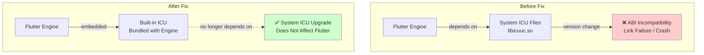

# Flutter OHOS ICU Upgrade Issues and Solutions

## Problem Background

After the OHOS system upgrades the ICU library, major version changes (e.g., ICU 67→72 or 76→78) cause the following issues:

- **ABI Incompatibility**: Applications compiled against an older ICU version fail to find new-version symbols at runtime (e.g., `undefined symbol: ucnv_getDefaultName_67`), resulting in dynamic linking failures or crashes
- **Globalization Behavior Changes**: Updates to underlying CLDR data and algorithms cause silent differences in string sorting, currency/date formatting, and Unicode category classification
- **Dependency Chain Breakage**: Dependent packages not recompiled after system ICU upgrade experience compatibility failures

### Flutter Engine Architecture Change

Before the fix, Flutter 3.7 relied on system ICU files. After the fix, it uses an embedded Engine approach and no longer depends on system ICU:



Before the fix, Flutter 3.7 exhibited the following symptoms on OHOS:

- Incorrect input field cursor position
- Font rendering anomalies
- Layout anomalies

**Root Cause**: Flutter 3.7 used an external system ICU approach; system ICU version changes caused compatibility conflicts.

**Fix PR**: https://gitcode.com/CPF-Flutter/flutter_engine/pull/1001

> This PR switches Flutter 3.7 to an embedded Engine approach, eliminating the dependency on system ICU files.

> ⚠️ **System Compatibility Notice**: The current OHOS system retains redundant legacy ICU versions to maintain compatibility with applications that have not yet been adapted. Future versions may remove this redundant compatibility. **Please complete the adaptation upgrade as soon as possible.**

---

## Solutions

### Option 1: Switch to a Fixed TAG Version (Recommended)

Switch directly to a version with the fix already integrated:

| Version |
|---------|
| 3.7.12-ohos-1.1.6 |
| 3.7.12-ohos-1.1.7 |

**Steps**:
```bash
# View current branch
git branch

# Switch to target version
git checkout 3.7.12-ohos-1.1.7

# Update dependencies
flutter pub get
```

---

### Option 2: Upgrade to a Higher Flutter Version

Upgrade to a later version that is fully adapted for HarmonyOS:

| Recommended Version |
|----------------------|
| Flutter 3.22 |
| Flutter 3.27 |
| Flutter 3.32 |
| Flutter 3.35 |

**Upgrade Path**:
Refer to the [Flutter 3.7 to 3.22 Upgrade Guide](https://gitcode.com/CPF-Flutter/flutter_flutter/blob/oh-3.35.7-dev/release-notes/changelog/Flutter3.7_to_3.22_Breaking-changes.md) to understand Breaking Changes, then upgrade step by step.

---

### Option 3: Self-Built Users — Sync the PR Fix

For developers who build from source:

1. **Sync the fix code**
   ```bash
   # Add upstream repository (if not already added)
   git remote add upstream https://gitcode.com/CPF-Flutter/flutter_engine.git
   
   # Fetch the fix branch or cherry-pick the specific PR
   git fetch upstream
   git cherry-pick <commit-hash>
   ```

2. **Build the Engine**
   ```bash
   # Follow the official build documentation to build from source
   ./tools/bin/activate_build_mode
   gn gen --ohos --target-os=ohos
   ninja -C out/ohos_release
   ```

3. **Verify the fix**
   - Use `flutter doctor -v` to confirm the Engine version
   - Run test cases to verify input fields, fonts, and layouts function correctly

---

## Version Selection Guide

| Scenario | Recommended Option |
|----------|-------------------|
| Production environment, stability first | Option 1 (switch to 3.7.12-ohos-1.1.7) |
| New projects, recommended | Option 2 (Flutter 3.27 or higher) |
| Self-built users | Option 3 (sync PR and compile) |

---

## Related Links

- Fix PR: https://gitcode.com/CPF-Flutter/flutter_engine/pull/1001
- Upgrade Guide: https://gitcode.com/CPF-Flutter/flutter_flutter/blob/oh-3.35.7-dev/release-notes/changelog/Flutter3.7_to_3.22_Breaking-changes.md

---

*Last Updated: 2026-04-30*
