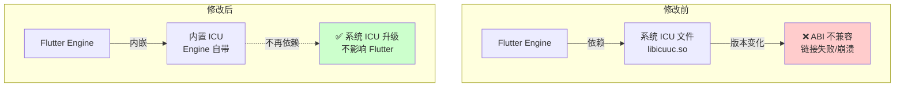

# Flutter OHOS ICU 文件升级问题与解决方案

## 问题背景

OHOS 系统升级 ICU 库后，主版本号变更（如 ICU 67→72 或 76→78）会引发以下问题：

- **ABI 不兼容**：编译时链接旧版 ICU 的应用在运行时找不到新版本符号（如 `undefined symbol: ucnv_getDefaultName_67`），动态链接失败或直接崩溃
- **全球化行为变更**：底层 CLDR 数据和算法更新导致字符串排序、货币/日期格式化、Unicode 类别判定出现静默差异
- **依赖链断裂**：系统 ICU 升级后未及时重新编译的依赖包出现兼容性故障

### Flutter Engine 架构变化

Flutter 3.7 修改前依赖系统 ICU 文件，修改后改为内嵌 Engine 方式，不再依赖系统 ICU：



修改前 Flutter 3.7 在 OHOS 系统上的具体表现为：

- 输入框光标位置错乱
- 字体显示异常
- 布局异常

**根因**：Flutter 3.7 采用系统外置 ICU 方式，系统 ICU 版本变化导致兼容性冲突。

**修复 PR**：https://gitcode.com/CPF-Flutter/flutter_engine/pull/1001

> 该 PR 将 Flutter 3.7 改为内嵌 Engine 方式，规避对系统 ICU 文件的依赖。

> ⚠️ **系统兼容提示**：当前 OHOS 系统保留了冗余的旧版 ICU 以兼容尚未适配的应用，后续版本可能移除该冗余兼容，**请尽快完成适配升级**。

---

## 解决方案

### 方案一：切换到已修复的 TAG 版本（推荐）

直接切换到已集成修复的版本：

| 版本号 |
|--------|
| 3.7.12-ohos-1.1.6 |
| 3.7.12-ohos-1.1.7 |

**操作步骤**：
```bash
# 查看当前分支
git branch

# 切换到目标版本
git checkout 3.7.12-ohos-1.1.7

# 更新依赖
flutter pub get
```

---

### 方案二：升级到更高版本 Flutter

升级到已完全适配HarmonyOS的后续版本：

| 推荐版本 |
|----------|
| Flutter 3.22 |
| Flutter 3.27 |
| Flutter 3.32 |
| Flutter 3.35 |

**升级路径**：
查阅 [Flutter 3.7 到 3.22 升级指南](https://gitcode.com/CPF-Flutter/flutter_flutter/blob/oh-3.35.7-dev/release-notes/changelog/Flutter3.7_to_3.22_Breaking-changes.md)，了解 Breaking Changes 后逐步升级。

---

### 方案三：自编译用户同步 PR 修复

适用于有自编译需求的开发者：

1. **同步修复代码**
   ```bash
   # 添加上游仓库（如果尚未添加）
   git remote add upstream https://gitcode.com/CPF-Flutter/flutter_engine.git
   
   # 拉取修复分支或 cherry-pick 指定 PR
   git fetch upstream
   git cherry-pick <commit-hash>
   ```

2. **编译 Engine**
   ```bash
   # 参考官方编译文档进行自编译
   ./tools/bin/activate_build_mode
   gn gen --ohos --target-os=ohos
   ninja -C out/ohos_release
   ```

3. **验证修复**
   - 使用 `flutter doctor -v` 确认 Engine 版本
   - 运行测试用例验证输入框、字体、布局等功能正常

---

## 版本选择建议

| 场景 | 推荐方案 |
|------|----------|
| 生产环境，稳定优先 | 方案一（切换到 3.7.12-ohos-1.1.7） |
| 新项目，建议使用 | 方案二（Flutter 3.27 或更高版本） |
| 自编译用户 | 方案三（同步 PR 并编译） |

---

## 相关链接

- 修复 PR：https://gitcode.com/CPF-Flutter/flutter_engine/pull/1001
- 升级指南：https://gitcode.com/CPF-Flutter/flutter_flutter/blob/oh-3.35.7-dev/release-notes/changelog/Flutter3.7_to_3.22_Breaking-changes.md

---

*文档更新时间：2026-04-30*
