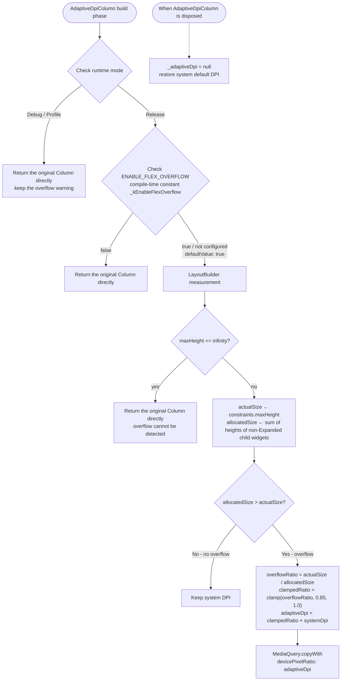

# Flutter Multi-Device Adaptive DPI Guide

## Overview

This document systematically summarizes the core strategies, breakpoint system, layout adaptation solutions, and best practices for multi-device adaptive DPI in Flutter, helping developers quickly master full-scenario adaptation across phones, foldables, tablets, and large-screen devices.

---

## Breakpoint System

The breakpoint system is the core infrastructure of adaptive DPI; all adaptation decisions are built on breakpoint evaluation.

### Standard Width Breakpoints

Five width breakpoints following the HarmonyOS ArkUI specification:

| Breakpoint | Range (vp) | Typical Devices            |
| ---------- | ---------- | -------------------------- |
| xs         | < 320      | Extra-small screen / split-screen small window |
| sm         | 320 - 599  | Phone portrait             |
| md         | 600 - 839  | Phone landscape / small foldable unfolded |
| lg         | 840 - 1439 | Tablet / large foldable unfolded |
| xl         | ≥ 1440     | PC / extra-large screen    |

### Standard Height Breakpoints

| Breakpoint | Range (vp) |
| ---------- | --------- |
| sm         | < 600     |
| md         | 600 - 839 |
| lg         | ≥ 840     |

**Aspect-ratio breakpoints for the danmaku scenario** (based on the height/width ratio rather than absolute pixels):

| Breakpoint | Aspect Ratio (h/w)    |
| ---------- | --------------------- |
| sm         | < 0.8 (landscape / wide and flat) |
| md         | 0.8 - 1.2 (near-square) |
| lg         | ≥ 1.2 (portrait / tall and narrow) |

### Device Type Classification (Width + Aspect Ratio Combined)

| Device Type   | Width Threshold | Aspect Ratio Condition |
| ------------- | --------------- | ---------------------- |
| mobile        | < 600           | Any                    |
| tablet        | 600 - 1199      | Any                    |
| wide          | 1200 - 1599     | Any                    |
| ultraWide     | ≥ 1600          | Aspect ratio > 2.0     |
| wide (fallback) | ≥ 1600        | Aspect ratio ≤ 2.0     |

A common simplified classification:

| Device Enum | Name        | Typical Size | Default Columns |
| ----------- | ----------- | ------------ | --------------- |
| phone       | Bar phone   | 360×800      | 1               |
| foldable    | Foldable    | 720×840      | 2               |
| tablet      | Tablet      | 1024×768     | 3               |
| pc          | PC/2-in-1   | 1366×900     | 4               |

### Initialization and Listening

Initialize with the breakpoint manager and listen for breakpoint changes:

```dart
// Initialize (executed asynchronously in main())
await BreakpointManager().init();

// Get the current breakpoints
final widthBp = BreakpointManager().getWindowWidthBreakpoint();
final heightBp = BreakpointManager().getWindowHeightBreakpoint();

// Listen for breakpoint changes (breakpoints switch dynamically on foldables, in split-screen, and during window dragging)
BreakpointManager().addBreakpointCallback((widthBp, heightBp) {
  setState(() { /* update the layout */ });
});

// Destroy at the end of the lifecycle
BreakpointManager().destroy();
```

### Generic Breakpoint-Value Mapping Pattern

The recommended generic approach maps 3 values to 5 breakpoints, consistent with the ArkUI `WidthBreakpointType` pattern:

```dart
static T getValue<T>(WidthBreakpoint bp, T smValue, T mdValue, T lgValue) {
  switch (bp) {
    case WidthBreakpoint.xs: return smValue;  // xs shares the value with sm
    case WidthBreakpoint.sm: return smValue;
    case WidthBreakpoint.md: return mdValue;
    case WidthBreakpoint.lg: return lgValue;
    case WidthBreakpoint.xl: return lgValue;  // lg shares the value with xl
  }
}
```

**Typical application examples**:

| Parameter        | xs/sm | md   | lg/xl   |
| ---------------- | ----- | ---- | ------- |
| Grid columns     | 2     | 3    | 4       |
| Card spacing     | 6.0   | 12.0 | 16.0    |
| Padding          | 8     | 16   | 24/32   |
| Font scale factor | 1.0  | 1.0  | 1.1/1.2 |

### WindowInfo Hybrid Breakpoint Mode

`WindowInfo` provides two construction methods:

```dart
// Pure pixel calculation (no dependency on the platform breakpoint package)
WindowInfo.fromSize(size: Size(1024, 768));

// Combined with platform breakpoint information (recommended; integrates native platform breakpoint information)
WindowInfo.fromSizeWithBreakpoint(
  size: Size(1024, 768),
  widthBreakpoint: hadssWidthBp,
  heightBreakpoint: hadssHeightBp,
);
```

---

## Ten Adaptation Strategies

### Strategy 1: Adaptive Navigation Mode

Switch between three navigation forms based on the width breakpoint:

| Breakpoint | Navigation Form        | Description                                         |
| ---------- | ---------------------- | --------------------------------------------------- |
| xs/sm/md   | BottomNavigationBar    | Bottom navigation bar, 60px height                  |
| lg         | NavigationRail         | Side navigation rail with text labels               |
| xl         | Full sidebar           | Expandable secondary menu, width varies by breakpoint |

```dart
final useBottom = (bp == xs || bp == sm || bp == md);
final useRail   = (bp == lg);
final useSidebar = (bp == xl);

if (useBottom) return BottomNavigationBar(...);
if (useRail)   return NavigationRail(...);
return Sidebar(...);  // xl breakpoint
```

**Sidebar width varies by breakpoint**:

- ultraWide: 320px, wide: 280px, tablet: 240px, mobile: 200px

**Two-level tab navigation**: At the xl breakpoint, the sidebar supports two levels of navigation (top-level tabs plus an expandable secondary list) and remembers the last selected secondary index for each top-level tab.

### Strategy 2: LayoutBuilder Conditional Layout

Use `LayoutBuilder` to obtain the actual available width and decide the layout structure accordingly:

```dart
LayoutBuilder(
  builder: (context, constraints) {
    final width = constraints.maxWidth;

    // Adaptive grid column count
    final crossAxisCount = width > 600 ? 4 : 2;

    // Whether the content needs to scroll
    final shouldScroll = width < 500;

    // Conditionally show accessory content
    final showSideAd = width > 600;

    return ...;
  },
);
```

**Typical thresholds**:

- 600vp: The dividing line between phone landscape and tablet; commonly used to decide the grid column count and whether side content is shown
- 500vp: Determines whether a flexible layout needs to scroll
- 760vp: Determines horizontal split columns vs vertical stacking
- 900vp: Determines switching the page padding from 16px to 24px

**Multi-level grid column count calculation**:

```dart
int _columns(double width) {
  if (width < 560) return 1;
  if (width < 920) return deviceColumns.clamp(1, 2);
  return deviceColumns.clamp(2, 4);
}
```

### Strategy 3: GridRow Responsive Grid

Use a responsive grid system (similar to CSS Grid) for layout adaptation:

```dart
GridRow(
  columns: 8,  // 8 grid columns in total
  gutter: Gutter(x: 5, y: 5),
  breakpoints: Breakpoints(
    value: [320, 480, 640, 960],
    reference: BreakpointsReference.componentSize,  // Based on the component size rather than the screen
  ),
  gridCols: [
    GridCol(
      span: SpanOption(xs: 2, sm: 2, md: 2, lg: 1, xl: 1, xxl: 1),
      offset: OffsetOption(xs: 0, sm: 0, md: 1, lg: 0),
      order: OrderOption(xs: 1, sm: 1, md: 2, lg: 1),
      child: ItemWidget(),
    ),
    // More columns...
  ],
)
```

**Key concepts**:

- `SpanOption`: The number of grid columns a widget occupies differs per breakpoint
- `OffsetOption`: The widget's column offset per breakpoint
- `OrderOption`: The widget's ordering per breakpoint
- `BreakpointsReference.componentSize`: Breakpoints are based on the component's own size rather than the global screen size

### Strategy 4: Aspect-Ratio Device Classification + Layout Direction Switching

For extra-large screens, width alone is not precise enough; combine it with the aspect ratio:

```dart
final aspectRatio = screenSize.width / screenSize.height;
final bool isWide = aspectRatio >= 1.2;
```

**Layout direction switching**:

| Breakpoint | Layout Direction   | Image-Text Ratio                   |
| ---------- | ------------------ | ---------------------------------- |
| xs/sm      | Vertical Column    | Image takes 100%, text below on its own |
| md/lg/xl   | Horizontal Row     | Image takes 50%-60%, text takes 40%-50% |

```dart
final isHorizontal = ScreenUtils.isHorizontalLayout(breakpoint);
if (isHorizontal) {
  final imageFlex = (imageWidthRatio * 10).toInt();
  final textFlex = 10 - imageFlex;
  return Row(children: [Expanded(flex: imageFlex), Expanded(flex: textFlex)]);
} else {
  return Column(children: [image, textSection]);
}
```

**Video + comments linked layout** (accessory pane adaptation):

| State                          | Video Area    | Comments                     |
| ------------------------------ | ------------- | ---------------------------- |
| Wide screen + comments on      | 66% width     | 34% right panel              |
| Wide screen + comments off     | 100% width    | None                         |
| Narrow screen + comments on    | 100% width    | Bottom overlay (58-82% height) |
| Narrow screen + comments off   | 100% width    | None                         |

```dart
final useSidePanel = isWide && _showComments;
final videoWidth = useSidePanel ? screenSize.width * 0.66 : screenSize.width;
```

### Strategy 5: Content Maximum Width Constraint

Unlimited content stretching on large screens degrades the reading experience; limit the maximum width:

```dart
static double getContentMaxWidth(BuildContext context) {
  if (windowInfo.isUltraWide) return 1200;
  else if (windowInfo.isWide) return 1000;
  else return double.infinity;  // No limit on small screens
}

// How to apply
BoxConstraints(maxWidth: getContentMaxWidth(context))
```

### Strategy 6: Content Priority / Progressive Disclosure

Decide which content to display based on the available space; elements of the same priority appear and disappear together:

```dart
// Priority 1: always visible (core content)
// Priority 2: visible when width ≥ 50% (secondary content)
// Priority 3: visible when width ≥ 80% (accessory content)
final showPriority2 = displayWidthPercent >= 50;
final showPriority3 = displayWidthPercent >= 80;
```

You can also use the `Visibility` widget to simplify conditional display:

```dart
Visibility(
  visible: constraints.maxWidth > 600,
  child: SideAdWidget(),
)
```

### Strategy 7: Foldable / Hover State / Tri-Fold Device Adaptation

#### Fold State Detection (via Native Platform Channel)

| Fold State     | Code  | Meaning                      |
| -------------- | ----- | ---------------------------- |
| expanded       | 1     | Fully expanded               |
| folded         | 2     | Fully folded                 |
| halfFolded     | 3     | Hover state (half-folded)    |
| tripleFoldFull | 11/21 | Tri-fold fully expanded      |

**Screen display modes of tri-fold devices**:

| Mode             | Description            |
| ---------------- | ---------------------- |
| dualFoldExpanded | Dual-fold expanded     |
| dualFoldClosed   | Dual-fold closed       |
| tripleFoldFull   | Tri-fold fully expanded |
| tripleFoldDual   | Tri-fold dual screen   |
| tripleFoldSingle | Tri-fold single screen |

```dart
// Get the fold status via MethodChannel
final foldStatus = await MethodChannel('fold_status_detector').invokeMethod('getFoldStatus');

// Listen for fold status changes via EventChannel (use StreamSubscription to respond in real time)
EventChannel('fold_status_detector/events').receiveBroadcastStream().listen((status) {
  setState(() { /* re-layout */ });
});

// Get the crease region (for avoidance)
final creaseRegion = await MethodChannel('fold_status_detector').invokeMethod('getCreaseRegion');
// Returns [top, height] crease position information

// Check whether landscape rotation is allowed
final canLandscape = FoldStatusDetector.canRotateLandscape(foldStatus);
```

#### Hover State Layout Scheme

The screen is divided into three areas:

| Area                 | Position                              | Purpose                               |
| -------------------- | ------------------------------------- | ------------------------------------- |
| Main display area    | Upper half of the screen (above the crease) | Video/images/core content             |
| Dynamic fill area    | Crease area                           | Avoid the crease or fill transitional content |
| Operation area       | Bottom 56px of the lower half         | Touch interaction (buttons/input)     |

```dart
// Height calculation of the main display area in hover state
final mainDisplayHeight = _creaseTop - _creaseHeight;

// Use addPostFrameCallback to delay native channel initialization (avoids calling before the engine is ready)
WidgetsBinding.instance.addPostFrameCallback((_) {
  _initFoldStatus();
});
```

### Strategy 8: Dialog and Safe Area Avoidance

Handling dialog heights across devices with different DPIs:

**Problem**: Fixed-height dialogs (for example, 700px) may be truncated on low-DPI devices.

**Option A — Set the dialog height proportionally**:

```dart
final deviceHeight = MediaQuery.of(context).size.height;
final dialogHeight = deviceHeight * 0.3;  // Dialog height = device height × 30%
```

**Option B — PixelRatio-aware dynamic status bar hiding**:

When the dialog height exceeds the available area, programmatically hide the status bar to free up space:

```dart
// Key: use devicePixelRatio to convert physical pixels to logical pixels
final actualStatusBarHeight = windowPadding.top / devicePixelRatio;
final availableHeight = deviceHeight - actualStatusBarHeight;

if (dialogHeight > availableHeight) {
  SystemChrome.setEnabledSystemUIMode(SystemUiMode.immersive);
  isStatusBarHidden = true;
}

// Always restore when the dialog closes
SystemChrome.setEnabledSystemUIMode(SystemUiMode.edgeToEdge);
```

**Option C — Dynamic SafeArea in full-screen mode**:

```dart
final safePadding = _isFullScreen ? EdgeInsets.zero : mediaQuery.padding;

SafeArea(
  top: !_isFullScreen,
  bottom: !_isFullScreen,
  child: ...,
)
```

**Touch handling in immersive mode**: In full-screen mode, the exit button should use `Listener` (instead of `GestureDetector`) to ensure touches are still captured reliably when the system UI overlay is present:

```dart
Listener(
  behavior: HitTestBehavior.opaque,
  onPointerDown: (_) => _toggleFullScreen(),
  child: ExitButton(),
)
```

### Strategy 9: Adaptive Parameter Mapping (Beyond Layout)

Breakpoints determine not only the layout structure but also runtime behavior parameters:

**Complete parameter mapping for the danmaku scenario**:

| Parameter             | xs   | sm   | md   | lg   | xl   |
| --------------------- | ---- | ---- | ---- | ---- | ---- |
| Font size             | 12   | 14   | 16   | 18   | 20   |
| Input field height    | 36   | 40   | 44   | 48   | 52   |
| Container height ratio | 0.3 | 0.3  | 0.4  | 0.4  | 0.5  |
| Danmaku speed         | 1.5  | 2.0  | 2.5  | 3.0  | 3.5  |
| Max danmaku count     | 10   | 15   | 20   | 25   | 30   |
| Generation interval (ms) | 2000 | 1500 | 1000 | 800  | 600  |

### Strategy 10: ThemeExtension Semantic Theming

Use Flutter's `ThemeExtension` to define custom semantic color tokens with light/dark theme support:

```dart
class AppColors extends ThemeExtension<AppColors> {
  final Color danmakuAreaBg;
  final Color pageBg;
  final Color inputFill;
  final Color bulletBubbleBg;

  const AppColors({...});

  @override AppColors copyWith({...}) => ...;
  @override AppColors lerp(AppColors? other, double t) => ...;
}

// Register into ThemeData
ThemeData(extensions: [AppColors.light(), AppColors.dark()]);

// Usage
final colors = Theme.of(context).extension<AppColors>()!;
Container(color: colors.danmakuAreaBg);
```

---

## Adaptive DPI Parameter Quick Reference

### Fonts and Input Fields

| Breakpoint | Font Size | Input Field Height | Font Scale Factor |
| ---------- | --------- | ------------------ | ----------------- |
| xs         | 12        | 36                 | 1.0               |
| sm         | 14        | 40                 | 1.0               |
| md         | 16        | 44                 | 1.0               |
| lg         | 18        | 48                 | 1.1               |
| xl         | 20        | 52                 | 1.2               |

### Spacing and Padding

| Breakpoint | Card Spacing | Page Padding | Content Max Width |
| ---------- | ------------ | ------------ | ----------------- |
| xs/sm      | 6.0          | 8            | ∞                 |
| md         | 12.0         | 16           | ∞                 |
| lg/xl      | 16.0         | 24/32        | 1000/1200         |

### Grid and Layout

| Breakpoint | Grid Columns | Sidebar Width | Navigation Form      |
| ---------- | ------------ | ------------- | -------------------- |
| xs/sm      | 2            | 200px         | Bottom navigation bar |
| md         | 3            | 240px         | Bottom navigation bar |
| lg         | 4            | 280px         | Side navigation rail |
| xl         | 4            | 320px         | Full sidebar         |

### Layout Direction Switching Thresholds

| Width Threshold  | Layout Switch                      |
| ---------------- | ---------------------------------- |
| 500vp            | Row ↔ SingleChildScrollView        |
| 600vp            | 2-column ↔ 4-column grid           |
| 600vp            | Whether to show side content       |
| 660vp            | Whether to show floating content   |
| 760vp            | Horizontal split ↔ vertical stacking |
| 900vp            | Page padding 16 ↔ 24               |
| aspectRatio ≥ 1.2 | Video side panel ↔ bottom overlay |

---

## DPI Scaling Calculation

For scenarios that need linear scaling by DPI, calculate a scale factor using a reference width:

```dart
// Use 352vp as the baseline reference width
final scaleFactor = MediaQuery.of(context).size.width / 352.0;

// Apply to sizes
final scaledHeight = 540 * scaleFactor;
final scaledIconSize = 20 * scaleFactor;
```

**Dynamic childAspectRatio calculation**:

```dart
// Dynamically calculate the card aspect ratio from the available width and the font scale factor
final availableWidth = constraints.maxWidth;
final imageHeight = availableWidth * 0.6;
final textContentHeight = 40 * fontScale;
final totalItemHeight = imageHeight + textContentHeight;
final childAspectRatio = availableWidth / totalItemHeight;
```

**Image height clamping** (prevents images from being too large or too small in split-screen/half-screen modes):

```dart
final imageHeight = (screenHeight * 0.6).clamp(150.0, 400.0);
```

---

## Column Overflow Adaptive DPI Solution

### Quick Start

**In one sentence**: Replace the top-level `Column` that may overflow with `AdaptiveDpiColumn` — it works with zero configuration.

**Migration mapping**:

| Scenario                               | Before                    | After                                |
| -------------------------------------- | ------------------------- | ------------------------------------ |
| Top-level page Column (may overflow)   | `Column(children: [...])` | `AdaptiveDpiColumn(children: [...])` |
| Top-level page Column (will not overflow) | `Column(children: [...])` | **No replacement needed**; keep `Column` |
| Row overflow                           | `Row(children: [...])`    | **Not applicable**; this solution only handles vertical Columns |

**Minimal-change example**:

```dart
// Before the change — truncated by overflow on small screens
@override
Widget build(BuildContext context) {
  return Scaffold(
    body: Column(
      children: [
        Container(height: 540, ...),  // Fixed-height card
        Container(height: 100, ...),  // Action bar
      ],
    ),
  );
}

// After the change — just replace Column → AdaptiveDpiColumn
@override
Widget build(BuildContext context) {
  return Scaffold(
    body: AdaptiveDpiColumn(
      children: [
        Container(height: 540, ...),
        Container(height: 100, ...),
      ],
    ),
  );
}
```

> No extra configuration is required after the replacement. In Release mode, overflow detection and DPI adjustment are enabled automatically; in Debug mode, the yellow overflow stripe warning is kept for easier debugging.

### How It Works

When the total height of the child widgets inside a top-level `Column` exceeds the available space, the DPI is dynamically adjusted so the content scales down proportionally to eliminate the overflow, instead of clipping or scrolling. This solution only affects the Column where the overflow occurs and does not affect other pages or components.

**DPI calculation formula**:

- `overflowRatio = actualSize / allocatedSize`
  - `actualSize` = the Column's available height (the maximum height of the parent constraints)
  - `allocatedSize` = the sum of the heights actually occupied by the Column's child widgets
- `adaptiveDpi = clamp(overflowRatio, 0.85, 1.0) × systemDpi`

| Parameter     | Meaning                                    | Value Range                   |
| ------------- | ------------------------------------------ | ----------------------------- |
| overflowRatio | Ratio of available space to actual usage   | < 1.0 indicates overflow      |
| clamp range   | Prevents excessive shrinking and guarantees readability | 0.85 ~ 1.0        |
| systemDpi     | System default DPI                         | Device-native `devicePixelRatio` |
| adaptiveDpi   | The adaptive DPI that finally takes effect | ≥ 0.85 × systemDpi            |

**Calculation example**:

- Overflow scenario: 600px available, 720px actual, system DPI 2.0
  - `overflowRatio = 600 / 720 = 0.833` → clamp → `0.85`
  - `adaptiveDpi = 0.85 × 2.0 = 1.7`
- No-overflow scenario: 600px available, 580px actual
  - `overflowRatio = 600 / 580 = 1.034` → clamp → `1.0`
  - `adaptiveDpi = 1.0 × 2.0 = 2.0` (keeps the system DPI)

### Complete Reference Implementation

The following is the complete code of the `AdaptiveDpiColumn` widget, which developers can use as a reference or import directly into their projects:

```dart
import 'package:flutter/foundation.dart';
import 'package:flutter/material.dart';

/// Compile-time switch: enabled by default, can be overridden with --dart-define
const bool _kEnableFlexOverflow = bool.fromEnvironment(
  'ENABLE_FLEX_OVERFLOW',
  defaultValue: true,
);

/// Adaptive DPI Column.
///
/// In Release mode, when the total height of the child widgets exceeds the
/// available space, the DPI is automatically lowered so the content scales
/// down proportionally to eliminate the overflow (the scale ratio is clamped
/// to 0.85~1.0).
/// In Debug mode it does not intervene, keeping the yellow overflow stripe
/// warning for easier troubleshooting.
///
/// Its scope is limited to the current page subtree; the system DPI is
/// restored automatically when the Column is disposed.
///
/// Usage: simply replace the top-level Column that may overflow with
/// AdaptiveDpiColumn.
class AdaptiveDpiColumn extends StatefulWidget {
  final List<Widget> children;
  final MainAxisAlignment mainAxisAlignment;
  final CrossAxisAlignment crossAxisAlignment;
  final VerticalDirection verticalDirection;

  const AdaptiveDpiColumn({
    required this.children,
    this.mainAxisAlignment = MainAxisAlignment.start,
    this.crossAxisAlignment = CrossAxisAlignment.center,
    this.verticalDirection = VerticalDirection.down,
    super.key,
  });

  @override
  State<AdaptiveDpiColumn> createState() => _AdaptiveDpiColumnState();
}

class _AdaptiveDpiColumnState extends State<AdaptiveDpiColumn> {
  double? _adaptiveDpi;

  @override
  void dispose() {
    _adaptiveDpi = null;
    super.dispose();
  }

  @override
  Widget build(BuildContext context) {
    // Condition 1: do not intervene in Debug mode; keep overflow warnings for debugging
    if (!kReleaseMode) {
      return Column(
        mainAxisAlignment: widget.mainAxisAlignment,
        crossAxisAlignment: widget.crossAxisAlignment,
        verticalDirection: widget.verticalDirection,
        children: widget.children,
      );
    }

    // Condition 2: do not intervene when the compile-time switch is off
    if (!_kEnableFlexOverflow) {
      return Column(
        mainAxisAlignment: widget.mainAxisAlignment,
        crossAxisAlignment: widget.crossAxisAlignment,
        verticalDirection: widget.verticalDirection,
        children: widget.children,
      );
    }

    final systemDpi = MediaQuery.of(context).devicePixelRatio;

    return LayoutBuilder(
      builder: (context, constraints) {
        final actualSize = constraints.maxHeight;

        // An infinite height constraint (e.g. a Column not wrapped in Expanded) cannot detect overflow; return directly
        if (actualSize == double.infinity) {
          return Column(
            mainAxisAlignment: widget.mainAxisAlignment,
            crossAxisAlignment: widget.crossAxisAlignment,
            verticalDirection: widget.verticalDirection,
            children: widget.children,
          );
        }

        // Measure the total height of the child widgets
        double allocatedSize = 0;
        for (final child in widget.children) {
          if (child is Expanded || child is Flexible || child is Spacer) {
            // Expanded/Flexible/Spacer heights are allocated from remaining space and not counted as fixed usage
            continue;
          }
          final box = child as RenderObjectWidget?;
          if (box != null) {
            final renderBox = _measureChild(child, constraints);
            allocatedSize += renderBox;
          }
        }

        // No overflow → keep the system DPI
        if (allocatedSize <= actualSize) {
          _adaptiveDpi = null;
          return Column(
            mainAxisAlignment: widget.mainAxisAlignment,
            crossAxisAlignment: widget.crossAxisAlignment,
            verticalDirection: widget.verticalDirection,
            children: widget.children,
          );
        }

        // Overflow → calculate the adaptive DPI
        final overflowRatio = actualSize / allocatedSize;
        final clampedRatio = overflowRatio.clamp(0.85, 1.0);
        _adaptiveDpi = clampedRatio * systemDpi;

        return MediaQuery(
          data: MediaQuery.of(context).copyWith(
            devicePixelRatio: _adaptiveDpi!,
          ),
          child: Column(
            mainAxisAlignment: widget.mainAxisAlignment,
            crossAxisAlignment: widget.crossAxisAlignment,
            verticalDirection: widget.verticalDirection,
            children: widget.children,
          ),
        );
      },
    );
  }

  /// Measure the intrinsic height of a single child widget
  double _measureChild(Widget child, BoxConstraints constraints) {
    final constrained = BoxConstraints(
      maxWidth: constraints.maxWidth,
      minHeight: 0,
      maxHeight: constraints.maxHeight,
    );
    final renderObject = child.createRenderObject(context);
    try {
      renderObject.layout(constrained, parentUsesSize: true);
      return renderObject.size.height;
    } finally {
      renderObject.dispose();
    }
  }
}
```

> The code above is a reference implementation. In real projects, `_measureChild` can be simplified as needed (for example, use `IntrinsicHeight` or pre-known height values instead of measuring each child).

### Scope and Lifecycle

| Phase                            | Behavior                                                          |
| -------------------------------- | ----------------------------------------------------------------- |
| Column detects overflow          | Calculates adaptiveDpi and overrides the DPI of the current page subtree via `MediaQuery` |
| Column does not overflow         | DPI stays at the system default; no intervention                   |
| Column is disposed (page exit)   | Immediately restores the system default DPI (`_adaptiveDpi = null` in `dispose`) |

**Core principle**: takes effect locally without polluting the global state. The adaptive DPI only overrides the current Column's page subtree and is restored automatically after page switching.

### ENABLE_FLEX_OVERFLOW Switch Control

To ensure the dynamic DPI adjustment capability for Flex layout overflow takes effect in default scenarios on the OpenHarmony platform while retaining a flexible compile-time control option, the following configuration strategy is adopted:

#### Enabled by Default

The `ENABLE_FLEX_OVERFLOW` feature is on by default; the overflow detection and DPI adjustment logic is activated without any extra configuration.

#### Explicit Compile-Time Control Supported

Developers can override the default behavior at build time with the `--dart-define` flag:

```bash
# Explicitly enable (same as the default)
flutter build hap --release --dart-define=ENABLE_FLEX_OVERFLOW=true

# Explicitly disable (disables the adaptive DPI solution)
flutter build hap --release --dart-define=ENABLE_FLEX_OVERFLOW=false
```

#### Reading the Compile-Time Configuration in Code

In `flex.dart`, the flag is read through Dart's compile-time constant mechanism, ensuring zero runtime overhead:

```dart
const bool _kEnableFlexOverflow = bool.fromEnvironment(
  'ENABLE_FLEX_OVERFLOW',
  defaultValue: true,
);
```

- If `ENABLE_FLEX_OVERFLOW` is not specified in the build command, `defaultValue: true` is applied automatically, keeping the feature enabled;
- The constant is resolved at compile time and does not affect runtime performance.

#### Switch State Summary

| Switch State               | Build Command                              | Behavior                         |
| -------------------------- | ------------------------------------------ | -------------------------------- |
| Not configured (default)   | `flutter build hap --release`              | **Enables** the adaptive solution |
| Explicitly enabled         | `--dart-define=ENABLE_FLEX_OVERFLOW=true`  | **Enabled** (same as the default) |
| Explicitly disabled        | `--dart-define=ENABLE_FLEX_OVERFLOW=false` | **Disabled**; keeps the system DPI |

### Debug / Release Mode Distinction

| Mode    | Adaptive DPI Behavior                          | Reason                                            |
| ------- | ---------------------------------------------- | ------------------------------------------------- |
| Debug   | **Not enabled**; keeps the yellow overflow stripe warning | Makes it easier to debug and locate layout issues during development |
| Profile | **Not enabled** (same as Debug)                | Performance analysis requires real rendering      |
| Release | **Enabled**; scales automatically on overflow  | Guarantees the user experience in production      |

The check logic is built into `AdaptiveDpiColumn` (see the `if (!kReleaseMode)` branch in the "Complete Reference Implementation" code); developers do not need to handle it manually.

### Notes and Limitations

| Scenario                       | Description                                                                                                       |
| ------------------------------ | ----------------------------------------------------------------------------------------------------------------- |
| **Only for top-level Columns** | `AdaptiveDpiColumn` should be placed at the outermost level of the page (for example, `Scaffold.body`); nested inner child Columns should not be replaced |
| **Not applicable to Row overflow** | This solution only handles vertical overflow; for horizontal overflow, use `SingleChildScrollView` or `FittedBox`            |
| **Expanded/Flexible/Spacer**   | The heights of these widgets are flexibly allocated from remaining space and are not counted as fixed usage; the solution skips them automatically |
| **Infinite height constraint** | If the Column's parent constraint is `maxHeight == infinity` (for example, not wrapped in `Expanded`), overflow cannot be detected; the solution skips automatically and returns the original Column |
| **0.85 lower bound**           | Even when the overflow is severe (for example, `overflowRatio < 0.85`), the DPI is reduced at most to `0.85 × systemDpi` to keep text readable; if the content still does not fit, the remainder is clipped |
| **Pages with multiple Columns** | Each page should have only one top-level `AdaptiveDpiColumn`; multiple ones cause conflicting DPI overrides |
| **Animation/transition**       | DPI changes have no transition animation, so a breakpoint switch may cause an abrupt scale change. For a smooth transition, wrap with `AnimatedContainer` or a custom animation |

### Overall Solution Flow



---

## Flutter Layout Widget Best Practices

| Adaptation Scenario          | Recommended Widget          | Description                                        |
| ---------------------------- | --------------------------- | -------------------------------------------------- |
| Proportional scaling container | `AspectRatio`             | Fixed aspect ratio, e.g. a 16:9 video area         |
| Percentage sizing            | `FractionallySizedBox`      | Occupies the parent container proportionally       |
| Flexible space allocation    | `Expanded(flex: N)`         | Proportional allocation among multiple areas       |
| Automatic wrap layout        | `Wrap`                      | Tags/button groups wrap adaptively                 |
| Scrollable adaptation        | `SingleChildScrollView`     | Scrolls when content overflows on small screens    |
| Conditional rendering        | `Visibility`                | Shows accessory content on large screens, hides it on small screens |
| Global constraint            | `BoxConstraints(maxWidth)`  | Prevents content from over-stretching on large screens |
| Video fill strategy          | `FittedBox`                 | `contain` for side panels, `cover` for full screen |
| Dynamic size changes         | `AnimatedContainer`         | Animated height transition for the comments panel  |
| Touch capture                | `Listener`                  | Replaces GestureDetector in full-screen mode       |
| Theme tokens                 | `ThemeExtension`            | Custom semantic colors adapting to light/dark      |

---

## Common Adaptation Issues and Solutions

### Content Truncation

**Problem**: Cards with fixed heights (for example, 540px) get truncated on small screens.

Common unadapted practice: heavy use of fixed pixel heights (for example, a 350px image area or 180px product cards), which inevitably truncates on small-screen devices.

**Solution**:

- Use `Expanded` + `Spacer` instead of fixed heights
- Use `shrinkWrap: true` so the content adapts its height
- Enable scrolling on small screens: `SingleChildScrollView`
- Use proportional values with a clamped range for image heights: `(screenHeight * 0.6).clamp(150.0, 400.0)`

### Content Overlap

**Problem**: Fixed bottom buttons overlap the content above.

Common unadapted practice: bottom buttons pinned with `Positioned(bottom: 0)`, overlapping the grid content above on small screens.

**Solution**:

- Use `Stack` + `Spacer` to reserve bottom space
- Or use `LayoutBuilder` to dynamically calculate the content area height
- Use `SafeArea` for the bottom action bar to avoid the system UI

### Dialog Truncation

**Problem**: Dialogs extend beyond the visible screen area.

Common unadapted practice: using `showModalBottomSheet` without a height limit, so the dialog may fill the entire screen on large screens.

**Solution**:

- Use a proportional value for the dialog height: `deviceHeight * 0.3`
- Compute the status bar height with PixelRatio awareness: `windowPadding.top / devicePixelRatio`
- Dynamically hide the status bar to free up space
- Use `SingleChildScrollView` for dialog content so it stays scrollable
- Always restore the status bar when the dialog closes: `SystemUiMode.edgeToEdge`

### Foldable Crease Avoidance

**Problem**: The foldable's crease area renders abnormally.

**Solution**:

- Get the crease position through a platform channel
- In hover state, split the layout into three areas: display / fill / operation
- Avoid placing critical interactive elements in the crease area
- Use `addPostFrameCallback` to delay native channel initialization

### Grid Column Count Not Adapting to Screen Size

**Problem**: Grids with a fixed column count have low information density on large screens and overly narrow items on small screens.

Common unadapted practice: all grids use a fixed column count (for example, 2 columns for products, 5 for categories, 4 for services) regardless of screen width.

**Solution**:

- Use breakpoint mapping: `getValue(bp, 2, 3, 4)`
- Or use a width threshold: `width > 600 ? 4 : 2`
- Or use `GridRow` + `SpanOption` for a responsive grid
