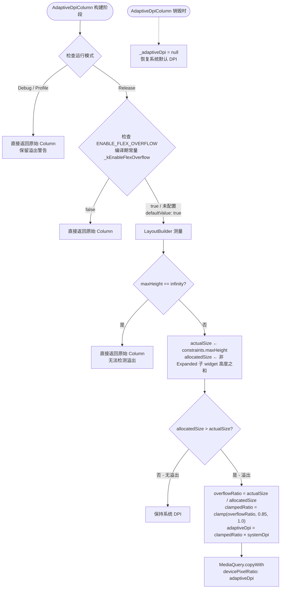

# Flutter 多设备自适应 DPI 指导文档

## 概述

本文档系统总结 Flutter 多设备自适应 DPI 的核心策略、断点体系、布局适配方案及最佳实践，帮助开发者快速掌握从手机到折叠屏、平板、大屏设备的全场景适配方法。

---

## 断点体系（Breakpoint System）

断点体系是自适应 DPI 的核心基础设施，所有适配决策都建立在断点判断之上。

### 标准宽度断点

采用 HarmonyOS ArkUI 规范的 5 级宽度断点：

| 断点 | 范围 (vp)  | 典型设备              |
| ---- | ---------- | --------------------- |
| xs   | < 320      | 超小屏 / 分屏小窗     |
| sm   | 320 - 599  | 手机竖屏              |
| md   | 600 - 839  | 手机横屏 / 小折叠展开 |
| lg   | 840 - 1439 | 平板 / 大折叠展开     |
| xl   | ≥ 1440     | PC / 超大屏           |

### 标准高度断点

| 断点 | 范围 (vp) |
| ---- | --------- |
| sm   | < 600     |
| md   | 600 - 839 |
| lg   | ≥ 840     |

**弹幕场景的宽高比断点**（基于 height/width 比值而非绝对像素）：

| 断点 | 宽高比 (h/w)        |
| ---- | ------------------- |
| sm   | < 0.8（横屏/扁宽）  |
| md   | 0.8 - 1.2（近方形） |
| lg   | ≥ 1.2（竖屏/窄长）  |

### 设备类型分类（结合宽度 + 宽高比）

| 设备类型     | 宽度阈值    | 宽高比条件   |
| ------------ | ----------- | ------------ |
| mobile       | < 600       | 任意         |
| tablet       | 600 - 1199  | 任意         |
| wide         | 1200 - 1599 | 任意         |
| ultraWide    | ≥ 1600      | 宽高比 > 2.0 |
| wide（回退） | ≥ 1600      | 宽高比 ≤ 2.0 |

常见简化分类：

| 设备枚举 | 名称    | 典型尺寸 | 默认列数 |
| -------- | ------- | -------- | -------- |
| phone    | 直板机  | 360×800  | 1        |
| foldable | 折叠屏  | 720×840  | 2        |
| tablet   | 平板    | 1024×768 | 3        |
| pc       | PC/2in1 | 1366×900 | 4        |

### 初始化与监听

使用断点管理器初始化并监听断点变化：

```dart
// 初始化（在 main() 中异步执行）
await BreakpointManager().init();

// 获取当前断点
final widthBp = BreakpointManager().getWindowWidthBreakpoint();
final heightBp = BreakpointManager().getWindowHeightBreakpoint();

// 监听断点变化（折叠屏、分屏、窗口拖拽时断点会动态切换）
BreakpointManager().addBreakpointCallback((widthBp, heightBp) {
  setState(() { /* 更新布局 */ });
});

// 生命周期结束时销毁
BreakpointManager().destroy();
```

### 通用断点-值映射模式

推荐的通用方法是 3 值映射 5 断点，与 ArkUI 的 `WidthBreakpointType` 模式一致：

```dart
static T getValue<T>(WidthBreakpoint bp, T smValue, T mdValue, T lgValue) {
  switch (bp) {
    case WidthBreakpoint.xs: return smValue;  // xs 与 sm 共享值
    case WidthBreakpoint.sm: return smValue;
    case WidthBreakpoint.md: return mdValue;
    case WidthBreakpoint.lg: return lgValue;
    case WidthBreakpoint.xl: return lgValue;  // lg 与 xl 共享值
  }
}
```

**典型应用示例**：

| 参数         | xs/sm | md   | lg/xl   |
| ------------ | ----- | ---- | ------- |
| 网格列数     | 2     | 3    | 4       |
| 卡片间距     | 6.0   | 12.0 | 16.0    |
| 内边距       | 8     | 16   | 24/32   |
| 字体缩放系数 | 1.0   | 1.0  | 1.1/1.2 |

### WindowInfo 混合断点模式

`WindowInfo` 提供两种构造方式：

```dart
// 纯像素计算（不依赖平台断点包）
WindowInfo.fromSize(size: Size(1024, 768));

// 结合平台断点信息（推荐，集成平台原生断点信息）
WindowInfo.fromSizeWithBreakpoint(
  size: Size(1024, 768),
  widthBreakpoint: hadssWidthBp,
  heightBreakpoint: hadssHeightBp,
);
```

---

## 十大适配策略

### 策略 1：自适应导航模式

根据宽度断点切换三种导航形态：

| 断点     | 导航形式            | 说明                           |
| -------- | ------------------- | ------------------------------ |
| xs/sm/md | BottomNavigationBar | 底部导航栏，60px 高度          |
| lg       | NavigationRail      | 侧边导航轨，带文字标签         |
| xl       | 完整侧边栏          | 可展开二级菜单，宽度按断点区分 |

```dart
final useBottom = (bp == xs || bp == sm || bp == md);
final useRail   = (bp == lg);
final useSidebar = (bp == xl);

if (useBottom) return BottomNavigationBar(...);
if (useRail)   return NavigationRail(...);
return Sidebar(...);  // xl 断点
```

**侧边栏宽度随断点变化**：

- ultraWide: 320px, wide: 280px, tablet: 240px, mobile: 200px

**二级标签页导航**：xl 断点下侧边栏支持两级导航（一级 Tab + 二级展开列表），并为每个一级 Tab 记忆上次选择的二级索引。

### 策略 2：LayoutBuilder 条件布局

使用 `LayoutBuilder` 获取实际可用宽度，据此决定布局结构：

```dart
LayoutBuilder(
  builder: (context, constraints) {
    final width = constraints.maxWidth;

    // 网格列数自适应
    final crossAxisCount = width > 600 ? 4 : 2;

    // 内容是否需要滚动
    final shouldScroll = width < 500;

    // 条件显示附属内容
    final showSideAd = width > 600;

    return ...;
  },
);
```

**典型阈值**：

- 600vp：手机横屏与平板的分界线，常用作网格列数、侧边内容显示的判断依据
- 500vp：弹性布局是否需要滚动的判断依据
- 760vp：横向分栏 vs 纵向堆叠的判断依据
- 900vp：页面内边距从 16px 切换到 24px 的判断依据

**多级网格列数计算**：

```dart
int _columns(double width) {
  if (width < 560) return 1;
  if (width < 920) return deviceColumns.clamp(1, 2);
  return deviceColumns.clamp(2, 4);
}
```

### 策略 3：GridRow 响应式栅格

使用响应式栅格系统（类似 CSS Grid）实现布局适配：

```dart
GridRow(
  columns: 8,  // 总共 8 栅格列
  gutter: Gutter(x: 5, y: 5),
  breakpoints: Breakpoints(
    value: [320, 480, 640, 960],
    reference: BreakpointsReference.componentSize,  // 基于组件尺寸而非屏幕
  ),
  gridCols: [
    GridCol(
      span: SpanOption(xs: 2, sm: 2, md: 2, lg: 1, xl: 1, xxl: 1),
      offset: OffsetOption(xs: 0, sm: 0, md: 1, lg: 0),
      order: OrderOption(xs: 1, sm: 1, md: 2, lg: 1),
      child: ItemWidget(),
    ),
    // 更多列...
  ],
)
```

**关键概念**：

- `SpanOption`：每个断点下组件占据的栅格列数不同
- `OffsetOption`：每个断点下组件的偏移列数
- `OrderOption`：每个断点下组件的排列顺序
- `BreakpointsReference.componentSize`：断点基于组件自身尺寸而非全局屏幕尺寸

### 策略 4：宽高比设备分类 + 布局方向切换

对于超大屏幕，仅用宽度不够精确，需结合宽高比：

```dart
final aspectRatio = screenSize.width / screenSize.height;
final bool isWide = aspectRatio >= 1.2;
```

**布局方向切换**：

| 断点     | 布局方向    | 图文比例                   |
| -------- | ----------- | -------------------------- |
| xs/sm    | 纵向 Column | 图占 100%，文独立下方      |
| md/lg/xl | 横向 Row    | 图占 50%-60%，文占 40%-50% |

```dart
final isHorizontal = ScreenUtils.isHorizontalLayout(breakpoint);
if (isHorizontal) {
  final imageFlex = (imageWidthRatio * 10).toInt();
  final textFlex = 10 - imageFlex;
  return Row(children: [Expanded(flex: imageFlex), Expanded(flex: textFlex)]);
} else {
  return Column(children: [image, textSection]);
}
```

**视频 + 评论区联动布局**（辅助窗格适配）：

| 状态            | 视频区域  | 评论区                  |
| --------------- | --------- | ----------------------- |
| 宽屏 + 评论开启 | 66% 宽度  | 34% 右侧面板            |
| 宽屏 + 评论关闭 | 100% 宽度 | 无                      |
| 窄屏 + 评论开启 | 100% 宽度 | 底部浮层（58-82% 高度） |
| 窄屏 + 评论关闭 | 100% 宽度 | 无                      |

```dart
final useSidePanel = isWide && _showComments;
final videoWidth = useSidePanel ? screenSize.width * 0.66 : screenSize.width;
```

### 策略 5：内容最大宽度约束

大屏上内容无限拉伸会导致阅读体验差，需限制最大宽度：

```dart
static double getContentMaxWidth(BuildContext context) {
  if (windowInfo.isUltraWide) return 1200;
  else if (windowInfo.isWide) return 1000;
  else return double.infinity;  // 小屏不限制
}

// 应用方式
BoxConstraints(maxWidth: getContentMaxWidth(context))
```

### 策略 6：内容优先级 / 渐进展示

根据可用空间决定显示哪些内容，同优先级元素同时出现/消失：

```dart
// 优先级1：始终显示（核心内容）
// 优先级2：宽度 ≥ 50% 时显示（次要内容）
// 优先级3：宽度 ≥ 80% 时显示（辅助内容）
final showPriority2 = displayWidthPercent >= 50;
final showPriority3 = displayWidthPercent >= 80;
```

也可以用 `Visibility` widget 简化条件显示：

```dart
Visibility(
  visible: constraints.maxWidth > 600,
  child: SideAdWidget(),
)
```

### 策略 7：折叠屏 / 悬停态 / 三折设备适配

#### 折叠状态检测（通过原生平台通道）

| 折叠状态       | 代码  | 含义             |
| -------------- | ----- | ---------------- |
| expanded       | 1     | 完全展开         |
| folded         | 2     | 完全折叠         |
| halfFolded     | 3     | 悬停态（半折叠） |
| tripleFoldFull | 11/21 | 三折完全展开     |

**三折设备的屏幕显示模式**：

| 模式             | 说明       |
| ---------------- | ---------- |
| dualFoldExpanded | 双折展开   |
| dualFoldClosed   | 双折闭合   |
| tripleFoldFull   | 三折全展开 |
| tripleFoldDual   | 三折双屏   |
| tripleFoldSingle | 三折单屏   |

```dart
// MethodChannel 获取折叠状态
final foldStatus = await MethodChannel('fold_status_detector').invokeMethod('getFoldStatus');

// EventChannel 监听折叠状态变化（使用 StreamSubscription 实时响应）
EventChannel('fold_status_detector/events').receiveBroadcastStream().listen((status) {
  setState(() { /* 重新布局 */ });
});

// 获取折痕区域（用于避让）
final creaseRegion = await MethodChannel('fold_status_detector').invokeMethod('getCreaseRegion');
// 返回 [top, height] 折痕位置信息

// 判断是否允许横屏旋转
final canLandscape = FoldStatusDetector.canRotateLandscape(foldStatus);
```

#### 悬停态布局方案

屏幕分为三区域——

| 区域       | 位置               | 用途                   |
| ---------- | ------------------ | ---------------------- |
| 主显示区   | 上半屏（折痕以上） | 视频/图片/核心内容     |
| 动态填充区 | 折痕区域           | 避让折痕或填充过渡内容 |
| 操作区     | 下半屏底部 56px    | 触控交互（按钮/输入）  |

```dart
// 悬停态时主显示区高度计算
final mainDisplayHeight = _creaseTop - _creaseHeight;

// 使用 addPostFrameCallback 延迟初始化原生通道（避免引擎未就绪时调用）
WidgetsBinding.instance.addPostFrameCallback((_) {
  _initFoldStatus();
});
```

### 策略 8：弹窗与安全区域避让

弹窗在不同 DPI 设备上的高度处理：

**问题**：固定高度弹窗（如 700px）在低 DPI 设备上可能被截断。

**方案 A — 按比例设置弹窗高度**：

```dart
final deviceHeight = MediaQuery.of(context).size.height;
final dialogHeight = deviceHeight * 0.3;  // 弹窗高度 = 设备高度 × 30%
```

**方案 B — PixelRatio 感知的动态隐藏状态栏**：

当弹窗高度超过可用区域时，程序化隐藏状态栏腾出空间：

```dart
// 关键：使用 devicePixelRatio 将物理像素转换为逻辑像素
final actualStatusBarHeight = windowPadding.top / devicePixelRatio;
final availableHeight = deviceHeight - actualStatusBarHeight;

if (dialogHeight > availableHeight) {
  SystemChrome.setEnabledSystemUIMode(SystemUiMode.immersive);
  isStatusBarHidden = true;
}

// 弹窗关闭时务必恢复
SystemChrome.setEnabledSystemUIMode(SystemUiMode.edgeToEdge);
```

**方案 C — 全屏模式动态 SafeArea**：

```dart
final safePadding = _isFullScreen ? EdgeInsets.zero : mediaQuery.padding;

SafeArea(
  top: !_isFullScreen,
  bottom: !_isFullScreen,
  child: ...,
)
```

**沉浸模式下的触摸处理**：全屏模式下退出按钮应使用 `Listener`（而非 `GestureDetector`），确保在系统 UI 遮罩层存在时仍能可靠捕获触摸：

```dart
Listener(
  behavior: HitTestBehavior.opaque,
  onPointerDown: (_) => _toggleFullScreen(),
  child: ExitButton(),
)
```

### 策略 9：自适应参数映射（超越布局）

断点不仅决定布局结构，还影响运行时行为参数：

**弹幕场景的完整参数映射**：

| 参数         | xs   | sm   | md   | lg   | xl   |
| ------------ | ---- | ---- | ---- | ---- | ---- |
| 字体大小     | 12   | 14   | 16   | 18   | 20   |
| 输入框高度   | 36   | 40   | 44   | 48   | 52   |
| 容器高度比   | 0.3  | 0.3  | 0.4  | 0.4  | 0.5  |
| 弹幕速度     | 1.5  | 2.0  | 2.5  | 3.0  | 3.5  |
| 最大弹幕数   | 10   | 15   | 20   | 25   | 30   |
| 生成间隔(ms) | 2000 | 1500 | 1000 | 800  | 600  |

### 策略 10：ThemeExtension 语义化主题

使用 Flutter 的 `ThemeExtension` 定义自定义语义颜色令牌，支持 light/dark 主题切换：

```dart
class AppColors extends ThemeExtension<AppColors> {
  final Color danmakuAreaBg;
  final Color pageBg;
  final Color inputFill;
  final Color bulletBubbleBg;

  const AppColors({...});

  @override AppColors copyWith({...}) => ...;
  @override AppColors lerp(AppColors? other, double t) => ...;
}

// 注册到 ThemeData
ThemeData(extensions: [AppColors.light(), AppColors.dark()]);

// 使用方式
final colors = Theme.of(context).extension<AppColors>()!;
Container(color: colors.danmakuAreaBg);
```

---

## 自适应 DPI 参数速查表

### 字体与输入框

| 断点 | 字体大小 | 输入框高度 | 字体缩放系数 |
| ---- | -------- | ---------- | ------------ |
| xs   | 12       | 36         | 1.0          |
| sm   | 14       | 40         | 1.0          |
| md   | 16       | 44         | 1.0          |
| lg   | 18       | 48         | 1.1          |
| xl   | 20       | 52         | 1.2          |

### 间距与内边距

| 断点  | 卡片间距 | 页面内边距 | 内容最大宽度 |
| ----- | -------- | ---------- | ------------ |
| xs/sm | 6.0      | 8          | ∞            |
| md    | 12.0     | 16         | ∞            |
| lg/xl | 16.0     | 24/32      | 1000/1200    |

### 网格与布局

| 断点  | 网格列数 | 侧边栏宽度 | 导航形态   |
| ----- | -------- | ---------- | ---------- |
| xs/sm | 2        | 200px      | 底部导航栏 |
| md    | 3        | 240px      | 底部导航栏 |
| lg    | 4        | 280px      | 侧边导航轨 |
| xl    | 4        | 320px      | 完整侧边栏 |

### 布局方向切换阈值

| 宽度阈值          | 布局切换                    |
| ----------------- | --------------------------- |
| 500vp             | Row ↔ SingleChildScrollView |
| 600vp             | 2列 ↔ 4列网格               |
| 600vp             | 是否显示侧边内容            |
| 660vp             | 是否显示浮动内容            |
| 760vp             | 横向分栏 ↔ 纵向堆叠         |
| 900vp             | 页面内边距 16 ↔ 24          |
| aspectRatio ≥ 1.2 | 视频侧面板 ↔ 底部浮层       |

---

## DPI 缩放计算

对于需要按 DPI 线性缩放的场景，使用参考宽度计算缩放系数：

```dart
// 以 352vp 作为基线参考宽度
final scaleFactor = MediaQuery.of(context).size.width / 352.0;

// 应用到尺寸
final scaledHeight = 540 * scaleFactor;
final scaledIconSize = 20 * scaleFactor;
```

**动态 childAspectRatio 计算**：

```dart
// 基于可用宽度和字体缩放系数动态计算卡片纵横比
final availableWidth = constraints.maxWidth;
final imageHeight = availableWidth * 0.6;
final textContentHeight = 40 * fontScale;
final totalItemHeight = imageHeight + textContentHeight;
final childAspectRatio = availableWidth / totalItemHeight;
```

**图片高度钳制**（防止分屏/半屏模式下图片过大或过小）：

```dart
final imageHeight = (screenHeight * 0.6).clamp(150.0, 400.0);
```

---

## Column 溢出自适应 DPI 方案

### 快速上手

**一句话**：将可能溢出的顶层 `Column` 替换为 `AdaptiveDpiColumn`，零配置即可生效。

**迁移对照**：

| 场景                        | 替换前                    | 替换后                               |
| --------------------------- | ------------------------- | ------------------------------------ |
| 页面顶层 Column（可能溢出） | `Column(children: [...])` | `AdaptiveDpiColumn(children: [...])` |
| 页面顶层 Column（不会溢出） | `Column(children: [...])` | **无需替换**，保持 `Column`          |
| Row 溢出                    | `Row(children: [...])`    | **不适用**，本方案仅处理纵向 Column  |

**最小改动示例**：

```dart
// 改动前 — 小屏溢出截断
@override
Widget build(BuildContext context) {
  return Scaffold(
    body: Column(
      children: [
        Container(height: 540, ...),  // 固定高度卡片
        Container(height: 100, ...),  // 操作栏
      ],
    ),
  );
}

// 改动后 — 仅替换 Column → AdaptiveDpiColumn
@override
Widget build(BuildContext context) {
  return Scaffold(
    body: AdaptiveDpiColumn(
      children: [
        Container(height: 540, ...),
        Container(height: 100, ...),
      ],
    ),
  );
}
```

> 替换后无需额外配置。Release 模式自动启用溢出检测与 DPI 调整，Debug 模式保留溢出黄条警告便于调试。

### 方案原理

当顶层 `Column` 内子 widget 总高度超过可用空间时，动态调整 DPI 使内容等比缩小以消除溢出，而非裁剪或滚动。该方案仅作用于发生溢出的 Column，不影响其他页面或组件。

**DPI 计算公式**：

- `overflowRatio = actualSize / allocatedSize`
  - `actualSize` = Column 可用高度（父容器约束的最大高度）
  - `allocatedSize` = Column 子 widget 实际占用高度之和
- `adaptiveDpi = clamp(overflowRatio, 0.85, 1.0) × systemDpi`

| 参数          | 含义                     | 取值范围                    |
| ------------- | ------------------------ | --------------------------- |
| overflowRatio | 可用空间与实际占用之比   | < 1.0 表示溢出              |
| clamp 范围    | 防止过度缩小，保证可读性 | 0.85 ~ 1.0                  |
| systemDpi     | 系统默认 DPI             | 设备原生 `devicePixelRatio` |
| adaptiveDpi   | 最终生效的自适应 DPI     | ≥ 0.85 × systemDpi          |

**计算示例**：

- 溢出场景：可用 600px，实际 720px，系统 DPI 2.0
  - `overflowRatio = 600 / 720 = 0.833` → clamp → `0.85`
  - `adaptiveDpi = 0.85 × 2.0 = 1.7`
- 未溢出场景：可用 600px，实际 580px
  - `overflowRatio = 600 / 580 = 1.034` → clamp → `1.0`
  - `adaptiveDpi = 1.0 × 2.0 = 2.0`（保持系统 DPI）

### 完整参考实现

以下为 `AdaptiveDpiColumn` 组件的完整代码，开发者可直接参考或引入项目：

```dart
import 'package:flutter/foundation.dart';
import 'package:flutter/material.dart';

/// 编译期开关：默认启用，可通过 --dart-define 覆盖
const bool _kEnableFlexOverflow = bool.fromEnvironment(
  'ENABLE_FLEX_OVERFLOW',
  defaultValue: true,
);

/// 自适应 DPI Column。
///
/// Release 模式下，当子 widget 总高度超过可用空间时，
/// 自动降低 DPI 使内容等比缩小以消除溢出（缩放比钳制在 0.85~1.0）。
/// Debug 模式下不介入，保留溢出黄条警告便于定位问题。
///
/// 作用域仅限当前页面子树，Column 销毁时自动恢复系统 DPI。
///
/// 用法：将可能溢出的顶层 Column 替换为 AdaptiveDpiColumn 即可。
class AdaptiveDpiColumn extends StatefulWidget {
  final List<Widget> children;
  final MainAxisAlignment mainAxisAlignment;
  final CrossAxisAlignment crossAxisAlignment;
  final VerticalDirection verticalDirection;

  const AdaptiveDpiColumn({
    required this.children,
    this.mainAxisAlignment = MainAxisAlignment.start,
    this.crossAxisAlignment = CrossAxisAlignment.center,
    this.verticalDirection = VerticalDirection.down,
    super.key,
  });

  @override
  State<AdaptiveDpiColumn> createState() => _AdaptiveDpiColumnState();
}

class _AdaptiveDpiColumnState extends State<AdaptiveDpiColumn> {
  double? _adaptiveDpi;

  @override
  void dispose() {
    _adaptiveDpi = null;
    super.dispose();
  }

  @override
  Widget build(BuildContext context) {
    // 条件1：Debug 模式不介入，保留溢出警告便于调试
    if (!kReleaseMode) {
      return Column(
        mainAxisAlignment: widget.mainAxisAlignment,
        crossAxisAlignment: widget.crossAxisAlignment,
        verticalDirection: widget.verticalDirection,
        children: widget.children,
      );
    }

    // 条件2：编译期开关关闭时不介入
    if (!_kEnableFlexOverflow) {
      return Column(
        mainAxisAlignment: widget.mainAxisAlignment,
        crossAxisAlignment: widget.crossAxisAlignment,
        verticalDirection: widget.verticalDirection,
        children: widget.children,
      );
    }

    final systemDpi = MediaQuery.of(context).devicePixelRatio;

    return LayoutBuilder(
      builder: (context, constraints) {
        final actualSize = constraints.maxHeight;

        // 无限高度约束（如未包裹 Expanded 的 Column）无法检测溢出，直接返回
        if (actualSize == double.infinity) {
          return Column(
            mainAxisAlignment: widget.mainAxisAlignment,
            crossAxisAlignment: widget.crossAxisAlignment,
            verticalDirection: widget.verticalDirection,
            children: widget.children,
          );
        }

        // 测量子 widget 总高度
        double allocatedSize = 0;
        for (final child in widget.children) {
          if (child is Expanded || child is Flexible || child is Spacer) {
            // Expanded/Flexible/Spacer 高度由剩余空间分配，不计入固定占用
            continue;
          }
          final box = child as RenderObjectWidget?;
          if (box != null) {
            final renderBox = _measureChild(child, constraints);
            allocatedSize += renderBox;
          }
        }

        // 无溢出 → 保持系统 DPI
        if (allocatedSize <= actualSize) {
          _adaptiveDpi = null;
          return Column(
            mainAxisAlignment: widget.mainAxisAlignment,
            crossAxisAlignment: widget.crossAxisAlignment,
            verticalDirection: widget.verticalDirection,
            children: widget.children,
          );
        }

        // 溢出 → 计算自适应 DPI
        final overflowRatio = actualSize / allocatedSize;
        final clampedRatio = overflowRatio.clamp(0.85, 1.0);
        _adaptiveDpi = clampedRatio * systemDpi;

        return MediaQuery(
          data: MediaQuery.of(context).copyWith(
            devicePixelRatio: _adaptiveDpi!,
          ),
          child: Column(
            mainAxisAlignment: widget.mainAxisAlignment,
            crossAxisAlignment: widget.crossAxisAlignment,
            verticalDirection: widget.verticalDirection,
            children: widget.children,
          ),
        );
      },
    );
  }

  /// 测量单个子 widget 的固有高度
  double _measureChild(Widget child, BoxConstraints constraints) {
    final constrained = BoxConstraints(
      maxWidth: constraints.maxWidth,
      minHeight: 0,
      maxHeight: constraints.maxHeight,
    );
    final renderObject = child.createRenderObject(context);
    try {
      renderObject.layout(constrained, parentUsesSize: true);
      return renderObject.size.height;
    } finally {
      renderObject.dispose();
    }
  }
}
```

> 上述代码为参考实现，实际项目中可按需简化 `_measureChild`（如使用 `IntrinsicHeight` 或预先已知高度值代替逐个测量）。

### 作用域与生命周期

| 阶段                    | 行为                                                       |
| ----------------------- | ---------------------------------------------------------- |
| Column 检测到溢出       | 计算 adaptiveDpi，通过 `MediaQuery` 覆盖当前页面子树的 DPI |
| Column 未溢出           | DPI 保持系统默认值，不介入                                 |
| Column 销毁（页面退出） | 立即恢复系统默认 DPI（`dispose` 中 `_adaptiveDpi = null`） |

**核心原则**：局部生效，不污染全局。自适应 DPI 仅覆盖当前 Column 页面子树，页面切换后自动恢复。

### ENABLE_FLEX_OVERFLOW 开关控制

为确保鸿蒙平台下 Flex 布局溢出动态 DPI 调整能力在默认场景中生效，同时保留灵活的编译期控制选项，采用以下配置策略：

#### 默认启用

`ENABLE_FLEX_OVERFLOW` 功能默认处于开启状态，无需额外配置即可激活溢出检测与 DPI 调整逻辑。

#### 支持编译期显式控制

开发者可通过 `--dart-define` 参数在构建时按需覆盖默认行为：

```bash
# 显式启用（与默认一致）
flutter build hap --release --dart-define=ENABLE_FLEX_OVERFLOW=true

# 显式关闭（禁用自适应 DPI 方案）
flutter build hap --release --dart-define=ENABLE_FLEX_OVERFLOW=false
```

#### 代码层读取编译期配置

在 `flex.dart` 中通过 Dart 编译时常量机制读取该标志，确保零运行时开销：

```dart
const bool _kEnableFlexOverflow = bool.fromEnvironment(
  'ENABLE_FLEX_OVERFLOW',
  defaultValue: true,
);
```

- 若构建命令中未指定 `ENABLE_FLEX_OVERFLOW`，则自动采用 `defaultValue: true`，保持功能开启；
- 该常量在编译阶段即被确定，不影响运行时性能。

#### 开关状态汇总

| 开关状态       | 构建命令                                   | 行为                   |
| -------------- | ------------------------------------------ | ---------------------- |
| 未配置（默认） | `flutter build hap --release`              | **启用**自适应方案     |
| 显式启用       | `--dart-define=ENABLE_FLEX_OVERFLOW=true`  | **启用**（与默认一致） |
| 显式关闭       | `--dart-define=ENABLE_FLEX_OVERFLOW=false` | **禁用**，保持系统 DPI |

### Debug / Release 模式区分

| 模式    | 自适应 DPI 行为              | 原因                     |
| ------- | ---------------------------- | ------------------------ |
| Debug   | **不启用**，保留溢出黄条警告 | 便于开发调试定位布局问题 |
| Profile | **不启用**（同 Debug）       | 性能分析需真实渲染       |
| Release | **启用**，溢出时自动缩放     | 保证生产环境用户体验     |

判断逻辑已内置于 `AdaptiveDpiColumn`（见「完整参考实现」代码 `if (!kReleaseMode)` 分支），开发者无需手动处理。

### 注意事项与限制

| 场景                         | 说明                                                         |
| ---------------------------- | ------------------------------------------------------------ |
| **仅适用顶层 Column**        | `AdaptiveDpiColumn` 应放置在页面最外层（如 `Scaffold.body`），内部嵌套的子 Column 不应替换 |
| **Row 溢出不适用**           | 本方案仅处理纵向溢出；横向溢出请使用 `SingleChildScrollView` 或 `FittedBox` |
| **Expanded/Flexible/Spacer** | 这些 widget 高度由剩余空间弹性分配，不计入固定占用，方案自动跳过 |
| **无限高度约束**             | 若 Column 的父约束 `maxHeight == infinity`（如未包裹 `Expanded`），无法检测溢出，方案自动跳过并返回原始 Column |
| **0.85 下限**                | 即使溢出严重（如 `overflowRatio < 0.85`），DPI 最多缩至 `0.85 × systemDpi`，保证文字可读性；若仍无法容纳，剩余部分将被裁剪 |
| **多 Column 页面**           | 每个页面建议仅有一个顶层 `AdaptiveDpiColumn`，多个会导致 DPI 覆盖冲突 |
| **动画/过渡**                | DPI 变化无过渡动画，断点切换时可能瞬间缩放。若需平滑过渡，可外层包裹 `AnimatedContainer` 或自定义动画 |

### 方案整体流程



---

## Flutter 布局组件最佳实践

| 适配场景     | 推荐组件                   | 说明                               |
| ------------ | -------------------------- | ---------------------------------- |
| 等比缩放容器 | `AspectRatio`              | 固定宽高比，如 16:9 视频区         |
| 百分比尺寸   | `FractionallySizedBox`     | 按比例占据父容器                   |
| 弹性分配空间 | `Expanded(flex: N)`        | 多区域比例分配                     |
| 自动换行排列 | `Wrap`                     | 标签/按钮组自适应换行              |
| 可滚动自适应 | `SingleChildScrollView`    | 小屏内容溢出时滚动                 |
| 条件渲染     | `Visibility`               | 大屏显示/小屏隐藏附属内容          |
| 全局约束     | `BoxConstraints(maxWidth)` | 防止大屏内容过度拉伸               |
| 视频填充策略 | `FittedBox`                | 侧面板用 `contain`，全屏用 `cover` |
| 动态尺寸变化 | `AnimatedContainer`        | 评论面板高度动画过渡               |
| 触摸捕获     | `Listener`                 | 全屏模式下替代 GestureDetector     |
| 主题令牌     | `ThemeExtension`           | 自定义语义颜色适配 light/dark      |

---

## 常见适配问题与解决方案

### 内容截断

**问题**：固定高度（如 540px）的卡片在小屏上被截断。

常见未适配做法：大量使用固定像素高度（如图片区 350px、商品卡片 180px），在小屏设备上必然截断。

**解决**：

- 使用 `Expanded` + `Spacer` 替代固定高度
- 使用 `shrinkWrap: true` 让内容自适应高度
- 小屏时启用滚动：`SingleChildScrollView`
- 图片高度使用比例值并钳制范围：`(screenHeight * 0.6).clamp(150.0, 400.0)`

### 内容堆叠

**问题**：底部固定按钮与上方内容重叠。

常见未适配做法：底部按钮使用 `Positioned(bottom: 0)` 固定定位，小屏时与上方网格内容重叠。

**解决**：

- 使用 `Stack` + `Spacer` 确保留出底部空间
- 或使用 `LayoutBuilder` 动态计算内容区高度
- 底部操作栏使用 `SafeArea` 避让系统 UI

### 弹窗截断

**问题**：弹窗超出屏幕可见区域。

常见未适配做法：使用 `showModalBottomSheet` 但无高度限制，大屏上弹窗可能撑满整个屏幕。

**解决**：

- 弹窗高度使用比例值：`deviceHeight * 0.3`
- PixelRatio 感知计算状态栏高度：`windowPadding.top / devicePixelRatio`
- 动态隐藏状态栏腾出空间
- 弹窗内容使用 `SingleChildScrollView` 确保可滚动
- 弹窗关闭时务必恢复状态栏：`SystemUiMode.edgeToEdge`

### 折叠屏折痕避让

**问题**：折叠屏折痕区域显示异常。

**解决**：

- 通过平台通道获取折痕位置
- 悬停态时将布局分三区：显示区 / 填充区 / 操作区
- 避免在折痕区域放置关键交互元素
- 使用 `addPostFrameCallback` 延迟初始化原生通道

### 网格列数不随屏幕变化

**问题**：固定列数的网格在大屏上信息密度低，小屏上元素过窄。

常见未适配做法：所有网格使用固定列数（如商品 2 列、分类 5 列、服务 4 列），无论屏幕宽度如何。

**解决**：

- 使用断点映射：`getValue(bp, 2, 3, 4)`
- 或使用宽度阈值：`width > 600 ? 4 : 2`
- 或使用 `GridRow` + `SpanOption` 实现响应式栅格
