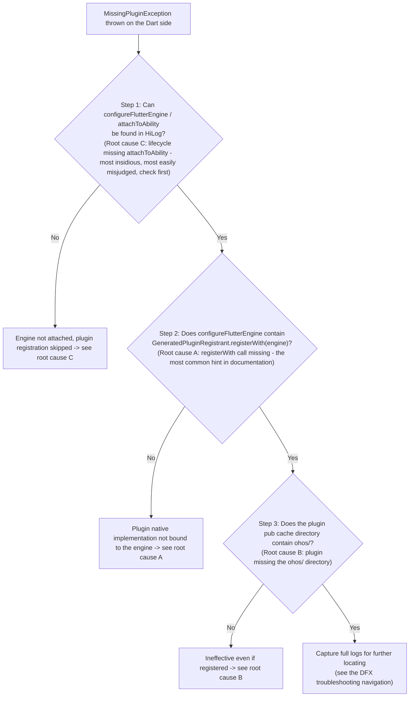

# Third-Party Library and Plugin Adaptation Issues

[Guidance on Adapting Flutter Third-Party Libraries to the OpenHarmony Platform](../plugin-and-package/ohos-flutter-lib-adaptation.en.md)

[Identifying Whether a Flutter Third-Party Library Requires OpenHarmony Adaptation](../plugin-and-package/flutter-library-ohos-check.en.md)

<a id="section212419"></a>

## The ohos Directory of a Plugin Project Cannot Be Synced in DevEco Studio

**Symptom:**

When the `ohos` directory of a Flutter plugin project is opened directly in DevEco Studio, the project cannot be synced properly.

**Cause:**

This is the designed behavior of DevEco Studio. The `ohos` directory of a Flutter plugin is an OpenHarmony **module** structure rather than a standalone OpenHarmony **project**, so it cannot be opened and synced in DevEco as an independent project.

**Solution:**

1. **Develop and debug in the example project**: Use DevEco Studio to open the plugin's `example/ohos` directory, and develop and debug the ohos platform code in this project. For details, see [Developing a Flutter Plugin](../plugin-and-package/developing-plugin.en.md).

2. **Reference the plugin from source code**: In the host Flutter project, depend directly on the plugin source code for building through the hvigor plugin approach. In this way, you can directly modify the source code and get code completion while writing the plugin, with an experience consistent with that on Android and iOS. For details, see [Using the Hvigor Plugin to Build Flutter Projects](../app-development/hvigor-plugin-build.en.md).

> **NOTE**: For an existing Flutter plugin project, leaving it unmodified only causes the example to fail to compile; it does not affect the normal use and compilation of the plugin in a Flutter project.

---

<a id="section152730"></a>

## Dependency Conflict Error During flutter pub get

**Symptom:**

Error log:

```log
Resolving dependencies...
Because flutter_cache_manager >=3.0.0-nullsafety.0 <3.3.2 depends on path_provider from hosted and flutter_cache_manager depends on path_provider from git, flutter_cache_manager >=3.0.0-nullsafety.0 <3.3.2 forbidden.
So because xxx depends on flutter_cache_manager 3.3.1, version solving failed.
pub get failed
...
exit code: 1
```

**Cause:**

The hosted version of `path_provider` conflicts with its git version, causing dependency resolution to fail.

**Solution:**

Use `dependency_overrides` to eliminate the dependency conflict:

```yaml
dependencies:
  flutter:
    sdk: flutter
dependency_overrides:
  path_provider:
    git:
      url: https://gitcode.com/CPF-Flutter/flutter_packages.git
      path: packages/path_provider/path_provider
  path_provider_ohos:
    git:
      url: https://gitcode.com/CPF-Flutter/flutter_packages.git
      path: packages/path_provider/path_provider_ohos
```

---

<a id="section483927"></a>

## The so Package Is Not Included in the har After an FFI Plugin Is Introduced via git

**Symptom:**

An FFI plugin introduces precompiled so packages. When the plugin is introduced as a local `path` dependency, the so files are properly packaged into the har/hap; after the dependency is changed to `git`, the build artifacts no longer contain the so files, and `dlopen failed: xxx.so not found` occurs at runtime.

**Cause:**

With a local `path` dependency, the build takes the so files directly from the plugin's `ohos/libs/<abi>/` on the local disk, without going through git. With a `git` dependency, pub clones the plugin source code into the PUB cache before it is included in the build, so the so files must exist in `ohos/libs/<abi>/` in the git repository source. The root cause of the inconsistency between the two behaviors is usually that the so files were not committed to git.

**Common causes and troubleshooting (in descending order of probability):**

1. **so files not committed to git (most common)**: Check whether `*.so` or `libs/` is ignored in the repository root and in `ohos/.gitignore`. Run `git ls-files | grep "\.so"` to confirm that the so files are tracked. If the output is empty, run `git add -f ohos/libs/arm64-v8a/libhello.so` to force-add them and fix `.gitignore`.
2. **Incorrect so directory location**: The so files must be placed in `ohos/libs/<abi>/` (the `libs/` directory at the root of the ohos module). Files placed in `src/main/libs/` or other locations will not be automatically packaged by hvigor.
3. **externalNativeOptions not removed**: When precompiled so files are used, `externalNativeOptions` in `ohos/build-profile.json5` (which points to `../src/CMakeLists.txt`) should be removed; otherwise the build attempts to compile from the CMake source on the fly.
4. **abi mismatch**: Real devices use `arm64-v8a` and emulators use `x86_64`; place the so files in the directory matching the corresponding abi.

**Solution:**

For the complete end-to-end development, packaging, verification, and publishing process, see [Developing an FFI Plugin](../plugin-and-package/developing-an-ffi-plugin.en.md) (Section 3 for placing so files, Section 6 for verifying the har, Section 7 for publishing to git, and Section 8 for FAQs).

---

<a id="section592016"></a>

## MissingPluginException When Calling a Flutter Plugin

**Symptom:**

A `MissingPluginException` is thrown when the Dart side calls a Flutter plugin (such as `path_provider`, `url_launcher`, or `shared_preferences`). A typical log:

```log
[ERROR:flutter/runtime/dart_vm_initializer.cc(XXX)] Unhandled Exception: MissingPluginException(No implementation found for method getTemporaryDirectory on channel plugins.flutter.io/path_provider)
#0      MethodChannel._invokeMethod (package:flutter/src/services/platform_channel.dart:XXX)
#1      ...
```

This log only indicates that "the platform channel call sent from the Dart side received no response from the native side"; it **cannot directly tell which cause applies**. On OHOS, `MissingPluginException` has **3 categories of root causes**. Troubleshoot them in the order of the decision tree below.

**Cause:**

The plugin's native implementation is not bound to the engine, which may be caused by one of three root causes: a lifecycle exception, a missing registerWith call, or the plugin lacking the ohos platform layer.

**Root cause troubleshooting decision tree (in order of troubleshooting priority):**



- Step 1 checks root cause C (lifecycle exception) first, because it is the most easily misdiagnosed as root cause A.
- Step 2 checks root cause A (missing `registerWith` call), the most common hint in documentation.
- Step 3 checks root cause B (plugin missing the `ohos/` directory). When full logs need to be captured, see [DFX Troubleshooting Navigation](../troubleshooting/dfx/README.en.md).

> **Why check C first?** Root cause A (missing `registerWith` call) is treated as the 'only cause' in most documentation, but in real projects category C (lifecycle exception) is more insidious: developers have usually already written `registerWith`, so troubleshooting by A leads nowhere — what is actually missing is `onAttach()`/`attachToAbility()`. Confirm the lifecycle first, then check the registration call.

**Solution:**

After the decision tree locates the corresponding root cause, refer to the fix for that root cause below.

---

### Root Cause C: Lifecycle Missing attachToAbility (Check First, Most Easily Misjudged)

**Symptom characteristics**: `registerWith` has been called and the plugin has an `ohos/` directory, but calls to the plugin still throw `MissingPluginException`.

**How it works**: Registration of the plugin's native handlers happens in `onAttachedToEngine()`, which is invoked by the engine creation + plugin `add()` flow triggered by `delegate.onAttach()`. Inside `delegate.onAttach()`, the execution order is `setupFlutterEngine() → attachToAbility() → providePlatformPlugin() → configureFlutterEngine() → processPendingMessages()`. If the host does not go through the standard `onAttach()`, the engine is not attached to the Ability, `configureFlutterEngine()` is never called back by the framework, and the `registerWith` written by the developer is not executed either.

**Common trigger scenarios**:

1. In an **Add-to-App hybrid development scenario**, a custom `EntryAbility` does not inherit `FlutterAbility`, does not create a `FlutterAbilityAndEntryDelegate`, or omits `this.delegate?.onAttach(this.context)` in `onCreate()`.
2. A custom `FlutterEntry` subclass does not call `flutterEntry.aboutToAppear()` in the page's `aboutToAppear()` (this method internally triggers `createView → onAttach → onWindowStageCreate`).
3. After an engine is manually created through `engines.createAndRunEngineByOptions()`, only `GeneratedPluginRegistrant.registerWith(engine)` is called, **without calling** `engine.getAbilityControlSurface()?.attachToAbility(host)`, so AbilityAware plugins cannot obtain the context and channel binding fails.

**Verification steps**:

1. Capture HiLog with keyword filters to confirm whether `onAttach()` was executed:
   ```bash
   hdc shell hilog | grep -E "configureFlutterEngine|attachToAbility|FlutterAbilityAndEntryDelegate"
   ```
   If no log corresponding to `configureFlutterEngine` is found, the `onAttach()` flow did not complete and plugin registration was skipped.
2. Check whether `EntryAbility` implements `ExclusiveAppComponent`, and whether it calls `FlutterManager.getInstance().pushUIAbility(this)`/`popUIAbility(this)` in pairs in `onCreate`/`onDestroy` and `pushWindowStage(this, windowStage)`/`popWindowStage(this)` in pairs in `onWindowStageCreate`/`onWindowStageDestroy`.
3. In the hybrid scenario, confirm that `flutterEntry.aboutToAppear()` is called in the page's `aboutToAppear` and that `getFlutterView()` is called after it.

**Fix**: Complete the standard lifecycle calls. For details, see [Flutter App/Module Launch Lifecycle Callback Guide](../app-development/app-module-lifecycle-callbacks.en.md) (§3.2.2, when to call attachToAbility) and [Using FlutterEntry in Hybrid Development](../hybrid-development/using-flutter-entry.en.md).

---

### Root Cause A: GeneratedPluginRegistrant.registerWith Not Called

**Symptom characteristics**: The standard `FlutterAbility` flow is used (engine created automatically, `onAttach` normal), but the Dart side still reports plugin errors.

**How it works**: `FlutterAbility`/`FlutterEntry` by default **only creates the engine and does not automatically register any plugin**. `GeneratedPluginRegistrant.registerWith(engine)` binds the native implementations of all plugins introduced by `pubspec.yaml` to the engine; if it is omitted, the native handlers do not exist when the Dart side calls the plugins.

**Verification step**: In `configureFlutterEngine` of your custom `FlutterEntry`/`FlutterAbility`, check whether the following is called:

```ts
configureFlutterEngine(flutterEngine: FlutterEngine): void {
  super.configureFlutterEngine(flutterEngine);              // super must be called
  GeneratedPluginRegistrant.registerWith(flutterEngine);    // Cannot be omitted
  this.delegate?.addPlugin(new CustomPlugin());              // Custom plugin
}
```

> **NOTE**: For an engine manually created through `engines.createAndRunEngineByOptions()`, the framework does not automatically register plugins. You must call `registerWith(engine)` yourself, and add `attachToAbility(host)` as required by the scenario (see root cause C, scenario 3).

**Fix**: Add the `GeneratedPluginRegistrant.registerWith(flutterEngine)` call. For details, see [Using FlutterEntry in Hybrid Development](../hybrid-development/using-flutter-entry.en.md) (Step 2) and [FlutterEnginePreload User Guide](../hybrid-development/using-flutter-engine-preload.en.md).

---

### Root Cause B: The Plugin Itself Lacks the ohos Platform Layer

**Symptom characteristics**: `registerWith` has been called and the lifecycle is normal, but only **certain plugins** throw `MissingPluginException` while the other plugins work properly.

**How it works**: If a third-party plugin does not provide an `ohos/` platform layer implementation, `GeneratedPluginRegistrant.registerWith()` does not include the native binding for that plugin, so no one responds when the Dart side calls its platform channel.

**Verification steps**:

1. In the plugin's pub cache directory (`~/.pub-cache/hosted/.../<plugin_name>/`), check whether an `ohos/` directory exists.
2. Alternatively, use the methods provided in [Identifying Whether a Flutter Third-Party Library Requires OpenHarmony Adaptation](../plugin-and-package/flutter-library-ohos-check.en.md).

**Fix**:

- If the community already provides an ohos adaptation (mostly in the `flutter_packages` repository), switch to a git reference:
  ```yaml
  dependency_overrides:
    <plugin_name>:
      git:
        url: https://gitcode.com/CPF-Flutter/flutter_packages.git
        path: packages/<plugin_name>/<plugin_name>
  ```
- If no existing adaptation is available, adapt the plugin yourself. For details, see [Guidance on Adapting Flutter Third-Party Libraries to the OpenHarmony Platform](../plugin-and-package/ohos-flutter-lib-adaptation.en.md).
