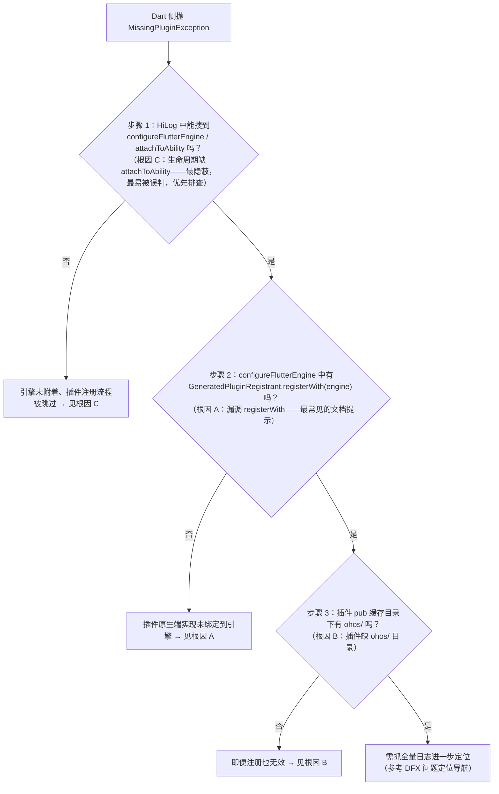

# 三方库与插件适配问题

[Flutter 三方库适配 OpenHarmony 平台指导](../plugin-and-package/ohos-flutter-lib-adaptation.md)

[识别 Flutter 三方库是否需要适配 OpenHarmony](../plugin-and-package/flutter-library-ohos-check.md)

<a id="section212419"></a>

## 插件工程的 ohos 目录无法在 DevEco 中同步

**现象：**

在 DevEco Studio 中直接打开 Flutter 插件工程的 `ohos` 目录，无法正常同步（Sync）项目。

**原因：**

这是 DevEco Studio 的设计行为。Flutter 插件的 `ohos` 目录是 OpenHarmony **module** 结构，而非独立的 OpenHarmony **project** 工程，因此无法作为独立工程在 DevEco 中打开和同步。

**解决方案：**

1. **在 example 工程中开发调试**：使用 DevEco Studio 打开插件的 `example/ohos` 目录，在该工程中开发和调试 ohos 平台代码。详见 [开发 Flutter Plugin](../plugin-and-package/developing-plugin.md)。

2. **以源码方式引用插件**：在宿主 Flutter 工程中通过 hvigor 插件方式直接依赖插件源码构建，这样编写插件时可直接修改源码并获得代码提示，体验与 Android、iOS 一致。详见 [使用 hvigor 插件方式编译 flutter 项目](../app-development/hvigor-plugin-build.md)。

> **注意：** 对于既有的 flutter plugin 项目，如果不做任何修改仅会导致 example 无法正常编译，但不影响该 plugin 在 flutter 项目中的正常使用和编译。

---

<a id="section152730"></a>

## flutter pub get 依赖冲突报错

**现象：**

报错日志：

```log
Resolving dependencies...
Because flutter_cache_manager >=3.0.0-nullsafety.0 <3.3.2 depends on path_provider from hosted and flutter_cache_manager depends on path_provider from git, flutter_cache_manager >=3.0.0-nullsafety.0 <3.3.2 forbidden.
So because xxx depends on flutter_cache_manager 3.3.1, version solving failed.
pub get failed
...
exit code: 1
```

**原因：**

`path_provider` 的 hosted 版本与 git 版本来源冲突，导致依赖求解失败。

**解决方案：**

使用 `dependency_overrides` 消除依赖冲突：

```yaml
dependencies:
  flutter:
    sdk: flutter
dependency_overrides:
  path_provider:
    git:
      url: https://gitcode.com/CPF-Flutter/flutter_packages.git
      path: packages/path_provider/path_provider
  path_provider_ohos:
    git:
      url: https://gitcode.com/CPF-Flutter/flutter_packages.git
      path: packages/path_provider/path_provider_ohos
```

---

<a id="section483927"></a>

## FFI 插件通过 git 引入后 har 未打入 so 包

**现象：**

FFI 插件引入预编译 so 包，本地通过 `path` 依赖引入时 so 正常打入 har/hap；改为 `git` 依赖后，构建产物内不含 so，运行期出现 `dlopen failed: xxx.so not found`。

**原因：**

本地 `path` 依赖时，构建直接从本地磁盘的插件 `ohos/libs/<abi>/` 取 so，不经过 git；而 `git` 依赖时，pub 将插件源码克隆到 PUB 缓存后纳入构建，so 必须存在于 git 仓库源码的 `ohos/libs/<abi>/` 中。两者表现不一致的根因通常在于 so 未被提交到 git。

**常见原因与排查（按概率从高到低）：**

1. **so 未提交到 git（最常见）**：检查仓库根与 `ohos/.gitignore` 是否忽略了 `*.so` 或 `libs/`。用 `git ls-files | grep "\.so"` 确认 so 已被跟踪，若为空需用 `git add -f ohos/libs/arm64-v8a/libhello.so` 强制添加并修正 `.gitignore`。
2. **so 目录位置错误**：so 必须放在 `ohos/libs/<abi>/`（ohos 模块根的 `libs/`），放在 `src/main/libs/` 等位置不会被 hvigor 自动打包。
3. **未移除 externalNativeOptions**：使用预编译 so 时，`ohos/build-profile.json5` 中的 `externalNativeOptions`（指向 `../src/CMakeLists.txt`）应移除，否则会尝试从 CMake 源码现场编译。
4. **abi 不匹配**：真机为 `arm64-v8a`，模拟器为 `x86_64`，需将 so 放在对应 abi 目录。

**解决方案：**

完整的端到端开发、打包、验证与发布流程见 [开发 FFI plugin](../plugin-and-package/developing-an-ffi-plugin.md)（第 3 节放置 so、第 6 节验证 har、第 7 节发布到 git、第 8 节常见问题）。

---

<a id="section592016"></a>

## Flutter 插件调用报 MissingPluginException

**现象：**

Dart 侧调用某个 Flutter 插件（如 `path_provider`、`url_launcher`、`shared_preferences` 等）时抛出 `MissingPluginException`，典型日志：

```log
[ERROR:flutter/runtime/dart_vm_initializer.cc(XXX)] Unhandled Exception: MissingPluginException(No implementation found for method getTemporaryDirectory on channel plugins.flutter.io/path_provider)
#0      MethodChannel._invokeMethod (package:flutter/src/services/platform_channel.dart:XXX)
#1      ...
```

该日志仅说明"Dart 侧发出的平台通道调用没有原生端响应"，**并不能直接判断是哪种原因**。在 OHOS 上 `MissingPluginException` 有 **3 类根因**，请按下方决策树顺序排查。

**原因：**

插件原生端实现未绑定到引擎，可能由生命周期异常、漏调注册、或插件缺 ohos 平台层三类根因之一导致。

**根因排查决策树（按排查优先级）：**



- 步骤 1 排查根因 C（生命周期异常），优先级最高，因为最易被误判为根因 A。
- 步骤 2 排查根因 A（漏调 `registerWith`），是文档中最常见的提示。
- 步骤 3 排查根因 B（插件缺 `ohos/` 目录），需抓全量日志时可参考 [DFX 问题定位导航](../troubleshooting/dfx/README.md)。

> **为什么先排 C？** 根因 A（漏调 `registerWith`）在多数文档里被当作"唯一原因"，但实际项目中 C 类（生命周期异常）更隐蔽：开发者的 `registerWith` 往往已经写了，按 A 排查会扑空，真正缺的是 `onAttach()`/`attachToAbility()`。先确认生命周期，再查注册调用。

**解决方案：**

按决策树定位到对应根因后，参考下方各根因的修复方式。

---

### 根因 C：生命周期缺 attachToAbility（优先排查，最易误判）

**症状特征**：`registerWith` 已调用、插件也有 `ohos/` 目录，但插件调用仍报 `MissingPluginException`。

**原理**：插件原生 handler 的注册发生在 `onAttachedToEngine()` 中，该回调由 `delegate.onAttach()` 触发的引擎创建 + 插件 `add()` 流程调用。`delegate.onAttach()` 内部执行顺序为 `setupFlutterEngine() → attachToAbility() → providePlatformPlugin() → configureFlutterEngine() → processPendingMessages()`。若宿主未走标准 `onAttach()`，引擎未附着到 Ability、`configureFlutterEngine()` 不会被框架回调，开发者即使写了 `registerWith` 也不会执行。

**常见触发场景**：

1. **Add-to-App 混编场景**中自定义 `EntryAbility` 未继承 `FlutterAbility`、未创建 `FlutterAbilityAndEntryDelegate`、或 `onCreate()` 中漏调 `this.delegate?.onAttach(this.context)`。
2. 自定义 `FlutterEntry` 子类未在页面 `aboutToAppear()` 中调用 `flutterEntry.aboutToAppear()`（该方法内部触发 `createView → onAttach → onWindowStageCreate`）。
3. 手动通过 `engines.createAndRunEngineByOptions()` 创建引擎后，只调用了 `GeneratedPluginRegistrant.registerWith(engine)`，**未调用 `engine.getAbilityControlSurface()?.attachToAbility(host)`**，导致 AbilityAware 插件拿不到上下文、channel 绑定异常。

**验证步骤**：

1. 抓取 HiLog 过滤关键字，确认 `onAttach()` 是否执行：
   ```bash
   hdc shell hilog | grep -E "configureFlutterEngine|attachToAbility|FlutterAbilityAndEntryDelegate"
   ```
   若搜不到 `configureFlutterEngine` 对应日志，说明 `onAttach()` 流程未走完，插件注册被跳过。
2. 检查 `EntryAbility` 是否实现 `ExclusiveAppComponent`、是否在 `onCreate`/`onDestroy` 中成对调用 `FlutterManager.getInstance().pushUIAbility(this)`/`popUIAbility(this)`，在 `onWindowStageCreate`/`onWindowStageDestroy` 中成对调用 `pushWindowStage(this, windowStage)`/`popWindowStage(this)`。
3. 混编场景确认 `flutterEntry.aboutToAppear()` 在页面 `aboutToAppear` 中被调用，且 `getFlutterView()` 在其之后调用。

**修复方式**：补齐标准生命周期调用，详见 [OpenHarmony 应用生命周期回调机制](../app-development/app-module-lifecycle-callbacks.md)（§3.2.2 attachToAbility 调用时机）与 [使用 FlutterEntry 实现混编](../hybrid-development/using-flutter-entry.md)。

---

### 根因 A：漏调 GeneratedPluginRegistrant.registerWith

**症状特征**：标准 `FlutterAbility` 流程（引擎自动创建、`onAttach` 正常），但 Dart 侧插件仍报错。

**原理**：`FlutterAbility`/`FlutterEntry` 默认**只创建引擎，不自动注册任何插件**。`GeneratedPluginRegistrant.registerWith(engine)` 会将 `pubspec.yaml` 引入的所有插件原生端实现绑定到引擎，省略后 Dart 侧调用插件时原生 handler 不存在。

**验证步骤**：在自定义 `FlutterEntry`/`FlutterAbility` 的 `configureFlutterEngine` 中检查是否调用：

```ts
configureFlutterEngine(flutterEngine: FlutterEngine): void {
  super.configureFlutterEngine(flutterEngine);              // 必须调用 super
  GeneratedPluginRegistrant.registerWith(flutterEngine);    // 不可省略
  this.delegate?.addPlugin(new CustomPlugin());              // 自定义插件
}
```

> **注意：** 手动通过 `engines.createAndRunEngineByOptions()` 创建的引擎，框架不会自动注册插件，必须开发者自行调用 `registerWith(engine)`，并视场景补 `attachToAbility(host)`（参见根因 C 场景 3）。

**修复方式**：补齐 `GeneratedPluginRegistrant.registerWith(flutterEngine)` 调用，详见 [FlutterEntry 插件注册](../hybrid-development/using-flutter-entry.md)（第二步）与 [FlutterEnginePreload 预加载](../hybrid-development/using-flutter-engine-preload.md)。

---

### 根因 B：插件本身缺 ohos 平台层

**症状特征**：`registerWith` 已调用、生命周期也正常，但只有**个别插件**报 `MissingPluginException`，其余插件正常。

**原理**：三方插件若未提供 `ohos/` 平台层实现，`GeneratedPluginRegistrant.registerWith()` 中不会包含该插件的原生绑定，Dart 侧调用其平台通道时无人响应。

**验证步骤**：

1. 在插件的 pub 缓存目录（`~/.pub-cache/hosted/.../<plugin_name>/`）下检查是否有 `ohos/` 目录。
2. 或用 [识别 Flutter 三方库是否需要适配 OpenHarmony](../plugin-and-package/flutter-library-ohos-check.md) 提供的方法识别。

**修复方式**：

- 若社区已有 ohos 适配版本（多在 `flutter_packages` 仓库），改用 git 引用：
  ```yaml
  dependency_overrides:
    <plugin_name>:
      git:
        url: https://gitcode.com/CPF-Flutter/flutter_packages.git
        path: packages/<plugin_name>/<plugin_name>
  ```
- 若无现成适配，需自行适配，详见 [三方库适配指导](../plugin-and-package/ohos-flutter-lib-adaptation.md)。
