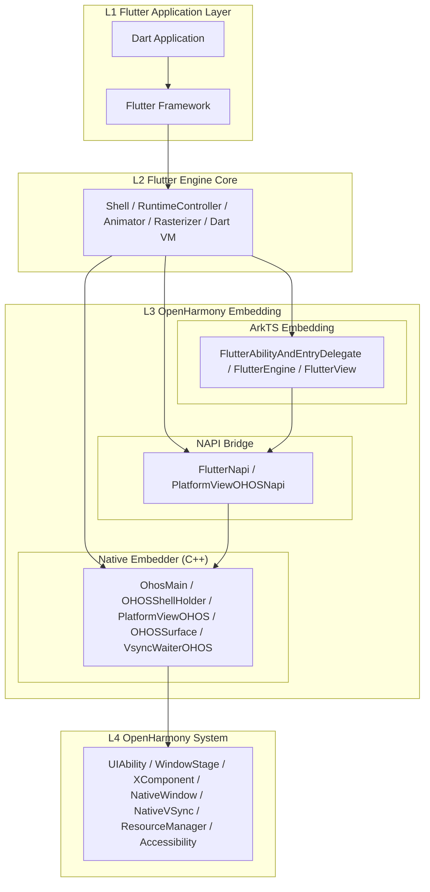
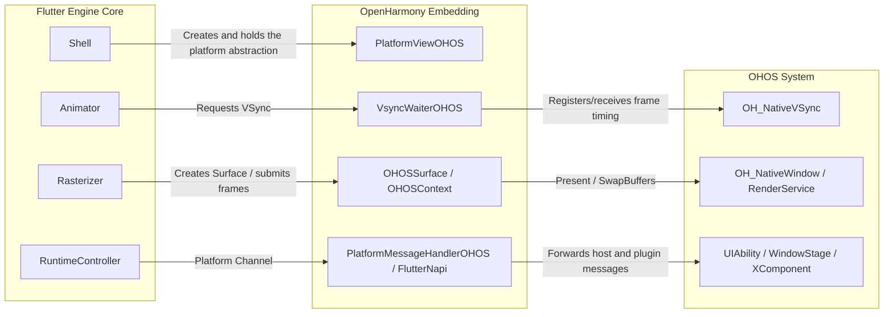
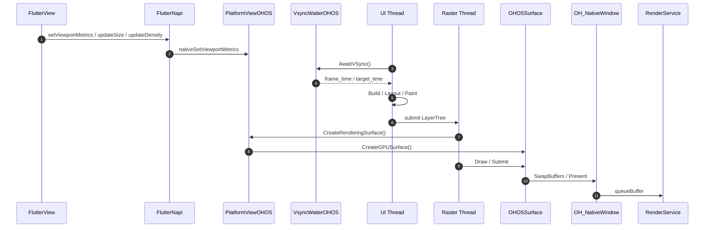

# Flutter OHOS Architecture Introduction

## Core Concepts

| Term | Description |
|---|---|
| **Flutter Engine** | Flutter's platform-agnostic core, including Shell, Rasterizer, RuntimeController, Dart VM, Platform Channel, and more |
| **Embedding** | The platform adaptation layer that integrates the Flutter runtime into the host platform (ArkTS Embedding + Native Embedder) |
| **NAPI** | OpenHarmony's ArkTS-C++ interoperability bridging mechanism |
| **UIAbility** | The application capability carrier in the OpenHarmony Stage model, hosting windows and the lifecycle |
| **WindowStage** | The OpenHarmony window stage, managing window creation and display |
| **XComponent** | The native rendering component provided by OpenHarmony, used to host Flutter content |
| **OH_NativeWindow** | The OpenHarmony native window handle, through which Flutter submits rendering frames |
| **OH_NativeVSync** | The OpenHarmony native vertical sync signal that drives Flutter frame scheduling |
| **Platform Channel** | The message communication channel between Flutter and the native platform (MethodChannel / EventChannel) |
| **PlatformView** | The capability of embedding native platform views in Flutter |
| **Impeller** | Flutter's next-generation rendering engine, using the Vulkan backend on OHOS |
| **ArkTS** | OpenHarmony's application development language, extended from TypeScript |
| **RenderService** | OpenHarmony's system compositing service, responsible for presenting the final frames |

## 1. Overview

The essence of Flutter OHOS is not to redesign a Flutter framework, but to complete the host, rendering, input, resource, lifecycle, and accessibility adaptation layers for the OpenHarmony platform while preserving the main capabilities of the Flutter Framework and Engine Core.

From a code ownership perspective, Flutter OHOS consists of three main parts:

- Flutter application and Framework: developers' Dart business code, plus the upper-layer Flutter framework capabilities.
- Flutter Engine universal core: platform-agnostic implementations such as `Shell`, `Rasterizer`, `RuntimeController`, `Dart VM`, and `Platform Channel`.
- OpenHarmony adaptation layer: ArkTS Embedding, NAPI bridging, and the Native Embedder, which together integrate the Flutter runtime with OpenHarmony system capabilities such as `UIAbility`, `WindowStage`, `XComponent`, `OH_NativeWindow`, `OH_NativeVSync`, `ResourceManager`, and accessibility services.

The OHOS adaptation layer is mainly concentrated in two directories:

- ArkTS Embedding: `engine/src/flutter/shell/platform/ohos/flutter_embedding/flutter/src/main/ets/`
- Native Embedder: `engine/src/flutter/shell/platform/ohos/`

Therefore, the Flutter OHOS architecture can be understood as a platform implementation consisting of an "ArkTS host layer + NAPI bridge layer + C++ Embedder layer": it connects to the Flutter Engine above and interfaces with OpenHarmony system capabilities below.

## 2. Overall Architecture

### 2.1 Layered View

#### 2.1.1 Static Layering Diagram



- L1 handles business logic and Flutter's declarative UI.
- L2 is responsible for the Dart runtime, frame scheduling, and the rendering core.
- L3 maps Flutter's platform abstractions to the OHOS host, windows, input, resources, and system services.
- L4 provides native OpenHarmony capabilities.

#### 2.1.2 Key Interaction Diagram



The relationship between `Flutter Engine Core` and `OpenHarmony Embedding` mainly involves four pathways:

1. Platform abstraction pathway: `Shell -> PlatformViewOHOS`
2. Frame scheduling pathway: `Animator -> VsyncWaiterOHOS -> OH_NativeVSync`
3. Rendering submission pathway: `Rasterizer -> OHOSSurface/OHOSContext -> OH_NativeWindow`
4. Platform message pathway: `RuntimeController -> PlatformMessageHandlerOHOS / FlutterNapi -> ArkTS host`

### 2.2 Functional Division

Flutter OHOS can also be divided into five functional layers:

| Layer | Representative Implementation | Primary Responsibilities |
| --- | --- | --- |
| Flutter application code | Business Dart code | Describes pages, state, routing, and business logic |
| Flutter Framework | Widgets, Rendering, Scheduler, Services | Builds the Widget/Element/RenderObject trees and drives layout, painting, and platform channels |
| Flutter Engine universal core | `Shell`, `Dart VM`, `RuntimeController`, `Rasterizer` | Hosts the Dart runtime, frame scheduling, scene construction, and rendering submission |
| OpenHarmony adaptation code | ArkTS Embedding + NAPI + Native Embedder | Interfaces with Ability, XComponent, input, textures, VSync, accessibility, resources, and system channels |
| OpenHarmony OS capabilities | `UIAbility`, `WindowStage`, `OH_NativeWindow`, `OH_NativeVSync`, `ResourceManager` | Provides windows, graphics buffers, display timing, resources, and system services |

The key conclusion here is that the platform differences of Flutter OHOS are mainly concentrated in the fourth layer, while the Flutter Framework and Engine Core still largely follow the upstream Flutter layered design.

## 3. Core Objects and Responsibilities

### 3.1 ArkTS Embedding

| Core Object | Location | Responsibilities |
| --- | --- | --- |
| `FlutterAbilityAndEntryDelegate` | `embedding/ohos/FlutterAbilityAndEntryDelegate.ets` | Chains together the Ability lifecycle, engine creation, view creation, initial Dart startup, and page show/hide |
| `FlutterEngineGroup` | `embedding/engine/FlutterEngineGroup.ets` | Manages the creation of the first engine and subsequent `spawn` operations, reusing the VM and shared resources |
| `FlutterEngine` | `embedding/engine/FlutterEngine.ets` | Encapsulates `DartExecutor`, system channels, plugin registration, `FlutterRenderer`, and `PlatformViewsController` |
| `FlutterView` | `view/FlutterView.ets` | ArkTS view container, responsible for `XComponent` binding, viewport synchronization, keyboard/mouse input, first-frame listening, and system safe area synchronization |
| `FlutterRenderer` | `embedding/engine/renderer/FlutterRenderer.ets` | Entry point for texture registration and external texture management |
| `PlatformViewsController` | `plugin/platform/PlatformViewsController.ets` | Manages ArkTS native view embedding, texture mode, and hybrid layout |

### 3.2 NAPI Bridge Layer

| Core Object | Location | Responsibilities |
| --- | --- | --- |
| `FlutterNapi` | `embedding/engine/FlutterNapi.ets` | The overall ArkTS-to-Native entry point, responsible for initialization, attach, spawn, platform messages, viewport, textures, accessibility, and `XComponent` binding |
| `PlatformViewOHOSNapi` | `napi/platform_view_ohos_napi.cpp` | The C++ NAPI export layer, receiving ArkTS calls and forwarding them to `OHOSShellHolder` / `PlatformViewOHOS` |

### 3.3 Native Embedder

| Core Object | Location | Responsibilities |
| --- | --- | --- |
| `OhosMain` | `ohos_main.cpp` | Parses Shell Args, generates `Settings`, selects the rendering backend, and completes global engine initialization |
| `OHOSShellHolder` | `ohos_shell_holder.cpp` | Creates `ThreadHost`, `Shell`, and `PlatformViewOHOS`, registers image decoders, and manages the engine lifecycle |
| `PlatformViewOHOS` | `platform_view_ohos.cpp` | Core of the platform adaptation, responsible for Surface, Viewport, Platform Messages, textures, input, lifecycle, and accessibility bridging |
| `XComponentAdapter` / `XComponentBase` | `ohos_xcomponent_adapter.cpp` | Manages multiple `XComponent` instances and their Surface/input/accessibility callbacks |
| `VsyncWaiterOHOS` | `vsync_waiter_ohos.cpp` | Interfaces with `OH_NativeVSync`, drives Flutter frame scheduling, and integrates refresh rate voting |
| `OHOSSurface` / `OHOSContext` | `surface/*`, `context/*` | Manages the graphics context, window surface, Swapchain/EGLSurface, and GPU Surface |
| `OHOSAssetProvider` | `ohos_asset_provider.cpp` | Provides Flutter assets from the raw resources of the HAP |
| `SemanticsBridge` | `accessibility/ohos_semantics_bridge.cpp` | Maintains the mapping between the Flutter semantics tree and OpenHarmony accessibility events |

## 4. Threading Model

Flutter OHOS inherits Flutter's multi-threaded runtime model, while additionally layering on the ArkTS main thread and OpenHarmony system thread constraints.

### 4.1 Thread Composition

| Thread | Primary Source | Core Responsibilities |
| --- | --- | --- |
| ArkTS main thread | OpenHarmony application main thread | `UIAbility`, `WindowStage`, `FlutterView`, ArkTS plugins, window events, system callbacks |
| Platform Thread | Current platform message loop | NAPI callback landing point, platform message dispatch, coordination of some host logic |
| UI Thread | Created by `OHOSShellHolder` | Dart Isolate scheduling, animation frame production, Framework Build/Layout/Paint |
| Raster Thread | Created by `OHOSShellHolder` | GPU Surface creation, scene rasterization, SwapBuffers/Present |
| IO Thread | Created by `OHOSShellHolder` | Resource loading, image decoding, some VSync voting, and background tasks |

### 4.2 OHOS Thread Adaptation Characteristics

1. `OHOSShellHolder` explicitly creates a `ThreadHost` that includes at least the Raster and IO threads; when `merged_platform_ui_thread` is not enabled, it also creates a separate UI thread.
2. The OHOS version sets higher QoS for the UI and Raster threads, mapping their priorities to `QOS_USER_INTERACTIVE` to ensure first-frame and interaction smoothness.
3. `VsyncWaiterOHOS` registers `OH_NativeVSync_RequestFrameWithMultiCallback` on the UI thread; when the VSync callback arrives, it wakes up the Flutter UI frame flow.
4. The ArkTS main thread does not directly carry Flutter engine rendering tasks. It is mainly responsible for host UI, lifecycle, and system event collection, and then enters the Flutter runtime through NAPI.

### 4.3 Threading Model

Flutter OHOS is closer to the native Flutter Embedder design, with `Platform / UI / Raster / IO` at its core. This means Flutter's layout, painting, and rasterization are naturally layered.

## 5. Startup Flow

Flutter OHOS startup can be divided into four phases.

### 5.1 Phase 1: Loader and Global Engine Initialization

1. The ArkTS side obtains `FlutterLoader` and `FlutterNapi` through `FlutterInjector`.
2. `FlutterLoader.startInitialization()` loads `FlutterApplicationInfo`, prefetches default fonts, and in Debug mode copies `kernel_blob.bin`, the VM snapshot, and the isolate snapshot from the HAP to the application's private directory.
3. `FlutterLoader.ensureInitializationComplete()` assembles Shell Args, such as ICU, the resource cache, the Impeller toggle, AOT/JIT resource paths, and so on.
4. `FlutterNapi.init()` enters Native, calls `OhosMain::NativeInit()`, generates the Flutter `Settings`, and determines the OHOS-side rendering backend:
   - Software rendering: `kSoftware`
   - Skia + OpenGL ES: `kOpenGLES`
   - Impeller + Vulkan: `kImpellerVulkan`

### 5.2 Phase 2: FlutterEngine Creation or Reuse

1. `FlutterAbilityAndEntryDelegate.setupFlutterEngine()` decides whether to use a cached engine, a custom engine, or a cached `FlutterEngineGroup`, or to create a new engine group.
2. The first engine is created through `FlutterEngineGroup.createAndRunEngineByOptions()`:
   - `FlutterEngine` initializes the `DartExecutor`, Renderer, system channels, and plugin registrar.
   - `FlutterNapi.attachToNative()` calls the Native `attach`.
   - The Native side creates `OHOSShellHolder`, `Shell`, and `PlatformViewOHOS`.
3. Subsequent engines are created through `spawn()`, sharing the VM and some underlying resources but owning independent Dart Isolates.

### 5.3 Phase 3: FlutterView and XComponent Binding

1. `FlutterAbilityAndEntryDelegate.createView()` creates the `FlutterView`.
2. `FlutterView.attachToFlutterEngine()` binds the viewId to the `FlutterEngine`.
3. `FlutterNapi.xComponentAttachFlutterEngine()` enters Native, where `XComponentAdapter` associates the `XComponent` with a specific `shellHolderId`.
4. When the `XComponent`'s `OnSurfaceCreated` callback is triggered, Native obtains the `OH_NativeWindow` and calls `PlatformViewOHOS::NotifyCreate()`.
5. `PlatformViewOHOS` hands the `OH_NativeWindow` to `OHOSSurface` on the Raster thread, completing the establishment of the onscreen surface or swapchain.

### 5.4 Phase 4: First-Frame Scheduling and Display

1. `Shell` waits for `OH_NativeVSync` through `VsyncWaiterOHOS::AwaitVSync()`.
2. After VSync arrives, the UI thread drives the Flutter Framework to complete Build/Layout/Paint, generating the LayerTree/DisplayList.
3. The Raster thread calls `CreateRenderingSurface()`, where `OHOSSurface` creates the GPU Surface and submits the rendering.
4. The final image is submitted to `RenderService` through `OH_NativeWindow`.
5. After the first frame is complete, Native calls back to ArkTS through `FlutterNapi.onFirstFrame()`, which then notifies the host through `FlutterView.onFirstFrame()`.

## 6. Rendering Architecture

### 6.1 Rendering Backend Selection

Flutter OHOS currently supports three rendering modes:

- Software rendering: the fallback path, mainly used for special scenarios.
- Skia + OpenGL ES: the traditional GPU path.
- Impeller + Vulkan: the key optimization path for OHOS, and currently the default high-performance path.

When created, `PlatformViewOHOS` constructs the corresponding `OHOSContext` and `OHOSSurface` based on `Settings.ohos_rendering_api`:

- `OhosContextGLSkia` + `OhosSurfaceGLSkia`
- `OHOSContextVulkanImpeller` + `OHOSSurfaceVulkanImpeller`
- `OHOSSurfaceSoftware`

### 6.2 Rendering Submission Pipeline



### 6.3 OHOS Rendering Adaptation Characteristics

1. `FlutterView` continuously synchronizes display size, pixel density, foldable-screen characteristics, system safe areas, keyboard areas, and gesture areas, aggregating them into ViewportMetrics.
2. `PlatformViewOHOS` caches `native_window` and supports surface rebuilds and context reconstruction after window changes.
3. `OHOSSurfaceVulkanImpeller` supports pre-warming the `GPUSurface`, reducing the cold-start cost of creating the Vulkan surface/swapchain before the first frame.
4. `VsyncWaiterOHOS` integrates refresh rate awareness and a voting mechanism, allowing it to work with LTPO dynamic refresh rates.

## 7. Communication Mechanisms

Flutter OHOS has two core communication pathways.

### 7.1 Platform Message Pathway Between Dart and ArkTS/Native

```text
Dart Platform Channel
  -> Engine PlatformMessage
  -> PlatformMessageHandlerOHOS
  -> FlutterNapi / ArkTS handler
  -> ArkTS plugin or system service
```

In the reverse direction, ArkTS calls `FlutterNapi.dispatchPlatformMessage()` or `dispatchEmptyPlatformMessage()`, which is forwarded through `PlatformViewOHOSNapi` to `PlatformViewOHOS::DispatchPlatformMessage()` and then delivered back to Dart.

### 7.2 System Channels and Host Channels

`FlutterEngine` creates a set of system channels during initialization, including:

- `LifecycleChannel`
- `NavigationChannel`
- `TextInputChannel`
- `PlatformChannel`
- `SystemChannel`
- `LocalizationChannel`
- `AccessibilityChannel`
- `SettingsChannel`
- `DisplayMetricsChannel`
- `NativeVsyncChannel`

This allows the OHOS host to inject lifecycle, routing, keyboard, system settings, refresh rate, localization, and accessibility capabilities into the Flutter Framework.

## 8. Input, Platform Views, and Textures

### 8.1 Input Events

The input pathway originates from `XComponent`:

```text
OH_NativeXComponent callback
  -> XComponentBase
  -> OhosTouchProcessor
  -> PointerDataPacket
  -> PlatformViewOHOS
  -> Flutter Engine
```

Specifically, it includes:

- Touch events: converted to Flutter `PointerDataPacket`
- Mouse events: buttons, movement, exit, and scroll wheel are supported
- Axis events: API 15+ uses native axis events to handle scrolling
- Keyboard events: handled on the ArkTS side by `KeyboardManager`, `TextInputPlugin`, and system channels working together

`OhosTouchProcessor` also filters certain duplicate down/up events from OpenHarmony to avoid abnormal gesture states in multi-touch scenarios.

### 8.2 Platform Views

Flutter OHOS's platform view capability is led by the ArkTS-side `PlatformViewsController`, and the implementation leans toward "ArkUI view orchestration + Flutter texture/layout coordination".

It is responsible for:

- Creating and destroying platform views
- Managing platform view sizes and offsets
- Maintaining `PlatformViewWrapper`
- Interfacing with texture mode through `TextureRegistry`/`FlutterRenderer`
- Mounting ArkTS native nodes into the Flutter page composition results

### 8.3 External Textures

The Native side unifies external texture abstractions through `OHOSExternalTexture`, split by backend into:

- `OHOSExternalTextureGL`
- `OHOSExternalTextureVulkan`

Typical scenarios include video, camera, PixelMap, and NativeImage. The ArkTS side registers textures through `FlutterRenderer`, while the Native side creates the producer window, receives frame-available callbacks, and drives Flutter redraws.

## 9. Lifecycle, Resources, and Accessibility

### 9.1 Lifecycle Synchronization

The ArkTS-side `FlutterAbilityAndEntryDelegate` dispatches lifecycle states to Flutter through `LifecycleChannel` based on events such as `onShow`, `onHide`, `onPaused`, `onResumed`, and window focus changes.

The Native-side `PlatformViewOHOS` listens for `flutter/lifecycle` platform messages and executes the local GPU resource reclamation strategy.

### 9.2 Resource Management

Flutter OHOS's resource strategy is mainly reflected in three points:

1. `OHOSAssetProvider` provides Flutter assets directly from the raw assets of the HAP.
2. `OHOSImageGenerator` integrates OpenHarmony's image decoding capabilities, prioritizing the system hardware decoding path.
3. `PlatformViewOHOS` supports GPU reclamation during lifecycle transitions:
   - Foreground resume: `kRestore`
   - Background/hidden/detached: `kAggressive`

The goal of this strategy is to reduce the occupancy of background DMA buffers, textures, and onscreen contexts, while rebuilding the rendering surface as quickly as possible when returning to the foreground.

### 9.3 Accessibility

The OHOS accessibility pathway is completed through ArkTS and Native collaboration:

- The ArkTS side listens for changes in the system accessibility toggle and dispatches them through `FlutterNapi.accessibilityStateChange()`
- The Native-side `SemanticsBridge` maintains the Flutter semantics tree
- `XComponentBase` is responsible for registering `ArkUI_AccessibilityProvider`
- In API 15+ scenarios, `MultiInstanceXCompAccessibility` supports accessibility handling for multiple `XComponent` instances

As a result, semantic nodes generated by the Flutter Framework can be mapped to accessibility nodes and events that OpenHarmony recognizes.

## 10. Multi-Engine and Architecture Feature Summary

The key architectural features of Flutter OHOS are as follows:

1. Clear adaptation layer boundaries. The Flutter Framework and Engine Core remain largely universal implementations, with OHOS differences concentrated in ArkTS Embedding, NAPI, and the Native Embedder.
2. The host model fits OpenHarmony. It uses `UIAbility + WindowStage + XComponent` as the host container instead of copying the Android Activity/View model.
3. A clear rendering pathway. `FlutterView` handles the host-side window and viewport; after synchronization into `PlatformViewOHOS`, `OHOSSurface` and `OHOSContext` complete the GPU submission.
4. Complete multi-engine capabilities. `FlutterEngineGroup`, `spawn()`, `preDraw()`, and the pre-warming mechanism provide good scalability for multi-page, multi-instance scenarios.
5. Deep platform capability integration. Input, refresh rate voting, external textures, foldable-screen characteristics, system safe areas, and accessibility are all incorporated into the platform implementation.

In summary, Flutter OHOS does not simply run Flutter on HarmonyOS; it implements a Flutter Embedder system that conforms to the OpenHarmony application model and system capability boundaries. Upward, this system keeps the Flutter development paradigm unchanged; downward, it achieves deep integration with OpenHarmony graphics, input, resources, and system services through dual-layer ArkTS and Native adaptation.
