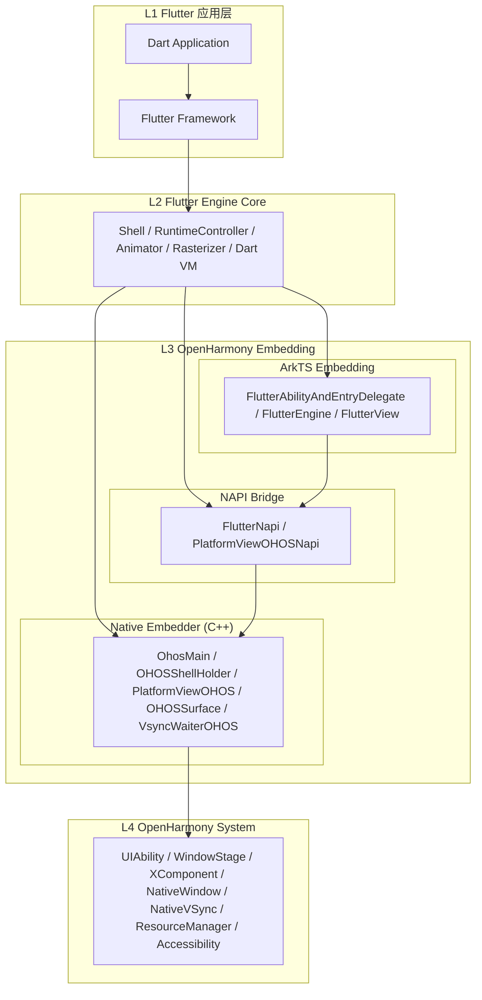
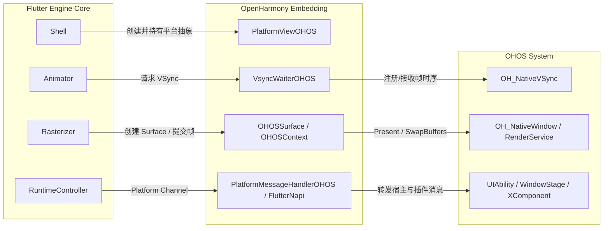
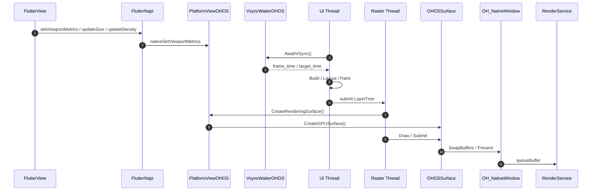

# Flutter OHOS 架构介绍

## 核心概念

| 术语 | 说明 |
|---|---|
| **Flutter Engine** | Flutter 的平台无关核心，包含 Shell、Rasterizer、RuntimeController、Dart VM、Platform Channel 等 |
| **Embedding** | 平台适配层，将 Flutter 运行时接入宿主平台（ArkTS Embedding + Native Embedder） |
| **NAPI** | OpenHarmony 的 ArkTS 与 C++ 互操作桥接机制 |
| **UIAbility** | OpenHarmony Stage 模型中的应用能力载体，承载窗口与生命周期 |
| **WindowStage** | OpenHarmony 窗口舞台，管理窗口创建与显示 |
| **XComponent** | OpenHarmony 提供的 Native 渲染组件，用于承载 Flutter 画面 |
| **OH_NativeWindow** | OpenHarmony 原生窗口句柄，Flutter 通过它提交渲染帧 |
| **OH_NativeVSync** | OpenHarmony 原生垂直同步信号，驱动 Flutter 帧调度 |
| **Platform Channel** | Flutter 与原生平台之间的消息通信通道（MethodChannel / EventChannel） |
| **PlatformView** | Flutter 中嵌入原生平台视图的能力 |
| **Impeller** | Flutter 新一代渲染引擎，OHOS 上使用 Vulkan 后端 |
| **ArkTS** | OpenHarmony 的应用开发语言，基于 TypeScript 扩展 |
| **RenderService** | OpenHarmony 系统合成服务，负责最终帧上屏 |

## 1. 概述

Flutter OHOS 的本质不是重新设计一套 Flutter 框架，而是在保留 Flutter Framework 与 Engine Core 主体能力的前提下，补齐 OpenHarmony 平台的宿主、渲染、输入、资源、生命周期和无障碍适配层。

从代码归属上看，Flutter OHOS 主要由三部分组成：

- Flutter 应用与 Framework：开发者 Dart 业务代码，以及 Flutter 上层框架能力。
- Flutter Engine 通用核心：`Shell`、`Rasterizer`、`RuntimeController`、`Dart VM`、`Platform Channel` 等平台无关实现。
- OpenHarmony 适配层：ArkTS Embedding、NAPI 桥接和 Native Embedder，共同把 Flutter 运行时接入 OpenHarmony 的 `UIAbility`、`WindowStage`、`XComponent`、`OH_NativeWindow`、`OH_NativeVSync`、`ResourceManager`、无障碍服务等系统能力。

OHOS 适配层主要集中在两个目录：

- ArkTS Embedding：`engine/src/flutter/shell/platform/ohos/flutter_embedding/flutter/src/main/ets/`
- Native Embedder：`engine/src/flutter/shell/platform/ohos/`

因此，Flutter OHOS 的架构可以理解为一套“ArkTS 宿主层 + NAPI 桥接层 + C++ Embedder 层”的平台实现，它向上承接 Flutter Engine，向下对接 OpenHarmony 系统能力。

## 2. 整体架构

### 2.1 分层视图

#### 2.1.1 静态分层图



- L1 负责业务与 Flutter 声明式 UI。
- L2 负责 Dart 运行时、帧调度和渲染核心。
- L3 负责把 Flutter 的平台抽象映射到 OHOS 宿主、窗口、输入、资源和系统服务。
- L4 提供 OpenHarmony 原生能力。

#### 2.1.2 关键交互图



`Flutter Engine Core` 与 `OpenHarmony Embedding` 的关系主要包含四条主线：

1. 平台抽象主线：`Shell -> PlatformViewOHOS`
2. 帧调度主线：`Animator -> VsyncWaiterOHOS -> OH_NativeVSync`
3. 渲染提交主线：`Rasterizer -> OHOSSurface/OHOSContext -> OH_NativeWindow`
4. 平台消息主线：`RuntimeController -> PlatformMessageHandlerOHOS / FlutterNapi -> ArkTS 宿主`

### 2.2 按功能划分

Flutter OHOS 也可以按功能拆成五层：

| 层次 | 代表实现 | 主要职责 |
| --- | --- | --- |
| Flutter 应用代码 | 业务 Dart 代码 | 描述页面、状态、路由和业务逻辑 |
| Flutter Framework | Widgets、Rendering、Scheduler、Services | 构建 Widget/Element/RenderObject 树，驱动布局、绘制与平台通道 |
| Flutter Engine 通用核心 | `Shell`、`Dart VM`、`RuntimeController`、`Rasterizer` | 承载 Dart 运行时、帧调度、场景构建与渲染提交 |
| OpenHarmony 适配代码 | ArkTS Embedding + NAPI + Native Embedder | 对接 Ability、XComponent、输入、纹理、VSync、无障碍、资源和系统通道 |
| OpenHarmony OS 能力 | `UIAbility`、`WindowStage`、`OH_NativeWindow`、`OH_NativeVSync`、`ResourceManager` | 提供窗口、图形缓冲、显示时序、资源和系统服务 |

这里最关键的结论是：Flutter OHOS 的平台差异主要集中在第四层，Flutter Framework 和 Engine Core 主体仍然遵循上游 Flutter 的分层设计。

## 3. 核心对象与职责

### 3.1 ArkTS Embedding

| 核心对象 | 位置 | 职责 |
| --- | --- | --- |
| `FlutterAbilityAndEntryDelegate` | `embedding/ohos/FlutterAbilityAndEntryDelegate.ets` | 串联 Ability 生命周期、引擎创建、视图创建、首轮 Dart 启动和页面显示/隐藏 |
| `FlutterEngineGroup` | `embedding/engine/FlutterEngineGroup.ets` | 管理首引擎创建与后续 `spawn`，复用 VM 和共享资源 |
| `FlutterEngine` | `embedding/engine/FlutterEngine.ets` | 封装 `DartExecutor`、系统通道、插件注册、`FlutterRenderer`、`PlatformViewsController` |
| `FlutterView` | `view/FlutterView.ets` | ArkTS 视图容器，负责 `XComponent` 绑定、Viewport 同步、键鼠输入、首帧监听、系统避让区同步 |
| `FlutterRenderer` | `embedding/engine/renderer/FlutterRenderer.ets` | 纹理注册与外部纹理管理入口 |
| `PlatformViewsController` | `plugin/platform/PlatformViewsController.ets` | 管理 ArkTS 原生视图嵌入、纹理模式与混合布局 |

### 3.2 NAPI 桥接层

| 核心对象 | 位置 | 职责 |
| --- | --- | --- |
| `FlutterNapi` | `embedding/engine/FlutterNapi.ets` | ArkTS 对 Native 的总入口，负责初始化、attach、spawn、平台消息、viewport、纹理、无障碍和 `XComponent` 绑定 |
| `PlatformViewOHOSNapi` | `napi/platform_view_ohos_napi.cpp` | C++ NAPI 导出层，接收 ArkTS 调用并转发给 `OHOSShellHolder` / `PlatformViewOHOS` |

### 3.3 Native Embedder

| 核心对象 | 位置 | 职责 |
| --- | --- | --- |
| `OhosMain` | `ohos_main.cpp` | 解析 Shell Args，生成 `Settings`，选择渲染后端，完成引擎全局初始化 |
| `OHOSShellHolder` | `ohos_shell_holder.cpp` | 创建 `ThreadHost`、`Shell`、`PlatformViewOHOS`、注册图像解码器，管理引擎生命周期 |
| `PlatformViewOHOS` | `platform_view_ohos.cpp` | 平台适配核心，负责 Surface、Viewport、Platform Message、纹理、输入、生命周期和无障碍桥接 |
| `XComponentAdapter` / `XComponentBase` | `ohos_xcomponent_adapter.cpp` | 管理多个 `XComponent` 实例及其 Surface/输入/无障碍回调 |
| `VsyncWaiterOHOS` | `vsync_waiter_ohos.cpp` | 对接 `OH_NativeVSync`，驱动 Flutter 帧调度，并接入刷新率投票 |
| `OHOSSurface` / `OHOSContext` | `surface/*`、`context/*` | 管理图形上下文、窗口表面、Swapchain / EGLSurface 与 GPU Surface |
| `OHOSAssetProvider` | `ohos_asset_provider.cpp` | 从 HAP 原始资源中提供 Flutter 资产 |
| `SemanticsBridge` | `accessibility/ohos_semantics_bridge.cpp` | 维护 Flutter 语义树与 OpenHarmony 无障碍事件之间的映射 |

## 4. 线程模型

Flutter OHOS 沿用了 Flutter 的多线程运行时模型，但又叠加了 ArkTS 主线程和 OpenHarmony 系统线程约束。

### 4.1 线程组成

| 线程 | 主要来源 | 核心职责 |
| --- | --- | --- |
| ArkTS 主线程 | OpenHarmony 应用主线程 | `UIAbility`、`WindowStage`、`FlutterView`、ArkTS 插件、窗口事件、系统回调 |
| Platform Thread | 当前平台消息循环 | NAPI 回调落点、平台消息分发、部分宿主逻辑协同 |
| UI Thread | `OHOSShellHolder` 创建 | Dart Isolate 调度、动画帧生产、Framework Build/Layout/Paint |
| Raster Thread | `OHOSShellHolder` 创建 | GPU Surface 创建、场景栅格化、SwapBuffers / Present |
| IO Thread | `OHOSShellHolder` 创建 | 资源加载、图片解码、部分 VSync 投票和后台任务 |

### 4.2 OHOS 线程适配特点

1. `OHOSShellHolder` 会显式创建 `ThreadHost`，至少包含 Raster 和 IO 线程；当未启用 `merged_platform_ui_thread` 时，还会单独创建 UI 线程。
2. OHOS 版本为 UI 线程和 Raster 线程设置了更高 QoS，优先级分别映射到 `QOS_USER_INTERACTIVE`，以保证首帧和交互流畅度。
3. `VsyncWaiterOHOS` 在 UI 线程上注册 `OH_NativeVSync_RequestFrameWithMultiCallback`，VSync 回调到来后再唤醒 Flutter UI 帧流程。
4. ArkTS 主线程并不直接承担 Flutter 引擎渲染任务，它主要负责宿主 UI、生命周期和系统事件收集，然后经由 NAPI 进入 Flutter 运行时。

### 4.3 线程模型

Flutter OHOS 更接近 Flutter 原生 Embedder 设计，核心是 `Platform / UI / Raster / IO`。这意味着 Flutter 的布局、绘制和栅格化天然分层。

## 5. 启动流程

Flutter OHOS 的启动可以拆成四个阶段。

### 5.1 阶段一：Loader 与引擎全局初始化

1. ArkTS 侧通过 `FlutterInjector` 获取 `FlutterLoader` 和 `FlutterNapi`。
2. `FlutterLoader.startInitialization()` 加载 `FlutterApplicationInfo`，预取默认字体，并在 Debug 模式下把 `kernel_blob.bin`、VM snapshot、isolate snapshot 从 HAP 复制到应用私有目录。
3. `FlutterLoader.ensureInitializationComplete()` 组装 Shell Args，例如 ICU、资源缓存、Impeller 开关、AOT/JIT 资源路径等。
4. `FlutterNapi.init()` 进入 Native，调用 `OhosMain::NativeInit()`，生成 Flutter `Settings`，并确定 OHOS 侧渲染后端：
   - 软件渲染：`kSoftware`
   - Skia + OpenGL ES：`kOpenGLES`
   - Impeller + Vulkan：`kImpellerVulkan`

### 5.2 阶段二：FlutterEngine 创建或复用

1. `FlutterAbilityAndEntryDelegate.setupFlutterEngine()` 决定使用缓存引擎、自定义引擎、缓存 `FlutterEngineGroup`，还是新建引擎组。
2. 首个引擎通过 `FlutterEngineGroup.createAndRunEngineByOptions()` 创建：
   - `FlutterEngine` 初始化 `DartExecutor`、Renderer、系统通道、插件注册器。
   - `FlutterNapi.attachToNative()` 调用 Native `attach`。
   - Native 侧创建 `OHOSShellHolder`、`Shell` 和 `PlatformViewOHOS`。
3. 后续引擎通过 `spawn()` 创建，共享 VM 和部分底层资源，但拥有独立 Dart Isolate。

### 5.3 阶段三：FlutterView 与 XComponent 绑定

1. `FlutterAbilityAndEntryDelegate.createView()` 创建 `FlutterView`。
2. `FlutterView.attachToFlutterEngine()` 把 viewId 绑定到 `FlutterEngine`。
3. `FlutterNapi.xComponentAttachFlutterEngine()` 进入 Native，由 `XComponentAdapter` 将 `XComponent` 与具体 `shellHolderId` 建立关联。
4. 当 `XComponent` 的 `OnSurfaceCreated` 回调触发时，Native 会拿到 `OH_NativeWindow`，并调用 `PlatformViewOHOS::NotifyCreate()`。
5. `PlatformViewOHOS` 在 Raster 线程上把 `OH_NativeWindow` 交给 `OHOSSurface`，完成 onscreen surface 或 swapchain 的建立。

### 5.4 阶段四：首帧调度与显示

1. `Shell` 通过 `VsyncWaiterOHOS::AwaitVSync()` 等待 `OH_NativeVSync`。
2. VSync 到来后，UI 线程驱动 Flutter Framework 完成 Build/Layout/Paint，生成 LayerTree/DisplayList。
3. Raster 线程调用 `CreateRenderingSurface()`，由 `OHOSSurface` 创建 GPU Surface 并提交渲染。
4. 最终图像通过 `OH_NativeWindow` 提交给 `RenderService`。
5. 首帧完成后，Native 通过 `FlutterNapi.onFirstFrame()` 回调 ArkTS，再由 `FlutterView.onFirstFrame()` 通知宿主。

## 6. 渲染架构

### 6.1 渲染后端选择

Flutter OHOS 当前支持三种渲染模式：

- 软件渲染：兜底路径，主要用于特殊场景。
- Skia + OpenGL ES：传统 GPU 路径。
- Impeller + Vulkan：OHOS 的重点优化路径，当前也是默认高性能路径。

`PlatformViewOHOS` 在创建时会根据 `Settings.ohos_rendering_api` 构造对应的 `OHOSContext` 与 `OHOSSurface`：

- `OhosContextGLSkia` + `OhosSurfaceGLSkia`
- `OHOSContextVulkanImpeller` + `OHOSSurfaceVulkanImpeller`
- `OHOSSurfaceSoftware`

### 6.2 渲染提交链路



### 6.3 OHOS 渲染适配特点

1. `FlutterView` 会持续同步显示尺寸、像素密度、折叠屏特征、系统避让区、键盘区域和手势区域，统一汇总为 ViewportMetrics。
2. `PlatformViewOHOS` 会缓存 `native_window`，支持 surface rebuild 和窗口变化后的上下文重建。
3. `OHOSSurfaceVulkanImpeller` 支持预热 `GPUSurface`，减少首帧前创建 Vulkan surface / swapchain 的冷启动成本。
4. `VsyncWaiterOHOS` 集成了刷新率感知与投票机制，可与 LTPO 动态刷新率协同。

## 7. 通信机制

Flutter OHOS 存在两条核心通信链路。

### 7.1 Dart 与 ArkTS/Native 的平台消息链路

```text
Dart Platform Channel
  -> Engine PlatformMessage
  -> PlatformMessageHandlerOHOS
  -> FlutterNapi / ArkTS handler
  -> ArkTS plugin or system service
```

反向链路则由 ArkTS 调用 `FlutterNapi.dispatchPlatformMessage()` 或 `dispatchEmptyPlatformMessage()`，经 `PlatformViewOHOSNapi` 转发到 `PlatformViewOHOS::DispatchPlatformMessage()`，再送回 Dart。

### 7.2 系统通道与宿主通道

`FlutterEngine` 初始化时会创建一组系统通道，包括：

- `LifecycleChannel`
- `NavigationChannel`
- `TextInputChannel`
- `PlatformChannel`
- `SystemChannel`
- `LocalizationChannel`
- `AccessibilityChannel`
- `SettingsChannel`
- `DisplayMetricsChannel`
- `NativeVsyncChannel`

这使得 OHOS 宿主可以把生命周期、路由、键盘、系统设置、刷新率、本地化和无障碍能力注入 Flutter Framework。

## 8. 输入、平台视图与纹理

### 8.1 输入事件

输入链路以 `XComponent` 为源头：

```text
OH_NativeXComponent callback
  -> XComponentBase
  -> OhosTouchProcessor
  -> PointerDataPacket
  -> PlatformViewOHOS
  -> Flutter Engine
```

具体包括：

- 触摸事件：转换为 Flutter `PointerDataPacket`
- 鼠标事件：支持按键、移动、离开、滚轮
- 轴事件：API 15+ 使用原生轴事件处理滚动
- 键盘事件：ArkTS 侧由 `KeyboardManager`、`TextInputPlugin` 和系统通道协同处理

`OhosTouchProcessor` 还对 OpenHarmony 某些重复 down/up 事件做了过滤，避免多指场景下手势状态异常。

### 8.2 平台视图

Flutter OHOS 的平台视图能力由 ArkTS 侧 `PlatformViewsController` 主导，实现方式更偏向“ArkUI 视图编排 + Flutter 纹理/布局协同”。

它负责：

- 创建和销毁平台视图
- 管理平台视图尺寸与偏移
- 维护 `PlatformViewWrapper`
- 通过 `TextureRegistry`/`FlutterRenderer` 对接纹理模式
- 把 ArkTS 原生节点挂入 Flutter 页面组合结果中

### 8.3 外接纹理

Native 侧通过 `OHOSExternalTexture` 统一外部纹理抽象，并按后端拆分为：

- `OHOSExternalTextureGL`
- `OHOSExternalTextureVulkan`

典型场景包括视频、相机、PixelMap 和 NativeImage。ArkTS 侧通过 `FlutterRenderer` 注册纹理，Native 侧则负责创建生产者窗口、接收帧可用回调并驱动 Flutter 重绘。

## 9. 生命周期、资源与无障碍

### 9.1 生命周期同步

ArkTS 侧 `FlutterAbilityAndEntryDelegate` 会根据 `onShow`、`onHide`、`onPaused`、`onResumed`、窗口焦点变化等事件，通过 `LifecycleChannel` 向 Flutter 下发生命周期状态。

Native 侧 `PlatformViewOHOS` 会监听 `flutter/lifecycle` 平台消息，并执行本地 GPU 资源回收策略。

### 9.2 资源管理

Flutter OHOS 的资源策略主要体现在三点：

1. `OHOSAssetProvider` 直接从 HAP 的 raw assets 中提供 Flutter 资源。
2. `OHOSImageGenerator` 接入 OpenHarmony 图像解码能力，优先使用系统硬解码路径。
3. `PlatformViewOHOS` 在生命周期切换时支持 GPU reclaim：
   - 前台恢复：`kRestore`
   - 后台/隐藏/分离：`kAggressive`

这套策略的目标是降低后台 DMA buffer、纹理和 onscreen context 占用，同时在恢复前台时尽快重建渲染面。

### 9.3 无障碍

OHOS 无障碍链路由 ArkTS 与 Native 协同完成：

- ArkTS 侧监听系统无障碍开关变化，并通过 `FlutterNapi.accessibilityStateChange()` 下发
- Native 侧 `SemanticsBridge` 维护 Flutter 语义树
- `XComponentBase` 负责注册 `ArkUI_AccessibilityProvider`
- API 15+ 场景下，`MultiInstanceXCompAccessibility` 支持多 `XComponent` 实例的无障碍处理

因此，Flutter Framework 生成的语义节点可以映射为 OpenHarmony 可识别的无障碍节点与事件。

## 10. 多引擎与架构特征总结

Flutter OHOS 的几个关键架构特征如下：

1. 适配层边界清晰。Flutter Framework 和 Engine Core 基本保持通用实现，OHOS 差异集中在 ArkTS Embedding、NAPI 和 Native Embedder。
2. 宿主模型贴合 OpenHarmony。以 `UIAbility + WindowStage + XComponent` 作为宿主容器，而不是照搬 Android Activity/View 模型。
3. 渲染链路明确。`FlutterView` 负责宿主侧窗口与 viewport，同步进入 `PlatformViewOHOS` 后，由 `OHOSSurface` 和 `OHOSContext` 完成 GPU 提交。
4. 多引擎能力完整。`FlutterEngineGroup`、`spawn()`、`preDraw()` 和预热机制使多页面、多实例场景具备较好的扩展性。
5. 平台能力融合较深。输入、刷新率投票、外部纹理、折叠屏特征、系统避让区和无障碍都已纳入平台实现。

综合来看，Flutter OHOS 并不是简单把 Flutter 跑在鸿蒙上，而是实现了一套符合 OpenHarmony 应用模型和系统能力边界的 Flutter Embedder 体系。这套体系向上保持 Flutter 的开发范式不变，向下则通过 ArkTS 与 Native 双层适配，完成对 OpenHarmony 图形、输入、资源和系统服务的深度接入。
