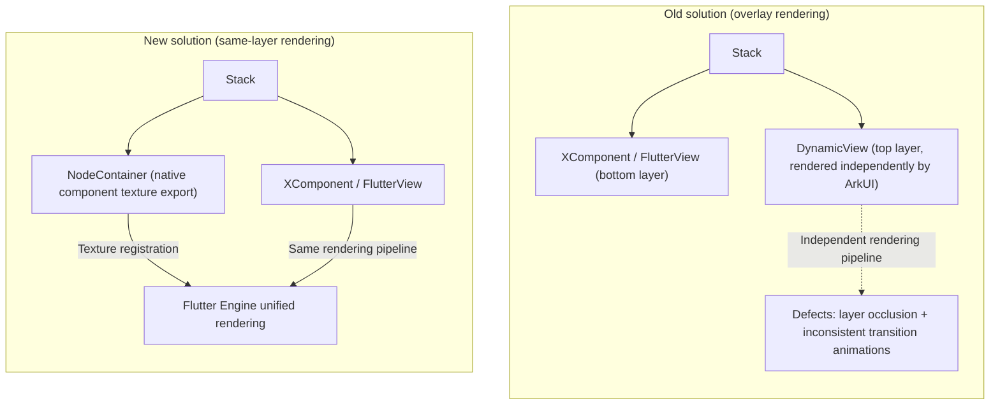

# PlatformView Same-Layer Rendering Solution Adaptation and Switching Guide

PlatformView is used to embed native OpenHarmony ArkUI components in Flutter pages. The early solution (the old solution) overlays native components on top of `FlutterView` via `DynamicView`, with ArkUI rendering them independently, which suffers from occlusion and animation inconsistency defects. The new solution adopts `NodeContainer` same-layer rendering: the native component's texture is exported and registered with the Flutter Engine, and Flutter renders everything in a unified way, fundamentally resolving the problems above. This document compares the implementation structures and key differences of the two solutions and guides developers through adaptation and switching.

## Overall Solution

The core difference between the old and new solutions lies in the layering relationship between native components and `FlutterView`, and in which rendering pipeline owns the rendering:



- **Old solution**: `DynamicView` is overlaid on top of `FlutterView` and rendered independently by ArkUI, separate from the Flutter rendering pipeline, which results in layer occlusion and inconsistent transition animations.
- **New solution**: `NodeContainer` exports the native component's texture and registers it with the Flutter Engine for unified rendering by Flutter. Native components and Flutter content live in the same rendering pipeline, eliminating occlusion and animation differences.

## Key Modules

| Module | Belongs To | Responsibility | Source Code Path |
|------|------|------|----------|
| `DVModel` / `DynamicView` | Old solution framework layer | Drives ArkUI component rendering through JSON-defined models, overlaid on top of `FlutterView` | `@ohos/flutter_ohos` (old solution; verify the specific path against your current version) |
| `PlatformView` | New solution base class | Developers extend it to implement custom native views and return a `WrappedBuilder` in `getView()` | `@ohos/flutter_ohos/src/main/ets/plugin/platform/PlatformView` |
| `PlatformViewFactory` | New solution factory | Creates `PlatformView` instances based on the `viewId` and parameters | `@ohos/flutter_ohos/src/main/ets/plugin/platform/PlatformViewFactory` |
| `NodeContainer` / `NodeController` | ArkUI system component | Same-layer rendering container that exports native component textures for the Flutter Engine to consume | OpenHarmony ArkUI system component (built into the SDK) |

## PlatformView Old Solution

### Overview

Define `DynamicView` and `DVModel` in the Flutter adaptation layer.

```ts
@Observed
export class DVModel {
  id_: number;
  compType: string;
  params: DVModelParameters;
  events: DVModelEvents;
  children: DVModelChildren;
  builder: Any;

  public getLayoutParams(): DVModelParameters {
    return this.params;
  }
}
```
```ts
@Component
export struct DynamicView{
  @ObjectLink model:DVModel;
  @ObjectLink children:DVModelChildren;
  @ObjectLink params:DVModelParameters;
  @ObjectLink events:DVModelEvents;
  @BuilderParam customBuilder?:($$:BuilderParams)=>void;
}
```

Developers use JSON strings to define and generate the `DVModel` model, implementing the definition of the PlatformView. The `FlutterView` is placed on the bottom layer and the PlatformView implemented by `DynamicView` on the top layer. `DynamicView` is implemented with ArkUI and rendered natively by OpenHarmony.

```ts
  build() {
    Stack() {
      XComponent({ id: this.viewId, type: this.xComponentType, libraryname: 'flutter' })
        .focusable(true)
        .focusOnTouch(true)
        .onLoad((context) => {
          this.flutterView?.onSurfaceCreated()
          Log.d(TAG, "XComponent onLoad ");
        })
        .onDestroy(() => {
          Log.d(TAG, "XComponent onDestroy ");
          this.flutterView?.onSurfaceDestroyed()
        })
        .backgroundColor(Color.Transparent)

      ForEach(this.rootDvModel!!, (child: Any) => {
        DynamicView({
          model: child as DVModel,
          params: child.params,
          events: child.events,
          children: child.children,
          customBuilder: child.builder
        })
      })
    }
  }
```

Embedding a PlatformView in a Flutter page has two serious defects:

1. The PlatformView sits on top of the `FlutterView`, causing occlusion.
2. During page transitions, the `FlutterView` and PlatformView animations are inconsistent.

## PlatformView New Solution

### Overview

The `NodeContainer` same-layer rendering capability is adopted to export the native platform component's texture and register it with the Flutter Engine, so that Flutter renders everything in a unified way. This resolves the inherent defects of the old solution. In addition, the PlatformView uses custom ArkUI Component widgets, which conforms to native OpenHarmony application development habits: there is no need to define views in terms of `DVModel`, and it avoids the trouble of writing JSON without code completion.

```ts
  build() {
    Stack() {
      NodeContainer(this.nodeController)
         .width(this.storageLinkWidth)
         .height(this.storageLinkHeight)

      XComponent({ id: this.viewId, type: this.xComponentType, libraryname: 'flutter' })
        .focusable(true)
        .focusOnTouch(true)
        .onLoad((context) => {
          this.flutterView?.onSurfaceCreated()
          Log.d(TAG, "XComponent onLoad ");
        })
        .onDestroy(() => {
          Log.d(TAG, "XComponent onDestroy ");
          this.flutterView?.onSurfaceDestroyed()
        })
        .backgroundColor(Color.Transparent)
    }
  }
```

## Key Differences Between the Old and New Solutions

Old solution:

```ts
private model: DVModel = createDVModelFromJson(
  {
    compType: "Column",
    attributes: { height: '200%'},
    children: [
      {
        compType: "Text",
        attributes: { value: "Native: send data to Dart111111111111111", fontColor: Color.Orange,backgroundColor: Color.Black,height: 100},
        events: { onClick: this.sendMessage },
      },
      {
        compType: "Text",
        attributes: { value: "Native: data from Dart", marginTop: 20 },
      }
    ],
  }
);
```

```ts
/// Interface implemented by the custom PlatformView entity class
getView(): DVModel {
  return this.model;
}
```

New solution:

```ts
@Component
struct ButtonComponent {
    @ObjectLink params: Params
    customView: CustomView = this.params.platformView as CustomView
    @StorageLink('numValue') storageLink: string = "first"
    @State bkColor: Color = Color.Red

    build() {
      Column() {
        Button("Send data to Flutter")
          .border({ width: 2, color: Color.Blue})
          .backgroundColor(this.bkColor)
          .onTouch((event: TouchEvent) => {
            console.log("nodeController button on touched")
          })
        .onClick((event: ClickEvent) => {
            this.customView.sendMessage();
            console.log("nodeController button on click")
        })

        Text(`Data from Flutter : ${this.storageLink}`)
          .onTouch((event: TouchEvent) => {
              console.log("nodeController text on touched")
        })

      }.alignItems(HorizontalAlign.Center)
      .justifyContent(FlexAlign.Center)
      .direction(Direction.Ltr)
      .width('100%')
      .height('100%')
    }
}
```

```ts
/// Interface implemented by the custom PlatformView entity class
getView(): WrappedBuilder<[Params]> {
  return new WrappedBuilder(ButtonBuilder);
}
```

## Applicable Scenarios

- **New solution**: Use it when ArkUI native components need to be seamlessly embedded in Flutter pages and their layering and transition animations are required to be consistent with Flutter content. The new solution is recommended for all newly integrated PlatformViews.
- **Old solution**: Deprecated and not recommended for new integrations. Existing pages that use the old solution can be migrated to the new solution according to the key differences described in this document.

## Limitations

> [!WARNING]
> `NodeContainer` same-layer rendering relies on OpenHarmony system capabilities; make sure the target device's system version supports same-layer rendering.
>
> The new solution must complete registration by calling `registerViewFactory(viewType, PlatformViewFactory)` in `FlutterPlugin.onAttachedToEngine`; otherwise, `OhosView` cannot create the native view.
