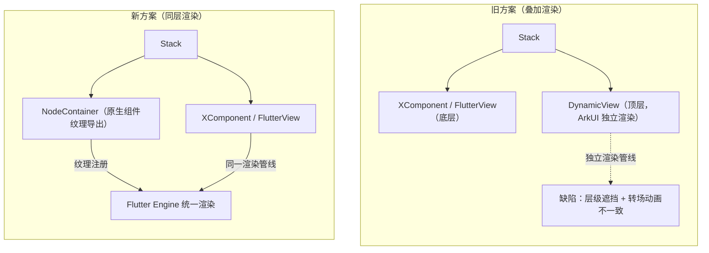

# PlatformView 同层渲染方案适配切换指导

PlatformView 用于在 Flutter 页面中嵌入 OpenHarmony 原生 ArkUI 组件。早期方案（旧方案）通过 `DynamicView` 将原生组件叠加在 `FlutterView` 之上，由 ArkUI 独立渲染，存在遮挡与动画不一致缺陷；新方案采用 `NodeContainer` 同层渲染，将原生组件纹理导出注册到 Flutter Engine，由 Flutter 统一渲染，从根本上解决上述问题。本文对比两种方案的实现结构与关键差异，指导开发者完成适配与切换。

## 整体方案

新旧方案的核心差异在于原生组件与 `FlutterView` 的层级关系及渲染管线归属：



- **旧方案**：`DynamicView` 叠加在 `FlutterView` 之上，由 ArkUI 独立渲染，与 Flutter 渲染管线分离，导致层级遮挡与转场动画不一致。
- **新方案**：`NodeContainer` 将原生组件纹理导出注册到 Flutter Engine，由 Flutter 统一渲染，原生组件与 Flutter 内容处于同一渲染管线，消除遮挡与动画差异。

## 关键模块说明

| 模块 | 所属 | 职责 | 源码路径 |
|------|------|------|----------|
| `DVModel` / `DynamicView` | 旧方案框架层 | 通过 JSON 定义模型驱动 ArkUI 组件渲染，叠加在 `FlutterView` 之上 | `@ohos/flutter_ohos`（旧方案，需对照当前版本核对具体路径） |
| `PlatformView` | 新方案基类 | 开发者继承它实现自定义原生视图，在 `getView()` 返回 `WrappedBuilder` | `@ohos/flutter_ohos/src/main/ets/plugin/platform/PlatformView` |
| `PlatformViewFactory` | 新方案工厂 | 根据 `viewId` 和参数创建 `PlatformView` 实例 | `@ohos/flutter_ohos/src/main/ets/plugin/platform/PlatformViewFactory` |
| `NodeContainer` / `NodeController` | ArkUI 系统组件 | 同层渲染容器，将原生组件纹理导出供 Flutter Engine 消费 | OpenHarmony ArkUI 系统组件（SDK 内置） |

## PlatformView 旧方案

### 简述

在 Flutter 适配层定义 `DynamicView` 和 `DVModel`。

```ts
@Observed
export class DVModel {
  id_: number;
  compType: string;
  params: DVModelParameters;
  events: DVModelEvents;
  children: DVModelChildren;
  builder: Any;

  public getLayoutParams(): DVModelParameters {
    return this.params;
  }
}
```
```ts
@Component
export struct DynamicView{
  @ObjectLink model:DVModel;
  @ObjectLink children:DVModelChildren;
  @ObjectLink params:DVModelParameters;
  @ObjectLink events:DVModelEvents;
  @BuilderParam customBuilder?:($$:BuilderParams)=>void;
}
```

开发者使用 JSON 字符串来定义生成 `DVModel` 模型，实现 PlatformView 的定义，将 `FlutterView` 置于底层，`DynamicView` 实现的 PlatformView 置于顶层，`DynamicView` 使用 ArkUI 实现，通过 OpenHarmony 原生渲染。

```ts
  build() {
    Stack() {
      XComponent({ id: this.viewId, type: this.xComponentType, libraryname: 'flutter' })
        .focusable(true)
        .focusOnTouch(true)
        .onLoad((context) => {
          this.flutterView?.onSurfaceCreated()
          Log.d(TAG, "XComponent onLoad ");
        })
        .onDestroy(() => {
          Log.d(TAG, "XComponent onDestroy ");
          this.flutterView?.onSurfaceDestroyed()
        })
        .backgroundColor(Color.Transparent)

      ForEach(this.rootDvModel!!, (child: Any) => {
        DynamicView({
          model: child as DVModel,
          params: child.params,
          events: child.events,
          children: child.children,
          customBuilder: child.builder
        })
      })
    }
  }
```

Flutter 页面嵌入 PlatformView 时存在两个严重缺陷：

1. PlatformView 覆盖在 `FlutterView` 上面出现遮挡问题。
2. 页面切换时，`FlutterView` 和 PlatformView 动画不一致。

## PlatformView 新方案

### 简述

采用 `NodeContainer` 同层渲染功能，将原生平台组件的纹理导出注册到 Flutter Engine，由 Flutter 统一渲染。可以解决旧方案的固有缺陷，并且 PlatformView 使用自定义 ArkUI 的 Component 组件，符合 OpenHarmony 原生应用开发习惯，不用按照 `DVModel` 来定义，同时避免写 json 没有代码提示的困扰。

```ts
  build() {
    Stack() {
      NodeContainer(this.nodeController)
         .width(this.storageLinkWidth)
         .height(this.storageLinkHeight)

      XComponent({ id: this.viewId, type: this.xComponentType, libraryname: 'flutter' })
        .focusable(true)
        .focusOnTouch(true)
        .onLoad((context) => {
          this.flutterView?.onSurfaceCreated()
          Log.d(TAG, "XComponent onLoad ");
        })
        .onDestroy(() => {
          Log.d(TAG, "XComponent onDestroy ");
          this.flutterView?.onSurfaceDestroyed()
        })
        .backgroundColor(Color.Transparent)
    }
  }
```

## 新旧方案实现关键区别

旧方案：

```ts
private model: DVModel = createDVModelFromJson(
  {
    compType: "Column",
    attributes: { height: '200%'},
    children: [
      {
        compType: "Text",
        attributes: { value: "Native:发送数据给Dart111111111111111", fontColor: Color.Orange,backgroundColor: Color.Black,height: 100},
        events: { onClick: this.sendMessage },
      },
      {
        compType: "Text",
        attributes: { value: "Native:来自Dart的数据", marginTop: 20 },
      }
    ],
  }
);
```

```ts
/// 自定义 PlatformView 实体类的实现的接口
getView(): DVModel {
  return this.model;
}
```

新方案：

```ts
@Component
struct ButtonComponent {
    @ObjectLink params: Params
    customView: CustomView = this.params.platformView as CustomView
    @StorageLink('numValue') storageLink: string = "first"
    @State bkColor: Color = Color.Red

    build() {
      Column() {
        Button("发送数据给Flutter")
          .border({ width: 2, color: Color.Blue})
          .backgroundColor(this.bkColor)
          .onTouch((event: TouchEvent) => {
            console.log("nodeController button on touched")
          })
        .onClick((event: ClickEvent) => {
            this.customView.sendMessage();
            console.log("nodeController button on click")
        })

        Text(`来自Flutter的数据 : ${this.storageLink}`)
          .onTouch((event: TouchEvent) => {
              console.log("nodeController text on touched")
        })

      }.alignItems(HorizontalAlign.Center)
      .justifyContent(FlexAlign.Center)
      .direction(Direction.Ltr)
      .width('100%')
      .height('100%')
    }
}
```

```ts
/// 自定义 PlatformView 实体类的实现的接口
getView(): WrappedBuilder<[Params]> {
  return new WrappedBuilder(ButtonBuilder);
}
```

## 适用场景

- **新方案**：需要在 Flutter 页面中无缝嵌入 ArkUI 原生组件，且要求层级关系与转场动画与 Flutter 内容一致时使用。新接入的 PlatformView 一律推荐新方案。
- **旧方案**：已废弃，不推荐新接入。存量使用旧方案的页面可按本文关键区别迁移至新方案。

## 限制

> [!WARNING]
> `NodeContainer` 同层渲染依赖 OpenHarmony 系统能力，需确认目标设备系统版本支持同层渲染。
>
> 新方案需通过 `FlutterPlugin.onAttachedToEngine` 调用 `registerViewFactory(viewType, PlatformViewFactory)` 完成注册，否则 `OhosView` 无法创建原生视图。
