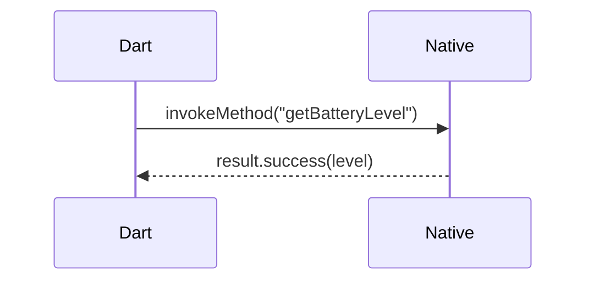
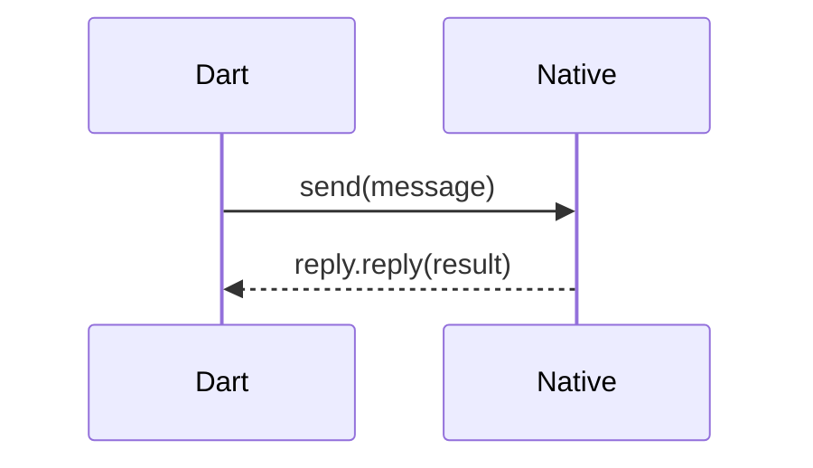
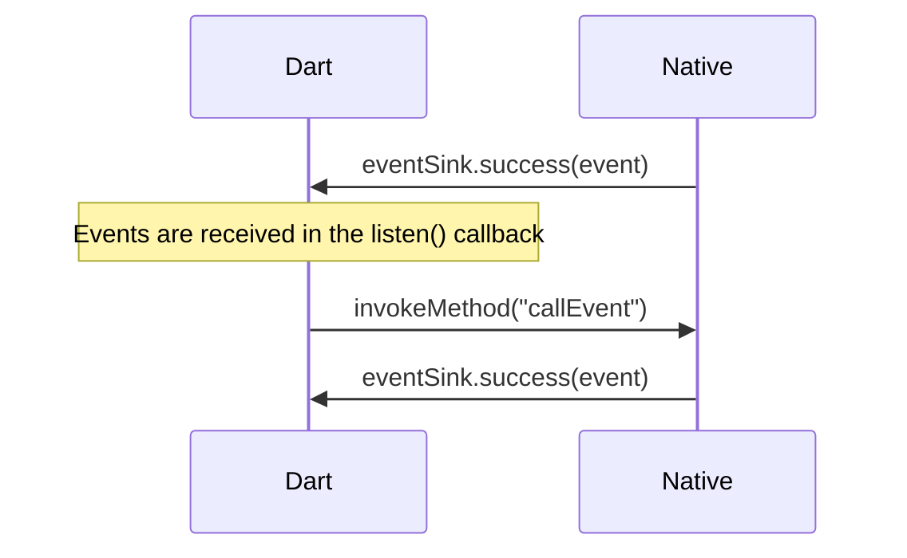

# How to Use Flutter Channel

This document describes how to use the three Platform Channels (`MethodChannel`, `BasicMessageChannel`, and `EventChannel`) in a Flutter OH application to enable two-way communication between Flutter and the OpenHarmony native side.

A Platform Channel is the standard communication mechanism between Flutter and the native platform: the Dart side sends messages or method calls through a channel, and the native side registers a handler to receive and process them, enabling two-way data exchange. On the OHOS platform, the Channel APIs are provided by `@ohos/flutter_ohos` and are used in the same way as on Android/iOS.

## Comparison of the Three Channels

| Channel Type | Communication Pattern | Applicable Scenario | Example |
|-------------|----------|----------|------|
| `MethodChannel` | Request-response | One-shot method calls; Dart invokes a native method and gets a return value | Getting the battery level |
| `BasicMessageChannel` | Two-way messaging | Simple two-way message passing; Dart sends a message and the native side replies | Sending a number; the native side returns different strings depending on whether it is odd or even |
| `EventChannel` | Continuous event stream | The native side continuously pushes data to Dart | The native side pushes timestamped events through an EventSink |

### Data Flow

The call directions of the three channels are as follows:

**MethodChannel (request-response)**



**BasicMessageChannel (two-way messaging)**



**EventChannel (continuous event stream)**




## Prerequisites

- The [Flutter OH development environment](../getting-started/flutter-oh-env-setup.en.md) has been set up.
- A Flutter OH application has been created; in this example it is named `channel_demo`.
- The `channel_demo/ohos` project has been opened in DevEco Studio.

## Implementation Steps

### Step 1: Implement the Native-Side Plugin (ArkTS)

The native-side code is located in the `ohos/entry/src/main/ets/entryability/` directory. Create `BatteryPlugin.ets`, implement the `FlutterPlugin` interface, and create the three channels and register handlers in `onAttachedToEngine`:

```ts
import {
  Any,
  BasicMessageChannel,
  EventChannel,
  FlutterPlugin,
  Log,
  MethodCall,
  MethodChannel,
  StandardMessageCodec
} from '@ohos/flutter_ohos';
import { FlutterPluginBinding } from '@ohos/flutter_ohos/src/main/ets/embedding/engine/plugins/FlutterPlugin';
import { batteryInfo } from '@kit.BasicServicesKit';
import { MethodResult } from '@ohos/flutter_ohos/src/main/ets/plugin/common/MethodChannel';
import { EventSink } from '@ohos/flutter_ohos/src/main/ets/plugin/common/EventChannel';
import { Reply } from '@ohos/flutter_ohos/src/main/ets/plugin/common/BasicMessageChannel';

const TAG = "BatteryPluginTag";

export default class BatteryPlugin implements FlutterPlugin {
  private channel?: MethodChannel;
  private basicChannel?: BasicMessageChannel<Any>;
  private eventChannel?: EventChannel;
  private eventSink?: EventSink;
  private api = new BatteryApi();

  onAttachedToEngine(binding: FlutterPluginBinding): void {
    // --- MethodChannel ---
    // Receive method calls from the Dart side and dispatch them by method name
    this.channel = new MethodChannel(binding.getBinaryMessenger(), "samples.flutter.dev/battery");
    let that = this;
    this.channel.setMethodCallHandler({
      onMethodCall(call: MethodCall, result: MethodResult) {
        switch (call.method) {
          case "getBatteryLevel":
            that.api.getBatteryLevel(result);
            break;
          case "callEvent":
            that.eventSink?.success("Success at " + new Date());
            break;
          default:
            result.notImplemented();
            break;
        }
      }
    })

    // --- BasicMessageChannel ---
    // Receive messages from the Dart side and reply after processing
    this.basicChannel = new BasicMessageChannel(binding.getBinaryMessenger(), "samples.flutter.dev/basic_channel", new StandardMessageCodec());
    this.basicChannel.setMessageHandler({
      onMessage(message: Any, reply: Reply<Any>) {
        Log.i(TAG, "message=" + message);
        if (message % 2 == 0) {
          reply.reply("run with if case.");
        } else {
          reply.reply("run with else case");
        }
      }
    })

    // --- EventChannel ---
    // Manage the EventSink lifecycle; save the reference in onListen for pushing events later
    this.eventChannel = new EventChannel(binding.getBinaryMessenger(), "samples.flutter.dev/event_channel");
    this.eventChannel.setStreamHandler({
      onListen(args: Any, events: EventSink): void {
        that.eventSink = events;
        Log.i(TAG, "onListen: " + args);
      },
      onCancel(args: Any): void {
        that.eventSink = undefined;
        Log.i(TAG, "onCancel: " + args);
      }
    });
  }

  onDetachedFromEngine(binding: FlutterPluginBinding): void {
    Log.i(TAG, "onDetachedFromEngine");
    this.channel?.setMethodCallHandler(null);
    this.eventChannel?.setStreamHandler(null);
  }

  getUniqueClassName(): string {
    return "BatteryPlugin";
  }
}

class BatteryApi {
  getBatteryLevel(result: MethodResult) {
    let level: number = batteryInfo.batterySOC;
    Log.i(TAG, "level=" + level);
    if (level >= 0) {
      result.success(level);
    } else {
      Log.i(TAG, "getBatteryLevel else");
      result.error("UNAVAILABLE", "Battery level not available.", null)
    }
    Log.i(TAG, "getBatteryLevel finish");
  }
}
```

The roles of the components are as follows:

| Component | Role |
|----------|------|
| `MethodChannel` | Receives `invokeMethod` calls from Dart and dispatches them to specific methods via `switch`. `result.success()` returns a successful result, and `result.error()` returns an error |
| `BasicMessageChannel` | Receives `send()` messages from Dart and replies via `reply.reply()`. A `MessageCodec` (such as `StandardMessageCodec`) must be specified to encode and decode messages |
| `EventChannel` | Manages the `EventSink` through `setStreamHandler`. Save the reference in `onListen` so that `eventSink.success()` can be called at any time later to push events to Dart; clear the reference in `onCancel` |
| `onDetachedFromEngine` | Cleans up the handlers when the plugin is detached; set them to `null` to avoid memory leaks |
| `BatteryApi` | Encapsulates the battery level retrieval logic and reads the device battery level using `batteryInfo.batterySOC` from `@kit.BasicServicesKit` |

### Step 2: Register the Plugin in EntryAbility

Call `addPlugin` in `configureFlutterEngine` of `EntryAbility` to register `BatteryPlugin`:

```ts
import { FlutterAbility } from '@ohos/flutter_ohos'
import { GeneratedPluginRegistrant } from '../plugins/GeneratedPluginRegistrant';
import FlutterEngine from '@ohos/flutter_ohos/src/main/ets/embedding/engine/FlutterEngine';
import BatteryPlugin from './BatteryPlugin';

export default class EntryAbility extends FlutterAbility {
  configureFlutterEngine(flutterEngine: FlutterEngine) {
    super.configureFlutterEngine(flutterEngine)
    GeneratedPluginRegistrant.registerWith(flutterEngine)
    this.addPlugin(new BatteryPlugin());
  }
}
```

### Step 3: Implement the Dart-Side Communication

Modify `lib/main.dart` to create the three channels and trigger the communication through buttons:

```dart
import 'package:flutter/material.dart';
import 'package:flutter/services.dart';

void main() {
  runApp(const MyApp());
}

class MyApp extends StatelessWidget {
  const MyApp({super.key});

  @override
  Widget build(BuildContext context) {
    return MaterialApp(
      title: 'Flutter Channel Demo',
      theme: ThemeData(
        primarySwatch: Colors.blue,
      ),
      home: const Scaffold(
        body: PluginPage(),
      ),
    );
  }
}

class PluginPage extends StatefulWidget {
  const PluginPage({super.key});

  @override
  State<PluginPage> createState() => _PluginPageState();
}

class _PluginPageState extends State<PluginPage> {
  String message = "";
  final _platform = const MethodChannel('samples.flutter.dev/battery');
  final _eventChannel = const EventChannel('samples.flutter.dev/event_channel');
  final _basicChannel = const BasicMessageChannel(
      "samples.flutter.dev/basic_channel", StandardMessageCodec());
  int count = 0;

  @override
  void initState() {
    super.initState();
    _initListener();
  }

  void _initListener() {
    // Listen to the EventChannel event stream
    _eventChannel.receiveBroadcastStream().listen((event) {
      setState(() {
        message = "EventChannel event=$event";
      });
    });
  }

  Future<void> _getBatteryLevel() async {
    String batteryLevel;
    try {
      // MethodChannel: invoke a native method and get the return value
      final result = await _platform.invokeMethod<int>('getBatteryLevel');
      batteryLevel = 'Battery level at $result % .';
    } on PlatformException catch (e) {
      batteryLevel = "Failed to get battery level: '${e.message}'.";
    }

    setState(() {
      message = batteryLevel;
    });
  }

  Future<void> _testStreamCall() async {
    try {
      // Trigger the native side, via MethodChannel, to call EventSink to push an event
      await _platform.invokeMethod('callEvent');
    } on PlatformException catch (e) {
      print(e);
    }
  }

  Future<void> _testBasicChannel() async {
    String result;
    try {
      // BasicMessageChannel: send a message and receive the reply from the native side
      result = await _basicChannel.send(++count) as String;
    } on PlatformException catch (e) {
      result = "Error: $e";
    }
    setState(() {
      message = result;
    });
  }

  @override
  Widget build(BuildContext context) {
    return Center(
      child: Column(
        mainAxisAlignment: MainAxisAlignment.center,
        children: <Widget>[
          Text(message),
          ElevatedButton(
            onPressed: () => _getBatteryLevel(),
            child: const Text("getBatteryLevel"),
          ),
          ElevatedButton(
            onPressed: () => _testStreamCall(),
            child: const Text("_testStreamCall"),
          ),
          ElevatedButton(
            onPressed: () => _testBasicChannel(),
            child: const Text("_testBasicChannel"),
          ),
        ],
      ),
    );
  }
}
```

The Dart-side usage of the three channels is as follows:

| Channel | Creation | Invocation |
|---------|----------|----------|
| `MethodChannel` | `const MethodChannel('name')` | `await channel.invokeMethod<T>('methodName')` |
| `BasicMessageChannel` | `const BasicMessageChannel('name', codec)` | `await channel.send(message)` |
| `EventChannel` | `const EventChannel('name')` | `channel.receiveBroadcastStream().listen((event) {...})` |

## Demo Reference

For the complete demo, see [channel_demo](../../../ohos/channel_demo/)
