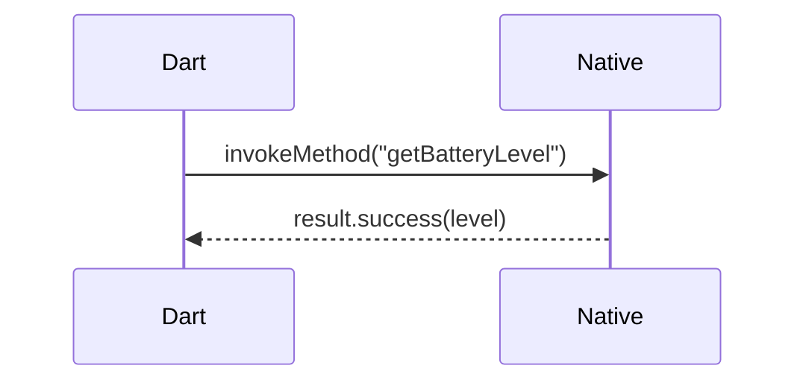
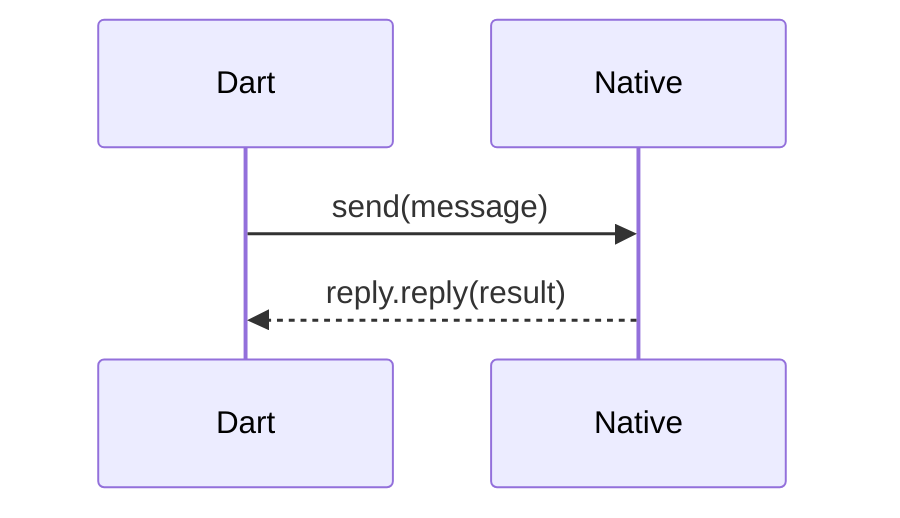
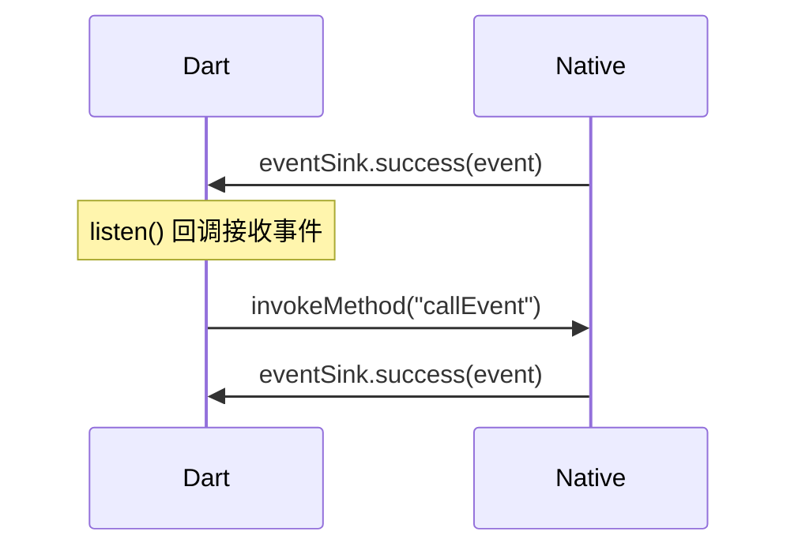

# 如何使用 Flutter Channel

本文介绍如何在 Flutter OH 应用中使用三种 Platform Channel（`MethodChannel`、`BasicMessageChannel`、`EventChannel`）实现 Flutter 与 OpenHarmony 原生侧的双向通信。

Platform Channel 是 Flutter 与原生平台之间的标准通信机制：Dart 侧通过 Channel 发送消息或方法调用，原生侧注册 handler 接收并处理，从而实现双向数据交互。OHOS 平台的 Channel API 由 `@ohos/flutter_ohos` 提供，用法与 Android/iOS 一致。

## 三种 Channel 对比

| Channel 类型 | 通信模式 | 适用场景 | 示例 |
|-------------|----------|----------|------|
| `MethodChannel` | 请求-响应 | 一次性方法调用，Dart 调用原生方法并获取返回值 | 获取电池电量 |
| `BasicMessageChannel` | 双向消息 | 简单的双向消息传递，Dart 发送消息原生回复 | 发送数字，原生按奇偶返回不同字符串 |
| `EventChannel` | 持续事件流 | 原生持续向 Dart 推送数据 | 原生通过 EventSink 推送带时间戳的事件 |

### 数据流

三种 Channel 的调用方向如下：

**MethodChannel（请求-响应）**



**BasicMessageChannel（双向消息）**



**EventChannel（持续事件流）**




## 前置条件

- 已完成 [Flutter OH 开发环境搭建](../getting-started/flutter-oh-env-setup.md)。
- 已创建 Flutter OH 应用，本示例命名为 `channel_demo`。
- 已使用 DevEco Studio 打开 `channel_demo/ohos` 工程。

## 实现步骤

### 第一步：实现原生侧插件（ArkTS）

原生侧代码位于 `ohos/entry/src/main/ets/entryability/` 目录下。新建 `BatteryPlugin.ets`，实现 `FlutterPlugin` 接口，在 `onAttachedToEngine` 中创建三种 Channel 并注册 handler：

```ts
import {
  Any,
  BasicMessageChannel,
  EventChannel,
  FlutterPlugin,
  Log,
  MethodCall,
  MethodChannel,
  StandardMessageCodec
} from '@ohos/flutter_ohos';
import { FlutterPluginBinding } from '@ohos/flutter_ohos/src/main/ets/embedding/engine/plugins/FlutterPlugin';
import { batteryInfo } from '@kit.BasicServicesKit';
import { MethodResult } from '@ohos/flutter_ohos/src/main/ets/plugin/common/MethodChannel';
import { EventSink } from '@ohos/flutter_ohos/src/main/ets/plugin/common/EventChannel';
import { Reply } from '@ohos/flutter_ohos/src/main/ets/plugin/common/BasicMessageChannel';

const TAG = "BatteryPluginTag";

export default class BatteryPlugin implements FlutterPlugin {
  private channel?: MethodChannel;
  private basicChannel?: BasicMessageChannel<Any>;
  private eventChannel?: EventChannel;
  private eventSink?: EventSink;
  private api = new BatteryApi();

  onAttachedToEngine(binding: FlutterPluginBinding): void {
    // --- MethodChannel ---
    // 接收 Dart 侧的方法调用，根据方法名分发处理
    this.channel = new MethodChannel(binding.getBinaryMessenger(), "samples.flutter.dev/battery");
    let that = this;
    this.channel.setMethodCallHandler({
      onMethodCall(call: MethodCall, result: MethodResult) {
        switch (call.method) {
          case "getBatteryLevel":
            that.api.getBatteryLevel(result);
            break;
          case "callEvent":
            that.eventSink?.success("Success at " + new Date());
            break;
          default:
            result.notImplemented();
            break;
        }
      }
    })

    // --- BasicMessageChannel ---
    // 接收 Dart 侧的消息，处理后通过 reply 回复
    this.basicChannel = new BasicMessageChannel(binding.getBinaryMessenger(), "samples.flutter.dev/basic_channel", new StandardMessageCodec());
    this.basicChannel.setMessageHandler({
      onMessage(message: Any, reply: Reply<Any>) {
        Log.i(TAG, "message=" + message);
        if (message % 2 == 0) {
          reply.reply("run with if case.");
        } else {
          reply.reply("run with else case");
        }
      }
    })

    // --- EventChannel ---
    // 管理 EventSink 生命周期，onListen 时保存引用用于后续推送事件
    this.eventChannel = new EventChannel(binding.getBinaryMessenger(), "samples.flutter.dev/event_channel");
    this.eventChannel.setStreamHandler({
      onListen(args: Any, events: EventSink): void {
        that.eventSink = events;
        Log.i(TAG, "onListen: " + args);
      },
      onCancel(args: Any): void {
        that.eventSink = undefined;
        Log.i(TAG, "onCancel: " + args);
      }
    });
  }

  onDetachedFromEngine(binding: FlutterPluginBinding): void {
    Log.i(TAG, "onDetachedFromEngine");
    this.channel?.setMethodCallHandler(null);
    this.eventChannel?.setStreamHandler(null);
  }

  getUniqueClassName(): string {
    return "BatteryPlugin";
  }
}

class BatteryApi {
  getBatteryLevel(result: MethodResult) {
    let level: number = batteryInfo.batterySOC;
    Log.i(TAG, "level=" + level);
    if (level >= 0) {
      result.success(level);
    } else {
      Log.i(TAG, "getBatteryLevel else");
      result.error("UNAVAILABLE", "Battery level not available.", null)
    }
    Log.i(TAG, "getBatteryLevel finish");
  }
}
```

各组成部分的作用如下：

| 组成部分 | 作用 |
|----------|------|
| `MethodChannel` | 接收 Dart 的 `invokeMethod` 调用，通过 `switch` 分发到具体方法。`result.success()` 返回成功结果，`result.error()` 返回错误 |
| `BasicMessageChannel` | 接收 Dart 的 `send()` 消息，通过 `reply.reply()` 回复。需指定 `MessageCodec`（如 `StandardMessageCodec`）编解码消息 |
| `EventChannel` | 通过 `setStreamHandler` 管理 `EventSink`。`onListen` 时保存引用，后续可随时调用 `eventSink.success()` 向 Dart 推送事件；`onCancel` 时清除引用 |
| `onDetachedFromEngine` | 插件卸载时清理 handler，设为 `null` 避免内存泄漏 |
| `BatteryApi` | 封装电池电量获取逻辑，使用 `@kit.BasicServicesKit` 的 `batteryInfo.batterySOC` 读取设备电量 |

### 第二步：在 EntryAbility 中注册插件

在 `EntryAbility` 的 `configureFlutterEngine` 中调用 `addPlugin` 注册 `BatteryPlugin`：

```ts
import { FlutterAbility } from '@ohos/flutter_ohos'
import { GeneratedPluginRegistrant } from '../plugins/GeneratedPluginRegistrant';
import FlutterEngine from '@ohos/flutter_ohos/src/main/ets/embedding/engine/FlutterEngine';
import BatteryPlugin from './BatteryPlugin';

export default class EntryAbility extends FlutterAbility {
  configureFlutterEngine(flutterEngine: FlutterEngine) {
    super.configureFlutterEngine(flutterEngine)
    GeneratedPluginRegistrant.registerWith(flutterEngine)
    this.addPlugin(new BatteryPlugin());
  }
}
```

### 第三步：实现 Dart 侧通信

修改 `lib/main.dart`，创建三种 Channel 并通过按钮触发通信：

```dart
import 'package:flutter/material.dart';
import 'package:flutter/services.dart';

void main() {
  runApp(const MyApp());
}

class MyApp extends StatelessWidget {
  const MyApp({super.key});

  @override
  Widget build(BuildContext context) {
    return MaterialApp(
      title: 'Flutter Channel Demo',
      theme: ThemeData(
        primarySwatch: Colors.blue,
      ),
      home: const Scaffold(
        body: PluginPage(),
      ),
    );
  }
}

class PluginPage extends StatefulWidget {
  const PluginPage({super.key});

  @override
  State<PluginPage> createState() => _PluginPageState();
}

class _PluginPageState extends State<PluginPage> {
  String message = "";
  final _platform = const MethodChannel('samples.flutter.dev/battery');
  final _eventChannel = const EventChannel('samples.flutter.dev/event_channel');
  final _basicChannel = const BasicMessageChannel(
      "samples.flutter.dev/basic_channel", StandardMessageCodec());
  int count = 0;

  @override
  void initState() {
    super.initState();
    _initListener();
  }

  void _initListener() {
    // 监听 EventChannel 事件流
    _eventChannel.receiveBroadcastStream().listen((event) {
      setState(() {
        message = "EventChannel event=$event";
      });
    });
  }

  Future<void> _getBatteryLevel() async {
    String batteryLevel;
    try {
      // MethodChannel：调用原生方法并获取返回值
      final result = await _platform.invokeMethod<int>('getBatteryLevel');
      batteryLevel = 'Battery level at $result % .';
    } on PlatformException catch (e) {
      batteryLevel = "Failed to get battery level: '${e.message}'.";
    }

    setState(() {
      message = batteryLevel;
    });
  }

  Future<void> _testStreamCall() async {
    try {
      // 通过 MethodChannel 触发原生端调用 EventSink 推送事件
      await _platform.invokeMethod('callEvent');
    } on PlatformException catch (e) {
      print(e);
    }
  }

  Future<void> _testBasicChannel() async {
    String result;
    try {
      // BasicMessageChannel：发送消息并接收原生端回复
      result = await _basicChannel.send(++count) as String;
    } on PlatformException catch (e) {
      result = "Error: $e";
    }
    setState(() {
      message = result;
    });
  }

  @override
  Widget build(BuildContext context) {
    return Center(
      child: Column(
        mainAxisAlignment: MainAxisAlignment.center,
        children: <Widget>[
          Text(message),
          ElevatedButton(
            onPressed: () => _getBatteryLevel(),
            child: const Text("getBatteryLevel"),
          ),
          ElevatedButton(
            onPressed: () => _testStreamCall(),
            child: const Text("_testStreamCall"),
          ),
          ElevatedButton(
            onPressed: () => _testBasicChannel(),
            child: const Text("_testBasicChannel"),
          ),
        ],
      ),
    );
  }
}
```

三种 Channel 的 Dart 侧用法如下：

| Channel | 创建方式 | 调用方式 |
|---------|----------|----------|
| `MethodChannel` | `const MethodChannel('name')` | `await channel.invokeMethod<T>('methodName')` |
| `BasicMessageChannel` | `const BasicMessageChannel('name', codec)` | `await channel.send(message)` |
| `EventChannel` | `const EventChannel('name')` | `channel.receiveBroadcastStream().listen((event) {...})` |

## Demo 参考

完整 demo 请参考 [channel_demo](../../../ohos/channel_demo/)
