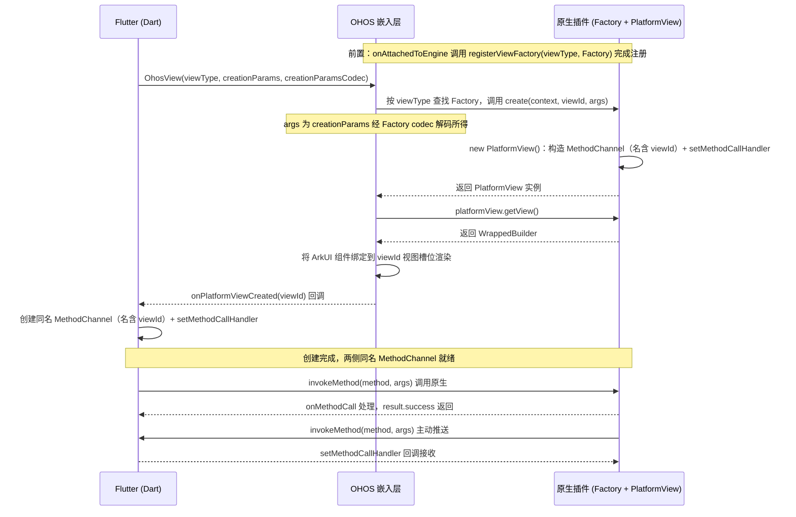

# 如何使用 PlatformView

本文介绍如何在 Flutter OH 应用中使用 PlatformView 将支持[同层渲染](https://developer.huawei.com/consumer/cn/doc/harmonyos-guides/web-same-layer#%E4%B8%89%E6%96%B9ui%E6%A1%86%E6%9E%B6)的 ArkUI 原生组件嵌入 Flutter 页面，并通过 MethodChannel 实现 Flutter 与原生侧的双向通信。

---

## 核心概念

| 术语 | 说明 |
|------|------|
| `PlatformView` | flutter_ohos 提供的基类，开发者继承它实现自定义原生视图，在 `getView()` 中返回 ArkUI 组件的 `WrappedBuilder` |
| `PlatformViewFactory` | 工厂类，负责根据 `viewId` 和参数创建 `PlatformView` 实例 |
| `FlutterPlugin` | 插件接口，在 `onAttachedToEngine` 中通过 `getPlatformViewRegistry().registerViewFactory()` 注册 `PlatformViewFactory` |
| `OhosView` | Dart 侧 Widget，通过 `viewType` 关联原生侧注册的 PlatformView，将原生组件嵌入 Flutter 页面 |
| `MethodChannel` | Flutter 与原生之间的双向通信通道，用于传递方法调用和数据 |

### 数据流

PlatformView 的创建与通信流程如下：



- **视图创建**：引擎启动时 `FlutterPlugin.onAttachedToEngine` 先调用 `registerViewFactory(viewType, PlatformViewFactory)` 完成注册；Dart 侧声明 `OhosView` 后，OHOS 嵌入层按 `viewType` 查找工厂并调用 `create(context, viewId, args)`（`args` 为 `creationParams` 经工厂 codec 解码所得）获得 `PlatformView` 实例——其构造函数创建名称含 `viewId` 后缀的 `MethodChannel` 并 `setMethodCallHandler`；嵌入层再调用 `getView()` 取回 `WrappedBuilder`，将对应 ArkUI 组件绑定到 `viewId` 视图槽位渲染，完成后回调 Dart 侧 `onPlatformViewCreated(viewId)`，Dart 在回调中创建同名 `MethodChannel`，两侧通道名称匹配后通信就绪。
- **Dart 调用原生**：Dart 侧通过 `MethodChannel.invokeMethod()` 发起方法调用，原生侧 `onMethodCall` 接收处理，通过 `result.success()` 返回结果。
- **原生调用 Dart**：原生侧通过 `methodChannel.invokeMethod()` 主动推送消息，Dart 侧 `setMethodCallHandler` 回调接收。

---

## 前置条件

- 已完成 [Flutter OH 开发环境搭建](../getting-started/flutter-oh-env-setup.md)。
- 已创建 Flutter OH 应用，本示例命名为 `platform_demo`。
- 已使用 DevEco Studio 打开 `platform_demo/ohos` 工程。

---

## 实现步骤

### 第一步：实现自定义 PlatformView（原生侧）

在 `ohos/entry/src/main/ets/entryability/` 目录下新建 `CustomView.ets`，包含 ArkUI 组件、Builder 方法与 PlatformView 实现类三部分。

```ts
import MethodChannel, {
  MethodCallHandler,
  MethodResult
} from '@ohos/flutter_ohos/src/main/ets/plugin/common/MethodChannel';
import PlatformView, { Params } from '@ohos/flutter_ohos/src/main/ets/plugin/platform/PlatformView';
import common from '@ohos.app.ability.common';
import { BinaryMessenger } from '@ohos/flutter_ohos/src/main/ets/plugin/common/BinaryMessenger';
import StandardMethodCodec from '@ohos/flutter_ohos/src/main/ets/plugin/common/StandardMethodCodec';
import MethodCall from '@ohos/flutter_ohos/src/main/ets/plugin/common/MethodCall';

@Component
struct ButtonComponent {
  @ObjectLink params: Params
  customView: CustomView = this.params.platformView as CustomView
  @StorageLink('numValue') numValue: string = ""

  build() {
    Column() {
      Button("发送数据给 Flutter")
        .onClick(() => this.customView.sendMessage())
      Text(`来自 Flutter 的数据：${this.numValue}`)
    }
    .width('100%')
    .height('100%')
    .justifyContent(FlexAlign.Center)
  }
}

@Builder
function ButtonBuilder(params: Params) {
  ButtonComponent({ params: params })
}

AppStorage.setOrCreate('numValue', '')

@Observed
export class CustomView extends PlatformView implements MethodCallHandler {
  methodChannel: MethodChannel;
  index: number = 0;

  constructor(context: common.Context, viewId: number, args: ESObject, message: BinaryMessenger) {
    super();
    // 注册消息通道，通道名需与 Dart 侧一致（含 viewId 后缀）
    this.methodChannel = new MethodChannel(message, `com.rex.custom.ohos/customView${viewId}`, StandardMethodCodec.INSTANCE);
    this.methodChannel.setMethodCallHandler(this);
  }

  onMethodCall(call: MethodCall, result: MethodResult): void {
    // 接收 Dart 侧发来的消息
    if (call.method === 'getMessageFromFlutterView') {
      AppStorage.setOrCreate('numValue', call.args as string);
      result.success(true);
    }
  }

  public sendMessage = () => {
    //向 Dart 侧发送消息
    this.methodChannel.invokeMethod('getMessageFromOhosView', 'native - ' + this.index++);
  }

  getView(): WrappedBuilder<[Params]> {
    return new WrappedBuilder(ButtonBuilder);
  }

  dispose(): void {}
}
```

各组成部分作用如下：

| 组成部分 | 作用 |
|----------|------|
| `ButtonComponent` | ArkUI 组件，定义原生视图的 UI 布局与交互。通过 `@ObjectLink params` 获取 PlatformView 实例，通过 `@StorageLink('numValue')` 与原生侧共享数据 |
| `ButtonBuilder` | `@Builder` 函数，将 `ButtonComponent` 包装为 `WrappedBuilder` 所需的构建器 |
| `CustomView` | 继承 `PlatformView`，实现 `getView()` 返回 `WrappedBuilder(ButtonBuilder)`；实现 `MethodCallHandler` 处理 Dart 侧消息 |
| `AppStorage.setOrCreate` | 初始化共享存储键 `numValue`，`ButtonComponent` 通过 `@StorageLink` 监听其变化实现 UI 更新 |

### 第二步：实现 PlatformViewFactory（原生侧）

在同级目录下新建 `CustomFactory.ets`，在 `create` 方法中实例化 `CustomView`。

```ts
import { BinaryMessenger } from '@ohos/flutter_ohos/src/main/ets/plugin/common/BinaryMessenger';
import MessageCodec from '@ohos/flutter_ohos/src/main/ets/plugin/common/MessageCodec';
import PlatformViewFactory from '@ohos/flutter_ohos/src/main/ets/plugin/platform/PlatformViewFactory';
import { CustomView } from './CustomView';
import common from '@ohos.app.ability.common';
import PlatformView from '@ohos/flutter_ohos/src/main/ets/plugin/platform/PlatformView';

export class CustomFactory extends PlatformViewFactory {
  message: BinaryMessenger;

  constructor(message: BinaryMessenger, createArgsCodes: MessageCodec<Object>) {
    super(createArgsCodes);
    this.message = message;
  }

  public create(context: common.Context, viewId: number, args: Object): PlatformView {
    return new CustomView(context, viewId, args, this.message);
  }
}
```

### 第三步：实现 FlutterPlugin 注册 PlatformViewFactory（原生侧）

新建 `CustomPlugin.ets`，实现 `FlutterPlugin` 接口，在 `onAttachedToEngine` 中注册 `CustomFactory`。

```ts
import  { FlutterPlugin,
  FlutterPluginBinding } from '@ohos/flutter_ohos/src/main/ets/embedding/engine/plugins/FlutterPlugin';
import StandardMessageCodec from '@ohos/flutter_ohos/src/main/ets/plugin/common/StandardMessageCodec';
import { CustomFactory } from './CustomFactory';

export class CustomPlugin implements FlutterPlugin {
  getUniqueClassName(): string {
    return 'CustomPlugin';
  }

  onAttachedToEngine(binding: FlutterPluginBinding): void {
    binding.getPlatformViewRegistry()?.
    registerViewFactory('com.rex.custom.ohos/customView', new CustomFactory(binding.getBinaryMessenger(), StandardMessageCodec.INSTANCE));
  }

  onDetachedFromEngine(binding: FlutterPluginBinding): void {}
}
```

### 第四步：在 EntryAbility 中注册插件（原生侧）

修改 `EntryAbility.ets`，继承 `FlutterAbility`，在 `configureFlutterEngine` 中注册 `GeneratedPluginRegistrant` 与自定义 `CustomPlugin`。

```ts
import { FlutterAbility } from '@ohos/flutter_ohos'
import { GeneratedPluginRegistrant } from '../plugins/GeneratedPluginRegistrant';
import FlutterEngine from '@ohos/flutter_ohos/src/main/ets/embedding/engine/FlutterEngine';
import { CustomPlugin } from './CustomPlugin';

export default class EntryAbility extends FlutterAbility {
  configureFlutterEngine(flutterEngine: FlutterEngine) {
    super.configureFlutterEngine(flutterEngine)
    GeneratedPluginRegistrant.registerWith(flutterEngine)
    this.addPlugin(new CustomPlugin());
  }
}
```

### 第五步：创建 OhosView 封装与 Controller（Dart 侧）

在 `lib/` 目录下新建 `custom_ohos_view.dart`，包含 `CustomOhosView` Widget 与 `CustomViewController`。

`OhosView` 是桥接 PlatformView 的关键组件，其核心参数如下：

- **`viewType`**：传递给原生侧，标识需创建的 PlatformView，须与 `registerViewFactory` 注册的 `viewType` 一致。
- **`onPlatformViewCreated`**：PlatformView 创建成功时的回调，返回 `viewId`，用于建立 `MethodChannel`。
- **`creationParams`**：传递给 PlatformView 的初始化参数，通过 `creationParamsCodec` 编码后传给原生侧。

```dart
import 'dart:async';

import 'package:flutter/material.dart';
import 'package:flutter/services.dart';

typedef OnViewCreated = Function(CustomViewController);

///自定义OhosView
class CustomOhosView extends StatefulWidget {
  final OnViewCreated onViewCreated;

  const CustomOhosView(this.onViewCreated, {Key? key}) : super(key: key);

  @override
  State<CustomOhosView> createState() => _CustomOhosViewState();
}

class _CustomOhosViewState extends State<CustomOhosView> {
  @override
  Widget build(BuildContext context) {
    return OhosView(
      viewType: 'com.rex.custom.ohos/customView',
      onPlatformViewCreated: _onPlatformViewCreated,
      creationParams: const <String, String>{'initParams': 'hello world'},
      creationParamsCodec: const StandardMessageCodec(),
    );
  }

  void _onPlatformViewCreated(int id) {
    widget.onViewCreated(
      CustomViewController._(MethodChannel('com.rex.custom.ohos/customView$id')),
    );
  }
}

class CustomViewController {
  final MethodChannel _channel;
  final StreamController<String> _controller = StreamController<String>();

  CustomViewController._(this._channel) {
    _channel.setMethodCallHandler((call) async {
      // 从native端获取数据
      if (call.method == 'getMessageFromOhosView') {
        _controller.sink.add(call.arguments as String);
      }
    });
  }

  Stream<String> get customDataStream => _controller.stream;

  // 发送数据给native
  Future<void> sendMessageToOhosView(String message) =>
      _channel.invokeMethod('getMessageFromFlutterView', message);
}
```

### 第六步：实现 Flutter 页面（Dart 侧）

修改 `lib/main.dart`，上半屏嵌入原生 `CustomOhosView`，下半屏为 Flutter 按钮，实现双向数据通信。

```dart
import 'dart:math';

import 'package:flutter/material.dart';
import 'custom_ohos_view.dart';

void main() => runApp(const MaterialApp(home: HomePage()));

class HomePage extends StatefulWidget {
  const HomePage({Key? key}) : super(key: key);

  @override
  State<HomePage> createState() => _HomePageState();
}

class _HomePageState extends State<HomePage> {
  CustomViewController? _controller;
  String _receivedData = '';

  @override
  Widget build(BuildContext context) {
    return Scaffold(
      body: Column(
        children: [
          Expanded(
            child: CustomOhosView((controller) {
              _controller = controller;
              _controller?.customDataStream.listen((data) {
                //接收到来自OHOS端的数据
                setState(() => _receivedData = '来自ohos：$data');
              });
            }),
          ),
          Expanded(
            child: Column(
              mainAxisAlignment: MainAxisAlignment.center,
              children: [
                TextButton(
                  onPressed: () => _controller?.sendMessageToOhosView(
                    'flutter - ${Random().nextInt(10)}',
                  ),
                  child: const Text('发送数据给ohos'),
                ),
                Text(_receivedData),
              ],
            ),
          ),
        ],
      ),
    );
  }
}
```

---

## 构建与运行

### 配置签名

使用 DevEco Studio 打开 `platform_demo/ohos` 目录，选择 **File → Project Structure → Project → SigningConfigs**，勾选 **Automatically generate signature**，完成签名。

### 构建打包

在 `platform_demo` 工程根目录执行：

```sh
flutter build hap --debug
```

### 运行

连接 OHOS 设备后执行：

```sh
flutter run -d <device-id>
```

也可在 DevEco Studio 中直接运行 entry 模块。

---

## 常见问题

### OhosView 显示空白或原生组件不渲染

- 检查 `viewType` 是否与原生侧 `registerViewFactory` 注册的完全一致。
- 检查 `CustomPlugin.onAttachedToEngine` 中是否正确调用了 `registerViewFactory`。
- 检查 `EntryAbility.configureFlutterEngine` 中是否调用了 `this.addPlugin(new CustomPlugin())`。
- 检查 `CustomView.getView()` 是否正确返回了 `WrappedBuilder(ButtonBuilder)`。

### MethodChannel 通信失败

- 检查 Dart 侧 `MethodChannel` 名称是否为 `com.rex.custom.ohos/customView$viewId`（含 `viewId` 后缀），与原生侧一致。
- 检查 `onMethodCall` 中的分支方法名是否与 Dart 侧 `invokeMethod` 的方法名匹配。

### 插件调用报 MissingPluginException

`MissingPluginException` 在 OHOS 平台存在多种根因，请按决策树排查，详见 [Flutter 插件适配 FAQ](../faq/plugin-adaptation-faq.md#section592016)。

---

## Demo 参考

完整 demo 请参考 [platform_demo](../../../ohos/platform_demo/)。
