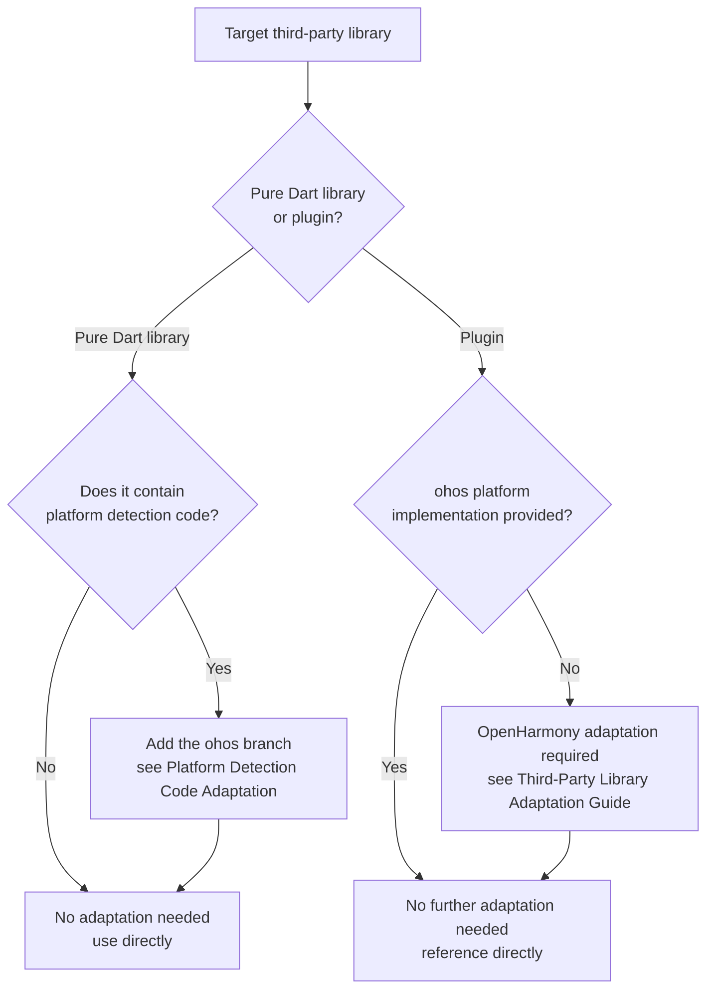

# Identifying Whether a Flutter Third-Party Library Requires OpenHarmony Adaptation

In Flutter OH app development, identifying whether a Flutter third-party library requires OpenHarmony adaptation is a key prerequisite step for bringing an app onto the OpenHarmony platform. This document provides the criteria for the two types of libraries, an actionable identification process, and the adaptation essentials for platform detection code in pure Dart libraries, helping developers quickly and accurately assess whether a third-party library requires OpenHarmony adaptation.

---

## Two Types of Third-Party Libraries

| Library Type | Requires Adaptation | Description |
|--------|---------------|------|
| Pure Dart library | Usually not | Contains only Dart code with no native platform dependencies; can be used directly in OpenHarmony projects |
| Flutter plugin (Plugin / FFI Plugin) | Yes | Contains native platform implementations for Android/iOS/macOS/Windows/Linux/Web, etc., and interacts with the Dart layer through Platform Channels or FFI |

**Typical characteristics of a pure Dart library**:

- Contains only `.dart` files under the `lib/` directory
- Does not declare a `flutter.plugin` field in `pubspec.yaml`
- Does not depend on any native plugins

**Typical characteristics of a plugin library**:

- Contains native platform directories such as `android/`, `ios/`, `macos/`, `windows/`, `linux/`, `web/`
- Declares `flutter.plugin.platforms` platform implementations in `pubspec.yaml`
- Depends on system native APIs, hardware capabilities, or platform-specific SDKs

---

## Identification Process



- A pure Dart library without platform detection logic requires no adaptation and can be used directly; if it contains platform checks, add an ohos branch.
- If a plugin library already provides an ohos platform implementation, reference it directly — no further adaptation is needed.
- If a plugin library does not provide an ohos platform implementation, complete the OpenHarmony adaptation by following the third-party library adaptation guide.

### Confirm the Library Type

Check the target library's information on [pub.dev](https://pub.dev/), or analyze its file structure through the local pub cache directory (`~/.pub-cache/hosted/.../<plugin_name>/`).

Criteria:

1. Check whether `pubspec.yaml` contains a `flutter.plugin` declaration — if it does, the library is a plugin; if not, it is likely a pure Dart library.
2. Check whether the source root contains native platform directories such as `android/` and `ios/` — if it does, the library is a plugin.

**Conclusion**: If it is a pure Dart library, OpenHarmony adaptation is usually not required and it can be used directly (but proceed to the third step to check for platform detection code); if it is a plugin library, proceed to the second step.

### Check Whether an ohos Platform Implementation Is Provided

Check whether the plugin already includes a native implementation for the OpenHarmony platform. You can check in the following ways:

**Method 1: Inspect the source directory structure**

Check whether an `ohos/` directory exists at the library root. If it does, the library already provides an OpenHarmony platform implementation.

**Method 2: Check the plugin declaration in pubspec.yaml**

Check whether it includes an `ohos` platform entry:

```yaml
flutter:
  plugin:
    platforms:
      android:
        package: com.example.xxx
        pluginClass: XxxPlugin
      ios:
        pluginClass: XxxPlugin
      ohos:
        package: com.example.xxx
        pluginClass: XxxPlugin
```

**Method 3: Query the adapted-libraries list**

Visit the [Flutter Third-Party Library Adaptation List for the OpenHarmony Platform](https://gitcode.com/CPF-Flutter/docs/blob/main/ThirdpartyLibrarites.md) and search for whether the library already has an OpenHarmony-adapted version.

**Conclusion**: If an `ohos` implementation already exists, no further adaptation is needed — reference it directly. If no `ohos` implementation exists, OpenHarmony adaptation is required; see [Flutter Third-Party Library OpenHarmony Platform Adaptation Guide](./ohos-flutter-lib-adaptation.en.md).

### Check Platform Detection Code in Pure Dart Libraries

Although pure Dart libraries do not require OpenHarmony adaptation, if a library internally contains platform detection logic (such as `Platform.isAndroid`, `defaultTargetPlatform == TargetPlatform.iOS`) without an `ohos` branch, it may fall into the wrong `else` branch at runtime, causing abnormal behavior.

---

## Platform Detection Code Adaptation

When platform checks exist in a pure Dart library or in app code, add the corresponding branch for OpenHarmony.

**Problematic example**:

```dart
if (Platform.isAndroid) {
  return androidStyle();
} else {
  return iosStyle(); // OpenHarmony devices will incorrectly execute this line
}
```

**Adaptation approach**: Add an ohos branch check. `defaultTargetPlatform` is recommended:

```dart
import 'package:flutter/foundation.dart';

// Recommended: use defaultTargetPlatform for the check
if (defaultTargetPlatform == TargetPlatform.android) {
  return androidStyle();
} else if (defaultTargetPlatform == TargetPlatform.ohos) {
  return ohosStyle(); // or reuse androidStyle()
} else {
  return iosStyle();
}
```

`Platform.isOhos` from `dart:io` can also be used for runtime checks, but it carries build risks:

```dart
import 'dart:io';

// Usable, but be aware of build risks
if (Platform.isAndroid || Platform.isOhos) {
  return androidStyle();
}
```

---

## FAQ

### How do I quickly distinguish a pure Dart library from a plugin library?

Check whether `pubspec.yaml` contains a `flutter.plugin` declaration, or whether the source contains native directories such as `android/` and `ios/`. If it does, the library is a plugin; if not, it is a pure Dart library.

### If a library runs normally on Android and iOS, will it also run normally on OpenHarmony/HarmonyOS?

Not necessarily. If the library is a pure Dart library without platform detection logic, it usually runs normally. If the library contains native platform implementations but lacks the `ohos` platform layer, the Dart layer throws a `MissingPluginException` when calling the platform channel. This exception has more than one possible root cause; follow the decision tree in [Flutter Plugin Call Throws MissingPluginException](../faq/plugin-adaptation-faq.en.md#section592016) to troubleshoot it.
