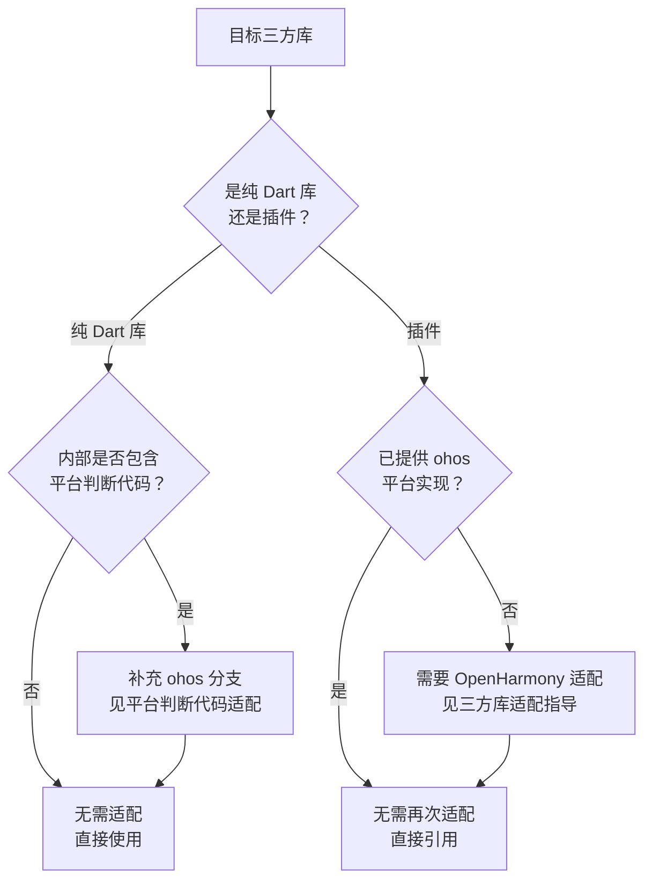

# 识别 Flutter 三方库是否需要适配 OpenHarmony

在 Flutter OH 应用开发中，识别一个 Flutter 三方库是否需要进行 OpenHarmony 适配，是应用接入 OpenHarmony 平台的关键前置步骤。本文档提供两类库的判断标准、可操作的识别流程，以及纯 Dart 库中平台判断代码的适配要点，帮助开发者快速准确地评估三方库是否需要 OpenHarmony 适配。

---

## 两类三方库

| 库类型 | 是否需要适配 | 说明 |
|--------|---------------|------|
| 纯 Dart 库 | 通常不需要 | 仅包含 Dart 代码，无原生平台依赖，可直接在 OpenHarmony 项目中使用 |
| Flutter 插件（Plugin / FFI Plugin） | 需要 | 包含 Android/iOS/macOS/Windows/Linux/Web 等原生平台实现，通过 Platform Channel 或 FFI 与 Dart 层交互 |

**纯 Dart 库的典型特征**：

- 仅包含 `lib/` 目录下的 `.dart` 文件
- `pubspec.yaml` 中未声明 `flutter.plugin` 字段
- 不依赖任何原生插件

**插件库的典型特征**：

- 包含 `android/`、`ios/`、`macos/`、`windows/`、`linux/`、`web/` 等原生平台目录
- `pubspec.yaml` 中声明了 `flutter.plugin.platforms` 平台实现
- 依赖系统原生 API、硬件能力或特定平台 SDK

---

## 识别流程



- 纯 Dart 库若无平台判断逻辑，无需适配直接使用；包含平台判断时需补充 ohos 分支。
- 插件库若已提供 ohos 平台实现，直接引用即可，无需再次适配。
- 插件库若未提供 ohos 平台实现，需参考三方库适配指导完成 OpenHarmony 适配。

### 确认库类型

查看目标库在 [pub.dev](https://pub.dev/) 上的信息，或通过本地 pub 缓存目录（`~/.pub-cache/hosted/.../<plugin_name>/`）分析其文件结构。

判断依据：

1. 检查 `pubspec.yaml` 是否包含 `flutter.plugin` 声明——有则为插件，无则倾向纯 Dart 库。
2. 检查源码根目录是否包含 `android/`、`ios/` 等原生平台目录——有则为插件。

**结论**：若为纯 Dart 库，通常无需 OpenHarmony 适配，直接使用（但需进入第三步检查平台判断代码）；若为插件库，进入第二步。

### 检查是否已提供 ohos 平台实现

查看该插件是否已包含 OpenHarmony 平台的原生实现，可通过以下方式检查：

**方式一：查看源码目录结构**

检查库根目录下是否存在 `ohos/` 目录。若存在，说明该库已提供 OpenHarmony 平台实现。

**方式二：查看 pubspec.yaml 中的 plugin 声明**

检查是否包含 `ohos` 平台入口：

```yaml
flutter:
  plugin:
    platforms:
      android:
        package: com.example.xxx
        pluginClass: XxxPlugin
      ios:
        pluginClass: XxxPlugin
      ohos:
        package: com.example.xxx
        pluginClass: XxxPlugin
```

**方式三：查询已适配清单**

访问 [OpenHarmony平台Flutter三方库适配列表](https://gitcode.com/CPF-Flutter/docs/blob/main/ThirdpartyLibrarites.md)，检索该库是否已有 OpenHarmony 适配版本。

**结论**：若已存在 `ohos` 实现，无需再次适配，直接引用即可；若不存在 `ohos` 实现，需要进行 OpenHarmony 适配，请参考 [Flutter 三方库适配 OpenHarmony 平台指导](./ohos-flutter-lib-adaptation.md)。

### 检查纯 Dart 库的平台判断代码

纯 Dart 库虽无需 OpenHarmony 适配，但如果库内部包含平台判断逻辑（如 `Platform.isAndroid`、`defaultTargetPlatform == TargetPlatform.iOS`）而缺少 `ohos` 分支，运行时可能落入错误的 `else` 分支，导致异常行为。

---

## 平台判断代码适配

当纯 Dart 库或应用代码中存在平台判断时，需为 OpenHarmony 补充对应分支。

**问题示例**：

```dart
if (Platform.isAndroid) {
  return androidStyle();
} else {
  return iosStyle(); // OpenHarmony 设备会错误执行此处
}
```

**适配方式**：补充 ohos 分支判断。推荐使用 `defaultTargetPlatform`：

```dart
import 'package:flutter/foundation.dart';

// 推荐写法：使用 defaultTargetPlatform 判断
if (defaultTargetPlatform == TargetPlatform.android) {
  return androidStyle();
} else if (defaultTargetPlatform == TargetPlatform.ohos) {
  return ohosStyle(); // 或复用 androidStyle()
} else {
  return iosStyle();
}
```

`dart:io` 中的 `Platform.isOhos` 同样可用于运行时判断，但存在构建风险：

```dart
import 'dart:io';

// 可用但需注意构建风险
if (Platform.isAndroid || Platform.isOhos) {
  return androidStyle();
}
```

---

## 常见问题

### 纯 Dart 库和插件库如何快速区分？

查看 `pubspec.yaml` 是否包含 `flutter.plugin` 声明，或检查源码是否包含 `android/`、`ios/` 等原生目录。有则为插件，无则为纯 Dart 库。

### 在 Android 和 iOS 上运行正常的库，OpenHarmony/HarmonyOS 上也能正常运行吗？

不一定。若该库为纯 Dart 库且不含平台判断逻辑，通常可正常运行。若该库包含原生平台实现但缺少 `ohos` 平台层，Dart 层调用平台通道时会抛出 `MissingPluginException`。该异常的根因不止一种，请按 [Flutter 插件调用报 MissingPluginException](../faq/plugin-adaptation-faq.md#section592016) 中的决策树排查。
