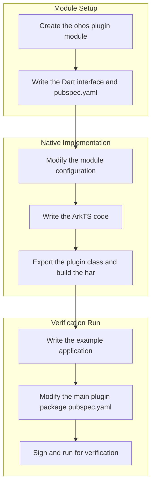

# OpenHarmony Platform Flutter Library Adaptation Guide

If a Flutter third-party library does not provide an OpenHarmony platform implementation, it cannot be called properly when used directly. This document uses the adaptation of [path_provider 2.1.0](https://pub-web.flutter-io.cn/packages/path_provider/versions/2.1.0) as an example to demonstrate how to create a standalone ohos platform package (such as `path_provider_ohos`) for a federated plugin and register it in the main plugin package, covering the complete process from module creation and native code writing to running and verification.

## Prerequisites

- The [Flutter OH environment setup](../getting-started/flutter-oh-env-setup.en.md) has been completed.
- The Flutter third-party library source code has been downloaded to the local machine.

## Adaptation Process Overview



- **Module setup**: Create the ohos plugin module skeleton and write the Dart-side interface and platform declaration.
- **Native implementation**: Modify the ohos module configuration, write the ArkTS native code, and export the plugin class and build the har package.
- **Verification run**: Create an example application, register the ohos platform implementation in the main plugin package, and run verification.

## Adaptation Steps

### Step 1: Understand the Plugin Directory Structure

Flutter third-party libraries commonly use two directory structures, and the adaptation approach differs between them.

**Structure 1: Single-package plugin**

The platform implementation directories are located directly under the plugin root directory. This structure is common in independently published plugins:

```
some_plugin/
├── lib/              # Dart code entry point; communicates with the native side via channels
├── android/          # Android platform implementation
├── ios/              # iOS platform implementation
├── example/          # Example application
├── README.md         # File that introduces the package
├── CHANGELOG.md      # Records the changes made in each version
└── LICENSE           # File containing the license terms of the package
```

For adaptation, add an `ohos/` directory to the plugin root directory and declare the `ohos` platform directly in pubspec.yaml. If you have write permission on the repository, you can run `flutter create . --template=plugin --platforms=ohos` to generate the scaffolding automatically. For details, see [Developing a Plugin](./developing-plugin.en.md#adding-ohos-platform-support-to-an-existing-plugin-project).

**Structure 2: Federated plugin**

The main package and each platform implementation are split into separate packages. This structure usually appears in multi-package repositories (such as flutter_packages):

```
flutter_packages/
└── packages/
    └── path_provider/
        ├── path_provider/              # Main package (common interfaces and the Dart API)
        ├── path_provider_android/       # Android platform implementation
        ├── path_provider_foundation/    # iOS/macOS platform implementation
        ├── path_provider_linux/         # Linux platform implementation
        └── path_provider_windows/       # Windows platform implementation
```

For adaptation, you need to create a standalone `path_provider_ohos` platform package and reference it through `default_package` in the pubspec.yaml of the main package. This document uses this structure to demonstrate the complete process.

### Step 2: Create the ohos Plugin Module

1. Open the downloaded plugin in Android Studio.
2. Open the Terminal and switch to the plugin directory.
3. Run the following command to create a Flutter module for the ohos platform:

```sh
flutter create --template=plugin --platforms=ohos path_provider_ohos
```

Plugin structure before running the creation command:


After running the creation command, you can delete the `.dart_tool` and `.idea` files in the `path_provider_ohos` directory:


### Step 3: Write the Dart Interface and pubspec.yaml

You can directly copy the Dart code under `lib` and the `pubspec.yaml` from the `path_provider_android` directory and modify them. The Dart code basically needs no changes; you only need to replace occurrences of `android` with `ohos`.

The modified `lib` directory structure:


Reference `pubspec.yaml` configuration:

```yaml
# For reference only
name: path_provider_ohos
description: "A new Flutter plugin project."
version: 0.0.1
homepage:

environment:
  sdk: ^3.11.5
  flutter: '>=3.3.0'

dependencies:
  flutter:
    sdk: flutter
  plugin_platform_interface: ^2.0.2

dev_dependencies:
  flutter_test:
    sdk: flutter
  flutter_lints: ^6.0.0

flutter:
  plugin:
    platforms:
      ohos:
        pluginClass: PathProviderOhosPlugin
```

### Step 4: Write the ohos Native Module

The `ohos/` directory generated by `flutter create --template=plugin` already has the har module structure. There is no need to create a new module or delete entry; you can write the ArkTS native code directly in it.

#### Modify the Configuration File

The current approach uses **source code dependency**: the plugin `ohos/` module is automatically injected into the host project (such as example) for compilation through the hvigor plugins (`flutterHvigorPlugin` + `injectNativeModules`). You do not need to manually add the `@ohos/flutter_ohos` har dependency to `oh-package.json5`; keep the default:

```json5
{
  "name": "path_provider_ohos",
  "version": "1.0.0",
  "description": "Please describe the basic information.",
  "main": "index.ets",
  "author": "",
  "license": "Apache-2.0",
  "dependencies": {}
}
```

#### Write the ArkTS Code

Use DevEco Studio to open the `example/ohos` directory (instead of opening the plugin's `ohos/` directory directly) to write the ArkTS code. The example host project automatically injects the plugin `ohos/` module source code through the hvigor plugins (`flutterHvigorPlugin` + `injectNativeModules`), so you can edit the plugin code directly. If you open the `ohos/` directory directly, the code will be flagged in red because the `@ohos/flutter_ohos` dependency is missing. If you have not created the example yet, complete [Step 5](#step-5-write-the-example-application) first.


#### Export the Plugin Class

Export the plugin class in the `index.ets` of the `ohos` module so that the toolchain can locate the implementation by package name:

```ts
import PathProviderPlugin from './src/main/ets/io/flutter/plugins/pathprovider/PathProviderPlugin';

export default PathProviderPlugin;
```


#### Build the har Package

After the code is written, you can build the har package:

1. Open the `example/ohos` directory in DevEco Studio.
2. Locate the ohos module of the plugin to build it.
3. Locate the plugin's ohos module (such as `path_provider_ohos`) in the project structure.
4. Click **Build > Make Module 'xxx'**.
5. Wait for the build to complete.


Expected result: a `path_provider_ohos.har` file is generated in the `ohos > build > default > outputs` directory, which indicates a successful build.


### Step 5: Write the Example Application

Create a Flutter example application for the ohos platform to verify the functionality of the adapted plugin.

1. Switch to the `path_provider_ohos` directory and run the following command to create the example:

```sh
flutter create --platforms ohos example
```

2. Copy the `main.dart` code under `path_provider_android/example/lib` and replace the `main.dart` code under `path_provider_ohos/example/lib`.

3. Modify the `pubspec.yaml` of the example:

```yaml
# For reference only
name: path_provider_ohos_example
description: "Demonstrates how to use the path_provider_ohos plugin."

publish_to: 'none'

environment:
  sdk: ^3.11.5

dependencies:
  flutter:
    sdk: flutter

  path_provider_ohos:
    path: ../

  cupertino_icons: ^1.0.8

dev_dependencies:
  integration_test:
    sdk: flutter
  flutter_test:
    sdk: flutter

  flutter_lints: ^6.0.0

flutter:
  uses-material-design: true
```


<p align="center"><strong>Figure 8</strong> Example application</p>

### Step 6: Modify the Main Plugin Package pubspec.yaml

In the `pubspec.yaml` of the main plugin package `path_provider`, add the `ohos` platform under `flutter.plugin.platforms` and add the `path_provider_ohos` dependency under `dependencies`:

```yaml
name: path_provider
description: Flutter plugin for getting commonly used locations on host platform file systems, such as the temp and app data directories.
repository: https://github.com/flutter/packages/tree/main/packages/path_provider/path_provider
issue_tracker: https://github.com/flutter/flutter/issues?q=is%3Aissue+is%3Aopen+label%3A%22p%3A+path_provider%22
version: 2.1.0

environment:
  sdk: ">=2.18.0 <4.0.0"
  flutter: ">=3.3.0"

flutter:
  plugin:
    platforms:
      android:
        default_package: path_provider_android
      ios:
        default_package: path_provider_foundation
      linux:
        default_package: path_provider_linux
      macos:
        default_package: path_provider_foundation
      windows:
        default_package: path_provider_windows
      ohos:
        default_package: path_provider_ohos   # Add the ohos plugin

dependencies:
  flutter:
    sdk: flutter
  path_provider_android: ^2.1.0
  path_provider_foundation: ^2.3.0
  path_provider_linux: ^2.2.0
  path_provider_platform_interface: ^2.1.0
  path_provider_windows: ^2.2.0
  path_provider_ohos:
    path: ../path_provider_ohos    # Add the ohos plugin

dev_dependencies:
  flutter_test:
    sdk: flutter
  integration_test:
    sdk: flutter
  plugin_platform_interface: ^2.0.0
  test: ^1.16.0
```

### Step 7: Sign and Run for Verification

#### Signing

1. Open the `example > ohos` directory of the third-party library in DevEco Studio.
2. Click `File > Project Structure > Project > Signing Configs`, select `Automatically generate signature`, wait for automatic signing to complete, and click `OK`.


<p align="center"><strong>Figure 9</strong> Signing configuration</p>

#### Running

Switch to the `path_provider_ohos/example` directory and run the following commands:

```sh
flutter pub get
flutter run -d <device-id>
```

## Verifying the Result

After a successful run, the example application loads normally and calls the `path_provider` interfaces, returning directory paths on the ohos platform. This indicates a successful adaptation.


<p align="center"><strong>Figure 10</strong> Effect of a successful run</p>
