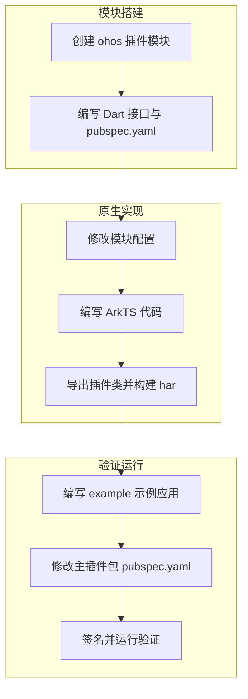

# Flutter 三方库适配 OpenHarmony 平台指导

Flutter 三方库若未提供 OpenHarmony 平台实现，直接使用将无法正常调用。本文以适配 [path_provider 2.1.0](https://pub-web.flutter-io.cn/packages/path_provider/versions/2.1.0) 为例，演示如何为联邦插件（federated plugin）创建独立的 ohos 平台包（如 `path_provider_ohos`），并在主插件包中注册，涵盖从创建模块、编写原生代码到运行验证的完整流程。

## 前置条件

- 已完成 [Flutter OH 开发环境搭建](../getting-started/flutter-oh-env-setup.md)。
- 已下载 Flutter 三方库源码到本地。

## 适配流程概览



- **模块搭建**：创建 ohos 插件模块骨架，编写 Dart 侧接口与平台声明。
- **原生实现**：修改 ohos 模块配置，编写 ArkTS 原生代码，导出插件类并构建 har 包。
- **验证运行**：创建 example 示例应用，在主插件包注册 ohos 平台实现并运行验证。

## 适配步骤

### 第一步：了解插件目录结构

Flutter 三方库常见两种目录结构，适配方式有所不同。

**结构一：单包插件**

平台实现目录直接位于插件根目录下，常见于独立发布的插件：

```
some_plugin/
├── lib/              # Dart 代码入口，通过 channel 与原生端通信
├── android/          # Android 平台实现
├── ios/              # iOS 平台实现
├── example/          # 示例应用
├── README.md         # 介绍包的文件
├── CHANGELOG.md      # 记录每个版本中的更改
└── LICENSE           # 包含软件包许可条款的文件
```

适配时在插件根目录添加 `ohos/` 目录，在 pubspec.yaml 中直接声明 `ohos` 平台。若拥有仓库修改权限，可执行 `flutter create . --template=plugin --platforms=ohos` 自动生成脚手架，详见 [开发 Flutter Plugin](./developing-plugin.md#5-为现有插件项目补齐-ohos-平台)。

**结构二：联邦插件（federated）**

主包与各平台实现拆分为独立包，通常出现在多包仓库（如 flutter_packages）中：

```
flutter_packages/
└── packages/
    └── path_provider/
        ├── path_provider/              # 主包（公共接口与 Dart API）
        ├── path_provider_android/       # Android 平台实现
        ├── path_provider_foundation/    # iOS/macOS 平台实现
        ├── path_provider_linux/         # Linux 平台实现
        └── path_provider_windows/       # Windows 平台实现
```

适配时需创建独立的 `path_provider_ohos` 平台包，在主包 pubspec.yaml 中通过 `default_package` 引用。本文以这种结构为例演示完整流程。

### 第二步：创建 ohos 插件模块

1. 用 Android Studio 打开下载好的插件。
2. 打开 Terminal，切换到插件目录下。
3. 执行以下命令创建 ohos 平台的 Flutter 模块：

```sh
flutter create --template=plugin --platforms=ohos path_provider_ohos
```

执行创建命令前的插件结构：


执行创建命令后，可删除 `path_provider_ohos` 目录下的 `.dart_tool` 和 `.idea` 文件：


### 第三步：编写 Dart 接口与 pubspec.yaml

可直接复制 `path_provider_android` 目录下 `lib` 的 Dart 代码和 `pubspec.yaml` 进行修改。Dart 代码基本无需改动，只需将 `android` 字样替换为 `ohos`。

修改后的 `lib` 目录结构：


`pubspec.yaml` 参考配置：

```yaml
# 仅作参考
name: path_provider_ohos
description: "A new Flutter plugin project."
version: 0.0.1
homepage:

environment:
  sdk: ^3.11.5
  flutter: '>=3.3.0'

dependencies:
  flutter:
    sdk: flutter
  plugin_platform_interface: ^2.0.2

dev_dependencies:
  flutter_test:
    sdk: flutter
  flutter_lints: ^6.0.0

flutter:
  plugin:
    platforms:
      ohos:
        pluginClass: PathProviderOhosPlugin
```

### 第四步：编写 ohos 原生模块

`flutter create --template=plugin` 生成的 `ohos/` 目录已经是 har module 结构，无需创建新模块或删除 entry，直接在其中编写 ArkTS 原生代码即可。

#### 修改配置文件

当前采用**源码依赖**方式：插件 `ohos/` 模块通过 hvigor 插件（`flutterHvigorPlugin` + `injectNativeModules`）自动注入到宿主工程（如 example）中编译，`oh-package.json5` 无需手动添加 `@ohos/flutter_ohos` har 依赖，保持默认即可：

```json5
{
  "name": "path_provider_ohos",
  "version": "1.0.0",
  "description": "Please describe the basic information.",
  "main": "index.ets",
  "author": "",
  "license": "Apache-2.0",
  "dependencies": {}
}
```

#### 编写 ArkTS 代码

使用 DevEco Studio 打开 `example/ohos` 目录（而非直接打开插件的 `ohos/` 目录）来编写 ArkTS 代码。 example 宿主工程通过 hvigor 插件（`flutterHvigorPlugin` + `injectNativeModules`）自动注入插件 `ohos/` 模块源码，可直接编辑插件代码。若直接打开 `ohos/` 目录，会因缺少 `@ohos/flutter_ohos` 依赖而出现代码标红。若尚未创建 example，请先完成[第五步](#第五步编写-example-示例应用)。


#### 导出插件类

在 `ohos` 模块的 `index.ets` 中导出插件类，使工具链能按包名找到实现：

```ts
import PathProviderPlugin from './src/main/ets/io/flutter/plugins/pathprovider/PathProviderPlugin';

export default PathProviderPlugin;
```


#### 构建 har 包

完成代码编写后，即可构建 har 包：

1. 用 DevEco Studio 打开 `example/ohos` 目录。
2. 定位到插件的 ohos 模块进行构建
3. 在项目结构中定位到插件的 ohos 模块（如 `path_provider_ohos`）。
4. 点击 **Build > Make Module 'xxx'**。
5. 等待构建完成。


预期结果：在 `ohos > build > default > outputs` 目录中生成 `path_provider_ohos.har` 文件，即为构建成功。


### 第五步：编写 example 示例应用

创建一个 ohos 平台的 Flutter example 应用，用于验证适配后的插件功能。

1. 切换到 `path_provider_ohos` 目录下，执行以下命令创建 example：

```sh
flutter create --platforms ohos example
```

2. 复制 `path_provider_android/example/lib` 下的 `main.dart` 代码，替换 `path_provider_ohos/example/lib` 下的 `main.dart` 代码。

3. 修改 example 的 `pubspec.yaml`：

```yaml
# 仅作参考
name: path_provider_ohos_example
description: "Demonstrates how to use the path_provider_ohos plugin."

publish_to: 'none'

environment:
  sdk: ^3.11.5

dependencies:
  flutter:
    sdk: flutter

  path_provider_ohos:
    path: ../

  cupertino_icons: ^1.0.8

dev_dependencies:
  integration_test:
    sdk: flutter
  flutter_test:
    sdk: flutter

  flutter_lints: ^6.0.0

flutter:
  uses-material-design: true
```


<p align="center"><strong>图8</strong> example 示例应用</p>

### 第六步：修改主插件包 pubspec.yaml

在主插件包 `path_provider` 的 `pubspec.yaml` 中，于 `flutter.plugin.platforms` 添加 `ohos` 平台，于 `dependencies` 添加 `path_provider_ohos` 依赖：

```yaml
name: path_provider
description: Flutter plugin for getting commonly used locations on host platform file systems, such as the temp and app data directories.
repository: https://github.com/flutter/packages/tree/main/packages/path_provider/path_provider
issue_tracker: https://github.com/flutter/flutter/issues?q=is%3Aissue+is%3Aopen+label%3A%22p%3A+path_provider%22
version: 2.1.0

environment:
  sdk: ">=2.18.0 <4.0.0"
  flutter: ">=3.3.0"

flutter:
  plugin:
    platforms:
      android:
        default_package: path_provider_android
      ios:
        default_package: path_provider_foundation
      linux:
        default_package: path_provider_linux
      macos:
        default_package: path_provider_foundation
      windows:
        default_package: path_provider_windows
      ohos:
        default_package: path_provider_ohos   # 添加ohos插件

dependencies:
  flutter:
    sdk: flutter
  path_provider_android: ^2.1.0
  path_provider_foundation: ^2.3.0
  path_provider_linux: ^2.2.0
  path_provider_platform_interface: ^2.1.0
  path_provider_windows: ^2.2.0
  path_provider_ohos:
    path: ../path_provider_ohos    # 添加ohos插件

dev_dependencies:
  flutter_test:
    sdk: flutter
  integration_test:
    sdk: flutter
  plugin_platform_interface: ^2.0.0
  test: ^1.16.0
```

### 第七步：签名并运行验证

#### 签名

1. 用 DevEco Studio 打开三方库的 `example > ohos` 目录。
2. 单击 `File > Project Structure > Project > Signing Configs`，勾选 `Automatically generate signature`，等待自动签名完成，单击 `OK`。


<p align="center"><strong>图9</strong> 签名配置</p>

#### 运行

切换到 `path_provider_ohos/example` 目录，执行以下指令运行：

```sh
flutter pub get
flutter run -d <device-id>
```

## 验证结果

运行成功后，example 应用正常加载并调用 `path_provider` 接口，返回 ohos 平台的目录路径，即为适配成功。


<p align="center"><strong>图10</strong> 运行成功效果</p>
