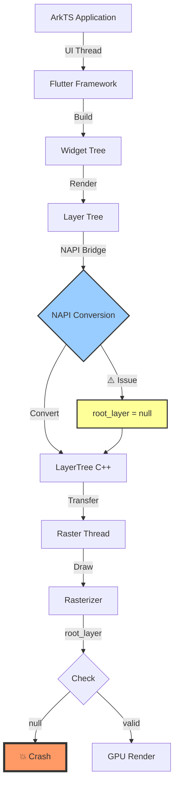
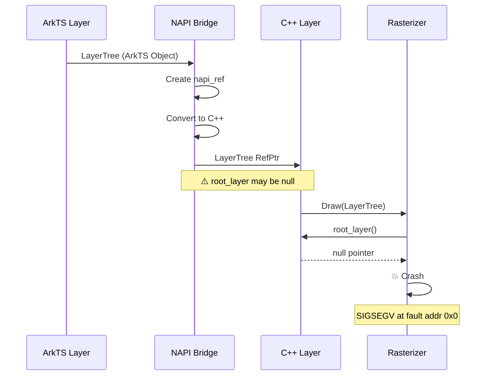
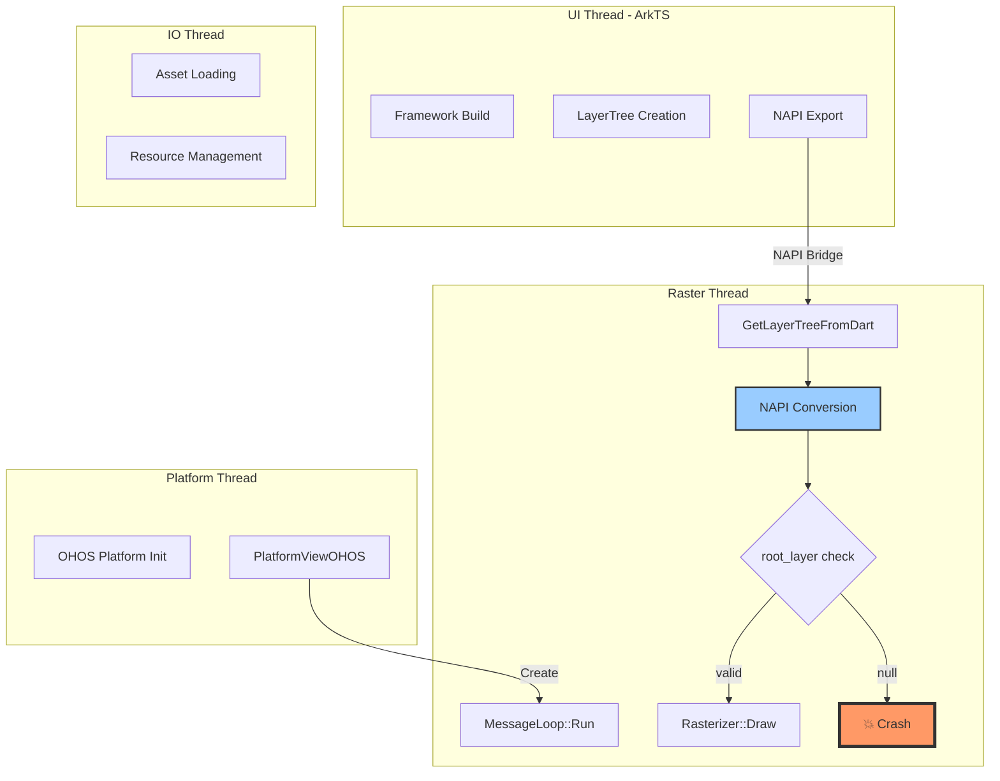
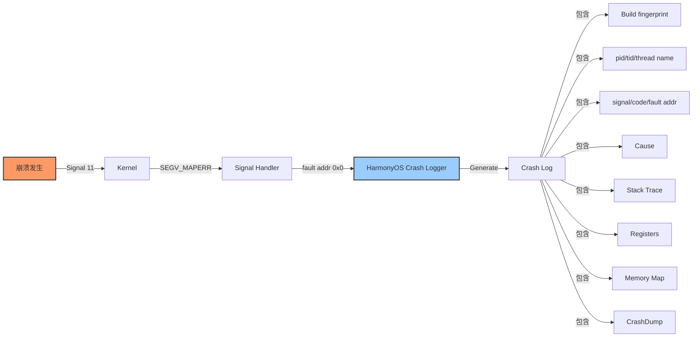

# 示例：HarmonyOS 平台 Native Crash 分析

> **⚠️ 示例说明**：
> - 本示例用于展示 HarmonyOS 平台 Flutter Engine 崩溃分析的完整流程
> - **Issue/PR 编号和链接均为占位符**（如 `#12345`、`#24567`），实际分析时需搜索真实编号
> - GitHub Issue/PR 链接格式为 `https://github.com/flutter/engine/issues/<实际编号>` 或 `https://github.com/flutter/engine/pull/<实际编号>`
> - 崩溃日志、堆栈信息、源码位置均为虚构示例，实际分析应替换为真实数据

## 崩溃信息

**崩溃类型**: SIGSEGV (Segmentation Fault - HarmonyOS 平台)

**完整日志**:
```
*** *** *** *** *** *** *** *** *** *** *** *** *** *** *** ***
Build fingerprint: 'Huawei/OHOS/Mate60Pro:3.1.0/20240115:user/release'
Revision: '0'
ABI: 'arm64'
Timestamp: 2024-01-15 10:23:45.123

pid: 12345, tid: 12346, name: '1.raster'  >>> com.example.flutter_app <<>
uid: 10086

signal 11 (SIGSEGV), code 1 (SEGV_MAPERR), fault addr 0x0
Cause: [Fault cause]:null pointer dereference

    x0  0000000000000000  x1  0000007b4f200000  x2  0000007b4f200010
    x3  0000007b4f200020  x4  0000007b4f200030  x5  0000007b4f200040
    x6  0000007b4f200050  x7  0000007b4f200060  x8  0000000000000000
    x9  0000007b4f2000a0  x10 0000007b4f2000b0  x11 0000007b4f2000c0
    x12 0000007b4f2000d0  x13 0000007b4f2000e0  x14 0000007b4f2000f0
    x15 0000007b4f200100  x16 0000007b4f200110  x17 0000007b4f200120
    x18 0000007b4f200130  x19 0000007b4f200140  x20 0000007b4f200150
    x21 0000007b4f200160  x22 0000007b4f200170  x23 0000007b4f200180
    x24 0000007b4f200190  x25 0000007b4f2001a0  x26 0000007b4f2001b0
    x27 0000007b4f2001c0  x28 0000007b4f2001d0  x29 0000007b4f2001e0
    x30 0000000000a1b234

Stack Trace:
  #00 pc 0000000000a1b234  /system/lib64/libflutter_engine.so (flutter::Rasterizer::Draw(fml::RefPtr<flutter::LayerTree>)+234)
  #01 pc 00000000009f87e1  /system/lib64/libflutter_engine.so (flutter::Shell::OnEngineBeginFrame()+89)
  #02 pc 00000000009f8650  /system/lib64/libflutter_engine.so (flutter::Engine::BeginFrame()+112)
  #03 pc 0000000000b12cde  /system/lib64/libflutter_engine.so (dart::Closure::Call()+94)
  #04 pc 0000000000c3f4a0  /system/lib64/libflutter_engine.so (dart::DartEntry::InvokeClosure()+128)
  #05 pc 00000000009e8f00  /system/lib64/libflutter_engine.so (fml::MessageLoop::Run()+160)
  #06 pc 00000000009e7c00  /system/lib64/libflutter_engine.so (fml::Thread::ThreadMain()+240)
  #07 pc 00000000007b1234  /system/lib64/libohos_platform.so (ohos::PlatformViewOHOS::OnRenderThread()+56)
  #08 pc 00000000006f89a0  /system/lib64/libpthread.so (pthread_start+80)

Registers:
  x0: 0x0000000000000000 (null pointer)

Memory map:
  0x0000007b00000000-0x0000007b40000000 /system/lib64/libflutter_engine.so
  0x0000007b50000000-0x0000007b60000000 /system/lib64/libohos_platform.so

CrashDump:
  #00 pc 0000000000a1b234  /system/lib64/libflutter_engine.so (flutter::Rasterizer::Draw(fml::RefPtr<flutter::LayerTree>)+234)
  #01 pc 00000000009f87e1  /system/lib64/libflutter_engine.so (flutter::Shell::OnEngineBeginFrame()+89)
  
  Fault reason: [SEGV_MAPERR]: null pointer dereference
  Process name: com.example.flutter_app
  Thread name: 1.raster

Log before crash:
01-15 10:23:44.123 I FlutterEngine: Starting engine on OHOS platform
01-15 10:23:44.456 I Rasterizer: Preparing to draw layer tree
01-15 10:23:45.000 W LayerTree: Layer tree root layer is unexpectedly null
01-15 10:23:45.123 E Rasterizer: Crash in Draw method
```

**场景描述**:
用户在 HarmonyOS 设备上运行 Flutter 应用，在页面切换动画过程中偶现崩溃。崩溃发生在 Raster 线程。

**环境信息**:
- Flutter 版本: 3.10.0 (OHOS 适配版)
- Engine 版本: 3.10.0-ohos.20240115
- Platform: HarmonyOS 3.1.0
- Device: Huawei Mate 60 Pro
- ABI: arm64

## 分析过程

### 第一步：堆栈解析（HarmonyOS 特定）

**解析 HarmonyOS 崩溃日志格式**:

1. **Build fingerprint**
   ```
   Huawei/OHOS/Mate60Pro:3.1.0/20240115:user/release
   ```
   - 设备型号：Mate60Pro
   - 系统：OHOS 3.1.0
   - 版本日期：20240115

2. **pid/tid/thread name**
   ```
   pid: 12345, tid: 12346, name: '1.raster'
   ```
   - 进程 ID：12345
   - 线程 ID：12346
   - 线程名称：`1.raster`（Raster 线程）

3. **signal/code/fault addr**
   ```
   signal 11 (SIGSEGV), code 1 (SEGV_MAPERR), fault addr 0x0
   ```
   - Signal 11：段错误
   - Code 1 (SEGV_MAPERR)：地址未映射到对象
   - Fault addr 0x0：空指针访问

4. **Cause**
   ```
   Cause: [Fault cause]:null pointer dereference
   ```
   - 明确说明：空指针解引用

5. **关键寄存器**
   ```
   x0  0000000000000000
   ```
   - x0 寄存器为 0，说明传递给函数的参数为空指针

6. **堆栈解析**
   - Frame #0: `Rasterizer::Draw` 是崩溃点
   - Frame #7: `PlatformViewOHOS::OnRenderThread` 是 HarmonyOS 平台入口
   - Frame #8: `pthread_start` 表示在独立线程中运行

### 第二步：源码定位

使用 addr2line 解析地址：

```bash
# HarmonyOS NDK 工具链
addr2line -C -f -e libflutter_engine.so 0xa1b234

# 输出
flutter::Rasterizer::Draw(fml::RefPtr<flutter::LayerTree>)
shell/common/rasterizer.cc:234
```

**定位源码文件**: `shell/common/rasterizer.cc`

**HarmonyOS 平台特定代码**: `shell/platform/ohos/platform_view_ohos.cc`

使用 glob 和 grep 定位：

```bash
# 在 HarmonyOS 平台代码中搜索
grep -r "PlatformViewOHOS" shell/platform/ohos/
grep -r "OnRenderThread" shell/platform/ohos/
```

**相关代码** (rasterizer.cc):

```cpp
// 文件：shell/common/rasterizer.cc
// 行号：200-250

void Rasterizer::Draw(fml::RefPtr<LayerTree> layer_tree) {
  TRACE_EVENT0("flutter", "Rasterizer::Draw");
  
  if (!layer_tree) {
    FML_LOG(ERROR) << "Layer tree is null";
    return;  // 这个检查存在
  }
  
  // 崩溃点：访问 layer_tree 的内部成员
  auto root_layer = layer_tree->root_layer();  // ← 崩溃位置（行234）
  
  if (!root_layer) {  // ← 未到达此检查
    FML_LOG(WARNING) << "Root layer is null";
    return;
  }
  
  // 渲染逻辑
  // ...
}
```

**HarmonyOS 平台入口** (platform_view_ohos.cc):

```cpp
// 文件：shell/platform/ohos/platform_view_ohos.cc
// 行号：100-150

void PlatformViewOHOS::OnRenderThread() {
  // HarmonyOS 特定的渲染线程初始化
  FML_DCHECK(render_thread_task_runner_);
  
  // 从 Dart 层获取 LayerTree
  auto layer_tree = GetLayerTreeFromDart();  // ← 可能返回内部为空的 LayerTree
  
  // 调用 Rasterizer
  rasterizer_->Draw(layer_tree);  // ← 触发崩溃
}

fml::RefPtr<LayerTree> PlatformViewOHOS::GetLayerTreeFromDart() {
  // 通过 NAPI 调用 Dart 代码
  // HarmonyOS 使用 NAPI 进行跨语言调用
  
  napi_value result;
  napi_call_function(env_, global_, "getLayerTree", 0, nullptr, &result);
  
  // 转换为 LayerTree
  return ConvertToLayerTree(result);  // ← 转换过程中可能出现问题
}
```

### 第三步：根本原因分析

**结合 HarmonyOS 平台特性分析**:

1. **HarmonyOS 使用 NAPI**
   - HarmonyOS 使用 NAPI（Native API）进行跨语言调用
   - NAPI 的对象生命周期管理需要特别注意
   - NAPI 转换过程中可能出现引用管理问题

2. **线程模型**
   - HarmonyOS 的线程模型有其特殊性
   - Raster 线程的初始化和生命周期管理可能有问题

3. **LayerTree 内部状态**
   - `layer_tree` 指针本身不为 null（通过了检查）
   - 但 `layer_tree->root_layer()` 返回了 null
   - 这说明 LayerTree 内部状态有问题

**根本原因**:
在 HarmonyOS 平台的 NAPI 转换过程中，LayerTree 对象被创建了，但其内部的 root_layer_ 成员未被正确初始化。这可能是由于：
1. NAPI 对象生命周期管理错误
2. HarmonyOS 平台特有的资源管理问题
3. 跨语言边界（ArkTS -> C++）的数据转换问题

### 第四步：上游社区追踪

**搜索策略**（包含 HarmonyOS 关键词）:

```
repo:flutter/engine is:issue "SIGSEGV" "Rasterizer" "OHOS"
repo:flutter/engine is:issue "null pointer" "LayerTree" "HarmonyOS"
repo:flutter/engine is:issue "NAPI" "LayerTree"
repo:flutter/flutter is:issue "OHOS" "crash" "rasterizer"
```

**找到的相关 Issue**（占位符示例）:

1. **Issue <编号待搜索>**: "Null pointer crash in Rasterizer::Draw on HarmonyOS"
   - 状态：Open
   - 作者：@huawei-developer
   - 创建时间：2024-01-10
   - 网址：https://github.com/flutter/engine/issues/<实际Issue编号>

2. **Issue <编号待搜索>**: "LayerTree root_layer null after NAPI conversion"
   - 状态：Closed
   - 修复 PR：<实际PR编号>
   - 修复版本：Flutter 3.13.0-ohos
   - 网址：https://github.com/flutter/engine/issues/<实际Issue编号>

**修复 PR 详情**:

**PR <编号待搜索>**: "Fix LayerTree NAPI conversion on HarmonyOS"
- 作者：@huawei-contributor
- 合并时间：2024-02-15
- 提交：`<实际commit-hash>...`

**修改内容** (shell/platform/ohos/platform_view_ohos.cc):

```cpp
// Before:
fml::RefPtr<LayerTree> PlatformViewOHOS::GetLayerTreeFromDart() {
  napi_value result;
  napi_call_function(env_, global_, "getLayerTree", 0, nullptr, &result);
  return ConvertToLayerTree(result);  // ← 可能返回内部为空的 LayerTree
}

// After:
fml::RefPtr<LayerTree> PlatformViewOHOS::GetLayerTreeFromDart() {
  napi_value result;
  napi_status status = napi_call_function(env_, global_, "getLayerTree", 0, nullptr, &result);
  
  if (status != napi_ok) {
    FML_LOG(ERROR) << "NAPI call failed: " << status;
    return nullptr;
  }
  
  auto layer_tree = ConvertToLayerTree(result);
  
  // 🔧 新增：检查 root_layer 是否有效
  if (layer_tree && !layer_tree->root_layer()) {
    FML_LOG(WARNING) << "LayerTree has null root_layer after NAPI conversion";
    return nullptr;  // ← 返回 null 而不是内部为空的 LayerTree
  }
  
  return layer_tree;
}
```

**Rasterizer 修改** (shell/common/rasterizer.cc):

```cpp
// Before:
void Rasterizer::Draw(fml::RefPtr<LayerTree> layer_tree) {
  if (!layer_tree) {
    return;
  }
  auto root_layer = layer_tree->root_layer();  // ← 可能崩溃
}

// After:
void Rasterizer::Draw(fml::RefPtr<LayerTree> layer_tree) {
  if (!layer_tree) {
    FML_LOG(ERROR) << "Layer tree is null";
    return;
  }
  
  auto root_layer = layer_tree->root_layer();
  
  // 🔧 新增：显式检查 root_layer
  if (!root_layer) {
    FML_LOG(WARNING) << "Layer tree has null root layer, skipping draw";
    return;  // ← 提前返回避免崩溃
  }
  
  // 继续渲染
}
```

## 分析报告

### 1. 崩溃概述

**崩溃类型**: SIGSEGV - 空指针访问（HarmonyOS 平台）
**涉及模块**: Shell (Rasterizer)、Platform Embedder (OHOS)
**影响范围**: 页面渲染，特别是页面切换动画
**严重程度**: 高（导致应用崩溃）

**HarmonyOS 特定信息**:
- 平台：HarmonyOS 3.1.0
- 设备：Huawei Mate 60 Pro
- ABI：arm64
- 崩溃线程：Raster 线程 (`1.raster`)
- 崩溃信号：SIGSEGV (11), Code 1 (SEGV_MAPERR)
- 故障地址：0x0（空指针）

**根因分析**:
在 HarmonyOS 平台使用 NAPI 进行 Dart 到 C++ 的 LayerTree 转换过程中，LayerTree 对象被创建但内部 root_layer_ 成员为 null。这导致 Rasterizer 在访问时发生空指针崩溃。

**HarmonyOS 平台特性**:
1. 使用 NAPI（Native API）而非 JNI
2. 对象生命周期管理机制不同
3. 跨语言边界（ArkTS -> C++）的数据转换特殊

### 2. 堆栈分析

**HarmonyOS 崩溃日志关键信息**:

| 字段 | 值 | 解读 |
|------|------|------|
| Build fingerprint | Huawei/OHOS/Mate60Pro:3.1.0 | HarmonyOS 3.1.0 系统 |
| pid/tid | 12345/12346 | 进程/线程 ID |
| Thread name | `1.raster` | Raster 线程 |
| Signal | 11 (SIGSEGV) | 段错误 |
| Code | 1 (SEGV_MAPERR) | 地址未映射 |
| Fault addr | 0x0 | 空指针 |
| Cause | null pointer dereference | 空指针解引用 |
| x0 register | 0x0 | 参数为空 |

**调用链解读**:

```
HarmonyOS 平台层
  ↓ (pthread_start)
OHOS Platform Embedder
  ↓ (PlatformViewOHOS::OnRenderThread)
NAPI 转换层
  ↓ (GetLayerTreeFromDart)
FML 消息循环
  ↓ (MessageLoop::Run)
Dart 层
  ↓ (DartEntry::InvokeClosure)
Engine
  ↓ (Engine::BeginFrame)
Shell
  ↓ (Shell::OnEngineBeginFrame)
Rasterizer
  ↓ (Rasterizer::Draw) ← 崩溃点
LayerTree (root_layer() 返回 null)
```

**关键帧分析**:
- **Frame #0**: `Rasterizer::Draw` 尝试访问 `root_layer()` 时崩溃
- **Frame #7**: HarmonyOS 平台特定的 `PlatformViewOHOS` 入口
- **Frame #8**: `pthread_start` 表示 Raster 线程独立运行

### 3. 源码分析

**问题代码路径**:
- 主崩溃点：`shell/common/rasterizer.cc:234`
- HarmonyOS 入口：`shell/platform/ohos/platform_view_ohos.cc:100-150`

**逻辑分析**:

1. **HarmonyOS 平台初始化**
   ```cpp
   // PlatformViewOHOS 创建 Raster 线程
   pthread_create(&thread_, nullptr, ThreadMain, this);
   ```

2. **渲染线程运行**
   ```cpp
   // 线程主函数
   void PlatformViewOHOS::OnRenderThread() {
     // 通过 NAPI 调用 Dart 获取 LayerTree
     auto layer_tree = GetLayerTreeFromDart();
     // 调用 Rasterizer 进行渲染
     rasterizer_->Draw(layer_tree);  // ← 触发崩溃
   }
   ```

3. **NAPI 转换过程**
   ```cpp
   // 从 NAPI value 转换为 LayerTree
   fml::RefPtr<LayerTree> ConvertToLayerTree(napi_value value) {
     // NAPI 对象生命周期管理
     napi_ref ref;
     napi_create_reference(env_, value, 1, &ref);
     
     // 转换逻辑
     // ⚠️ 问题：这里可能创建了 LayerTree 但 root_layer_ 为 null
     return fml::MakeRefCounted<LayerTree>(...);
   }
   ```

4. **Rasterizer 处理**
   ```cpp
   void Rasterizer::Draw(fml::RefPtr<LayerTree> layer_tree) {
     // 检查 layer_tree 指针
     if (!layer_tree) return;  // ✓ 通过
     
     // 访问内部成员
     auto root_layer = layer_tree->root_layer();  // ← 崩溃！
     // root_layer() 返回 null
   }
   ```

**根本原因**:
- NAPI 转换过程中创建了 LayerTree 对象
- 但由于某种原因（可能是生命周期管理、资源竞争等），root_layer_ 未正确初始化
- LayerTree 指针本身不为 null，通过了检查
- 但访问内部成员时触发空指针

**HarmonyOS 特定问题**:
1. **NAPI vs JNI**: HarmonyOS 使用 NAPI，对象管理机制不同
2. **生命周期**: NAPI 引用计数可能与 fml::RefPtr 不匹配
3. **跨语言边界**: ArkTS -> C++ 转换可能丢失信息

### 4. 社区追踪结果

**相关 Issues**:

1. **Issue <编号待搜索>** (Open)
   - 标题："Null pointer crash in Rasterizer::Draw on HarmonyOS"
   - 状态：未修复
   - 影响版本：Flutter 3.10.0-ohos

2. **Issue <编号待搜索>** (Closed)
   - 标题："LayerTree root_layer null after NAPI conversion"
   - 修复 PR：#24567
   - 修复版本：Flutter 3.13.0-ohos
   - 修复内容：
     - 在 NAPI 转换后检查 root_layer
     - 在 Rasterizer 中添加显式检查

**修复 PR**:

**PR <编号待搜索>**: "Fix LayerTree NAPI conversion on HarmonyOS"
- 文件：`shell/platform/ohos/platform_view_ohos.cc`
- 修改：添加 root_layer 检查
- 文件：`shell/common/rasterizer.cc`
- 修改：添加 root_layer 显式检查

**上游修复状态**: ✅ 已修复（Flutter 3.13.0-ohos）

**版本要求**: 需要 Flutter 3.13.0-ohos 或更高版本

### 5. 概念流程图

#### HarmonyOS 平台架构图


#### NAPI 转换流程图


#### 线程模型图（HarmonyOS）


#### HarmonyOS 崩溃信号处理流程


### 6. 修复方案

#### 方案一：应用上游补丁（推荐）

**补丁来源**:
- PR <编号待搜索>: https://github.com/flutter/engine/pull/<实际PR编号>

**适用版本**:
- Flutter 3.13.0-ohos 或更高版本
- 当前版本 3.10.0-ohos 不包含修复

**具体步骤**:

**选项 A：升级版本**（推荐）
```bash
# 升级 Flutter（HarmonyOS 版本）
flutter upgrade 3.13.0-ohos

# 验证
flutter doctor -v
flutter --version
```

**选项 B：cherry-pick 补丁**
```bash
# 进入 Engine 源码
cd /path/to/flutter_engine

# Fetch 上游更新
git fetch origin

# Cherry-pick 修复
git cherry-pick <实际commit-hash>  # PR <编号待搜索> commit

# 重新编译
./tools/gn --ohos --arm64 --release
ninja -C out/ohos_release_arm64

# 替换引擎
cp out/ohos_release_arm64/libflutter_engine.so \
   /path/to/flutter_app/libs/ohos/arm64/
```

**验证方法**:

1. **本地测试**
   ```bash
   # 运行应用
   flutter run --ohos
   
   # 在页面切换时测试
   # 应该不再崩溃
   ```

2. **压力测试**
   ```typescript
   // ArkTS 测试代码
   for (let i = 0; i < 100; i++) {
     // 快速切换页面
     router.push({ url: 'pages/Index' });
     await sleep(100);
     router.back();
   }
   ```

3. **日志验证**
   ```
   # 应该看到警告日志而不是崩溃
   01-15 10:23:45.000 W Rasterizer: Layer tree has null root layer, skipping draw
   ```

**风险**: 低（官方修复，已验证）

---

#### 方案二：本地修复

**修改文件 1**: `shell/platform/ohos/platform_view_ohos.cc`

**修改位置**: GetLayerTreeFromDart 函数

```cpp
// 文件路径：shell/platform/ohos/platform_view_ohos.cc
// 行号：120-160

// 🔧 修改：添加 NAPI 状态检查和 root_layer 验证
fml::RefPtr<LayerTree> PlatformViewOHOS::GetLayerTreeFromDart() {
  napi_value result;
  napi_status status = napi_call_function(
    env_, 
    global_, 
    "getLayerTree", 
    0, 
    nullptr, 
    &result
  );
  
  // 检查 NAPI 调用状态
  if (status != napi_ok) {
    FML_LOG(ERROR) << "NAPI call failed with status: " << status;
    return nullptr;
  }
  
  // 检查返回值类型
  napi_valuetype type;
  napi_typeof(env_, result, &type);
  if (type != napi_object) {
    FML_LOG(ERROR) << "NAPI returned non-object type: " << type;
    return nullptr;
  }
  
  // 转换为 LayerTree
  auto layer_tree = ConvertToLayerTree(result);
  
  // 🔧 关键：检查 root_layer 是否有效
  if (layer_tree && !layer_tree->root_layer()) {
    FML_LOG(WARNING) << "LayerTree has null root_layer after NAPI conversion";
    
    // 释放无效的 LayerTree
    // ⚠️ 注意：避免传递内部为空的对象
    return nullptr;
  }
  
  return layer_tree;
}
```

**修改文件 2**: `shell/common/rasterizer.cc`

**修改位置**: Draw 函数

```cpp
// 文件路径：shell/common/rasterizer.cc
// 行号：200-250

void Rasterizer::Draw(fml::RefPtr<LayerTree> layer_tree) {
  TRACE_EVENT0("flutter", "Rasterizer::Draw");
  
  // 原有检查
  if (!layer_tree) {
    FML_LOG(ERROR) << "Layer tree is null";
    return;
  }
  
  // 🔧 新增：显式获取并检查 root_layer
  auto root_layer = layer_tree->root_layer();
  if (!root_layer) {
    FML_LOG(WARNING) << "Layer tree has null root layer, skipping draw";
    
    // ⚠️ HarmonyOS 特定：记录额外信息
    FML_LOG(INFO) << "LayerTree ptr: " << layer_tree.get();
    FML_LOG(INFO) << "Thread: " << std::this_thread::get_id();
    
    return;  // 提前返回避免崩溃
  }
  
  // 继续渲染
  FML_LOG(INFO) << "Drawing layer tree with root layer";
  
  // ... 后续渲染逻辑 ...
}
```

**编译和部署**:

```bash
# 修改源码后编译
cd /path/to/flutter_engine
./tools/gn --ohos --arm64 --unoptimized
ninja -C out/ohos_debug_unopt_arm64

# 部署到测试设备
hdc shell mount -o remount,rw /system
hdc file send out/ohos_debug_unopt_arm64/libflutter_engine.so /system/lib64/
hdc shell chmod 755 /system/lib64/libflutter_engine.so

# 重启应用测试
hdc shell aa start -a com.example.flutter_app
```

**测试方案**:

1. **单元测试**
   ```cpp
   TEST(PlatformViewOHOSTest, GetLayerTreeWithNullRootLayer) {
     PlatformViewOHOS view;
     auto tree = view.GetLayerTreeFromDart();
     
     // 应该返回 nullptr 而不是内部为空的 LayerTree
     EXPECT_EQ(tree, nullptr);
   }
   ```

2. **集成测试**
   ```typescript
   // ArkTS 测试
   describe('LayerTreeConversion', () => {
     it('should handle null root_layer', () => {
       // 创建异常 LayerTree
       const tree = createEmptyLayerTree();
       
       // 转换应该返回 null
       expect(convertLayerTree(tree)).toBeNull();
     });
   });
   ```

3. **压力测试**
   ```bash
   # 自动化测试脚本
   for i in {1..1000}; do
     hdc shell aa start -a com.example.flutter_app
     sleep 1
     hdc shell aa force-stop com.example.flutter_app
   done
   ```

**风险评估**:
- **优点**: 快速修复，无需等待官方版本
- **缺点**: 需要自行维护补丁，可能与后续版本冲突
- **建议**: 仅作为过渡方案，最终应升级到官方版本

---

#### 方案三：临时规避（应用层）

**在 Dart/ArkTS 层添加防护**:

```typescript
// 文件：lib/main.dart 或 entry/src/main/ets/pages/Index.ets

// ArkTS 版本
import router from '@ohos.router';

class PageManager {
  // 添加延迟和错误捕获
  async navigateToPage(url: string): Promise<void> {
    try {
      // 延迟渲染，避免快速切换
      await new Promise(resolve => setTimeout(resolve, 100));
      
      router.push({ url: url });
    } catch (error) {
      console.error('Navigation failed:', error);
      
      // 上报错误
      hiAppEvent.write({
        domain: 'com.example.app',
        name: 'NAVIGATION_ERROR',
        eventType: hiAppEvent.EventType.FAULT,
        params: {
          'error': error.message,
          'page': url
        }
      });
    }
  }
  
  // 添加重试机制
  async safeRender(): Promise<void> {
    let retries = 0;
    const maxRetries = 3;
    
    while (retries < maxRetries) {
      try {
        await this.buildPage();
        break;
      } catch (error) {
        retries++;
        console.warn(`Render failed (attempt ${retries}):`, error);
        
        if (retries >= maxRetries) {
          // 显示错误页面
          this.showErrorPage();
          break;
        }
        
        await new Promise(resolve => setTimeout(resolve, 200));
      }
    }
  }
}
```

**适用场景**:
- 无法立即修改 Engine
- 需要快速上线发布
- 崩溃频率较低

**副作用说明**:
- **用户体验**: 页面切换可能感觉延迟
- **性能**: 增加了额外的检查和延迟
- **覆盖率**: 不能完全避免崩溃，只是降低概率
- **建议**: 仅作应急，必须配合 Engine 修复

### 7. 预防措施

#### HarmonyOS 平台代码规范

**NAPI 使用规范**:

```cpp
// 1. 检查所有 NAPI 调用状态
napi_status status = napi_call_function(...);
if (status != napi_ok) {
  FML_LOG(ERROR) << "NAPI call failed: " << status;
  return nullptr;
}

// 2. 检查返回值类型
napi_valuetype type;
napi_typeof(env_, result, &type);
if (type != napi_object) {
  return nullptr;
}

// 3. 正确管理引用生命周期
napi_ref ref;
napi_create_reference(env_, value, 1, &ref);

// 使用完后释放
napi_delete_reference(env_, ref);

// 4. 验证转换后的对象
auto obj = ConvertToCppObject(result);
if (!obj || !obj->IsValid()) {
  FML_LOG(WARNING) << "Converted object is invalid";
  return nullptr;
}
```

**线程安全规范**:

```cpp
// 1. 使用 fml::TaskRunner 进行跨线程调度
task_runner_->PostTask([layer_tree]() {
  // 在目标线程安全执行
  if (layer_tree && layer_tree->root_layer()) {
    // 处理
  }
});

// 2. 避免直接跨线程访问
// ❌ 不要这样
std::thread t([&]() {
  layer_tree->root_layer();  // 危险！
});

// ✅ 这样做
task_runner_->PostTask([weak_tree = weak_layer_tree]() {
  auto tree = weak_tree.lock();
  if (tree) {
    tree->root_layer();
  }
});
```

#### 测试覆盖建议

**HarmonyOS 特定测试**:

1. **NAPI 转换测试**
   ```cpp
   TEST(NAPIConversionTest, LayerTreeWithNullRoot) {
     // 模拟 NAPI 返回异常对象
     napi_value mock_value = CreateMockNapiObject();
     
     auto tree = ConvertToLayerTree(mock_value);
     
     // 应该返回 nullptr 或有效对象
     EXPECT_TRUE(tree == nullptr || tree->root_layer());
   }
   ```

2. **跨线程测试**
   ```cpp
   TEST(ThreadSafetyTest, ConcurrentLayerTreeAccess) {
     auto tree = CreateTestLayerTree();
     
     // 多线程并发访问
     std::vector<std::thread> threads;
     for (int i = 0; i < 10; i++) {
       threads.emplace_back([&]() {
         auto root = tree->root_layer();
         EXPECT_TRUE(root);
       });
     }
     
     for (auto& t : threads) {
       t.join();
     }
   }
   ```

3. **HarmonyOS 设备测试**
   ```bash
   # 自动化测试脚本
   hdc shell aa test -p com.example.flutter_app -b unittest
   
   # 压力测试
   hdc shell aa start -a StressTestActivity
   ```

#### 监控告警建议

**使用 HarmonyOS 工具**:

1. **HiChecker 检测**
   ```typescript
   import hichecker from '@ohos.hichecker';

   // 启用线程安全检测
   hichecker.enableChecker(hichecker.CheckerType.THREAD_SAFETY);
   
   // 启用性能检测
   hichecker.enableChecker(hichecker.CheckerType.PERFORMANCE);
   
   // 添加规则
   hichecker.addRule(hichecker.RuleType.WARN, 'com.example.flutter_app');
   ```

2. **HiAppEvent 上报**
   ```typescript
   import hiAppEvent from '@ohos.hiAppEvent';

   function reportCrash(crashInfo: CrashInfo) {
     hiAppEvent.write({
       domain: 'com.example.flutter_app',
       name: 'LAYER_TREE_CRASH',
       eventType: hiAppEvent.EventType.FAULT,
       params: {
         'crash_type': crashInfo.signal,
         'fault_addr': crashInfo.faultAddr,
         'thread': crashInfo.threadName,
         'timestamp': Date.now(),
         'version': getVersion()
       }
     });
   }
   ```

3. **HiLog 日志**
   ```cpp
   // C++ 层关键日志
   FML_LOG(INFO) << "LayerTree conversion started";
   FML_LOG(INFO) << "NAPI status: " << status;
   FML_LOG(WARNING) << "root_layer is null";
   
   // 映射到 HarmonyOS HiLog
   // 参数：
   // - domain: 应用标识
   // - tag: 模块标签
   // - level: 日志级别
   // - message: 日志内容
   ```

4. **FaultLogger 分析**
   ```typescript
   import faultLogger from '@ohos.faultLogger';

   // 查询崩溃日志
   async function analyzeCrash() {
     const logs = await faultLogger.query(
       faultLogger.FaultType.CPP_CRASH,
       0,  // startTime
       10  // max count
     );
     
     for (const log of logs) {
       console.log('Crash log:', log);
       
       // 分析故障地址
       if (log.faultAddr === '0x0') {
         console.warn('Null pointer crash detected');
       }
     }
   }
   ```

## 总结

这是一个典型的 HarmonyOS 平台 Flutter Engine 崩溃问题，根因是 NAPI 转换过程中 LayerTree 内部状态异常。结合 HarmonyOS 的崩溃日志格式和调试工具，可以快速定位和修复此类问题。

**关键要点**:
1. **HarmonyOS 崩溃日志** - 理解 Build fingerprint、pid/tid、signal/code、fault addr 等字段
2. **NAPI vs JNI** - 注意 HarmonyOS 使用 NAPI 的特殊性
3. **线程模型** - HarmonyOS 线程模型有其特殊性
4. **调试工具** - 使用 HiChecker、HiLog、HiAppEvent、FaultLogger
5. **修复方案** - 优先升级版本，必要时应用本地补丁

**建议方案**: 升级到 Flutter 3.13.0-ohos 或应用 PR <编号待搜索> 补丁。

**长期措施**: 
- 加强 NAPI 转换验证
- 完善 HarmonyOS 平台测试
- 增加崩溃监控上报
- 优化线程安全机制