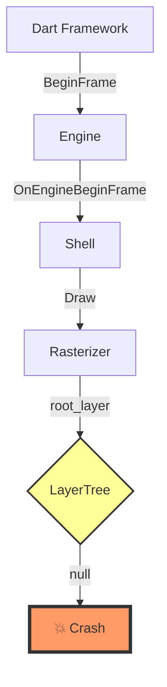
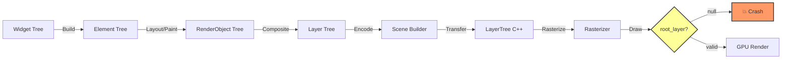
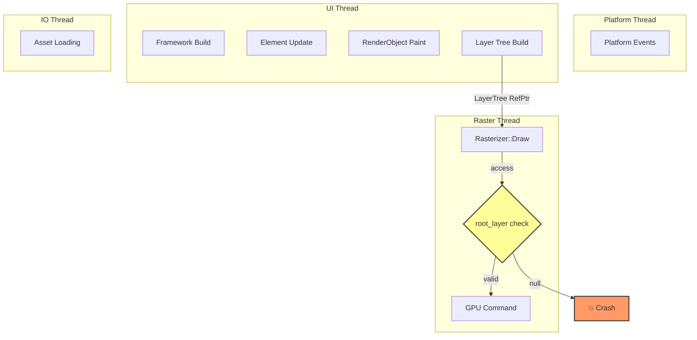
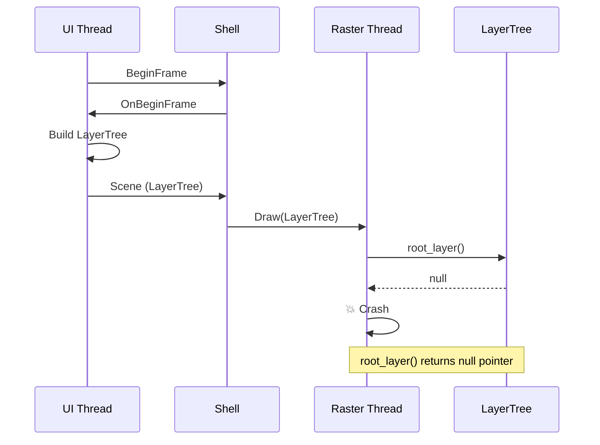

# 示例：空指针崩溃分析

> **⚠️ 示例说明**：
> - 本示例用于展示 Flutter Engine 空指针崩溃分析的完整流程
> - **Issue/PR 编号和链接均为占位符**（如 `#12345`、`#23456`），实际分析时需搜索真实编号
> - GitHub Issue/PR 链接格式为 `https://github.com/flutter/engine/issues/<实际编号>` 或 `https://github.com/flutter/engine/pull/<实际编号>`
> - 崩溃日志、堆栈信息、源码位置均为虚构示例，实际分析应替换为真实数据

## 崩溃信息

**崩溃类型**: SIGSEGV (Segmentation Fault)

**堆栈信息**:
```
*** *** *** *** *** *** *** *** *** *** *** *** *** *** *** ***
Build fingerprint: 'Huawei/OHOS'
Revision: '0'
ABI: 'arm64'
pid: 12345, tid: 12346, name: '1.raster'  >>> com.example.app <<<
signal 11 (SIGSEGV), code 1 (SEGV_MAPERR), fault addr 0x0
Cause: null pointer dereference

    x0  0000000000000000  x1  0000007b4f200000  x2  0000007b4f200010
    x3  0000007b4f200020  x4  0000007b4f200030  x5  0000007b4f200040
    x6  0000007b4f200050  x7  0000007b4f200060  x8  0000000000000000

Backtrace:
    #00 pc 0000000000a1b234  /data/app/lib/libflutter_engine.so (flutter::Rasterizer::Draw(fml::RefPtr<flutter::LayerTree>)+234)
    #01 pc 00000000009f87e1  /data/app/lib/libflutter_engine.so (flutter::Shell::OnEngineBeginFrame()+89)
    #02 pc 00000000009f8650  /data/app/lib/libflutter_engine.so (flutter::Engine::BeginFrame()+112)
    #03 pc 0000000000b12cde  /data/app/lib/libflutter_engine.so (Dart::__Anonymous__::Invoke()+94)
    #04 pc 0000000000b12b90  /data/app/lib/libflutter_engine.so (dart::Closure::Call()+64)
    #05 pc 0000000000c3f4a0  /data/app/lib/libflutter_engine.so (dart::DartEntry::InvokeFunction()+128)
    #06 pc 0000000000c3f380  /data/app/lib/libflutter_engine.so (dart::DartEntry::InvokeClosure()+112)
    #07 pc 0000000000c7a8c0  /data/app/lib/libflutter_engine.so (dart::DartCall::Invoke()+96)

CrashDump:
    #00 pc 0000000000a1b234  /data/app/lib/libflutter_engine.so (flutter::Rasterizer::Draw(fml::RefPtr<flutter::LayerTree>)+234)
    #01 pc 00000000009f87e1  /data/app/lib/libflutter_engine.so (flutter::Shell::OnEngineBeginFrame()+89)
    
    Fault reason: [SEGV_MAPERR]: null pointer dereference
    Process name: com.example.app
    Thread name: 1.raster
```

**场景描述**:
用户反馈在切换页面时偶现崩溃，崩溃发生在光栅化线程。

**环境信息**:
- Flutter 版本: 3.10.0
- Engine 版本: 3.10.0
- 平台: OHOS 3.1
- 设备: Huawei Mate 60 Pro

## 分析过程

### 第一步：堆栈解析

**崩溃类型**: SIGSEGV - 空指针访问
**崩溃位置**: `flutter::Rasterizer::Draw()`
**关键信息**:
- 崩溃发生在 Raster 线程 (`1.raster`)
- 故障地址为 0x0，确认空指针
- 堆栈显示在 `Rasterizer::Draw` 函数偏移 234 字节处

### 第二步：源码定位

使用 glob 和 grep 定位源码：

**文件位置**: `shell/common/rasterizer.cc`

**相关代码** (行号 200-250):

```cpp
void Rasterizer::Draw(fml::RefPtr<LayerTree> layer_tree) {
  TRACE_EVENT0("flutter", "Rasterizer::Draw");
  
  // ... 其他代码 ...
  
  if (!layer_tree) {
    FML_LOG(ERROR) << "Layer tree is null";
    return;  // 这个检查存在
  }
  
  // 崩溃点：这里访问了 layer_tree 的成员
  auto root_layer = layer_tree->root_layer();  // ← 崩溃位置
  
  if (!root_layer) {  // ← 这里的检查未能到达
    FML_LOG(ERROR) << "Root layer is null";
    return;
  }
  
  // ... 后续处理 ...
}
```

**根本原因**:
`layer_tree` 智能指针本身不为 null，但其内部持有的原始指针为 null。这导致 `layer_tree` 通过了 null 检查，但在调用 `root_layer()` 时崩溃。

### 第三步：上游社区追踪

**搜索关键词**:
- "Rasterizer::Draw null pointer"
- "LayerTree crash"
- "rasterizer crash layer tree"

**找到的相关 Issue**（占位符示例）:

1. **Issue <编号待搜索>**: "Crash in Rasterizer::Draw with non-null LayerTree"
   - 状态: Closed
   - 修复 PR: <实际PR编号>
   - 修复版本: Flutter 3.13.0
   - 网址: https://github.com/flutter/engine/issues/<实际Issue编号>

2. **Issue <编号待搜索>**: "Layer tree root_layer returns null occasionally"
   - 状态: Closed
   - 修复 PR: <实际PR编号>
   - 修复版本: Flutter 3.13.0

**修复 PR 详情**:

**PR <编号待搜索>**: "Fix null root_layer in LayerTree"
- 作者: @flutter-developer
- 合并时间: 2023-08-15
- 提交: `<实际commit-hash>...`

**修改内容**:
```cpp
// Before:
auto root_layer = layer_tree->root_layer();

// After:
auto root_layer = layer_tree->root_layer();
if (!root_layer) {
  FML_LOG(WARNING) << "Layer tree has null root layer, skipping draw";
  return;
}
```

**根本修复**:
在 `LayerTree` 构造和 `set_root_layer` 时添加了更多检查，确保 root_layer 不为 null。

## 分析报告

### 1. 崩溃概述

**崩溃类型**: 空指针访问 (SIGSEGV)
**涉及模块**: Shell (Rasterizer)
**影响范围**: 页面渲染
**严重程度**: 高（导致应用崩溃）

**根因分析**:
LayerTree 对象在传递过程中，其内部的 root_layer_ 成员未正确初始化或被意外置空，导致 Rasterizer 在访问时发生空指针崩溃。

### 2. 堆栈分析

**完整调用链**:
```
Dart Framework
  ↓ (InvokeClosure)
Dart Engine
  ↓ (BeginFrame)
Shell
  ↓ (OnEngineBeginFrame)
Rasterizer
  ↓ (Draw) ← 崩溃点
LayerTree (root_layer() 返回 null)
```

**关键帧解读**:
- Frame #0: `Rasterizer::Draw` 尝试访问 `layer_tree->root_layer()` 时崩溃
- Frame #1-2: Shell 和 Engine 的帧处理流程
- Frame #3-7: Dart 层的闭包调用链

### 3. 源码分析

**问题代码路径**: `shell/common/rasterizer.cc:234`

**逻辑分析**:
1. `Rasterizer::Draw` 接收一个 `LayerTree` 的 `RefPtr`
2. 检查 `layer_tree` 指针本身不为 null
3. 调用 `layer_tree->root_layer()` 获取根图层
4. 该方法返回了一个 null 指针
5. 后续代码尝试使用该指针导致崩溃

**根本原因**:
- LayerTree 的 root_layer_ 成员在某个时刻被置为 null
- 可能的原因：
  1. LayerTree 构造时未正确初始化
  2. 某个生命周期管理错误导致提前释放
  3. 并发访问导致的竞态条件

### 4. 社区追踪结果

**相关 Issues**:
- Issue <编号待搜索>: 已修复，合并到 Flutter 3.13.0
- Issue <编号待搜索>: 已修复，合并到 Flutter 3.13.0

**修复 PR**:
- PR <编号待搜索>: 添加了 Rasterizer 中的 root_layer 空指针检查（防御性兜底）
- PR <编号待搜索>: 修复了 LayerTree 生命周期管理中的根本问题（根因修复）

**上游修复状态**: ✅ 已修复

**版本要求**: 需要 Flutter 3.13.0 或更高版本

### 5. 概念流程图

#### 调用链图


#### 数据流图


#### 线程模型图


#### 生命周期图


### 6. 修复方案

#### 方案一：应用上游补丁（推荐）

**补丁来源**:
- PR <编号待搜索>: https://github.com/flutter/engine/pull/<实际PR编号>
- PR <编号待搜索>: https://github.com/flutter/engine/pull/<实际PR编号>

**适用版本**:
- 需要 Flutter 3.13.0 或更高
- 当前版本 3.10.0 不包含修复

**具体步骤**:

1. **升级 Flutter 版本**（推荐）
   ```bash
   flutter upgrade 3.13.0
   flutter doctor
   ```

2. **如果无法升级，cherry-pick 补丁**
   
   ```bash
   # 进入 engine 目录
   cd flutter_engine
   
   # 获取补丁
   git fetch origin
   git cherry-pick <实际commit-hash>  # PR <编号待搜索> 的 commit
   git cherry-pick <实际commit-hash>  # PR <编号待搜索> 的 commit
   
   # 重新编译
   ./tools/gn --ohos --unoptimized
   ninja -C out/ohos_debug_unopt
   ```

**验证方法**:
1. 编译并运行应用
2. 在页面切换时不再崩溃
3. 使用压力测试工具重复测试

**风险**: 低（官方修复，已验证）

#### 方案二：本地防御性处理

⚠️ **重要警告**: 此方案仅添加防御性检查避免崩溃，**未解决根因**。root_layer_ 仍可能为 null，需要进一步追查为何 LayerTree 的 root_layer_ 被置为 null。

> **参考 SKILL.md NEVER 规则**: "NEVER 只修复崩溃点而不检查根因 — 崩溃点往往是症状，真正问题在调用链上游"

**修改文件**: `shell/common/rasterizer.cc`

**修改位置**: Draw 函数（约 234 行）

**修改内容**:

```cpp
// 文件路径: shell/common/rasterizer.cc
// 行号: 200-250

void Rasterizer::Draw(fml::RefPtr<LayerTree> layer_tree) {
  TRACE_EVENT0("flutter", "Rasterizer::Draw");
  
  // 原有检查
  if (!layer_tree) {
    FML_LOG(ERROR) << "Layer tree is null";
    return;
  }
  
  // 🔧 临时兜底：检查 root_layer 是否为 null
  // 注意：这只是避免崩溃的防御性代码，未解决 root_layer_ 为何为 null 的根因
  auto root_layer = layer_tree->root_layer();
  if (!root_layer) {
    FML_LOG(WARNING) << "Layer tree has null root layer, skipping draw";
    return;  // 提前返回，避免崩溃
  }
  
  // 继续原有的渲染逻辑
  // ...
}
```

**测试方案**:
1. 编译修改后的 Engine
2. 创建测试用例：在 Dart 层构造异常 LayerTree
3. 验证不再崩溃，而是输出警告日志

**风险评估**:
- **优点**: 快速规避崩溃，无需升级
- **缺点**: 
  - **未解决根因**：root_layer_ 仍可能为 null，未追查其被置为 null 的原因
  - **可能导致渲染缺失**：页面可能无法正常显示，仅避免崩溃
  - **掩盖真实问题**：跳过绘制可能导致更难发现上游问题
- **建议**: 仅作为**临时规避方案**，必须配合根因排查或升级版本

**根因追查方向**（配合此防御性处理）:
1. 检查 LayerTree 构造时 root_layer_ 初始化逻辑
2. 追查 root_layer_ 被置为 null 的代码路径
3. 检查是否存在并发访问导致的竞态条件
4. 参考 PR <编号待搜索> 中 LayerTree 生命周期管理的修复

#### 方案三：临时规避

**规避方法**:
在 Dart 层面添加重试机制：

```dart
// 在 build 方法中添加 try-catch
@override
Widget build(BuildContext context) {
  try {
    return _buildContent(context);
  } catch (e, stack) {
    // 记录错误
    debugPrint('Build error: $e');
    debugPrint('Stack: $stack');
    
    // 返回空 widget 避免崩溃
    return const SizedBox.shrink();
  }
}

// 或者在页面切换时添加延迟
void _navigateToNextPage() {
  Future.delayed(const Duration(milliseconds: 100), () {
    Navigator.push(
      context,
      MaterialPageRoute(builder: (context) => NextPage()),
    );
  });
}
```

**适用场景**:
- 无法立即升级版本
- 无法重新编译 Engine
- 需要快速上线

**副作用说明**:
- 可能导致页面渲染不完整
- 用户体验下降
- 未真正解决问题

### 7. 预防措施

#### 代码规范建议

1. **空指针检查**
   ```cpp
   // 所有指针访问前检查
   if (!ptr) {
     FML_LOG(ERROR) << "Pointer is null";
     return;
   }
   
   // 使用 fml::RefPtr 的隐式 bool 转换
   if (!layer_tree) {
     return;
   }
   ```

2. **生命周期管理**
   ```cpp
   // 使用 RefPtr 确保对象生命周期
   fml::RefPtr<LayerTree> tree = layer_tree;
   
   // 避免原始指针持有引用
   // ❌ Layer* raw_layer = tree->root_layer();
   // ✅ auto layer = tree->root_layer();
   ```

3. **线程安全**
   ```cpp
   // 跨线程访问时使用锁或任务调度
   task_runner_->PostTask([layer_tree]() {
     // 在目标线程访问
     if (layer_tree && layer_tree->root_layer()) {
       // 安全访问
     }
   });
   ```

#### 测试覆盖建议

1. **单元测试**
   ```cpp
   TEST(RasterizerTest, DrawWithNullLayerTree) {
     Rasterizer rasterizer;
     EXPECT_NO_FATAL_FAILURE(rasterizer.Draw(nullptr));
   }
   
   TEST(RasterizerTest, DrawWithNullRootLayer) {
     Rasterizer rasterizer;
     auto tree = fml::MakeRefCounted<LayerTree>();
     // tree 的 root_layer 为 null
     EXPECT_NO_FATAL_FAILURE(rasterizer.Draw(tree));
   }
   ```

2. **压力测试**
   - 频繁的页面切换
   - 高负载渲染场景
   - 并发操作测试

3. **模糊测试**
   - 随机构造异常 LayerTree
   - 测试边界条件

#### 监控告警建议

1. **崩溃监控**
   ```cpp
   // 在 Rasterizer::Draw 中添加监控
   void Rasterizer::Draw(fml::RefPtr<LayerTree> layer_tree) {
     if (!layer_tree || !layer_tree->root_layer()) {
       // 上报监控指标
       metrics::IncrementCounter("rasterizer.null_layer_tree");
     }
     // ...
   }
   ```

2. **日志告警**
   ```cpp
   FML_LOG(WARNING) << "Layer tree has null root layer"
                    << ", thread=" << std::this_thread::get_id()
                    << ", timestamp=" << GetCurrentTime();
   ```

3. **性能监控**
   - 监控 LayerTree 构建时间
   - 监控 Rasterizer 渲染时间
   - 监控内存使用情况

## 总结

这是一个典型的空指针崩溃问题，根因是 LayerTree 的 root_layer 在某些情况下为 null，而 Rasterizer 未进行充分检查。上游社区已在 Flutter 3.13.0 中修复此问题。

**建议方案**: 升级到 Flutter 3.13.0 或更高版本。

**临时方案**: 应用本地补丁或添加规避代码。

**长期措施**: 加强空指针检查、完善测试覆盖、增加监控告警。