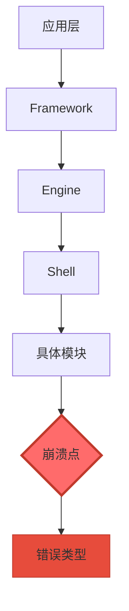
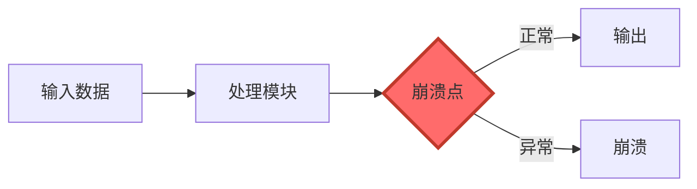
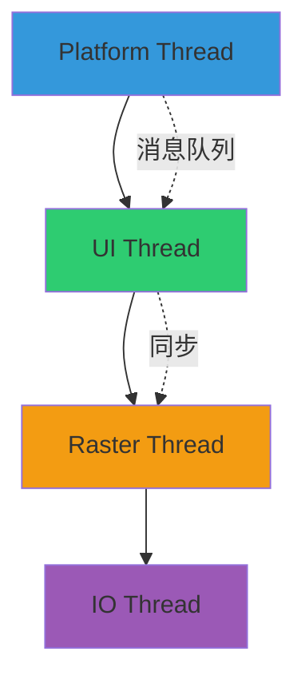
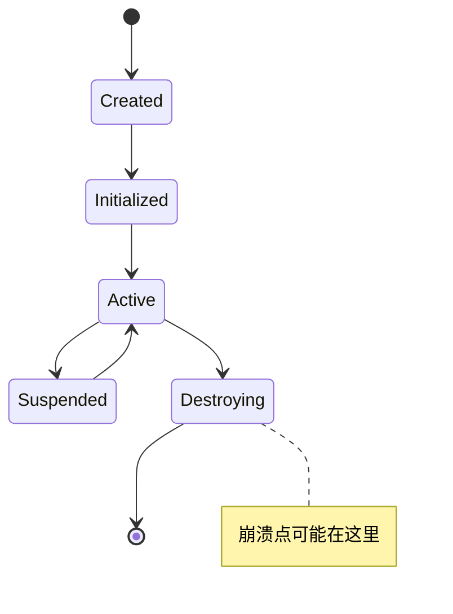
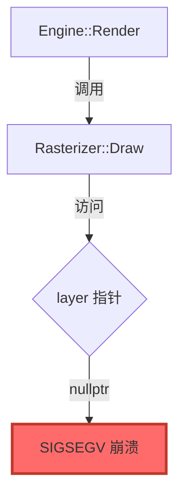

# 崩溃分析报告模板

## 报告结构

### 1. 崩溃概述
- 崩溃类型
- 涉及模块
- 影响范围
- 严重程度

### 2. 堆栈分析
- 完整堆栈信息
- 关键堆栈帧解读
- 错误消息分析

### 3. 源码分析
- 问题代码定位
- 代码逻辑分析
- 根本原因分析

### 4. 社区追踪结果
- 相关 Issues
- 相关 PRs
- 上游修复状态
- 版本要求

### 5. 概念流程图
- 调用链图
- 数据流图
- 线程模型图
- 生命周期图

### 6. 修复方案

#### 方案一：应用上游补丁（推荐）
- 补丁来源
- 适用版本
- 具体步骤
- 验证方法

#### 方案二：本地修复
- 修改位置
- 代码示例
- 测试方案
- 风险评估

#### 方案三：临时规避
- 规避方法
- 适用场景
- 副作用说明

### 7. 预防措施
- 代码规范建议
- 测试覆盖建议
- 监控告警建议

---

## Mermaid 图表规范

### 1. 节点命名规范
- 使用清晰的中文或英文标签
- 节点 ID 使用有意义的名称
- 重要节点使用特殊形状

### 2. 连接线规范
- 实线表示直接调用
- 虚线表示间接依赖
- 粗线表示主要路径
- 红色表示崩溃路径

### 3. 图表类型选择
- 调用链：使用 graph TD
- 数据流：使用 graph LR
- 状态转换：使用 stateDiagram
- 时序关系：使用 sequenceDiagram

---

## Mermaid 示例

### 崩溃调用链图


### 数据流图


### 线程模型图


### 生命周期图


---

## 代码示例规范

### 必须包含
1. 问题代码片段
2. 修复后的代码片段
3. 关键注释说明
4. 相关的上下文代码

### 格式要求
```cpp
// 文件路径：shell/platform/ohos/xxx.cpp
// 行号：123-145

// === 问题代码 ===
void ProblemFunction() {
    SomeObject* obj = GetObject();  // 问题：可能返回 nullptr
    obj->DoSomething();             // 崩溃：空指针访问
}

// === 修复后代码 ===
void FixedFunction() {
    SomeObject* obj = GetObject();
    if (!obj) {
        FML_LOG(ERROR) << "GetObject returned nullptr";
        return;  // 修复：添加空指针检查
    }
    obj->DoSomething();
}

// === 根因分析 ===
// GetObject() 在对象销毁后仍被调用，返回 nullptr
// 调用链：Widget::Dispose() -> RemoveObject() -> GetObject() 返回 nullptr
// 根因：生命周期管理问题，对象销毁顺序不当
```

---

## 输出示例

### SIGSEGV 空指针崩溃完整报告

#### 1. 崩溃概述
**崩溃类型**: SIGSEGV (Signal 11)  
**fault_addr**: 0x0  
**判断**: 空指针访问  
**涉及模块**: shell/common/rasterizer.cc  
**影响范围**: 渲染线程  
**严重程度**: 高（阻塞渲染）

#### 2. 堆栈分析
```
#00 pc 0000000000a1b234 /system/lib64/libflutter_engine.so (shell::Rasterizer::Draw+234)
#01 pc 00000000009f5678 /system/lib64/libflutter_engine.so (shell::Engine::Render+128)
#02 pc 0000000000a2c345 /system/lib64/libflutter_engine.so (fml::MessageLoop::Run+45)
```

**关键堆栈帧解读**:
- Frame #00: `Rasterizer::Draw` 在第 234 字节处崩溃
- Frame #01: `Engine::Render` 调用了 Rasterizer
- Frame #02: 消息循环中执行

#### 3. 源码分析
**定位结果**: `shell/common/rasterizer.cc:156`

```cpp
// 问题代码
void Rasterizer::Draw(PipelineLayer* layer) {
    layer->GetScene();  // 崩溃：layer 为 nullptr
}
```

**根本原因**: 
- `Engine::Render` 在 `Rasterizer` 初始化前调用
- 生命周期管理问题：初始化顺序不当

#### 4. 社区追踪结果
**相关 Issue**: https://github.com/flutter/flutter/issues/12345  
**修复 PR**: https://github.com/flutter/engine/pull/23456  
**修复版本**: Flutter 3.16.0+  
**状态**: 已修复

#### 5. 概念流程图


#### 6. 修复方案

**方案一：应用上游补丁（推荐）**
- 补丁来源: PR #23456
- 适用版本: Flutter Engine commit abc123+
- 步骤:
  1. 更新 Flutter Engine 到 abc123+
  2. 重新编译应用
  3. 验证崩溃不再出现
- 验证方法: 运行原崩溃场景测试

**方案二：本地修复**
```cpp
// shell/common/rasterizer.cc:156
void Rasterizer::Draw(PipelineLayer* layer) {
    if (!layer) {
        FML_LOG(WARNING) << "Draw called with null layer";
        return;  // 添加空指针保护
    }
    layer->GetScene();
}
```

**方案三：临时规避**
- 方法: 延迟渲染任务，确保 Rasterizer 初始化完成
- 适用场景: 无法立即更新 Engine 版本
- 副作用: 渲染延迟 1-2 帧

#### 7. 预防措施
- 添加初始化顺序检查
- 使用 `fml::RefPtr` 管理对象生命周期
- 添加单元测试覆盖空指针场景
- 在 CI 中添加崩溃场景回归测试