# 05 · API 接口文档（纯接口版）

> 来源：由 `04_API契约_v2_草案.md` 整理；实现状态对照现有后端源码
> （`qqbot-backend/server.py`、`qqbot-backend/relay.py`、`qqbot-backend/llm_worker.py`）核验。
> UI 对应关系来自 `知了设计UI/` 下的 8 张 Figma 导出稿。
> 状态口径：**✅ 已实现** / **❌ 约定未实现**。
>
> **2026-10-28 当前主链路**：**自动群采集暂时关闭**（`QQBOT_GROUP_COLLECT=0`，默认值）。服务端默认不接收、不落库群消息，也不做跨消息上下文/聚类；App 只处理**用户主动私聊/转发给 Bot** 的单条文本，进入「待确认」。`/groups`、`/subscribe`、`/messages`、`/candidates` 代码保留，但当前不会因群消息产生新数据。

---

## 整体数据流

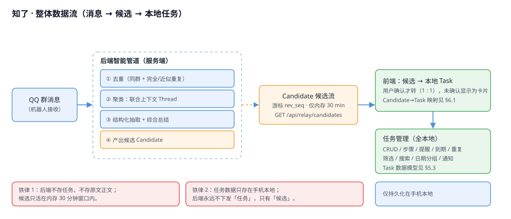

> 该图是原「群消息 → 候选」链路；**2026-10-28 起自动群采集暂停**，当前实际主链路是「用户转发 → `/forward/pending` → `/parse` → 待确认」。

---

## 0. 通用约定

| 项 | 约定 |
| --- | --- |
| Base URL | `http://<控制台主机>:8730`（默认仅本机 `127.0.0.1`；手机联调需设 `QQBOT_CONSOLE_HOST=0.0.0.0`） |
| App 接口前缀 | **`/api/relay/`**（机器人通道；与 Web 控制台自身的 `/api/*` 不撞车） |
| 鉴权请求头 | `X-Device-Id` + `X-Device-Token`（由 `POST /api/relay/device/register` 下发） |
| 成功信封 | `{ "ok": true, "data": { ... } }` |
| 失败信封 | `{ "ok": false, "error": { "code": "...", "message": "..." } }` |
| 时间格式 | `YYYY-MM-DD HH:mm:ss` |
| 正文合规 | 群消息/转发文本只存在内存 30 分钟滚动窗口/转发队列，**不落盘**；服务端不存任务、不存原文正文 |
| 凭据合规 | BYOB 的 AppSecret 仅以 AES-256-GCM 密文存 `tenants.json`；接口响应/日志不回显，解绑即删 |
| 限流（2026-11-01） | 公网口按**客户端 IP**限流（60s 窗口）：`/device/register` 10 次、`/tenant/register` 5 次、`/parse` 20 次、`/bind/code` 10 次；超限返回 `429 rate_limited`。1 秒轮询的 `/forward/pending` **不限流**。 |

### 错误码

| code | HTTP | 含义 | 前端应对 |
| --- | --- | --- | --- |
| `unauthorized` | 401 | 缺请求头/令牌无效 | 清身份回「首次启动/Onboarding」 |
| `bad_request` | 400 | 缺必填参数 | 代码 bug |
| `forbidden` | 403 | 该群未授权给你的账号 / 内部密钥错误 | 提示无权限 |
| `dev_disabled` | 403 | 联调注入未开启 | 仅联调用 |
| `not_found` | 404 | 路径不存在（**老后端即没有 v2 接口**） | 视作「不支持」，降级 |
| `internal` | 500 | 服务端异常 | 展示 message，重试 |
| `not_supported` | 501 | 接口存在但功能未启用（如未装模型） | 降级到本地规则（**v2 预留**） |
| `secret_key_missing` | 400 | BYOB 主密钥未配置 | 服务端配置 `QQBOT_SECRET_KEY`，不是用户错误 |
| `bot_start_failed` | 400 | AppID/AppSecret 无效或 Bot 未上线 | 提示核对凭据；看后端 `[tenant:...]` 日志 |
| `bot_already_bound` | 400 | 同一 AppID 已绑到另一设备，且 AppSecret 不一致 | 用同一份 AppSecret 重装会自动转移；重置过 Secret 需先在原设备解绑 |
| `rate_limited` | 429 | 请求过于频繁（注册设备/注册租户/解析/配对码） | 按提示等待重试 |
| `tenant_busy` | 400 | 同时启动的租户过多（启动队列已满） | 稍后重试 |

---

## 1. 已实现接口（v1 冻结）

### 1.1 `GET /api/relay/health` ✅

- **作用**：连接与能力探测。App 启动/连接时调用，判断后端可用性。
- **鉴权**：无。
- **响应**：
  ```json
  { "ok": true, "data": {
    "ok": true, "version": "mvp0",
    "time": "2026-10-14 10:00:00",
    "bot_running": true,
    "window": { "window_items": 12, "window_minutes": 30, "max_seq": 37 }
  }}
  ```
- **对应界面**：`首次启动.svg`（连接检测）、Onboarding 绑定页进入前的探测。

  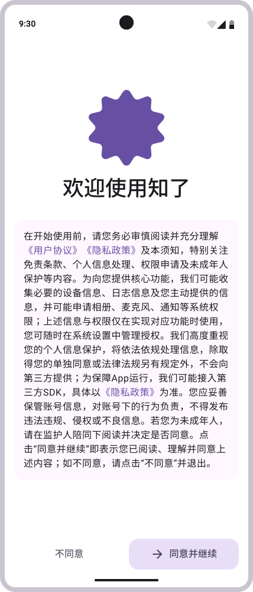

- **实现现状**：返回如上字段；**不含** v2 要求的 `api_version` / `capabilities`（见 §2.4）。

### 1.2 `POST /api/relay/device/register` ✅

- **作用**：注册一台设备，拿到后续所有请求要用的 `device_id` 与 `token`。
- **鉴权**：无。
- **请求**：`{ "name": "可选，设备名" }`
- **响应**：`{ "ok": true, "data": { "device_id": "dev_xxx", "token": "..." } }`
- **对应界面**：`首次启动.svg`（首次启动即注册，本地保存身份，见图 §1.1）。

### 1.3 `POST /api/relay/tenant/register` ✅（2026-10-28 BYOB）

- **作用**：用户自建 QQ Bot 后，把 **AppID / AppSecret** 交给后端；后端按设备加密保存 Secret，并拉起该用户的 botpy 子进程。
- **鉴权**：设备身份。
- **请求**：`{ "app_id": "1906107486", "app_secret": "..." }`
- **响应**：`{ "ok": true, "data": { "bound": true, "app_id": "1906107486", "bot_nickname": "", "running": true, "ready": true } }`
- **错误**：`secret_key_missing`（服务端未配 `QQBOT_SECRET_KEY`）、`bot_start_failed`（凭据错/未上线）、`bot_already_bound`（同一 AppID 已绑另一设备且 Secret 不一致）、`tenant_limit`。
- **卸载重装**：若 AppID + AppSecret 与旧租户一致，服务端会停掉旧设备 runner、删除旧租户/绑定，再把 Bot 转移到新 `device_id`（不会报 `bot_already_bound`）。
- **对应界面**：`设置.svg` → 绑定 QQ（复制创建链接到 QQ 内打开 → 填 AppID/AppSecret → 绑定）。
- **安全**：Secret **只进后端**，落盘为 AES-256-GCM 密文；接口响应、日志均不回显。

### 1.3.1 `GET /api/relay/tenant/status` ✅ / `POST /api/relay/tenant/unbind` ✅

- **作用**：查看当前设备托管的 Bot 运行状态；解绑时停止子进程并删除租户记录。
- **鉴权**：设备身份。
- **status 响应**：`{ "ok": true, "data": { "tenant": { "app_id": "...", "running": true, "ready": true } } }`（无租户时 `tenant: null`）
- **unbind 响应**：`{ "ok": true, "data": { "unbound": true } }`
- **备注**：解绑同时清 `bindings`，但不会自动删除 App 本地任务。
- **安全缺口**：当前租户 Bot 的私聊未校验发送者是否为 Bot 主人；任何人发消息都会进入 owner 转发队列。上线前需补一次性 owner 校验码或首个 `user_openid` 白名单。

### 1.3.2 `POST /api/relay/bind/code`（旧版，保留兼容）

- **状态**：代码仍保留，**App 新 UI 不再调用**；旧配对码链路仅用于历史调试。
- **说明**：生成 6 位配对码，用户私聊官方 Bot 发码完成绑定。BYOB 下不需要配对码，因为 Bot 本身已经属于该用户。

### 1.4 `GET /api/relay/bind/status` ✅

- **作用**：查询当前设备是否已完成绑定（App 启动/回前台时刷新）。
- **鉴权**：设备身份。
- **响应**：
  - 未绑定：`{ "ok": true, "data": { "bound": false } }`
  - BYOB 已绑定：`{ "ok": true, "data": { "bound": true, "source": "byob", "bot_app_id": "1906107486", "bot_running": true, "bot_ready": true } }`
  - 旧配对码绑定：`{ "ok": true, "data": { "bound": true, "user_openid_tail": "…1234", "source": "pair_code" } }`
- **对应界面**：`设置.svg` 绑定状态；App 不再轮询配对码。

### 1.5 `GET /api/relay/groups` ✅（当前不产生新数据）

> **自动群采集暂停**：`QQBOT_GROUP_COLLECT=0` 时 bot 不接收群消息，因此本接口只可能返回历史 `bot.db` 中的群/授权数据，不会因新群消息增长。BYOB 当前只保证私聊转发。

- **作用**：列出**机器人历史上出现过消息的群**（读 `bot.db`）。当前 `QQBOT_GROUP_COLLECT=0`，不会因新群消息增长；`/admin/grant` 那套「按账号授权隔离」只服务于**旧配对码链路**，BYOB 不依赖它。
- **鉴权**：设备身份。
- **响应**：
  ```json
  { "ok": true, "data": { "groups": [
    { "group_openid": "15B451...", "label": "HMOS 知了APP开发", "has_name": true,
      "message_count": 128, "last_message_at": "2026-10-14 09:59:00",
      "subscribed": true, "bot_present": true }
  ]}}
  ```
- **对应界面**：`设置.svg`（群订阅/群管理列表）。

  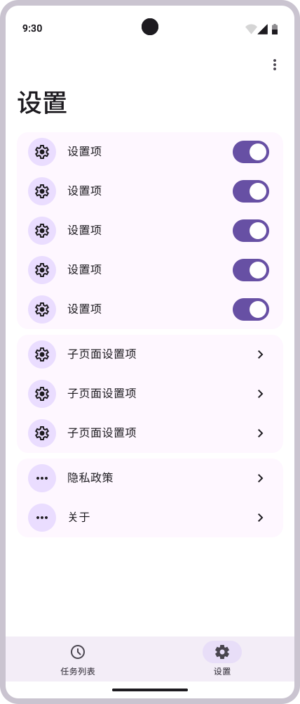

### 1.6 `POST /api/relay/subscribe` ✅

- **作用**：订阅某个群，可带关键词过滤、优先级过滤、免打扰。
- **鉴权**：设备身份。
- **请求**：`{ "group_openid": "...", "keywords": "可选,逗号或空格分隔", "min_priority": "all|notice", "mute": false }`
- **响应**：`{ "ok": true, "data": { "subscribed": true, "group_openid": "..." } }`
- **对应界面**：`设置.svg`（群开关/关键词设置，见图 §1.5）。

### 1.7 `POST /api/relay/unsubscribe` ✅

- **作用**：取消订阅某个群。
- **鉴权**：设备身份。
- **请求**：`{ "group_openid": "..." }`
- **响应**：`{ "ok": true, "data": { "subscribed": false, "group_openid": "..." } }`
- **对应界面**：`设置.svg`（关闭群订阅，见图 §1.5）。

### 1.8 `GET /api/relay/messages?after=<seq>&limit=<n>` ✅（当前无新增群消息）

> `QQBOT_GROUP_COLLECT=0` 时群消息不进入内存窗口，本接口只可能读到历史窗口/历史 `bot.db` 内容；当前 App 主链路不依赖它。转发的单条文本走 `/forward/pending`，不进 `/messages`。

- **作用**：按 `seq` 增量拉取**已订阅群**的原始群消息（供「查看原话」与搜索）。每条消息带后端 `parse` 结构（小模型优先、失败回退规则）。
- **鉴权**：设备身份。
- **参数**：`after`（上次的最大 `seq`，首次 0）、`limit`（默认 200，上限 500）。
- **响应**：
  ```json
  { "ok": true, "data": {
    "messages": [
      { "seq": 37, "group_openid": "...", "group_label": "...",
        "sender": "硫酸Cu", "content": "比赛是定在后天",
        "attachments": [], "timestamp": "2026-10-13 23:07:36",
        "msg_id": "dev_230736", "event_type": "GROUP_MESSAGE_CREATE",
        "is_self": false,
        "parse": { "engine": "llm", "kind": "活动", "category": "活动",
                   "title": "...", "action": "...", "summary": "...",
                   "items": [], "sourceText": "...", "timeText": "后天",
                   "timeNormalized": "2026-10-15", "timeUnresolved": false,
                   "place": "", "who": "", "deadline": "", "confidence": 0.85,
                   "tags": ["竞赛"] }
      }
    ],
    "max_seq": 37, "server_time": "2026-10-14 10:00:00",
    "window_minutes": 30, "subscribed_groups": 3
  }}
  ```
  > 游标语义：`/messages` 用消息 **`seq`**；候选流（v2 `/candidates`）改用 **`rev_seq`**，两者不可混用。
- **对应界面**：`任务详情.svg`（「查看原话」按 `sourceMsgIds` 回溯）、`搜素.svg`（正文搜索）。
  交付前端（`cicad_fe`）尚未对接，对接方案见 `07_前后端对接方案.md`。
- **其它字段**：`content_short`（后端给的截断正文，供列表 / 汇总渲染用，别整段展开）、
  `is_self`（是否本机绑定用户自己发的）、`attachments[]`（见 §2.5，图片/文件消息的正文就在附件里）。

  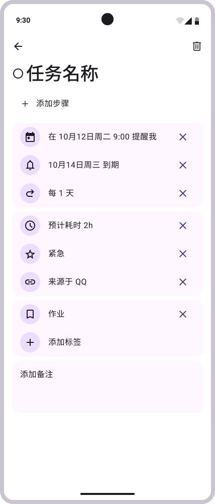

  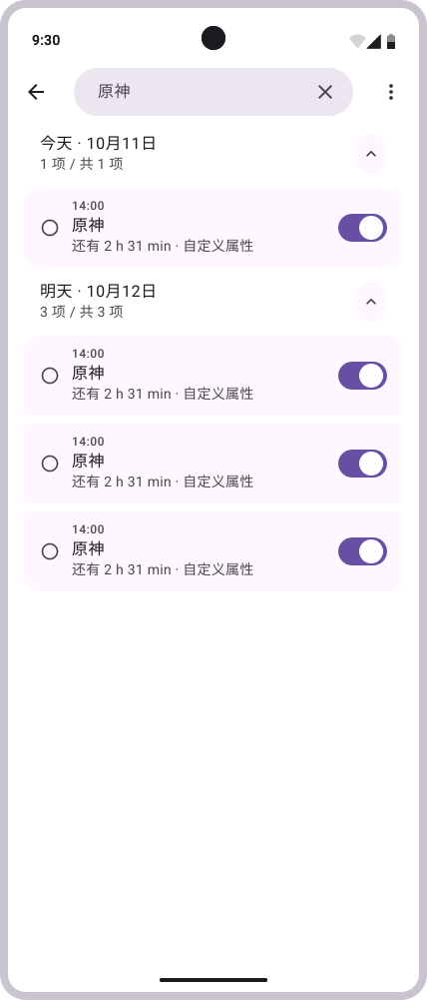

### 1.9 `GET /api/relay/my/data` ✅ / `DELETE /api/relay/my/data` ✅

- **作用**：查看 / 一键删除该设备在服务端的全部数据（隐私合规）。
- **鉴权**：设备身份。
- **GET 响应**：`{ "ok": true, "data": { "device_count": 1, "bindings": 1, "subscriptions": 3, "queue_items": 12 } }`
- **DELETE 响应**：`{ "ok": true, "data": { "deleted": true } }`（清绑定、订阅、配对码、BYOB 租户记录；同时停止该设备的 botpy 子进程；无绑定则连群授权一并清除）
- **对应界面**：`设置.svg`（隐私/关于区「清除服务端数据」，见图 §1.5）。

### 1.10 `POST /api/relay/dev/ingest` ✅（联调专用）

- **作用**：在无真实 QQ 消息时，伪造一条群消息进入中继窗口，便于联调。
- **鉴权**：设备身份 **且** 服务端启动时设 `QQBOT_DEV_INGEST=1`（否则返回 `dev_disabled`）。
- **请求**：`{ "group_openid": "...", "sender": "...", "content": "...", "group_label": "..." }`
- **对应界面**：无（仅开发联调）。

---

 ## 2. v2 新增接口（后端已全部实现 ✅）

> 契约 §4.2、§4.3 约定的 3 个新接口 + `/health` 的 2 个新字段。
> **现状：后端已全部实现**（注册进 `RELAY_PATHS`，`test_candidates_api.py` / `test_parse_api.py` 覆盖）。

 ### 2.1 `GET /api/relay/candidates?after=<cursor>&limit=<n>` ✅ ⭐

- **作用**：**增量拉取候选任务**——后端做去重 + 聚类（联合上下文）+ 综合总结后的结构化结果。这是「任务列表」的唯一数据源。
- **鉴权**：设备身份。
- **参数**：`after`（本地保存的候选游标 `cursor`，首次传 0）、`limit`（默认 100，硬上限 500）。
- **响应**：
  ```json
  { "ok": true, "data": {
    "candidates": [ { "candidate_id": "c_8f2a1b", "rev_seq": 37,
      "thread_id": "t_15B451_9", "kind": "活动", "priority": "normal",
      "level": 1, "category": "活动", "channel": "bot",
      "due_at": 1760630400000, "due_text": "后天",
      "repeat": [], "repeat_text": "", "certainty": 85,
      "missing_fields": ["place", "who"],
      "title": "传智杯比赛", "summary": "传智杯比赛在后天举行。",
      "time_text": "后天", "time_normalized": "2026-10-15", "time_unresolved": false,
      "place": "", "who": "", "deadline": "", "items": [],
      "steps": [{ "content": "报名", "done": 0 }],
      "tags": ["竞赛"], "confidence": 0.85, "engine": "llm",
      "source": { "group_openid": "...", "group_label": "HMOS 知了APP开发",
                  "senders": ["硫酸Cu"], "msg_ids": ["dev_230736","dev_230754","dev_230758"],
                  "count": 3, "first_ts": "...", "last_ts": "..." },
      "created_at": "2026-10-13 23:07:59" } ],
    "cursor": 37, "server_time": "2026-10-13 23:20:00", "window_minutes": 30
  }}
  ```
- **游标语义**：候选流用 **`rev_seq`（候选修订序号，单调递增）**；同一 `candidate_id` 被后续消息更新时会重新下发且带更大 `rev_seq`。App 必须按 `candidate_id` **upsert**（有则覆盖、无则新增），`cursor` 取本次返回里最大的 `rev_seq`。
- **Candidate 字段**：`candidate_id`(幂等ID) · `rev_seq` · `thread_id` · `kind`(待办/通知/活动/出行计划/闲聊/忽略) · `priority`(urgent/high/normal/later) · `title` · `summary`(综合总结≤120字) · `time_text` · `time_normalized` · `time_unresolved` · `place` · `who` · `deadline` · `items[]` · `steps[]` · `tags[]` · `confidence`(0~1) · `engine`(llm/rules) · `source{}` · `created_at`。

### 2.1.1 卡片字段（《任务字段表&idea更新》v1，2026-10-16）

> 交付口径：`HM_Cicada/任务字段表/任务字段表&idea更新.md`。实现：后端 `card_fields.py`（纯规则），
> 候选流与消息级 `parse` **共用**同一套，避免同一件事在两个页面上显示不一致。

| 字段 | 类型 | 卡片 | 产出方 | 说明 |
| --- | --- | --- | --- | --- |
| `level` | int 0/1/2 | ❌ | 规则 | 易/中/难。**只参与排序**。规则：`步骤数 + 需带物品数 ≥ 4 → 2；= 0 → 0；否则 1`；用户可在 App 改 |
| `category` | string | ❌ | 规则 | 作业/考试/活动/通知/其他。**注意**：与消息级 `parse.category`（教务/活动/招聘/二手/闲聊，已被 236 条评测集覆盖）是两套口径，不要混用 |
| `channel` | string | ❌ | 规则 | `bot` / `manual`（另有 `paste`/`share`/`voice` 预留） |
| `due_at` | int 毫秒 | ✅ | 规则 | 由 `time_normalized` 换算；0 = 没有截止。**只有日期时按当天 23:59:59 算**（否则零点一过就显示"已过期"） |
| `due_text` | string | ❌ | 规则 | 等于 `time_text`（截止原话） |
| `repeat` | object[] | ✅ | 规则 | **规则数组**（字段名同官方 `calendarManager.RecurrenceRule`，见下）。空数组 = 不重复；**命中任意一条即算当天要做（并集）** |
| `repeat_text` | string | ✅ | 规则 | **只在规则表达不了时**兜底（如「每学期第 3 周交」「每月最后一天」）；能表达时为 `""` |
| `certainty` | int 0~100 | ❌ | 规则 | `round(confidence × 100)` |
| `missing_fields` | string[] | ❌ | 规则 | 缺失字段名，取值 `place` / `who` / `dueAt`；确认态高亮用 |
| `steps` | object[] | ✅ | 规则 | **形态变了**：`string[]` → `[{ "content": "...", "done": 0 }]`（`done` 存 0/1） |

**不在后端产的卡片字段（只属于端侧）**：`alarm`（提醒开关，用户意图）、`remindAt`（按 App 设置页「提醒提前量」从 `due_at` 算出）。
它们与 `done`/`doneAt` 一样**只存本机**，不随候选下发、也不接受 `/messages/update` 改写。

**App 映射层换算**（`Types.ets`）：

| 后端 | 本机 | 规则 |
| --- | --- | --- |
| `priority` | Task 重要性 `0/1/2` | `urgent→2` / `high→1` / `normal,later→0` |
| `confidence` | `certainty` | `×100` 取整（后端已给 `certainty` 时直接采用） |
| `time_normalized` | 毫秒戳 | `due_at` 优先；缺省时本机按上面同一条规则换算 |
| `due_at` | 卡片文案 | `≥24h` → 今天/明天/后天/N 天后截止；`<24h` → `__h 后截止`；已过 → `已过期`。**卡片不显示时分** |

**排序**（`05` 对应「任务列表」）：`priority` 降序 → `level` 降序 → `due_at` 近的在前。
`level` **不跨档翻盘**（卡片上唯一可见的排序信号是 priority 那个红圈）。

#### `repeat` 规则数组（2026-10-17 起）

元素字段名与官方 `calendarManager.RecurrenceRule` **逐字段同名**，「转日历日程」零翻译。

| 字段 | 类型 | 说明 |
| --- | --- | --- |
| `frequency` | int 0~3 | **必填**。0 每年 / 1 每月 / 2 每周 / 3 每天 |
| `interval` | int | 每 N 个周期一次；缺省或 ≤1 = 每 1 个周期 |
| `daysOfWeek` | int[] | 1~7 = 周一~周日 |
| `daysOfMonth` | int[] | 1~31 |
| `monthsOfYear` | int[] | 1~12 |
| `weeksOfMonth` | int[] | 1~5 |
| `count` / `expire` | int / 毫秒 | 次数上限、重复截止日 |
| `dates` | int[] 毫秒 | **本机扩展、MVP 不产出**（预留） |

实测产出（`test_candidates.py` 第十一节断言）：

| 原文 | `repeat` |
| --- | --- |
| 每周一、周二、周四要写高数作业 | `[{"frequency":2,"daysOfWeek":[1,2,4]}]` |
| 每两周的周二 | `[{"frequency":2,"interval":2,"daysOfWeek":[2]}]` |
| 每3天 | `[{"frequency":3,"interval":3}]` |
| 每月15号交房租 | `[{"frequency":1,"daysOfMonth":[15]}]` |
| 每月15号并且每周一 | `[{"frequency":2,"daysOfWeek":[1]}, {"frequency":1,"daysOfMonth":[15]}]` |
| 每年3月 | `[{"frequency":0,"monthsOfYear":[3]}]` |
| 每个工作日打卡 | `[]` + `repeat_text: "工作日"`（**移出 MVP，不造规则**） |
| 每月最后一天交小组汇报 | `[]` + `repeat_text: "每月最后一天"`（同上） |

> 官方 `daysOfMonth` 没有「-1 / 倒数第几天」，`frequency` 也没有「工作日」，
> 所以这三类（最后一天 / 仅工作日 / 调休）**字段留着、MVP 不产出**，只写 `repeat_text`。
> 另外：周期任务的提醒受**单应用 30 条有效提醒**限制（超了报 `1700002`），
> 不能每条都预发布——与 `ReminderService` 一起定，目前无定论。
- **对应界面**：`任务列表.svg`、`任务列表-编辑状态.svg`；候选经用户确认后转本地 `Task`，用于 `任务详情.svg`、`删除弹窗.svg`（本地删除）。

  生成管道（已实现，`candidate_engine.py`：去重 → 聚类 → 簇级小模型/规则 → 安全闸）：

  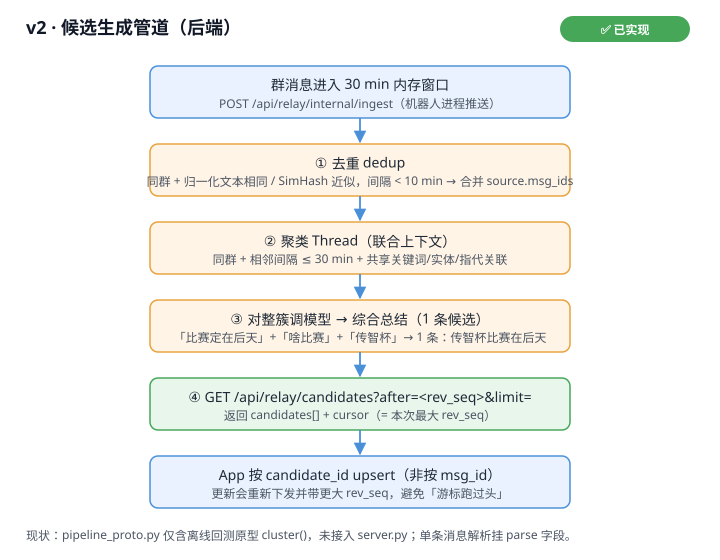

  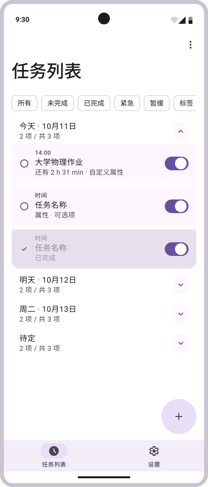

  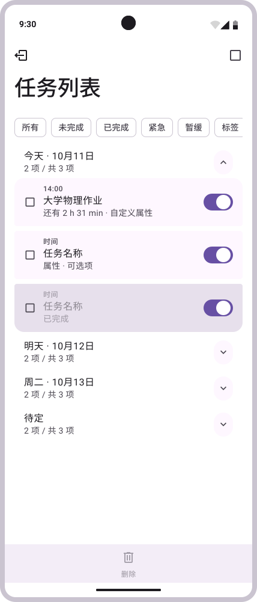

  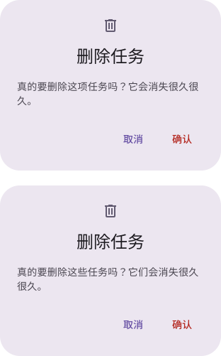

### 2.2 `POST /api/relay/parse` ✅

- **作用**：**无状态文本抽取**。给「手动添加任务」复用同一套抽取逻辑；隐私上「只处理、不存储」（内容不进窗口、不进候选流、不落盘）。
- **鉴权**：设备身份。
- **请求**（契约字段 + 图片/文件扩展，三来源可单用可混用）：
  ```json
  {
    "text": "明天四六级记得带准考证",     // 可选：手打文本（≤4000 字，超长截断）
    "image_b64": "iVBORw0KG...",        // 可选：截图 base64（≤8MB；模型可用时后端 OCR）
    "file_b64": "5YWl6IGM...",          // 可选：文件 base64（图片 ≤8MB / 文本·文档 ≤4MB）
    "file_name": "通知.docx",           // file_b64 必带：按扩展名分流（见下）
    "source": "manual"                  // 渠道标识，原样透传到 candidate.source.group_label
  }
  ```
- **`file_name` 扩展名分流**：
  - 图片 `png/jpg/jpeg/webp/bmp` → 后端 OCR（同 `image_b64`）；
  - 文本 `txt/md/csv/log/json` → UTF-8/GBK 解码当正文；
  - 文档 `docx/xlsx/pptx` → 后端标准库（zip+XML）抽文本，**零额外依赖**；
  - 文档 `pdf` → `pypdf` 软依赖抽文本（未装 → `501`；扫描版抽空 → `400` 提示改传截图）；
  - 老格式 `doc/xls/ppt` 等 → `400`（引导转存新格式）。
- **响应**：`{ "ok": true, "data": { "candidate": Candidate, "text": "参与解析的合并文本" } }`
  - `candidate_id` 为 `m_` 前缀临时值（同文本幂等），前端建 `Task` 时忽略；`rev_seq` 恒 0；`source.msg_ids` 为空、`source.group_openid` 为空；
  - `text` 是实际参与解析的文本（OCR 结果/文件抽取内容与 `text` 按序以 `\n` 拼接），供前端回显到可编辑框；
  - 手动输入的宽松判据：规则路径判成「闲聊」但含任务词（开会/交/报名…）或有明确时间 → 升「待办」；「忽略」一律改判「闲聊」（手动输入不当噪声丢）。
- **错误分支**：
  - `400 bad_request`：无内容 / 过大 / 不支持的文件类型 / 文件损坏或抽不到文本（扫描版 PDF、空文档）/ OCR 无文字 / file_b64 非法 base64；
  - `501 not_supported`：`image_b64`/图片文件但本机多模态模型不可用——**前端收到 501 应回退端侧 OCR**（Core Vision Kit），把文字放进 `text` 重发；`.pdf` 但服务端未装 pypdf——前端提示用户改传截图/手动输入。
- **能力协商**：后端能否 OCR 看 `/health` 的 `capabilities` 是否含 `"ocr"`（含 → 截图可直接传 `image_b64`；不含 → 端侧 OCR 后传 `text`）。文本与 docx/xlsx/pptx 路径无需模型也无需 pypdf（规则兜底），任何后端都可用。
- **对应界面**：`添加任务.svg`（截图 / 录音 / 文本 三来源 tab；录音仍走端侧 ASR → `text`）。

  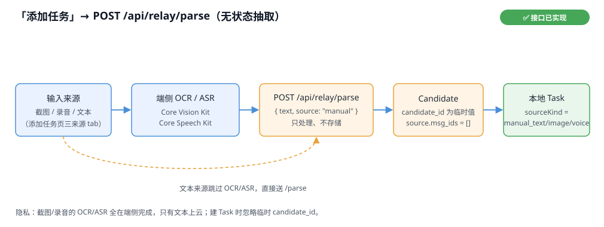

  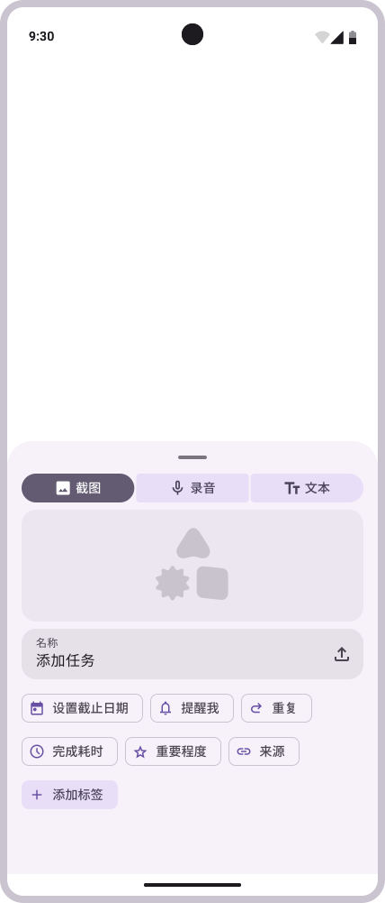

### 2.3 `POST /api/relay/feedback` ✅（可选）

- **作用**：用户对候选的动作回传（接受/忽略/改过哪些字段），供后端优化。
- **鉴权**：设备身份。
- **请求**：`{ "candidate_id": "c_8f2a", "action": "accept" | "dismiss", "edited_fields": ["title"] }`
- **响应**：`{ "ok": true, "data": { "recorded": true } }`
- **对应界面**：`任务详情.svg`（确认/忽略候选的操作回传，见图 §1.8）。

  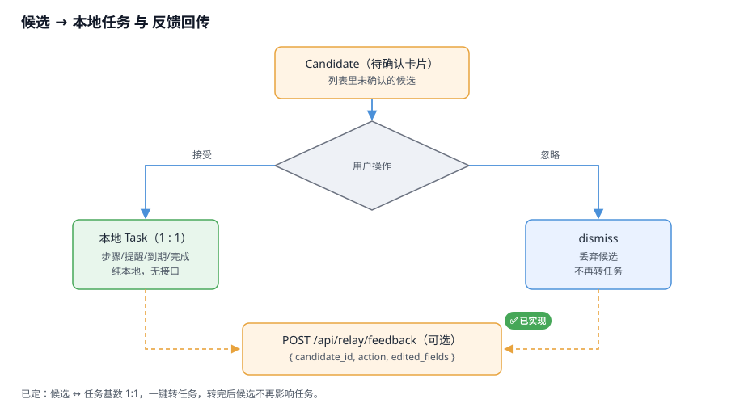

### 2.4 `GET /api/relay/health` 新增字段 ✅

- **作用**：能力协商——前端启动时读 `capabilities` 决定走 v2 还是退回 v1 本地规则。
- **实际返回**：
  ```json
  { "ok": true, "data": {
    "ok": true, "version": "mvp0",
    "api_version": 2,
    "capabilities": ["candidates", "parse", "feedback", "attachment", "profile", "ocr", "push"],
    "time": "...", "bot_running": true,
    "window": { "window_items": 12, "window_minutes": 30, "max_seq": 37 }
  }}
  ```
- **能力位语义**（只声明真实现并验证过的）：
  - `candidates` / `parse` / `feedback`：恒在（`parse` 文本路径规则兜底，无需模型）；
  - `attachment`：恒在（附件过路，2026-10-15 真机验证图片/文件都可取）；
  - `ocr`：仅当本机多模态模型（Ollama）可用时出现——**截图直传后端**靠它；没有则端侧 OCR 后传 `text`。
- **降级规则**：`capabilities` 含 `candidates` → 走 v2；不含（老后端）→ 自动退回 v1 本地规则，功能降级但不出错。
- **对应界面**：所有页面的数据源开关（启动探测）。

  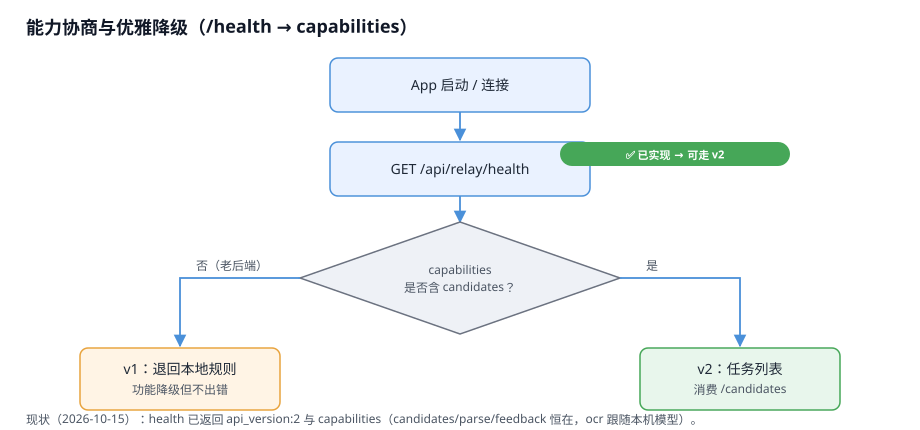

### 2.5 `GET /api/relay/attachment?msg_id=<id>&index=<n>` ✅（2026-10-15 真机验证通过）

- **作用**：附件过路——App 按需取某条消息第 `index` 个附件（图片/文件）的**原始字节**。
  服务器不存附件：消息元数据只在 30 分钟窗口里；字节从 QQ 拉、内存里短缓存
  （90 秒 / 16 条 / 64MB 封顶）、转发后即丢，**全程不落盘**。
- **附件元数据**：随 `/messages` 的 `attachments[]` 下发，字段保留**原生类型**
  （`size`/`height`/`width` 是数字，缺值是 `null`；`content_type`/`filename`/`url` 是字符串）。
  * 图片消息：`content_type:"image/png"`、正文在 URL 里，`image/*` 用 `index` 取原图；
  * **文件消息：`content` 为空**，正文就是附件本身（`content_type:"file"`、`filename`、`size`、`url`）。
    前端对这类消息**应渲染文件卡片**，而不是当空白消息。
- **鉴权**：设备身份（同其它接口）。
- **参数**：`msg_id`（来自 `/messages` 或候选 `source.msg_ids`）+ `index`（附件序号，从 0 起）。
- **前置约束**（与 `/messages` 同一套纪律）：
  * 消息必须在 30 分钟窗口内（过期 404，找不回）；
  * 设备必须订阅了消息所在群（没订阅的群连元数据都不给）；
  * 单附件 ≤ 12MB（与 QQ 单文件上限一致）；同时从 QQ 拉取 ≤ 8 路。
- **成功响应**：`200` + 附件原始字节，`Content-Type` 为附件类型（如 `image/png`）。
- **失败响应**（标准错误 JSON）：

  | 状态 | 场景 |
  | --- | --- |
  | 400 | 缺 `msg_id` / `index` 非整数 |
  | 401 | 设备令牌无效 |
  | 404 | 消息不在窗口 / 群未订阅 / 附件不存在 |
  | 405 | 非 GET |
  | 502 | 从 QQ 拉取失败（QQ 直链失效 / 网络不通；**2026-10-15 真机已验证图片与文件直链均可取**） |

- **能力位**：`/health` 的 `capabilities` **已含 `attachment`**（2026-10-15 真机验证：图片显示成功、docx「保存到手机」落盘成功）。
- **对应测试**：`test_attachment_api.py`（23 项：鉴权 / 窗口 / 订阅 / 缓存逐出 / 降级 / 真 aiohttp 拉取路径）。

### 2.6 `POST /api/relay/messages/update` ✅（用户改「待办」）

- **作用**：用户对某条消息的**结构化解析结果**（前端那张待办卡）做人工修正——
  改类别（通知/待办/活动…）、摘要、标题、时间原话、地点、对象、截止、需带、标签。
- **鉴权**：设备身份；**约束与 `/attachment` 同一套**：消息必须在 30 分钟窗口内、设备已订阅该群（否则 404）。
- **请求**：

  ```json
  { "msg_id": "ROBOT1.0_xxx",
    "fields": { "kind": "通知", "summary": "我自己写的摘要", "timeText": "明天下午两点" } }
  ```

- **可改字段（白名单）**：`kind` / `title` / `summary` / `action` / `timeText` / `place` / `who` /
  `deadline` / `items[]` / `tags[]`。
  **派生字段不接受改写**（`engine` / `confidence` / `timeNormalized` / `timeUnresolved` /
  `sourceText` / `category`）——传了就 400，并在错误信息里回可改字段清单。
- **时间**：只改 `timeText` 时，后端用**规则**（`parse_time`）重算 `timeNormalized` / `timeUnresolved`；
  认不出就留空、不猜（与候选管道同一套纪律，绝不信客户端算出来的时间）。
- **响应**：`{ "ok": true, "data": { "msg_id": …, "parse": {…覆盖后的**完整** parse…}, "edited_fields": ["kind","summary"] } }`
- **生效范围**：`/messages` 下发的该条 `parse` 立即被覆盖；同一 `msg_id` 多次修改是**合并**（改 kind 不会把上次改的 summary 冲掉）。
  **不改历史、不影响候选**（候选由原始消息聚类算出）。覆盖表**只在内存**，随 30 分钟窗口一起失效、**不落盘**
  （与「正文只在内存窗口」同一套合规姿势）。
- **老后端降级**：没有这个路由时，前端可把修改**落在本机**——用户改了就一定生效。
- **对接提示**：交付前端（`cicad_fe`）的待办是**本机 `Task`**，改它走 `repository`，**不需要**调这个接口；
  本接口适用于「直接把 `/messages` 的 `parse` 当待办」的接法（见 `07_前后端对接方案.md` §4）。

---

### 2.7 `POST /api/relay/push/token` ✅（2026-10-17 新增）

- **作用**：App 启动/进前台时把自己的 **Push Token** 上报给后端，用于「App 在后台/被杀时也能收到提醒」。
  App 在后台不轮询（HarmonyOS 限制），云侧推送是唯一通路。
- **鉴权**：设备身份。
- **请求**：`{ "token": "<Push Token>" }`；**空串表示注销**（换绑/清空本机数据时主动清）。
- **响应**：
  ```json
  { "ok": true, "data": { "registered": true, "push_ready": true } }
  ```
  `push_ready` = 后端服务账号是否配好（没配好时 token 会存下来，但发不出推送）。
- **服务端发送**（不对外暴露）：`push_sender.py` 用服务账号 JWT（**PS256**）调
  `https://push-api.cloud.huawei.com/v1/{projectId}/messages:send`，
  `push-type: 0`（Alert 通知），成功判据 `code == "80000000"`。
- **触发**：`server.py` 的 `push_loop()` 每 `QQBOT_PUSH_INTERVAL`（默认 10s）重算候选；
  `CandidateStream` 的窗口指纹闸保证「同一份窗口只推一次」，只推**新增/变化**的 actionable 候选。
- **隐私**：默认推标题 + 摘要（会经过华为网关）；`QQBOT_PUSH_INCLUDE_TEXT=0` 改成只推「有新的校园提醒」。
  Token 只存「device_id → token」，属于匿名设备标识，不含任何消息内容；`DELETE /my/data` 会一并清除。

## 3. 非 App 契约接口（仅记录，不属本次对接范围）

### 3.1 机器人 → 服务端内部通道

| 接口 | 作用 | 保护 |
| --- | --- | --- |
| `POST /api/relay/internal/ingest` | 机器人进程把群消息推入服务端内存窗口 | `X-Relay-Key` |
| `GET /api/relay/admin/bindings` | 运营总览：各设备绑定的 QQ 号 / 授权 / 订阅 | `X-Relay-Key` |
| `POST /api/relay/admin/grant` | 给某 QQ 号授权某群 | `X-Relay-Key` |
| `POST /api/relay/admin/revoke` | 撤销授权 | `X-Relay-Key` |

### 3.2 Web 控制台自身接口（浏览器用，非 App）

`/api/status` · `/api/start` · `/api/stop` · `/api/restart` · `/api/shutdown` · `/api/heartbeat` · `/api/watchdog` · `/api/logs` · `/api/logs/clear` · `/api/logs/download` · `/api/messages`（网页消息页，读 bot.db） · `/api/group_names` · `/api/tables` · `/api/table` · `/api/db/open`。

---

## 4. 设计稿页面 ↔ 接口映射

> 每张设计稿已插在上方对应接口小节，下表给出索引。

| 设计稿（`知了设计UI/`） | 页面职责 | 依赖接口 | 预览 |
| --- | --- | --- | --- |
| `首次启动.svg` | 首次启动 / 协议 / 设备注册 | `GET /health`、`POST /device/register` | §1.1 |
| `设置.svg` | 设置 / 绑定 QQ（BYOB）/ 群订阅 / 隐私 | `POST /tenant/register`、`GET /tenant/status`、`POST /tenant/unbind`、`GET /bind/status`、`GET /groups`、`POST /subscribe`、`POST /unsubscribe`、`GET/DELETE /my/data` | §1.3 |
| `任务列表.svg` | 待办列表 | 交付前端：`GET /candidates`（转本地 `Task`，按 `candidate_id` upsert）+ `GET /messages`（取原文写 `raw_text`） | §2.1 |
| `任务列表-编辑状态.svg` | 多选编辑态（全选/删除） | 纯本地 `Task` CRUD（无接口） | §2.1 |
| `任务详情.svg` | 待办详情（原话 / 提醒 / 编辑） | `GET /candidates`、`GET /messages`（按 `source.msg_ids` 回溯原文）、`GET /attachment`（附件）、`POST /feedback` | §2.1 |
| `删除弹窗.svg` | 删除确认弹窗 | 纯本地删除（无接口） | §2.1 |
| `搜素.svg` | 搜索（本地全文） | 本地 `Task` 全文（前端算） | §1.8 |
| `添加任务.svg` | 添加任务（粘贴 / 分享 / 截图 / 语音 / 文本） | `POST /parse`（无状态抽取；含 `ocr` 时截图直传，缺模型 501 → 端侧 `service/ai` 兜底） | §2.2 |

> 上表按**交付前端的口径**写：待办来自候选流，落成本机 22 列 `Task`（见 `07_前后端对接方案.md` §3 的字段映射）。
> 分组「今天/明天/周二/待定」按 `due_at`→`remind_at`→待定；筛选/分组都在前端算，不占接口。

---

## 5. 前后端实现状态对照

### 5.1 后端实现状态（已核验源码 + 测试）

| 接口 | 状态 | 说明 | 流程图 |
| --- | --- | --- | --- |
| `POST /api/relay/tenant/register` | ✅ | BYOB：按设备加密保存 AppID/AppSecret，拉起租户 botpy；`test_tenants.py` 覆盖加密/fail-closed | §1.3 |
| `GET /api/relay/tenant/status` / `POST /api/relay/tenant/unbind` | ✅ | 租户运行状态 / 解绑并停止子进程 | §1.3.1 |
| `GET /api/relay/candidates` | ✅ | `candidate_engine.py`：去重 → 聚类 → 簇级小模型/规则 → 安全闸；`rev_seq` 游标 + upsert 语义 | §2.1 |
| `POST /api/relay/parse` | ✅ | 无状态抽取；文本/截图/文件三来源；截图走本机多模态 OCR（无模型 501，前端降级端侧）；`test_parse_api.py` 覆盖 | §2.2 |
| `POST /api/relay/feedback` | ✅ | accept/dismiss 计数 + `drop_words` 手动删词（接 `/feedback`） | §2.3 |
| `GET /api/relay/attachment` | ✅ | 附件过路：窗口内按 `msg_id+index` 转发原始字节（12MB 上限、8 路并发、90s 内存缓存，不落盘）；**图片与文件直链均已真机验证可取**；`test_attachment_api.py` 覆盖 | §2.5 |
| `POST /api/relay/messages/update` | ✅ | 用户改「待办」：白名单字段（kind/摘要/时间原话/地点…）+ 时间由规则重算；覆盖表只在内存、随窗口失效；`test_message_update_api.py` 24 项断言 | §2.6 |
| `GET /api/relay/health` 的 `api_version` / `capabilities` | ✅ | `api_version: 2`；`capabilities` 含 `candidates/parse/feedback/attachment/profile` 恒在，`ocr` 跟随模型、`push` 跟随服务账号配置 | §2.4 |

> 注：v2 管道复用了 `pipeline_proto.py` 的 `Event`/`parse_time()` 与 `llm_worker.py` 的单条解析；簇级实现在 `candidate_engine.py`（`test_candidates.py` 覆盖规则路径，`test_llm_e2e.py` 覆盖模型路径）。

### 5.2 前端实现现状（交付前端 `cicad_fe`，2026-10-15 按代码核验）

> 交付前端 = 袁正琨工程 `cicad_fe`（不在本仓库）。**它当前还没对接后端任何接口**：
> 页面只有 `A_Main` / `A_TaskList` / `A_Settings`，数据来自 `mock/MockTasks.ets`，
> `service/{ai,auth,backend,cloud,system}` 全是骨架——全仓检索不到 `/api/relay`。
> 它的进度以该工程为准，本仓库不代它声明。

| 能力 | 状态 | 依赖 |
| --- | --- | --- |
| 待办列表（候选 → 本地 `Task`） | ❌ 未接（现为 mock） | `GET /candidates` |
| 详情 / 原文对照 | ❌ | `GET /messages`（按 `source.msg_ids`） |
| 附件（图片 / 文件） | ❌ | `GET /attachment` |
| 手动添加（粘贴 / 分享 / 截图 / 语音） | ❌ | `POST /parse` + 端侧 `service/ai` |
| 确认页「转成待办 / 忽略」回传 | ❌ | `POST /feedback` |
| 群订阅 / 隐私一键删除 | ❌ | `/groups`、`/subscribe`、`/my/data` |
| 本机 `Task` 模型与落库 | 🟡 模型已定稿（`model/Models.ets`，`@ObservedV2`），`repository/` 空 | 无接口 |
| 提醒（代理提醒） | ❌ | 无接口（纯端侧） |

> 结论：**后端接口已就绪；交付前端尚未开始对接**。逐字段的映射与落位见 `07_前后端对接方案.md`。

---

## 6. 一句话总结

> **已实现（v1）**：`health` / `device/register` / `bind/status` / `groups` / `subscribe` / `unsubscribe` / `messages` / `my/data` / `dev/ingest`；`bind/code` 仅为旧流程保留。
> **已实现（BYOB，2026-10-28）**：`POST /tenant/register`、`GET /tenant/status`、`POST /tenant/unbind`；App 绑定改为「用户创建 Bot → 填 AppID/AppSecret」。
> **已实现（v2）**：`/candidates`、`/parse`（含截图 OCR 与 docx/xlsx/pptx/pdf 文件抽取）、`/feedback`、`/attachment`（附件过路）、`/messages/update`（**用户改待办**），以及 `/health` 的 `api_version` + `capabilities`（`ocr` 跟随模型可用性）。
> **前端**：交付前端（`cicad_fe`，袁正琨）仍是静态原型 + mock，**尚未对接**；逐字段映射与落位见 `07_前后端对接方案.md`。
> 后端做「消息 → 候选（去重 + 聚类 + 综合总结）」，前端做「候选 → 本地任务 + 全程管理」。
